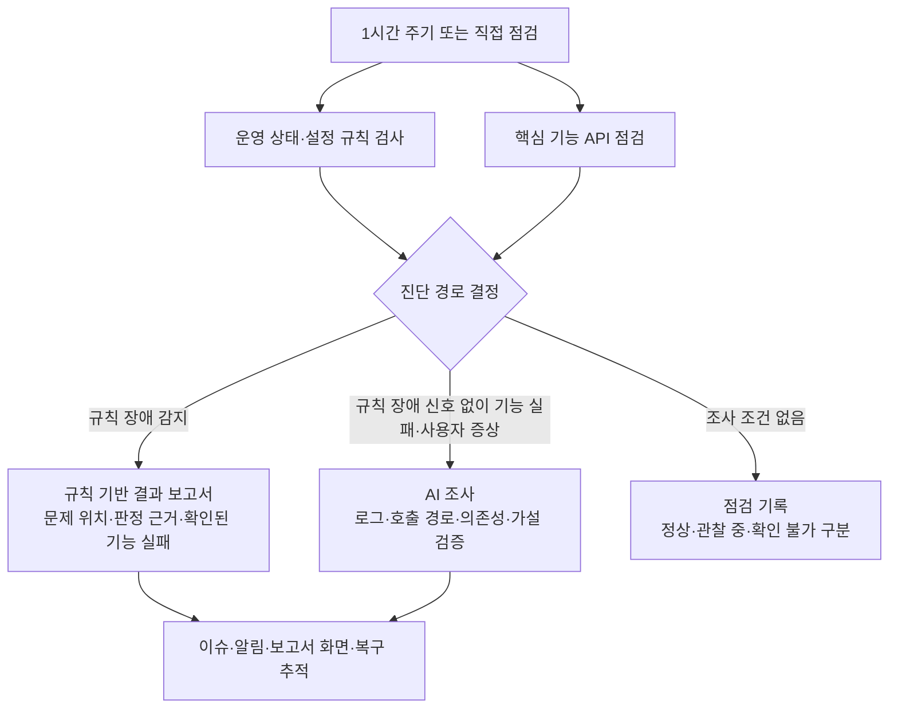
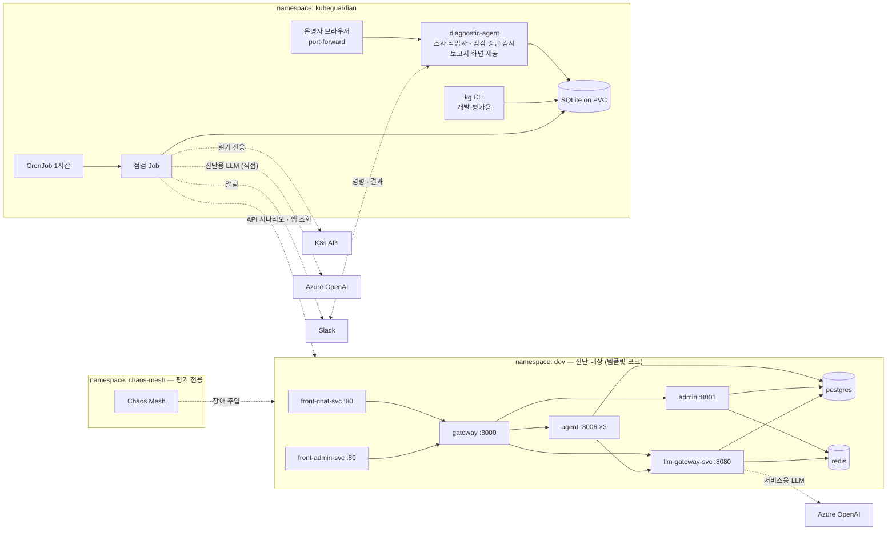
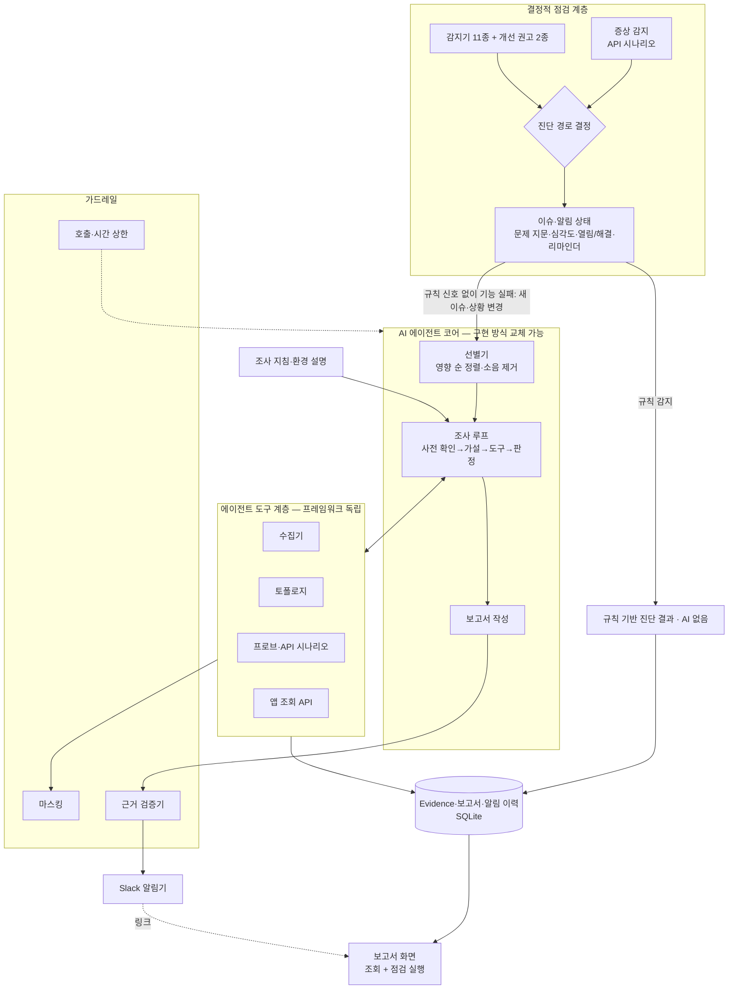

# KubeGuardian AI — 프로젝트 기획서

> **AI 기반 Kubernetes 서비스 환경 진단 Agent**
> *Agentic Kubernetes Service Diagnosis Agent*

| 항목 | 내용 |
|---|---|
| 유형 | 사내 과제 / PoC |
| **1차 목적** | **Kubernetes 장애 분석 역량 + 에이전트 정량 평가 역량 함양** |
| 2차 목적 | 템플릿 기반 AI 서비스용 진단 에이전트 PoC |
| 인원·기간 | 1인 · **2026-10-12 ~ 11-20** (개발 4주 W1~W4 + 평가 보고서·최종 점검 W5 + 발표 준비, 주마다 분량 조절) · 기능 완료 11/8 |
| 기준 서비스 | [agent-template-apps-lite](https://github.com/orgs/agent-template-apps-lite/repositories) 포크 (앱 6개) |
| 실행 환경 | minikube (단일 노드) + Chaos Mesh |
| LLM | 진단 에이전트·진단 대상 서비스 모두 Azure OpenAI (경로는 분리). 진단용은 역할별 모델 배치(초안: 조사 gpt-4.1, 선별 gpt-4.1-mini, 비교 gpt-5 계열) |
| 사용 방식 | **1시간 주기 자동 점검 + 직접 점검 → 규칙 기반 결과 또는 기능 실패 AI 조사 → Slack·보고서 화면**. 증상 입력 조사는 CLI(`kg investigate`). Slack에서는 긴급 알림의 확인 버튼만 누른다 (#156, Slack 명령은 10/31 결정으로 확장 후보). 규칙 감지는 AI 없이 규칙 기반 진단 결과로 끝낸다 (§3, #185) |
| 문서 버전 | 2026-11-09 규칙 감지 AI 조사 생략 구현 반영(§3, §6, #185). 2026-11-03 진단 범위·정책 명확화. 기존 v3.2 피드백 반영: 알림 정책(심각도·재알림), 보고서 화면(조사 과정·점검 실행), KPI 전/후 비교, 앱 구조 (변경 이력은 §17) |
| 관련 산출물 | [역량·기술 스택](산출물/01-역량및기술스택확인.md), [문제 정의·서비스 기획](산출물/02-문제정의및서비스기획.md), [시나리오](산출물/03-시나리오수립.md) |

---

## 1. 한 줄 설명

Kubernetes에서 운영하는 서비스의 **운영 상태·설정은 규칙으로, 로그인·채팅 등 실제 기능은 API 호출로 점검**하고, **규칙으로 설명되지 않는 기능 실패는 AI가 앱 로그·호출 경로·하위 의존성을 조사**해 근거와 한계를 보고하는 진단 에이전트.

> **규칙 감지 장애는 AI 조사 없이 규칙 기반 진단 결과로 끝난다** ([#185](https://github.com/skax-jihyeryu/KubeGuardian/issues/185), 2026-11-09 구현). 규칙 장애 신호 없이 기능 실패·사용자 증상이 있을 때만 새 이슈·상황 변경 시 AI 조사를 예약한다. 현재 점검 설정은 운영자 인터뷰를 반영한 **1시간 주기**이며 직접 점검도 지원한다. 아래의 5분 기반 기존 KPI·산출 예시는 과거 계획으로 보존하고 현재 목표 달성으로 해석하지 않는다.

### 1.1 프로젝트의 1차 목적: 학습

실무에서 LangGraph·DeepAgents 기반 에이전트와 RAG를 이미 구축해 봤으므로, 이번 프로젝트는 **부족한 두 영역**에 집중한다.

| 학습 영역 | 이 프로젝트에서 얻는 것 | 어디서 |
|---|---|---|
| **K8s 리소스 모델** | Deployment·ReplicaSet·Pod·Service·EndpointSlice의 관계를 코드로 따라가 봄 | 수집기·토폴로지, 감지기 |
| **K8s 네트워킹** | Service 라우팅, Pod 직접 호출, 포트 매핑, 서비스 간 통신 차단 | 감지기 S01~S04, 시나리오 B1·C2 |
| **K8s 설정·배포** | ConfigMap·Secret 참조, 이미지, 롤아웃 | 감지기 C01·P03, 시나리오 A3·C5 |
| **K8s 운영 기능** | CronJob(주기 실행·중복 실행 방지), PVC, RBAC 최소 권한 | 주기 점검, 진단 에이전트 권한 |
| **K8s 장애 재현** | CRD 기반 도구(Chaos Mesh)로 장애 주입 | 평가 환경 |
| **에이전트 정량 평가** | 정답 파일 설계, 지표 정의, 자동 채점 러너, 기준 조건 대비 비교, 실패 사례 분석 | 평가 체계 (§9) |
| 에이전트 설계 심화 | 가설 → 도구 검증 → 판정 루프, 근거 인용 강제, 호출 상한 | 에이전트 코어 (§6) |
| 에이전트 기술 비교 | 구현 방식, 지침 주입, MCP, Code Mode 등을 같은 지표로 비교 | 비교 실험 (§10) |

**학습 산출물**: 주간 학습 노트(주 1건, "어떤 K8s 개념이 어떻게 장애가 되고 어떤 신호로 보이는가"), 설계 결정 기록(ADR 3건 이상).

## 2. 배경과 문제

### 2.1 MSA 구조의 운영 부담

요즘 서비스는 화면, 요청 중계, 핵심 로직, 인증, 외부 연동을 각각 독립된 서비스로 나누는 MSA 구조가 일반적이다. 서비스 하나를 운영하려면 여러 레포·이미지, 여러 Pod와 Service, 공유 설정(ConfigMap·Secret)·DB·캐시를 함께 관리해야 한다. 조각끼리 네트워크로 호출하기 때문에 **한 곳의 문제가 다른 곳의 증상으로** 나타난다.

### 2.2 우리 팀의 예: AI 서비스 템플릿

우리 팀은 MSA 구조의 템플릿 agent-template-apps-lite를 만들어 사용한다. 구조는 `front-chat / front-admin → gateway → agent / admin / llm-gateway → PostgreSQL · Redis · Azure OpenAI`이고, 앱 6개가 별도 레포, 배포 설정은 shared-infra 레포에 있다. 직접 구축·운영한 **SK Inc. PR 보도자료 자동화 서비스**도 이 템플릿에서 출발해 AWS EKS에서 운영 중이다. 운영에서 겪은 장애는 대부분 다음 유형이었다.

- **보이지 않음**: Pod는 Running·Ready인데 서비스가 안 된다.
- **멀리 있음**: gateway에서 502가 났는데 원인은 llm-gateway의 할당량, 또는 Redis다.
- **너무 많음**: 경고·이벤트·재시작 기록이 쌓여 있지만 대부분 지금 장애와 무관하다.

운영 사례: 공유 ConfigMap을 여러 레포가 덮어써서 생긴 장애, agent 메모리 512Mi에서 OOMKilled, gateway 504 타임아웃, `create_all`이 ALTER를 하지 않아 생긴 스키마 드리프트. 모두 **kubectl 한 번으로는 원인이 보이지 않았던** 사례다.

### 2.3 템플릿 자체의 구조적 약점 (배경)

| # | 관찰 | 결과 |
|---|---|---|
| T1 | `shared-infra/kubernetes` 매니페스트에 `AGENT_SERVICE_URL` 등 서비스 주소 설정이 없음. gateway 코드 기본값은 `http://localhost:*` | 원본 그대로 배포하면 gateway가 하위 서비스를 못 찾음 |
| T2 | readinessProbe가 모두 tcpSocket(포트 연결)만 봄. `/health`는 의존성 확인 없이 고정 응답 | 앱이 500을 내도 Ready로 표시 → "보이지 않음"의 원인 |
| T3 | 이미지 tag 고정(`0.0.1`) + `imagePullPolicy: Always` | 같은 tag에 다른 이미지가 공존 가능 |
| T4 | 모든 앱이 공용 ConfigMap·Secret을 공유 | 공용 설정 하나의 변경이 전 서비스에 파급 |

T1은 템플릿을 고쳐서 해결할 문제라 **문제 정의의 중심이 아니다.** 데모 시나리오(A5)로만 쓴다. T2·T4는 "보이지 않음"·"멀리 있음"이 생기는 구조적 이유다.

### 2.4 핵심 문제

상태를 보여주는 도구(kubectl, 대시보드)는 있다. 하지만 **"지금 서비스가 안 되는지, 수많은 신호 중 무엇이 원인인지"를 알아내는 일**은 사용자 문의가 온 뒤에 숙련자가 수작업으로 한다. 현재 방식으로는 장애 발생부터 원인 파악까지 **약 3~5일**(사용자 문의 대기 + 수작업 진단 포함, 경험 기반 추정)이 걸린다. 특히 증상과 원인이 다른 서비스에 있고 K8s 상태는 정상인 장애는 규칙만으로 자동화하기 어렵다.

## 3. 핵심 방향: 주기 점검 + 규칙 우선 + AI 조사

<a id="diagnostic-scope"></a>

### 3.0 진단 범위: Kubernetes 정상과 서비스 정상은 다르다

이 절을 기획·설계·화면·발표의 공통 정의로 사용한다. **Kubernetes 규칙에 장애 신호가 없다는 것은 서비스 기능 정상의 증거가 아니다.** 서비스 오류도 운영 중인 서비스의 장애이며, Kubernetes 자체 장애와 원인 계층을 구분해 보고한다.

| 구분 | 확인할 질문 | 수행 방식 | 결과의 경계 |
|---|---|---|---|
| Kubernetes 운영 상태·설정 점검 | Pod·배포·Service 연결·설정 참조에 명시적 이상이 있는가? | Kubernetes API와 결정적 규칙 | 검사한 항목의 관측 시점 결과다. 규칙 장애 신호 없음은 전체 정상이나 앱 기능 정상을 뜻하지 않는다 |
| 서비스 기능 점검 | 로그인·채팅 등 핵심 사용자 흐름이 실제 성공하는가? | 설정된 API 시나리오를 코드로 호출·응답 본문까지 검사 | HTTP 200이어도 오류 답변이면 실패다. 기능 실패 감지에 AI를 쓰는 것은 아니다 |
| 증상 기반 AI 원인 조사 | 규칙으로 설명되지 않는 기능 실패가 어느 호출 단계·의존성에서 시작됐는가? | 앱 로그·설정·Kubernetes 상태·연결·허용된 앱 API를 조사 | 문제 위치·오류 전파·근본 원인 규명은 별개다. 관측 불가능한 외부 정책·DB 변경 이력은 미확인으로 남긴다 |

예를 들어 추가 시나리오 C8은 Pod·Service가 정상인 상태에서 잘못된 LLM 호출 배포명 때문에 실제 상류가 403으로 거절하는 **서비스 설정/외부 연동 오류**다. Kubernetes 장애로 분류하지 않는다. 기능 점검이 채팅 본문 오류를 감지하고 AI는 `사용자 오류 답변 ← llm-gateway 500 ← 외부 배포명 거절`을 근거로 연결한다. 사전 시험은 해당 경로를 설명했으나 외부 최초 오류 생성 계층과 DB 변경 이력을 확인하지 못해 최종 판정은 후보다. [시나리오 정의](../scenarios/C8/README.md).

### 3.1 목표 정책과 현재 구현

> **규칙 감지 장애는 규칙 결과로 보고하고 AI 원인 조사는 실행하지 않는다. 규칙 장애 신호 없이 기능 실패·사용자 증상이 있으면 AI 조사로 연결한다.** 이 분리 정책은 #185로 구현했다 (2026-11-09). 이미 대기 중이던 규칙 감지 조사 요청은 작업자가 AI 없이 규칙 진단으로 마감하고, 과거 AI 조사 기록은 고치지 않는다.
>
> 점검 → 이슈·보고서 → 알림 → 운영자 확인 → 조치 → 복구는 다른 단계다. 점검 주기(현재 1시간)와 알림 시점(감지·결과·지속·복구)은 별개다.



위 그림이 구현된 동작이다 (#185). 규칙 분기는 AI로 연결되지 않고, 이슈 상태는 `규칙 진단`, 화면·Slack은 `규칙 기반 진단 결과`로 표시한다. 지문이 바뀌어 경로가 바뀌면 그때의 경로를 따른다(규칙→증상이면 AI 조사 예약, 증상→규칙이면 대기 중인 AI 요청을 지우고 규칙 진단). 동일 장애 지속의 중복 억제·확인/재알림·복구 처리는 각 진단 경로와 별도로 유지한다.

| 경로 | 조건 | 목표 처리 | 현재 배포 |
|---|---|---|---|
| A. 규칙 감지 | 규칙 장애 신호 있음. 기능 실패가 함께 있어도 이 분기 우선 | AI 없이 문제 위치·규칙·근거로 규칙 기반 진단 결과를 보임. 근본 원인을 추정해 확정하지 않음 | 구현됨 (#185). 이슈 `investigation = rule`, 조사 예약·LLM 호출 없음 |
| B. 증상 감지 | 규칙 장애 신호 없이 기능 실패 또는 사용자 증상 있음 | AI가 로그·호출 경로·의존성에서 원인을 조사 | AI 조사 구현·실행 확인 |
| C. 조사 조건 없음 | 위 두 조건에 해당하지 않음 | 조사 생략. 관찰 중·개선 권고·확인 불가를 완전 정상과 구분 | 조사 생략 구현 |

기능 점검은 모든 경로에서 독립적으로 수행한다. 규칙이 문제를 찾았다고 기능 점검을 생략하거나, 규칙 신호가 없다고 기능 성공으로 간주하지 않는다. 외부 연동 거절을 근거 없이 Kubernetes 장애로 분류하지 않는다.

### 3.2 이렇게 나누는 이유

- **역할 분리**: 상태·설정의 명시적 문제는 규칙으로 재현 가능하게 판정하고, 사용자 기능 성공 여부는 실제 호출로 확인한다.
- **조사 범위**: AI는 규칙에 드러나지 않는 증상에서 여러 서비스의 근거를 연결한다. 모든 서비스 오류에 AI가 필수라는 주장은 하지 않는다.
- **비용과 평가**: 규칙 진단과 AI 조사 결과·시간·토큰을 나눠 측정한다 (평가 러너는 경로 A에서 AI를 부르지 않고 `rule_diagnosis`로 기록, 과거 비교용 `--ai-on-rules`). 과거 18회 AI 시험에는 규칙 감지 사례도 포함돼 있으므로 과거 결과를 바꾸거나 변경 후 분모와 직접 비교하지 않는다.
- **불확실성**: 오류 전달 지점을 찾은 것과 최초 원인을 확정한 것을 구분한다. 접근할 수 없는 외부 정책은 미확인으로 보고한다.

### 3.3 AI를 믿을 수 있게 만드는 장치

1. **사실은 도구에서만 나온다.** 모든 사실은 도구 호출 결과(evidence)로 저장되고 id를 가진다.
2. **모든 사실 문장은 근거를 인용한다.** 근거 검증기가 코드로 확인하고, 인용이 없으면 "추정"으로 강등한다.
3. **보고서 하나로 판단이 끝난다.** 배제한 가설과 이유, 확인한 범위와 확인하지 못한 것을 함께 쓴다.
4. **읽기 전용.** 에이전트는 클러스터를 바꿀 수 없다 (RBAC로 강제).
5. **정답 기반 평가.** 장애를 주입하고 정답과 비교해 정확도를 수치로 공개한다.

## 4. 목표와 비목표

### 4.1 목표

**학습 목표 (1차)**
1. K8s 리소스·네트워킹·설정·운영 기능(CronJob, RBAC)을 **진단 코드와 장애 재현으로** 익힌다 (§1.1).
2. **정답 기반 평가 체계**를 설계·자동화하고, 기준 조건 대비로 효과를 숫자로 보고한다.
3. 에이전트 기술을 **같은 시나리오·같은 지표로 비교**하고 선택 근거를 남긴다 (§10).

**기능 목표 (2차)**
1. **운영 상태·기능 점검** — 현재 1시간 주기와 직접 점검으로 규칙 및 핵심 기능 API를 확인한다. 규칙 장애 없음과 기능 정상을 구분한다.
2. **결과 보고·AI 조사** — 규칙 감지는 규칙 보고서, 규칙으로 설명되지 않는 기능 실패는 AI 조사·근거 인용 보고서로 처리한다. 규칙 분리 정책은 #185로 구현했다.
3. **Slack 알림** — 심각도(긴급·주의·참고)에 따라 새 이슈를 알리고, 같은 이슈는 AI를 다시 호출하지 않고 심각도별 리마인더만 보내며, 해결되면 복구 알림을 보낸다. 알림은 요약과 보고서 링크만 담는다.
4. **CLI** — 증상 입력 조사(`kg investigate 증상`). 배포 직후 즉시 점검은 화면의 지금 점검(3)이나 `kg check`로 한다. Slack 명령(`/kg check`·`/kg investigate`)은 10/31 결정으로 이번 범위에서 빼고 확장 후보로 둔다.
5. **보고서 화면** — 조사 보고서, 근거 원문, 점검 이력, 조사 과정을 웹 화면에서 확인하고, 화면에서 즉시 점검을 실행한다 (§11).

### 4.2 비목표

| 항목 | 이유 / 처리 |
|---|---|
| **조치 에이전트** (승인 후 실행, 자동 실행) | 진단 정확도 우선, 안전, 평가 명확성. 조사 보고서를 입력으로 받는 **다음 단계 과제** |
| 보고서 후속 질문(대화) | 보고서 하나로 판단이 끝나도록 만드는 데 집중 |
| 변경 검증 (배포 전후 diff, 영향 범위 재검증) | 별도 제품 수준의 범위 |
| 상태 대시보드·제품용 웹 화면 (React) | 실시간 리소스 조회·리소스 탐색·로그 검색은 ArgoCD·Kubernetes Dashboard 영역이다. **보고서 화면**(보고서·근거·점검 이력·조사 과정 조회와 점검 실행)만 범위 안(§11). 정상 상태의 상시 확인은 kubectl·기존 도구 |
| 보고서 메일 발송 | 후속 옵션. 이번에는 보고서 화면과 Slack 알림만 |
| 부하·시간 의존 장애 (L4) | 메트릭 샘플러·추세 센서·부하 도구가 필요해 범위가 큼 |
| 멀티 클러스터, 실제 AKS·EKS 적용 | PoC 범위 밖 |
| Prometheus·서비스 메시 등 관측 스택 | 대상 장애가 상태·선언 기반이고, 메트릭 추세가 필요한 시간 의존 장애(L4)는 범위 밖이다. minikube 자원과 주 10~15시간 제약에서 학습 비용이 크다. Kubernetes API 기반 자체 경량 수집으로 대체하고, 점검 시작 지점을 분리해 후속에서 Alertmanager 알림을 점검 트리거로 연결할 수 있게 한다 |
| 범용 애드온 배포, 원본 템플릿 기여 | **비전으로만 유지** (§12) |
| 과거 조사 기억(Memory) | 후속 과제. 이력 RAG 검색과 함께 향후 계획으로 둔다 ([§12.1](#121-향후-계획-이력-검색-확장rag)) |

## 5. 기준 환경

### 5.1 구성



- 다중 Pod 시나리오(B1)를 위해 agent는 replicas 3으로 둔다.
- 리소스 예산: `minikube start --cpus=4 --memory=10g`
- 진단 에이전트는 진단 대상 llm-gateway를 거치지 않고 Azure OpenAI를 **직접** 호출한다. llm-gateway가 고장 나도 진단할 수 있어야 하기 때문이다.
- **diagnostic-agent**는 항상 떠 있는 Deployment(replicas 1)로, 주기·직접 점검이 넣은 조사 대기 이슈를 조사하고(작업자), 화면의 점검 실행 요청을 받아 점검을 실행하며, **보고서 화면**(SQLite의 보고서·근거·점검 이력·조사 과정)을 서버 렌더링으로 제공한다. Slack으로는 알림을 보내고 긴급 알림의 확인 버튼 클릭만 받는다(Socket Mode, #156). 명령은 받지 않는다(10/31).
- 주기 점검 Job과 diagnostic-agent, 개발용 CLI는 같은 코드·같은 SQLite(PVC)를 쓴다. 점검은 실행 경로와 관계없이 동시에 1건만 돈다.

### 5.2 템플릿 포크와 수정 항목

| ID | 수정 | 이유 |
|---|---|---|
| F1 | K8s 매니페스트에 서비스 주소 설정 추가 (`AGENT_SERVICE_URL` 등) | T1 수정. 없으면 정상 기준선을 만들 수 없음. A5는 이 값을 `localhost`로 바꿔 같은 동작을 만든다 |
| F2 | agent 검색을 선택 기능으로 (검색 설정이 없으면 건너뜀) | Azure AI Search 미사용. 기본 경로 rag v1은 원래 검색 설정 없이 동작한다. F2는 검색 설정이 없을 때 rag v2의 검색 판단 LLM 호출(route·grade·rewrite)을 건너뛴다 |
| F5 | 테스트 사용자 시드 | API 시나리오(로그인 → 채팅) 실행 |
| F6 | minikube용 postgres·redis 매니페스트, 로컬 이미지 overlay | 원본은 Azure PG·Redis를 가리킴 |
| F7 | 버전 2 이미지 (DB 컬럼 추가) | C5(스키마 드리프트) 시나리오 전용 |

### 5.3 장애 주입

| 도구 | 용도 |
|---|---|
| **Chaos Mesh** | HTTPChaos(특정 Pod HTTP 오류), NetworkChaos(서비스 간 통신 차단) |
| kubectl / kustomize overlay | K8s 구성 장애: selector, 이미지, 서비스 주소 |
| 앱 API | 앱 설정 장애: llm-gateway 할당량 |

## 6. 에이전트 아키텍처

### 6.1 구성

> 아래 구성은 §3의 정책을 따른다. 규칙 분기의 AI 예약 분리는 #185로 구현했다.



**계층을 나누는 이유**: 감지기·증상 감지·도구·가드레일은 **어떤 에이전트 프레임워크에도 묶이지 않는 일반 Python 모듈**로 만든다. 에이전트 코어만 구현 방식에 따라 바뀐다. 그래야 비교 실험(§10)을 같은 도구·같은 시나리오로 할 수 있다.

- 기본 구현은 **LangGraph**(실무 숙련 도구)로 하고, 직접 구현한 도구 호출 루프와 비교한다 (§10 실험 1).
- JSON API는 `api/`, 웹 화면은 `web/`에 둔다. 기능 로직은 `service/` 아래 기능별 패키지(checks, sensors, tools, agent, alerts, notify, pipeline), 공통 기반(설정, SQLite, K8s 클라이언트, 가드레일, 추적)은 `core/`에 둔다. 폴더 구조는 [실행 계획서 §1.2](02-execution-plan.md).
- 에이전트 실행은 **Phoenix**로 추적한다 (OpenTelemetry GenAI 표준 속성).

### 6.2 흐름

**처리 흐름** (CronJob 현재 1시간 / 직접 점검, #185 반영)
1. 운영 상태·설정 규칙 검사와 서비스 핵심 기능 API 점검을 각각 코드로 수행한다.
2. 조사 조건이 없으면 관찰 중·확인 불가 등을 구분해 기록한다. 복구는 해당 이슈의 규칙·증상을 확인한 후 판단한다.
3. 규칙 장애 감지는 AI를 호출하지 않고 문제 위치·판정 근거·확인된 기능 실패를 저장된 판정으로 화면에서 규칙 기반 진단 결과로 보인다 (별도 저장 없음, 규칙별 정적 "확인할 사항" 포함). 여러 신호를 미확인 근본 원인 하나로 합치지 않는다.
4. 규칙 장애 신호 없이 기능 실패·사용자 증상이 있으면 AI 조사한다. 새 이슈·상황 변경 때 최초 감지 알림을 먼저 보내고, 동일 장애 지속은 중복 조사·알림을 억제한다.
5. AI는 가설 없는 사실 확인 후 앱 로그·호출 경로·연결·설정·하위 의존성을 조사한다. 규칙에 보이지 않는 원인은 서비스 설정·외부 연동 또는 더 깊은 운영 환경 문제일 수 있으며 미리 원인 계층을 단정하지 않는다.
6. 보고서에 확인 사실·문제 위치·오류 전파·근본 원인 확정 여부·미확인 범위를 구분한다. 원인 미확정·조사 실패도 그대로 안내한다. 규칙 보고서는 AI 조사 중/완료로 표시하지 않는다.

Slack 1차 알림(M1)은 규칙 ID·이름·위치 요약과 "규칙 기반 진단 결과입니다. 근본 원인은 확인하지 않았습니다"를 담고 조사 갱신(M1u)·원인 답글(M9)은 없다. 상태·알림 계약은 [UI 정의서](04-ui-spec.md)에 있다.

**조사 방식**: 에이전트는 사람이 장애를 볼 때처럼 구동 → 설정 → 연결 → 로그 순서로 훑는다. 순서는 권장이고, 신호가 가리키는 곳이 분명하면 그 영역부터 본다. 코드는 순서를 강제하지 않고 멈춤 조건만 검사한다.
- 1순위 원인으로 지목한 리소스의 spec을 직접 조회한 근거가 있어야 한다.
- 로그를 봤거나, 볼 필요가 없는 이유(예: 새 Pod가 시작되지 못함)가 있어야 한다.
- 채우지 못한 채 조사 완료를 선언하면 빠진 영역을 **한 번 더** 재조사시킨다. 예산이 없으면 "확인하지 못함 (예산 소진)"으로 남긴다. 보고서는 네 영역마다 확인함·확인하지 못함·해당 없음과 근거 또는 사유를 남긴다.
- 설정이 없다는 사실만으로는 원인으로 올리지 않는다. 앱이 그 설정을 찾는 로그, 이전 revision과의 차이, 그 서비스가 속한 경로의 실패 중 증거가 하나 이상 함께 있으면 원인 "후보"가 되고, 서로 다른 출처의 증거 2개 이상이고 지지된(supported) 가설 하나가 출처 2종 이상을 인용하면 "확정"한다. 근거는 [규칙 점검 명세 §0.1.1](05-rules.md)과 [상세 설계 §2](산출물/04-상세설계및개발환경구축.md)다.

**배포 직후 점검** (화면 지금 점검, CLI `kg check`): 점검 이력을 먼저 만들고 위 흐름을 주기 점검과 동일하게 적용한다. 새 장애·지문 변경이면 이슈를 생성/연결하고 1차 알림을 시도한 뒤, 기능 실패만 있는 경우(경로 B)에는 기존 worker에 AI 조사를 예약하고 규칙 감지(경로 A)는 규칙 진단으로 표시한다. 점검 상세에서 조사 대기·진행·완료/실패(경로 B) 또는 규칙 기반 진단 결과(경로 A)와 연결된 이슈의 결과를 확인한다. 같은 지문이면 새 이슈·조사를 중복 생성하지 않는다. 정상·개선 권고만이면 조사하지 않으며, 해결 조건을 충족하면 그 자리에서 해결·복구 알림을 보낸다 (#173).

**증상 입력 조사** (CLI `kg investigate 증상`): 사용자 증상 = 규칙 적발이 없으면 경로 B로 게이트가 바로 열림(적발이 있으면 경로 A라 AI를 부르지 않고 규칙 결과와 "규칙 감지: AI 원인 조사 생략"을 출력) → 사전 확인 → 가설 최대 3개 → 도구로 검증 → 요약을 출력하고 보고서는 화면에서 본다.

같은 기능을 개발·디버깅용 CLI(`kg check`, `kg investigate`)로도 실행할 수 있다.

### 6.3 에이전트 도구 (7종)

모든 도구는 읽기 전용이다. 결과는 evidence로 저장되고 id를 반환한다. LLM에는 한 줄 요약, 필드를 고르고 줄 수·길이를 제한한 데이터, 근거 번호(`evidence_id`), 잘림 표시(`truncated`)를 준다. 원문은 근거로 저장되어 보고서 화면에서 본다. 신호판은 도구가 아니라 조사 시작 시 입력으로 준다.

| 도구 | 설명 |
|---|---|
| `get_topology(service?, direction?)` | 서비스 호출 관계, 상·하위 서비스 |
| `get_resource(kind, name? \| selector?)` | 정규화된 spec·status (필드 선별): 이미지, 포트, 환경변수 키, requests·limits, replicas, 상태 조건과 변경 시각, 재시작 횟수, Pod 시작 시각, 컨테이너 시작·종료 시각, 마지막 종료 사유. 환경변수는 키 이름만, ConfigMap은 키 이름만, Secret은 메타데이터와 키 이름만 준다 |
| `get_pod_logs(pod, previous, tail≤200, grep?, since_seconds?)` | 마스킹된 로그 끝 tail줄(기본 100). `grep`은 최근 2000줄에서 `\|`로 나눈 키워드 중 하나라도 든 줄(OR, 대소문자 무시, 정규식 아님)을 마스킹한 뒤 찾아 마지막 tail줄을 준다. `since_seconds`(1~86400)로 기간을 좁힌다. 읽은 줄 수·전체 일치 수·앞부분 더 있음 여부를 함께 준다 |
| `get_events(subject, since)` | 이벤트 (마스킹) |
| `probe(target, path, via=service\|pod, times=1..10)` | HTTP GET. Service 경유 반복 호출, Pod 직접 호출. 경로는 상태 확인 경로(`/health` 계열, 대상 Pod의 readinessProbe 경로)만 |
| `run_api_scenario(name)` | API 시나리오 (로그인 → 채팅 등) |
| `query_app_api(service, endpoint)` | **허용 목록의 GET API만** (llm-gateway 상태·할당량 등) |

### 6.4 Evidence와 보고서 모델

```yaml
Evidence:
  id: ev-0042
  kind: resource | event | log_excerpt | probe_result | app_api | detector
  subject: dev/Pod/agent-7c9f-x2k
  collected_at: 2026-10-20T10:12:03+09:00
  source: "GET /api/v1/namespaces/dev/pods/agent-7c9f-x2k"
  data: {...}   # 마스킹 후

Issue (요약 항목):
  rank: 1
  title: "채팅 실패 — llm-gateway 할당량 소진"
  impact: core_path_broken | partial_users | latent_risk | improvement
  severity: critical | warning | info   # impact에서 결정 (§6.6 알림 정책)
  confidence: high | medium | low
  evidence_ids: [ev-12, ev-15, ev-3]

Report (조사 보고서):
  conclusion, confidence, impact_scope   # confidence는 LLM 자기 평가 (기록만, 화면·알림에 쓰지 않음)
  judgement: confirmed | candidate | guess   # 판단 수준 (코드가 정함, §6.5)
  judgement_basis: "원인 리소스 설정 인용 · 근거 출처 2종(설정·상태, 로그) · 지지 가설 근거 2종"
  preliminary_facts: [...]   # 가설 없이 먼저 확인한 사실 (evidence_ids)
  evidence: [...]
  hypotheses: [{statement, status: supported|refuted|inconclusive, reason, evidence_ids}]
  coverage: {run|config|wiring|logs: {status: checked|not_checked|not_applicable, summary, evidence_ids}}  # 구동·설정·연결·로그 영역별 확인 범위
  issues[].cause_resource: {kind, name}  # 1순위 원인 리소스
  actions: [...]          # 권장 조치 (실행할 명령 수준, 자동 실행 안 함)
  verification: "..."     # 재검증 방법
```

### 6.5 신뢰성 장치

| 장치 | 내용 |
|---|---|
| 근거 검증기 | 사실 문장마다 유효한 evidence id를 1개 이상 인용해야 함. 아니면 "추정"으로 강등 또는 제거 |
| 출력 파싱 | 구조화 출력 스키마로 파싱. 코드펜스·비정형·null 응답 방어 |
| 상한 | 조사 1건: 도구 ≤ 20회·150초 (문제당 ≤ 8회). 재조사를 시작하면 시간 상한에 60초를 더한다(호출 상한은 그대로). 보고서 작성 34~44초 뒤에는 남는 시간이 49~65초뿐이라 시간 여유를 확보하려는 것이다. 연장했는데도 도구 호출이 늘지 않은 회차는 시간 차단이 아니라 LLM이 호출하지 않은 것이므로, 재조사 메시지에 새로 쓸 수 있는 호출 수를 알려 보강했다, #144. 요약 전체: ≤ 300초. 상한 도달 시 부분 결과 + "조사 미완" 표시. 경로 B 사전 확인은 토폴로지·이벤트·시나리오 재실행 3회에 실패 경로 서비스의 오류 줄 수집 `get_pod_logs` 최대 4회를 더해 7회까지 쓴다. 전체 상한(20)에는 모두 들어가고, 문제당 카운터는 첫 문제의 계획을 세울 때 0으로 되돌리므로 문제당 상한(8)에는 들어가지 않는다 |
| 판단 수준 | 결론을 무엇으로 확인했나를 **코드가** 정한다. 확정: 결론이 1순위 원인 리소스의 설정(get_resource 결과)을 인용하고 인용 근거의 출처(설정·상태 / 로그 / 이벤트 / 연결 확인 / 앱 API)가 2종 이상이며, 지지된(supported) 가설이 있고 그중 한 가설이 인용한 근거의 출처가 2종 이상(여러 가설의 출처는 합치지 않음). 출처는 저장된 근거의 종류로 세며 조회 실패 기록은 세지 않는다. 조사 실행 공통 경로가 판정해 에이전트 버전과 무관하고, LLM 출력 스키마에는 이 값이 없다. 후보: 근거는 있으나 위 조건 중 하나가 빠짐(지지된 가설이 없는 경우 포함). 한계: 가설과 원인 리소스의 연결이 스키마에 없어 무관한 가설이 supported여도 통과한다. 추정: 결론에 근거 없음. 화면·Slack에는 이 값과 근거 설명만 보인다. LLM이 스스로 매긴 확신도는 기준이 없고 정답률과 맞는지 잰 적이 없어 기록만 하고, W4 평가에서 판단 수준과 함께 정답률을 잰다 (§6.2의 후보·확정과 같은 기준) |
| 결정성 | 진단 모델 `gpt-6.1-sol`은 temperature가 1로 고정되어 있어, 평가에서 3회 반복으로 흔들림을 잰다 |
| 마스킹 | 로그·**이벤트 메시지**·env에서 `password|secret|token|key|Bearer|Authorization·Cookie·Set-Cookie 헤더|://user:pass@` 치환. Secret은 목록을 받되 값은 즉시 버리고 키 이름만 남긴다. **Slack으로 보내는 내용과 보고서 화면에 표시하는 내용에도 동일하게 적용** |
| 읽기 전용 | RBAC `get/list/watch`만. `query_app_api`는 GET·허용 목록만 |

### 6.6 주기 점검과 알림

| 항목 | 설계 |
|---|---|
| 주기 실행 | Kubernetes CronJob `*/5 * * * *`, `concurrencyPolicy: Forbid` (이전 점검이 끝나지 않았으면 다음 점검을 건너뜀), `startingDeadlineSeconds` 설정 |
| 점검 설정 확인 불가 | 같은 항목을 연속 3회 확인하지 못하면 장애 알림과 별개인 M10을 한 번 보낸다. 발송 실패는 재시도하고 정상 복구 뒤 재발하면 다시 알린다. 화면에 이유·최근 점검 링크를 표시하며 저장된 Service 이름과 비교 가능한 항목만 읽기 전용 수정 제안을 제공한다. OpenAPI 경로·메서드 비교와 설정 자동 수정은 지원하지 않는다 (#85, #131) |
| 이슈 (`incident`) | 장애 신호·증상이 이어지는 동안 하나로 묶이는 지속 단위. 열림 → 해결, 보고서·알림이 딸린다. 보고서 안의 선별 항목 "문제"(`Issue`)와 구별한다 | "채팅 실패 #12" |
| 이슈 | 지속 단위의 이름은 **이슈**(코드는 `incident`)다. 보고서 모델의 `Issue`(보고서 안 선별 항목)와 겹치지 않게 코드에서만 구분한다. 보고서·알림은 이슈에 딸린 기록이다 |
| 이슈를 여는 조건 | **게이트 A·B**(장애 신호·증상)일 때만 연다. 개선 권고만 나온 점검(`info`)은 이슈를 열지 않고 화면에 '이상 없음'과 권고 수만 남긴다 |
| 문제 지문 | AI 호출 전에 결정적 신호로 계산: (경로, 적발된 감지기 ID 목록, 실패한 API 시나리오 단계, 대상 서비스). Pod 이름처럼 재시작마다 바뀌는 값은 넣지 않는다 |
| 이슈 묶음 | **점검 하나 = 이슈 하나.** 한 점검의 장애 신호·증상을 이슈 하나로 묶는다. 영향 기능(신호 서비스가 속한 `core_paths` 기능, 실패한 시나리오의 기능)이 열린 이슈와 하나라도 겹치면 같은 이슈로 잇고(지문이 같으면 진행 중, 다르면 재조사), 겹치지 않으면 새 이슈. 여러 기능에 걸친 서비스(예: gateway) 장애 하나에 알림·조사가 한 번만 나가게 한다 (10/28) |
| 조사 실행 위치 | 주기 점검 CronJob과 직접 점검(화면·CLI)은 점검 → 이슈 열기·잇기·해결 → 1차 감지 알림까지 하고, 새 이슈·지문 변경이면 경로 B는 "조사 대기"로 표시만 하고 경로 A는 "규칙 진단"으로 표시한다. AI 조사는 상시 떠 있는 diagnostic-agent Deployment의 작업자가 대기 이슈를 몇 초(5초 간격) 안에 집어 실행한다 (상세설계 §2.7). CronJob 시간 제한(270초)에 조사가 잘리지 않고, 별도 조사 CronJob의 대기(최대 5분) 없이 원인 파악 7분을 지킨다 (10/28) |
| 점검↔이슈 | **다대다**. 한 점검이 여러 이슈를 열고·잇고·해결할 수 있고, 한 이슈는 여러 점검에 걸친다 |
| 알림 상태 | SQLite에 이슈별 `open / resolved`, 지문, 1차 심각도(3값)와 최종 심각도(4값), 최초 감지 시각, 마지막 리마인더 시각, Slack 메시지 ID 저장 |
| 심각도 | 1차(규칙·게이트)는 긴급(`critical`) / 주의(`warning`) / 참고(`info`) 3값. 조사 뒤 최종 심각도는 보고서 `impact`를 이슈에 저장한 4값: 긴급(`core_path_broken`, 🔴) / 주의(`partial_users`, 🟠) / 잠재 위험(`latent_risk`, 🟡) / 개선 권고(`improvement`, ⚪). 잠재 위험은 조사 뒤에만 나온다. 알림은 긴급·주의만 |
| 새 이슈 | 1차 감지 알림 발송(심각도, 실패한 기능, 원인 조사 중) → AI 조사 → 보고서 화면에 저장 → 같은 알림을 원인·조치·보고서 링크로 갱신. 규칙 감지(경로 A)는 AI 조사 없이 1차 알림에 규칙 결과를 담고 끝낸다 (잠재 위험·개선 권고는 알림 없이 화면에만 표시) |
| 진행 중 | 같은 지문의 이슈가 열려 있으면 AI 조사 생략 (LLM 비용 방지). 단, 지문이 같아도 1차 심각도가 올라가면(주의 → 긴급) 예외로 M1을 갱신하고 재조사한다. 알림은 아래 재알림 정책에 따라 리마인더만 발송 |
| 재알림 | 긴급: 미해결 시 30분 후 첫 리마인더, 이후 확인(ack)할 때까지 30분마다 (확인 버튼을 받을 수 없으면 3회까지). 주의: 2시간 후 1회. 참고: 없음. 리마인더는 기존 알림에 "N분째 미해결" 한 줄만 달고 AI를 호출하지 않음. 점검과 무관하게 항상 떠 있는 작업자가 판단하며, 다음 시각은 마지막 리마인더 기준이다 |
| 상황 변경 | 지문이 바뀌면(원인 변경, 새 신호 추가) **같은 이슈에서** 재조사하고(보고서가 하나 더 붙는다) 같은 알림을 갱신. 영향받는 기능이 다르면 새 이슈 |
| 해결 | **그 이슈의 규칙·증상을 모두 확인한(확인하지 못함·중단이 아닌) 점검 1회**에서 이슈의 지문이 사라지면 `resolved`로 바꾸고 복구 알림 1회 (장애 지속 시간 포함), 리마인더 중단. 일부를 확인하지 못한 점검은 해결하지 않는다. 주기 점검이든 직접 점검(화면·`/kg check`)이든 같고, 직접 점검에서도 그 자리에서 해결·복구 알림을 보낸다 |
| 확인(ack) | 긴급 알림의 `확인` 버튼을 누르면 리마인더를 멈춘다. 이슈마다 첫 확인만 남기고 알림 메시지에 확인 표시와 스레드 답글을 단다. 앱 토큰이 없거나 dry-run이면 버튼을 넣지 않는다 (#156) |
| 발송 방식 | Slack 봇 토큰(`chat:write`)으로 `chat.postMessage` 호출. 리마인더·복구는 원 메시지 ID(`ts`)의 스레드에 달아야 해 Incoming Webhook은 쓰지 않음 |
| 알림 대상 | 기존 운영 채널 또는 DM에서 시작. 알림량·수신자가 늘면 전용 채널 개설 (필수 아님) |
| 명령 수신 | 이번 범위에서 만들지 않는다 (10/31). 즉시 점검은 화면·CLI, 증상 조사는 CLI로 한다. 슬래시 명령은 확장 후보. 확인 버튼 클릭만 Socket Mode(앱 토큰)로 받는다 (#156) |
| 평가 중 | Slack 전송을 생략(dry-run)하고 알림 이력에 발송 예정 시각·내용만 기록 |

### 6.7 조사 지침과 환경 설명

AI의 일반 지식으로는 **그 환경의 사정**을 모른다. 운영자의 요령을 문서로 넘겨준다.

| 층 | 예 |
|---|---|
| 템플릿 공통 지침 | "gateway가 하위 호출에 실패하면 서비스 주소 env가 `localhost`인지 먼저 확인", "Ready인데 500이면 readinessProbe가 tcpSocket인지 확인" |
| 템플릿 환경 설명 | 서비스 구성, 공유 ConfigMap·Secret 구조, llm-gateway 할당량·상태 API 위치 |

지침은 장애 유형별 문서로 나눠 둔다. 전체를 프롬프트에 넣는 방식과 필요한 것만 불러오는 방식(Skills)의 비교는 §10 실험 2.

### 6.8 예외 처리 방침

예상하지 못한 상황에서 점검과 알림이 조용히 실패하지 않도록 방침만 정한다. 세부 구현은 상세 설계에서 정한다.

| 상황 | 처리 방침 |
|---|---|
| Kubernetes API·앱 API 수집 실패 | 해당 항목을 "확인하지 못함"으로 표시하고 나머지 점검은 계속한다 |
| LLM 실패·호출 상한 초과 | 1차 감지 알림은 이미 나갔으므로 인지는 늦어지지 않는다. 알림을 "조사 실패"(규칙·증상 결과만) 또는 "조사 미완"(확인한 사실까지)으로 갱신한다 |
| 규칙에 없는 이상, 근거 불충분 | 증상 기반으로 조사하되, 원인을 확정하지 못하면 "원인 미확정"으로 보고하고 판단 수준을 후보·추정으로 둔다 (§6.5) |
| 점검기 자체 장애 (CronJob 실패 등) | "점검 중단" 알림을 별도로 보낸다. 점검이 멈추면 정상으로 오인하기 때문이다 |
| Slack 전송 실패 | 재시도 후에도 실패하면 알림 이력에 남기고 보고서 화면에서 확인할 수 있게 한다 |

## 7. 규칙 점검과 증상 감지 (결정적 코드)

### 7.1 토폴로지

- env의 `*_SERVICE_URL`·`*_URL` 값을 파싱해 Service·port와 매칭 → `declared` / `unresolved`(없는 Service·`localhost`) / `inferred`(에이전트 추정)
- Service → Deployment → ReplicaSet → Pod 계층 (selector·ownerReferences)

### 7.2 감지기

카테고리 접두사 + 번호로 ID를 붙인다 (N Node · P Pod · W Workload · S Service · C Config · H 개선 권고). 이번 범위는 **MVP 시나리오를 잡는 데 필요한 것과 기본 상태 확인**만 둔다. 규칙별 판정 조건·지속 시간·제외 조건·1차 심각도·출처는 [규칙 점검 명세](05-rules.md)가 기준이다.

| ID | 감지 | 판정 근거 | 성격 | 판정 시점 | 관련 시나리오 |
|---|---|---|---|---|---|
| **N01** | 노드 NotReady | `Node.status.conditions` Ready ≠ True (cordon 제외) | 상태 | 15분 지속 | 기본 |
| **P03** | 이미지 받기 실패 | `ErrImagePull`·`ImagePullBackOff`·`InvalidImageName` | 상태 | 1시간 지속 | A3 |
| **P06** | 반복 재시작 (CrashLoop) | `CrashLoopBackOff` 또는 직전 점검 대비 `restartCount` 증가 (회복된 과거 재시작 제외) | 시간 | 15분 지속 | E1 (미끼) |
| **P07** | OOMKilled | `lastState.terminated.reason = OOMKilled`, 최근 15분 안 종료 | 상태 | 즉시 | 기본 |
| **W01** | 가용 replicas 부족 | `spec.replicas` > `status.availableReplicas`, 10분간 롤아웃 진행 없음 | 상태 | 15분 지속 | 기본 |
| **W02** | 롤아웃 정체 | `Progressing` 조건 reason `ProgressDeadlineExceeded` | 상태 | 15분 지속 | A3 |
| **S01** | selector에 맞는 Pod 0 | `Service.spec.selector` ↔ Pod 라벨 | 선언 | 즉시 | A1 |
| **S02** | EndpointSlice Ready 0 / 일부 | `endpoints[].conditions.ready` | 상태 | 15분 지속 | 기본 (A1은 대상 Pod 0개라 S01이 다룸) |
| **S03** | targetPort ↔ containerPort 불일치 | Service `targetPort` ↔ 컨테이너 `ports` | 선언 | 즉시 | 기본 |
| **S04** | env URL이 없는 Service·`localhost`를 가리킴 | `*_SERVICE_URL`·`*_URL` ↔ Service 목록 | 선언 | 즉시 | A5 |
| **C01** | 참조한 ConfigMap·Secret 또는 키가 없음 | `envFrom`·`valueFrom`·volume 참조 ↔ 실제 객체·키 (`optional` 제외) | 선언 | 즉시 | 기본 |
| C05 | 운영자가 `required_config`로 선언한 env가 없음 (기본값 비움) | 선언한 서비스의 env·envFrom ↔ 선언 목록 | 선언 | 즉시 | 운영자 선언 |
| H01 | readinessProbe 없음·tcpSocket만 | 컨테이너 probe 설정 | 선언 | 즉시 | 개선 권고 (H0) |
| H02 | requests·limits 미설정 | 컨테이너 `resources` | 선언 | 즉시 | 개선 권고 (H0) |

- **신호 등급**: 장애 신호(게이트를 연다) = N·P·W·S·C / 개선 권고(게이트를 열지 않음) = H
- **성격**: 상태 = 현재 status로 판정 / 선언 = spec만 보고 판정 (트래픽이 없어도 잡힘) / 시간 = 일정 기간의 변화로 판정
- **판정 시점**: 상태 규칙은 [kubernetes-mixin](https://github.com/kubernetes-monitoring/kubernetes-mixin) 알림 규칙의 지속 시간(`for`)을 따른다. 조건을 만족해도 지속 시간 전에는 "관찰 중"으로 두고 게이트를 열지 않는다. 선언 규칙은 다음 점검에서 바로 판정한다
- 이전 버전(v2.3)의 나머지 감지기(N02·N03, P01·P02·P04·P05·P08·P09, S05, C02~C04, H03)는 **확장 후보**로 둔다. W02는 A3을 잡기 위해 MVP로 올렸다 (롤링 업데이트에서 이전 Pod가 남아 W01이 적발되지 않음, [규칙 점검 명세 §5.1](05-rules.md))

### 7.3 증상 감지

| 감지 | 이상 판정 (게이트 경로 B) |
|---|---|
| API 시나리오 | 설정한 호출 순서(기본: 로그인 → 채팅) 중 하나라도 실패하거나 제한 시간 초과 |
| 사용자 입력 | CLI `kg investigate 증상` (규칙 적발이 없으면 경로 B, 적발이 있으면 경로 A. 사용자 증상은 조사 입력으로 함께 전달) |

- 평가 시나리오 C5(특정 API만 500)를 위해 해당 API를 호출 순서에 포함한다.
- L7 프로브 반복 호출·Pod 직접 호출은 증상 감지가 아니라 **에이전트 도구**(`probe`)로 둔다. 그래서 B1(Pod 1개만 오류)은 주기 점검이 놓칠 수 있고, 증상 입력으로 조사한다.

### 7.4 수집

| 수집 | 내용 |
|---|---|
| 수집 방식 | **Kubernetes API(Python `kubernetes` 클라이언트) 읽기 전용 호출**. kubectl CLI는 호출하지 않는다 (출력 파싱·쉘 실행 위험 회피, RBAC 일관 적용) |
| 리소스 | Deployment·RS·Pod·Service·EndpointSlice·ConfigMap·Secret(값은 즉시 버리고 키 이름만)·Node |
| 로그·이벤트 | 현재·이전 컨테이너 로그, 네임스페이스 이벤트 (마스킹) |
| 앱 조회 | llm-gateway 상태·할당량 등 허용 목록 GET |

## 8. 장애 시나리오

### 8.1 난이도 체계

| 레벨 | 정의 | 규칙만으로 |
|---|---|---|
| L1 | 신호 하나로 원인 확정 | 가능 |
| L2 | 여러 신호를 연결해야 함 | 일부 가능 |
| L3 | **증상과 원인이 다른 서비스에 있음**, K8s는 정상 | 어려움 |
| L4 | 부하·시간에 따라 나타남 | 거의 불가 — **이번 범위 제외** |
| L5 | 복합 원인 또는 미끼 신호 | 불가 |

**기준선 H0 (정상 + 개선 권고)**: 포크 정상 배포. 템플릿 고유의 경고(tcpSocket probe 등)는 **일부러 남겨 둔다.** 이것들이 개선 권고로만 분류되고 **알림이 발송되지 않는지** 확인한다.

### 8.2 MVP 시나리오 (8개 + H0, 경계 시험 H1·A6)

| ID | Lv | 사용자 증상 | 실제 원인 | 주입 | AI 진입 | 사용자 시나리오 |
|---|---|---|---|---|---|---|
| A1 | L1 | agent 관련 기능 전부 실패 | Service selector 오타 | Service 수정 | A (S01) | SC-002 |
| A3 | L1 | 신규 배포가 뜨지 않음 | 없는 이미지 tag | 이미지 변경 | A (W02·P03, 적발까지 약 25분) | SC-002 |
| A5 | L1 | 로그인부터 모든 API 5xx | 서비스 주소 설정 누락 (원본 템플릿과 같은 동작 = T1, 데모용) | gateway 주소 env를 코드 기본값 `localhost`로 바꿈 (env를 지우면 S04가 판정할 값이 없다) | A (S04) | SC-002 |
| B1 | L2 | 요청의 약 1/3 실패 | agent Pod 1개만 HTTP 500 | HTTPChaos (Pod 1개) | B (사용자 입력) | SC-003 |
| C1 | L3 | 채팅 실패 (HTTP 200 + 오류 문구) | **llm-gateway가 채팅 요청에 429(insufficient_quota)** | HTTPChaos로 llm-gateway 채팅 응답을 429(insufficient_quota)로 바꿈 (템플릿 llm-gateway는 할당량을 강제하지 않아 할당량 하향으로는 429가 나지 않는다) | B (API 시나리오) | SC-001 |
| C2 | L3 | 로그인 불가, Pod 전부 Ready | **admin → Redis 연결 차단** | NetworkChaos (admin↔redis) | B (API 시나리오) | SC-001 |
| C5 | L3 | 특정 API만 500 | **스키마 드리프트** (v2가 컬럼 추가, `create_all`은 ALTER 안 함) | F7 v2 배포 | B (API 시나리오) | SC-001 |
| E1 | L5 | 로그인 불가 | C2 + **이전의 무해한 재시작 기록이 미끼** | C2 + 과거 재시작 | A + B (미끼는 P06) | SC-001 |
| H0 | — | 없음 | 정상 (개선 권고만) | — | C (알림 없음) | SC-001 |
| H1 | — | 없음 | 설정이 없어도 정상인 서비스 (Secret 참조 없음, ConfigMap 없이 env 직접 기재, 주소 env 없이 기본값이 맞는 구성) | — | C (알림 없음). 강제로 조사해도 `not_a_cause`를 원인으로 올리지 않음 | — |
| A6 | — | 로그인부터 API 5xx | 서비스 주소 env 삭제 (이전 revision에는 있었음. A5와 달리 값을 바꾸지 않고 지움) | gateway 주소 env 삭제 | B (API 시나리오). 규칙은 적발하지 않고 AI가 설정과 로그로 확정 (W3, 증상 감지 뒤) | — |

- **C1·C2·C5·E1**은 K8s 상태만으로 원인이 드러나지 않는 시나리오다(`k8s_visible: false`). KPI "원인 규명 커버리지"의 측정 대상이다.
- 각 시나리오는 `scenarios/<ID>/{inject.sh, reset.sh, verify_symptom.sh, expected.yaml, README.md}`로 구성한다. `expected.yaml`에는 정답 원인, 영향 서비스, 기대 요약 1순위, `k8s_visible`을 적는다.

### 시연 시나리오

| ID | 난이도 | 장애 | 운영 진단 경로 |
|---|---|---|---|
| [A7](../scenarios/A7/README.md) | L1 | gateway의 agent 호출 주소에 점 또는 대시가 붙음 | A · S04가 주소 오류를 적발 |
| [C8](../scenarios/C8/README.md) | L3 | llm-gateway DB의 잘못된 배포명으로 채팅 실패 | B · 기능 점검 실패 뒤 AI가 호출 경로를 조사 |

기존 리허설과 평가 기록의 C7은 A7, C6은 C8에 해당한다. 이 두 시연은 MVP 평가 집계와 별도로 기록한다.

### 8.3 확장 후보 (여유 시)

| ID | Lv | 내용 |
|---|---|---|
| A2 | L1 | targetPort 불일치 |
| B2 | L2 | 신규 ReplicaSet만 잘못된 env (롤아웃 정체) |
| C3 | L3 | Pod 1개 시계 어긋남 → 토큰 만료 판정 |
| C4 | L3 | 짧은 `PROXY_TIMEOUT` + 긴 스트리밍 응답 |

L4 시나리오(CPU 제한 연쇄 타임아웃, 점진적 메모리 증가, 재시도 폭주, 커넥션 풀 고갈)는 메트릭 샘플러가 필요해 이번 범위에서 제외한다.

## 9. 평가

평가 대상은 진단 대상 서비스가 아니라 **진단 에이전트 자체**다.

### 9.1 비교 조건

같은 시나리오를 두 조건으로 실행해 비교한다. 시나리오마다 3회 반복한다.

| 조건 | 설명 |
|---|---|
| ① 기준 조건 | 규칙 점검 + 증상 감지만. 결과를 심각도 순으로 나열 (AI 없음) |
| ② 비교 조건 | ① + AI 조사 (조사 지침 포함) |

기대하는 그림:
- 기존 경로 A 평가: ①은 규칙 결과, ②는 규칙 사례에도 AI를 실행한 과거 비교 조건이다. #185로 운영은 규칙 감지에서 AI를 부르지 않으므로 이 비교를 AI의 필수 가치로 설명하지 않는다. 평가 러너는 규칙 감지를 `rule_diagnosis`(AI 미호출)로 따로 기록하고 AI 조사 집계에 넣지 않는다.
- 경로 B(L3 이상): ①은 "API가 실패함"까지만 말하고 원인은 모른다. **②가 원인을 찾는 비율이 AI의 핵심 가치**다.

**효과의 기준선은 "현재 방식"이다.** 현재 방식은 사용자 문의로 장애를 알고 사람이 kubectl로 수작업 진단하는 것이며, 장애 발생부터 원인 파악까지 약 3~5일(경험 기반 추정)이 걸린다. 기준 조건(규칙만)은 이 현재 방식에서 자동화할 수 있는 부분이다.

### 9.2 KPI

| KPI | 전: 현재 수준 (추정) | 후: 목표 | 개선 | 측정 |
|---|---|---|---|---|
| **장애 감지 시간** (1차 알림) | 사용자 문의 후 인지 (아래 3~5일에 포함) | 주기(5분) + 1분 이내 = 6분 (잠정) | 사후 인지 → 사전 인지 | 장애 주입 시각 → 1차 감지 알림 발송 시각(알림 이력 기준) (C1·C2·C5·E1) |
| **원인 파악 시간** (전/후 헤드라인) | 약 3~5일 (사용자 문의 대기 + 수작업 진단) | 점검 시작 후 5분 이내 | 약 99.8~99.9% 단축 | 점검 시작 시각 → 원인 요약이 담긴 조사 완료 알림 발송 시각(알림 이력 기준, 정각 점검까지의 대기 제외) (C1·C2·C5·E1) |
| **원인 규명 커버리지** | 50% (`k8s_visible: false` 4개 중 2개를 사람이 맞힌다고 판단. 기준 조건은 0%에 가까움) | ≥ 60% | +10%p 이상 | `k8s_visible: false` 시나리오(C1·C2·C5·E1) 중 보고서가 원인 지점 기준으로 정답인 비율(원인 지점을 찾고 원인 서비스 또는 직접 연결된 서비스를 1순위로 지목) |
| **5분 이내 원인 정확도** | 거의 0% (문의 접수 전에는 조사가 시작되지 않음) | ≥ 70% | +70%p 이상 | 점검 시작 후 5분 이내 발송된 조사 완료 알림·보고서가 원인 지점 기준으로 정답인 비율 |
| 원인 정확도 (시간 제한 없음) | 약 69% (보임 3개, 일부 1개 반반, 안 보임 4개 중 2개 → 5.5/8) | ≥ 70% | 사람과 비슷한 수준 유지, 시간만 단축 | 전체 시나리오에서 보고서가 원인 지점 기준으로 정답인 비율(원인 지점을 찾고 원인 서비스 또는 직접 연결된 서비스를 1순위로 지목). 신뢰구간·반복 일관성 기록 |
| 확인 항목 감소율 | 0% (전부 수작업) | ≥ 90% | 90% 이상 감소 | 1 − (서비스 사용 후 남은 수동 확인 항목 수 / 운영자가 직접 진단할 때 필요한 확인 항목 수) |
| 잘못된 알림 | 해당 없음 | 0건 | — | H0에서 주기 점검 4시간(48회) 연속 실행 중 알림 이력에 기록된 알림 수 |
| 근거 일치율 | — | ≥ 90% (잠정) | — | 인용된 근거가 실제로 문장을 뒷받침하는 비율. 보고서 주장별 LLM 판정(judge), 사람 판정 표본과의 일치율 90% 이상일 때 |
| AI 조사 시간·비용 | 위 3~5일에 포함 | 중앙값 ≤ 200초, 중앙값 ≤ 25만 토큰 (입력+출력, 11/11 확정) | — | 평가 러너 자동 기록 (`result.json`의 `ai` 블록) |

"전"은 경험 기반 추정치이고 개선 폭도 추정치 기준이다. W4 평가에서 기준 조건 측정값과 실제 감지 시간으로 교체한다.

원인 지점 기준과 5분 정의는 11월 11일 최종 KPI 정리 때 확정했다. 원인 Pod·리소스까지 특정하는 것은 다음 단계 과제다.

**목표치의 근거**
- 장애 감지 시간: 장애가 점검 직후에 생기면 다음 점검까지 최대 5분, 점검 실행(규칙 점검 + API 시나리오 호출)에 최대 약 1분이 걸린 뒤 1차 알림이 나간다. 원인 파악 시간은 여기에 AI 조사(잠정 120초)를 더한 값이다.
- 조사 시간·비용: 처음에는 도구 호출 상한 20회 × LLM 판단 1회 3~6초, 입력 2천~5천 토큰으로 역산해 120초·10만 토큰으로 잡았다. **W2 실측(10/20, PR #61, investigator v1, 조사 모델 gpt-6.1-sol, A1·A3·A5 각 3회)으로 다시 정했다.**
  - 실측: 조사 시간 중앙값 106초(78~122초), 입력 토큰 중앙값 약 13.2만(5.1만~15.0만), 출력 약 3천, 도구 호출 4~10회. 시나리오별 평균은 A1 115초·14.8만/3.0천, A5 107초·13.2만/3.1천, A3 80초·5.1만/2.5천.
  - 시간: 120초를 유지한다. 실측 중앙값이 안에 들어오고, 원인 파악 시간 7분의 근거이기 때문이다. 다만 7분은 점검과 조사를 합쳐 2분 안이어야 하므로, 조사 106초면 점검에 남는 시간은 약 14초다. W3 C1 실측(알림 이력)에서 함께 확인한다.
  - 토큰: 10만에서 20만으로 올린다. 도구를 한 번 부를 때마다 앞선 대화 전체를 다시 보내 입력이 누적된다(도구 10회 ≈ 15만). 잠정치의 "1회 2천~5천 토큰" 가정이 이 누적을 빠뜨렸다. #21의 빠진 영역 재조사로 호출이 늘 것을 감안해 실측 최대(약 15.3만)보다 여유를 둔다. W4 전체 평가에서 다시 확인한다.
  - 11/11 확정: 목표를 중앙값 200초, 25만 토큰 이하로 정했다. 시간 200초는 장애 감지 시간 5분(점검 시작 → 조사 완료 알림)에서 점검과 알림 처리 여유 약 100초를 뺀 조사 예산이며, 조사 시간 상한(150초 + 재조사 60초 = 210초) 안에 든다. 토큰 25만은 도구를 부를 때마다 앞선 대화 전체를 다시 보내 입력이 누적되고(도구 10회 ≈ 15만, 10/23 W2 실측으로 20만으로 재설정한 근거), 이후 사전 확인(호출 구간 근거표)과 재조사 1회를 더해 도구 호출 상한(20회)까지 쓰는 조사를 허용하도록 정했다. 최종 배포 유효 AI 조사 9회 중앙값 183.8초 / 208,385토큰으로 달성했다(9회 중 200초 이내 6회, 25만 토큰 이내 7회).
- 근거 일치율: 샘플 10건 중 1건 정도의 어긋남까지 허용. 근거 인용 자체는 검증기가 강제하므로(항상 100%) 지표로 쓰지 않는다. 의미 판정(인용 근거가 문장을 뒷받침하는가)은 judge가 하고, 사람 판정 표본과의 일치율로 보정한다.

**사람의 진단 시간은 실측하지 않는다.** 시나리오를 설계한 본인이 진단하면 증상만 보고 어떤 시나리오인지 알아보게 되어 진단 능력이 아니라 기억을 재게 된다. 그래서 "현재 방식 약 3~5일"은 **경험 기반 추정치**로만 표기하고, 같은 시나리오의 기준 조건(규칙만) 측정값을 함께 보고한다. "사람이 하던 일 중 얼마나 대신했나"는 원인 규명 커버리지와 확인 항목 감소율로 측정한다. (기존 v2.3의 블라인드 자가 진단은 폐지)

**사람 기준선의 추정**: 사람의 정확도는 시나리오 8개를 "K8s 상태로 원인이 보이나"로 나눈 판단이다. 보이는 3개(A1·A3·A5)는 맞히고, 일부 보이는 1개(B1)는 반반, 안 보이는 4개(C1·C2·C5·E1)는 2개를 맞히는 것으로 가정해 5.5/8(약 69%), 커버리지 2/4(50%)로 잡았다. 실측값이 아니며 W4 평가에서 교체한다. 사람은 시간만 있으면 원인을 대부분 찾으므로(그래서 3~5일이 걸린다) 시간 제한 없는 정확도는 사람과 비슷한 수준을 유지하고, **7분 이내 정확도**에서 차이를 만든다. 주장하는 가치는 정확도 우위가 아니라 같은 수준의 정확도를 7분에 내는 것이다. 시나리오 1개가 12.5%p라 정확도에는 신뢰구간(Wilson)과 반복 일관성을 함께 기록한다.

**정확도의 평가 주체**: 원인 규명 커버리지·원인 정확도는 사람이 정한 정답 파일(`expected.yaml`) 대조(**사람 기준**)가 주 지표이고, LLM 채점(**AI 기준**, 비교 실험 4)은 사람 기준과의 일치도를 확인한 뒤 근거 일치율 같은 대량 채점의 보조로 쓴다.

### 9.3 평가 러너

- `make eval S=<ID>`: 주입 → 증상 확인(`verify_symptom.sh`, 증상이 안 나면 무효) → 점검·게이트·AI → 채점 → 원복
- `make eval`: 전체 시나리오 × 2조건 × 3회, `eval/report.md`에 레벨별·경로별 결과표 생성
- 평가 중에는 Slack 전송을 생략(dry-run)하고, 발송 시각·내용은 알림 이력(SQLite)에 기록해 거기서 읽는다. 반복 실행(48회 점검, 시나리오 × 3회)에서 알림이 쌓이지 않게 하기 위해서다. 실제 Slack 전송은 W3의 스모크 1회와 데모 때만 확인한다.
- 프롬프트·지침을 바꾸면 전체 eval로 회귀를 확인한다. `make eval-batch B=<묶음> S="..." ARGS="--condition ai --ai-repeats 3"`로 시나리오 × 조사 3회를 묶어 돌리고 `eval/report.py <묶음> --baseline <기준 묶음>`으로 통과 수 변화(2 이상 감소 = 회귀)를 본다.

**지침 쪽 과적합 방지**: 시나리오를 설계한 사람이 조사 지침도 쓰므로, 지침이 특정 시나리오의 정답을 그대로 담지 않도록 장애 유형 단위로 쓴다. 지침을 쓸 때 보지 않은 확장 후보 시나리오 1~2개를 마지막에 한 번 돌려 차이를 확인한다.

## 10. 비교 실험

에이전트 기술을 **같은 시나리오·같은 지표로 비교**해 효과를 숫자로 남긴다. 평가 러너를 그대로 쓰므로 추가 비용은 각 기술의 구현 부분이다. 일정 여유에 따라 위에서부터 진행하며, 몇 번까지 할지는 실행 계획서에서 정한다.

| # | 비교 대상 | 비교 내용 | 비용 |
|---|---|---|---|
| 1 | 에이전트 구현 방식 | LangGraph vs 직접 구현한 도구 호출 루프 — 정확도, 토큰, 코드량, 상한 강제의 용이성 | 중 |
| 2 | 조사 지침 주입 방식 | 지침 전체 주입 vs 필요한 지침만 불러오기(Skills 방식) — 정확도, 토큰 | 하 |
| 3 | 도구 연결 방식 | 함수 직접 호출 vs MCP 서버 경유 — 외부 에이전트(Claude Code 등)에서 같은 도구 재사용 | 하 |
| 4 | 보고서 채점 방식 | 본인 채점 vs LLM-as-judge — 일치도. 일치하면 근거 일치율 측정을 LLM으로 대체 | 하 |
| 5 | 도구 호출 방식 | 도구 개별 호출 vs Code Mode(코드를 써서 K8s Agent Sandbox에서 실행) — 정확도, 토큰, 호출 수. 샌드박스는 SA 토큰 미마운트, NetworkPolicy로 도구 서버 외 통신 차단 | 상 |
| 6 | 외부 벤치마크 | 자체 시나리오 vs ITBench(IBM 공개 SRE 벤치마크) — 실행 가능성 확인 후 일부 과제 실행, 불가하면 채점 방식만 적용 | 상 |
| 7 | 에이전트 운영 방식 | CronJob + API 서버 배포 vs kagent(CNCF) CRD 기반 에이전트 — 설계 비교 ADR만 | 하 |
| 8 | 모델 조합 | 조사·선별 모델 조합(gpt-4.1 단일 / 조사 gpt-4.1 + 선별 gpt-4.1-mini / 추론 계열 gpt-5·gpt-5-mini) — 정확도, 조사 시간, 토큰. 추론 계열은 temperature 제약과 추론 토큰을 함께 확인 | 하 |

## 11. 사용 화면

| 화면 | 용도 |
|---|---|
| **Slack** (운영자용) | 심각도별 이상 알림(요약 + 보고서 링크), 리마인더, 복구 알림, 점검 중단 알림. 명령은 받지 않는다 |
| **보고서 화면** (운영자·개발자) | 점검 이력(홈), 점검 상세(판정·조사 과정·보고서·근거), 이슈 목록·상세, 점검 구성, 점검 실행 |
| CLI (개발·운영 보조) | `kg check`, `kg investigate [증상]`, `kg worker`, `kg report <ID>`, `kg evidence <ID>` — 증상 입력 조사는 CLI로 한다 |
| 실행 추적 (Phoenix) | LLM 호출·도구 호출·토큰 추적 |

**보고서 화면의 경계.** 점검 결과에는 판정에 쓴 값(점검 시점의 Pod·Service·Endpoint 상태, 문제가 된 로그 발췌)이 포함된다. 그러나 이는 점검 시점에 고정된 **판정 근거**이며, 실시간 상태 조회·리소스 탐색·로그 검색·배포 기능은 제공하지 않는다(상태 대시보드는 비목표, §4.2). 화면의 조작은 점검 실행 하나이고, 점검도 조회 전용 도구만 쓴다. 구현은 diagnostic-agent의 FastAPI가 서버 렌더링 HTML(Jinja2 + HTMX)로 제공한다(React 제품 화면 아님). 별도 개발용 화면(Chainlit)은 두지 않고 조사 과정 페이지와 Phoenix로 대신한다. 접근은 PoC에서 `kubectl port-forward`로 한다.

메시지 형식과 명령 규칙, 화면 구성은 [UI 정의서](04-ui-spec.md)에 정의한다.

## 12. 비전: 범용 애드온

이번 PoC 범위는 아니지만, 최종적으로는 템플릿으로 새 서비스를 시작할 때 함께 설치하는 **진단 애드온**(`infra-kubeguardian`)을 지향한다. 이를 위해 이번에도 아래 원칙은 지킨다.

- 진단 대상의 서비스 이름·포트·API 시나리오를 코드가 아니라 설정 파일로 받는다.

```yaml
# kubeguardian.yaml
target:
  namespace: dev
schedule: "*/5 * * * *"
llm:
  provider: azure_openai   # 연결 정보(엔드포인트·키)는 Secret, 모델은 에이전트 버전 설정에서 고른다
topology:
  url_env_patterns: ["*_SERVICE_URL", "*_URL"]
api_scenarios:
  - name: chat
    steps:
      - login: {via: gateway, path: /api/v1/auth/login, account_secret: kg-test-user,
                token: access_token, extract: {org_id: user.role.organizations.0.org_id}}
      - call:  {via: gateway, path: /api/v1/agent/invoke, expect: 200, timeout_s: 60,
                body: {query: "...", model: gpt-4.1, org_id: "${org_id}"},
                check: {path: data.answer, not_starts_with: "오류가 발생했습니다:"}}  # 200이어도 실패 문구면 실패
app_apis:            # query_app_api 허용 목록 (GET만, gateway 경유)
  gateway: ["/api/v1/llm-gateway/deployments/assignments/org/${org_id}"]
app_api_auth:        # 선택: 기존 Secret 계정으로 로그인, 토큰은 저장하지 않음
  gateway:
    via: gateway
    path: /api/v1/auth/login
    account_secret: kg-test-user
    token: access_token
    extract: {org_id: user.role.organizations.0.org_id}
slack:
  alert_target: "C0123456789"           # 채널 ID(이름 아님). 기존 운영 채널 또는 DM. 알림량이 늘면 전용 채널로 분리
  bot_token_secret: kg-slack-bot        # 메시지 발송 (chat:write)
  reminders:                            # 심각도별 재알림 (max는 리마인더 총 횟수, 없으면 상한 없음)
    critical: {first_after: 30m, then_every: 30m, require_ack: true}   # 확인할 때까지 (수단이 없으면 3회)
    warning:  {first_after: 2h, max: 1}
knowledge:
  runbooks: [builtin:template, ./runbooks/]
  environment: ./environment.md
```

- 템플릿이 따르면 진단 품질이 올라가는 규약(서비스 주소 명시, 의존성을 확인하는 `/health/ready`, 버전 노출)은 PoC 결과와 함께 제안만 한다.

### 12.1 향후 계획: 이력 검색 확장(RAG)

PoC 기간(~11/20)에는 구현하지 않는다. 11/06 발표 피드백(고객사가 기간별 이슈 리포트를 요청하는 경우가 많다)에 따라 이력 검색을 기간·키워드에서 의미 기반 검색으로 넓히는 방향만 정리한다. §4.2의 "과거 조사 기억(Memory)"도 이 방향의 일부다.

| 목적 | 내용 |
|---|---|
| 기간 리포트 | 기간 + 서비스 + 심각도로 보고서 묶음을 모아 요약 리포트를 만든다 |
| 유사 장애 검색 | "이 장애 전에 비슷한 일이 있었나"를 문구가 달라도 찾는다 |
| 과거 결론 참고 | 조사 에이전트가 비슷한 과거 보고서의 결론을 참고한다 (Memory) |

| 항목 | 내용 |
|---|---|
| 현재 (#201까지) | 이력 화면의 기간 필터와 이력 질의의 `since`·`until`(이슈는 기간 중 열려 있던 기준), `search_reports` 키워드 검색 ([UI 정의서 §6.7](04-ui-spec.md#67-이력-질의-채팅-패널)). 기간 리포트의 일부를 지원 |
| 구조 | 보고서(결론·문제·가설 판정)와 근거 AI 요약을 마스킹된 텍스트로 임베딩 → 벡터 색인(SQLite 확장 또는 별도 저장소, 결정은 그때 ADR) → 이력 질의 도구 `search_similar_reports(query, since?, until?)` 추가. 답변은 기존처럼 `[근거 N]`·보고서 ID 인용과 검증기를 거친다 |
| 필요 데이터·전제 | 마스킹된 보고서만 색인(원문 로그·Secret 제외), 프로젝트(네임스페이스)별 분리, 보존 기간(#39)과 같은 정리 정책 |
| 위험·한계 | 임베딩 비용·모델 선택, 유사도 오탐(근거 인용으로 검증), 데이터가 적은 초기에는 키워드 검색과 차이가 작음 |

## 13. 보안·권한

- 전용 ServiceAccount `kubeguardian` + 최소 권한 (`get/list/watch`만)
  - 네임스페이스 리소스는 진단 대상 네임스페이스(`dev`)의 Role + RoleBinding으로만 준다. 다른 네임스페이스는 조회할 수 없다
  - 클러스터 범위 권한(ClusterRole)은 nodes 조회만 둔다 (대상 Pod가 올라간 노드 상태 확인)
  - core: pods, pods/log, events, services, endpoints, configmaps, namespaces · 클러스터 범위: nodes
  - `discovery.k8s.io`: endpointslices · `apps`: deployments, replicasets
  - secrets: 목록을 받되 값은 즉시 버리고 키 이름만 남긴다(C01 키 누락 판정용). RBAC상 값 읽기가 가능하다는 잔여 위험은 문서화
- `query_app_api`: GET + 허용 목록만. 테스트 계정은 Secret으로 주입
- Slack 봇 토큰은 Secret으로 주입. 권한은 메시지 발송 `chat:write`. 확인 버튼 클릭은 Socket Mode 앱 토큰(`connections:write`, `.env`의 `SLACK_APP_TOKEN`)으로 받는다 (명령은 받지 않으므로 `commands`는 없다)
- 보고서 화면은 조회와 점검 실행만 가능하고 표시 내용에 같은 마스킹을 적용. PoC는 외부 노출 없이 `kubectl port-forward`로만 접근(클러스터 접근 권한 = 화면 접근 권한). 화면의 점검 실행은 동시 1건·1분 간격으로 제한
- 외부 통신은 Azure OpenAI와 Slack API만. 로그·이벤트·설정은 마스킹 후 전송 (Slack 포함)
- Chaos Mesh는 평가 환경 전용
- 사내 SSL 프록시 대비 CA 번들 주입

## 14. 기술 스택

| 영역 | 선택 | 이유 |
|---|---|---|
| 앱·API | Python 3.12, FastAPI, Pydantic | 실무 주력 스택, 템플릿 backend-agent와 같은 구조 |
| 패키지·테스트 | uv, pytest, ruff | 레포 셋업에서 결정 |
| 에이전트 코어 | LangGraph (기본), 직접 구현 루프 (비교) | 실무 숙련 도구. 도구 계층은 프레임워크 독립 |
| LLM | Azure OpenAI, 구조화 출력. 역할별 모델 배치(초안): 조사 루프 gpt-4.1, 선별 gpt-4.1-mini, 복합 원인 비교용 gpt-5 계열, 채점(LLM-as-judge)은 조사와 다른 모델 | 사내 표준(사용 가능 목록 기준). 도구 호출·구조화 출력과 temperature 0이 필요해 기준 모델은 gpt-4.1이고, 최종 조합은 W2 비교 실험(§10 #8)으로 확정한다. 진단 대상 llm-gateway와 경로 분리 |
| K8s 접근 | `kubernetes` 공식 클라이언트 (API, 읽기 전용). kubectl CLI 호출은 쓰지 않음 | 구조화된 응답, in-cluster 인증·RBAC 일관 적용, 쉘 실행 없음, 테스트 용이 |
| 주기 실행 | Kubernetes CronJob | 한 Job이 규칙·API 호출·AI 조사를 수행. 별도 스케줄러·관측 스택 없이 클러스터 기능 사용, K8s 학습 범위 |
| 관측 스택 | Prometheus 미도입 | 대상 장애가 상태·선언 기반, 시간 의존 장애(L4)는 범위 밖, 자원·시간 제약. 후속에서 점검 트리거로 연결 가능 |
| 알림 | Slack 앱 (`slack_sdk`, 봇 토큰 `chat:write`) | 팀 메신저로 심각도별 알림. 리마인더·복구는 원 메시지 스레드에 단다 |
| 저장소 | SQLite on PVC | 근거·보고서·알림 이력. 단일 노드라 CronJob Pod와 공유 가능 |
| 추적 | Phoenix + OpenTelemetry GenAI 표준 속성 | 실무 경험, 템플릿 표준(infra-phoenix) |
| 화면 | Slack (알림·명령), 보고서 화면 (FastAPI + Jinja2 + HTMX 서버 렌더링, 조회 + 점검 실행), CLI (개발·평가용) | 별도 프론트 프로젝트 없이 Python 하나로 빌드·배포. 조회 위주 화면이라 충분하다. 상태 대시보드·React 제품 화면·Chainlit 없음 |
| 장애 주입 | Chaos Mesh + kustomize overlay | Pod 단위 장애를 코드 수정 없이 |
| 비교 실험용 | MCP Python SDK, K8s Agent Sandbox, ITBench | §10 |

## 15. 리스크와 대응

| 리스크 | 영향 | 대응 |
|---|---|---|
| 주별 분량이 커서 일정 초과 (특히 W1 약 34.5시간) | 일정 지연 | 범위는 유지하고 못 채운 분량은 다음 주로 넘김. 11/8 기능 완료 후 W5(11/9~11/15)가 지연을 흡수. 넘긴 분량이 W5를 넘어서면 실행 계획서 §5 축소 순서 적용. MVP 시나리오 8개 고정, 비교 실험은 우선순위순으로 여유 시에만 |
| 에이전트 선별이 L1에서도 흔들림 | 방향 전체의 전제가 흔들림 | 에이전트 골격 완성 직후 L1으로 조기 검증. 실패 시 신호판 구조·프롬프트부터 개선 |
| 주기 점검의 오탐 | 잘못된 알림 → 신뢰 하락 | H0에서 4시간 연속 실행해 잘못된 알림 0건 확인 후 기준 확정 |
| 같은 문제로 5분마다 AI 호출 | LLM 비용·알림 피로 | 문제 지문으로 진행 중 이슈는 AI·알림 생략 (§6.6) |
| AI 조사가 점검 주기를 넘김 | 점검 중복 실행 | CronJob `concurrencyPolicy: Forbid`, 조사 상한 150초·요약 300초 |
| Slack 앱 생성(메시지 권한)·사내망 통신 제한 | 알림 불가 | W1에 Azure OpenAI 연결 확인과 함께 점검. 막히면 알림은 파일·로그로 대체하고 평가는 알림 이력으로 진행 |
| 클러스터 안에서 Azure OpenAI 연결 실패 (사내 SSL) | 환경 구축 지연 | W1 첫날 연결 스파이크, CA 주입 |
| 템플릿 선택 의존성(Milvus, MinIO 등) 없이 앱이 안 뜸 | 환경 구축 지연 | W1에 의존성별 기동 확인, 필요하면 포크에서 선택화 (F2와 같은 방식) |
| minikube 자원 부족 | 불안정 | 10GB 할당, 비교 실험용 샌드박스는 해당 실험 때만 기동 |
| LLM 결과 편차 | 지표 흔들림 | temperature 0, 3회 반복, 구조화 출력 |
| 앱 층 시나리오(C1 등) 재현 불안정 | 평가 신뢰도 | inject 후 증상 확인 스크립트, 증상이 안 나면 무효 처리 |
| 지침이 평가 시나리오에 과적합 | 정확도 과대평가 | 장애 유형 단위로 지침 작성, 지침 작성 시 보지 않은 시나리오로 확인 (§9.3) |
| 민감정보 외부 전송 | 보안 | 마스킹(이벤트·Slack·보고서 화면 포함), Secret 값 즉시 폐기(키 이름만 보관), 필드 화이트리스트 |
| 보고서 화면 구현·접근 제어 | 일정 지연, 보안 | 점검 이력·이슈·점검 구성 화면과 점검 실행으로 제한(약 5.5시간, Chainlit 대체분 포함), 상태 조회 기능은 넣지 않음. 접근은 port-forward로만. 일정이 밀리면 점검 실행 버튼 → 이슈·점검 이력·점검 구성 순으로 줄이고 CLI(`kg report`)로 대체 |
| 재알림이 알림 피로를 만듦 | 신뢰 하락 | 긴급은 확인하면 멈춤(확인 수단이 없으면 3회), 주의 1회, 참고 없음, 같은 이슈는 AI 재호출 없음 |
| 점검이 조용히 멈춤 | 정상으로 오인 | 점검 중단 알림, 점검 이력 화면에서 최근 점검 시각 확인 (§6.8) |

## 16. 외부 서비스 대비 포지션

K8sGPT, HolmesGPT, Komodor(Klaudia), Azure SRE Agent, Kiali 비교는 [03-market-analysis.md](03-market-analysis.md) 참고.

- **차별점**
  1. **규칙 + 사각지대 탐색**: 규칙으로 확정되는 것은 규칙으로, 규칙이 통과하는데 증상이 있을 때 AI가 원인을 탐색. 정상일 때는 LLM 비용 0
  2. **선언 기반 관계 검증**: 트래픽이 없어도 서비스 주소·포트 선언의 불일치를 잡음
  3. **템플릿을 아는 지침**: 운영 사례에서 나온 함정을 기본 지식으로 담음
  4. **정답 기반 평가**: 난이도별 장애 주입 + 기준 조건 대비 비교
- **HolmesGPT와의 관계**: HolmesGPT도 도구 호출 + runbook으로 K8s를 조사한다. 이번 프로젝트는 학습이 1차 목적이라 직접 구현하되, 위 차별점 1·2(규칙 우선 게이트, 선언 기반 검증)가 HolmesGPT에 runbook만 붙이는 방식과 다른 지점이다.

## 17. 결정 이력

| 날짜 | 결정 | 이유 |
|---|---|---|
| 11-09 | **규칙 감지 장애는 AI 조사 없이 규칙 기반 진단 결과로 종료 구현 (#185)**: 경로 A는 조사 예약·LLM 호출·AI 도구 탐색 0회, 이슈 상태 `규칙 진단`, 화면·Slack은 규칙 결과(규칙별 정적 확인 사항). 경로 B는 그대로 AI 조사, 지문 변경으로 경로가 바뀌면 그때 경로를 따름. 대기 중이던 규칙 요청은 작업자가 AI 없이 마감. 평가는 규칙 진단을 AI 조사 집계에서 분리 | 규칙으로 위치·사실이 확인된 장애에 AI 비용·시간을 쓰지 않고, AI는 규칙으로 설명되지 않는 기능 실패에 집중하기 위해 (11/03 요청) |
| 11-03 | **운영 상태·기능 성공·AI 조사를 분리**: §3을 공통 정의로 사용. 규칙 감지는 AI 없는 규칙 보고서, 규칙 신호 없는 기능 실패는 AI 조사. 규칙 분리 변경은 #185이고 추가 C8은 별도 사전 시험 | Kubernetes 규칙 정상과 서비스 정상을 혼동하고, 기능 점검과 AI 조사를 같은 역할로 설명하는 혼선을 방지 |
| 09-28 | 사내 PoC, 1인 8주 | — |
| 09-28 | 진단용 LLM은 Azure OpenAI 직접 | 진단 대상 llm-gateway 장애 시에도 진단 가능해야 함 |
| 09-28 | 자동 조치는 비목표 | 진단 정확도 우선, 안전, 평가 명확성 |
| 09-28 | 진단 대상 = 템플릿 앱 6개 | 범용성 |
| 09-28 | Pod 단위 장애는 Chaos Mesh | 템플릿 코드 오염 방지 |
| 09-28 | Azure AI Search 미사용, 관련 장애 제외 | 범위 축소 |
| 09-28 | 규칙 우선 + AI 조사 하이브리드 (v2.1) | 정상 시 비용·예측 가능성, AI 역할 명확화 |
| 09-28 | 감지기를 카테고리 ID(N·P·W·S·C·H)로 재편 | 규칙을 카테고리로 이해·관리 |
| 09-29 | 업무 효율 KPI, 블라인드 자가 진단 (v2.2) | 업무 효율화 입증 |
| 09-29 | 최신 에이전트 기술 도입 (v2.3) | 2026년 기술을 직접 도입·검증 |
| 09-29 | 추적은 Phoenix 유지 | 템플릿 표준, minikube 자원 부담 |
| 10-04 | **투입 시간을 주 10~15시간으로 확정, 범위 조정 (v3.0)** | 기존 계획이 풀타임 기준이라 약 3배 초과 |
| 10-04 | 1차 목적을 K8s 장애 분석 + 정량 평가 역량으로 변경 | 에이전트 개발(LangGraph·DeepAgents·RAG)은 실무 경험 보유 |
| 10-04 | 문제 정의의 중심을 L3(K8s로 원인이 안 보이는 장애)로 이동, 템플릿 결함은 배경·데모로 | 템플릿 결함은 고칠 문제라 진단 도구의 근거로 약함 |
| 10-04 | **주 사용 방식을 5분 주기 점검 + Slack 알림으로 변경** | 사용자 문의 전에 운영자가 먼저 알아야 함. 정상 시 LLM 비용 0 구조와 맞음 |
| 10-04 | 변경 검증, 보고서 후속 질문, React 제품 화면, L4 시나리오 제외 | 주 10~15시간 범위. 보고서 하나로 판단이 끝나도록 집중 |
| 10-04 | 조치는 조치 에이전트로서 다음 단계 과제 | 조사 보고서를 입력으로 받는 구조 |
| 10-04 | 시나리오 16 → 8개 + H0, 감지기 26 → 10종 + 개선 권고 2종, 도구 13 → 7종 | MVP 시나리오 기준으로 역산 |
| 10-04 | 블라인드 자가 진단 폐지, KPI를 기준 조건(규칙만) 대비로 재구성 | 설계자 본인 측정은 기억을 반영, 표본·비용 문제 |
| 10-04 | 신기술(MCP, Code Mode, ITBench, LLM-as-judge, Skills, kagent)은 비교 실험으로 분리 | 핵심 기능과 분리해 우선순위순으로 진행 |
| 10-04 | 범용 애드온·템플릿 기여는 비전으로만 | PoC 범위 밖 |
| 10-04 | Slack 알림은 웹훅이 아니라 봇 토큰 | 스레드 답글에 원 메시지 ID 필요 |
| 10-06 | **증상 입력·즉시 점검도 Slack 명령으로** (`/kg check`, `/kg investigate`), CLI는 개발용 | 알림을 받는 곳과 조사를 맡기는 곳을 하나로. 문의도 대개 Slack으로 옴. Socket Mode라 공개 URL 불필요 |
| 10-12 | **알림 정책: 심각도 3단계(긴급·주의·참고) + 심각도별 재알림**, 점검 주기와 알림 주기 분리 (v3.1) | 피드백: 알림 심각도 고려, 감지·알림·인지·확인 단계 분리. 같은 문제 반복 알림은 막되 미해결 장애는 놓치지 않게 |
| 10-12 | **보고서는 읽기 전용 화면에서 확인**, Slack 알림은 요약 + 링크. `/kg evidence` 명령은 화면의 근거 보기로 대체 | 피드백: 보고서 알림은 옵션, 화면 확인. 상태 대시보드는 비목표 유지 (ArgoCD 영역) |
| 10-12 | 조사 순서를 **가설 없는 사전 확인 → 가설 검증**으로 변경 | 피드백: 가설 없이 확인할 것을 먼저 확인 |
| 10-12 | KPI에 현재 방식(약 3~5일, 경험 기반 추정) 대비 전/후 비교 추가, 정확도 평가 주체(사람/AI) 명시 | 피드백: 프로젝트 전/후 비교 가능한 수치, 현재 수준 기준 |
| 10-12 | CronJob, Kubernetes API 클라이언트(kubectl CLI 미사용), Prometheus 미도입 확정 | 피드백: 기술 선택 근거. ADR로 정리 예정 |
| 10-12 | 평가 러너는 Slack 전송 생략(dry-run), 평가용 채널 삭제. 알림 대상은 기존 채널·DM에서 시작 | 감지 시간은 알림 이력으로 측정. 반복 평가의 노이즈 방지. 채널 개설은 필수 아님 |
| 10-12 | 예외 처리 방침 추가 (수집 실패, LLM 실패, 규칙 밖 이상, 점검기 중단, 전송 실패) | 피드백: 예상하지 못한 부분의 처리 |
| 10-12 | **보고서 화면에 점검 실행과 조사 과정(P5) 추가, Chainlit 개발용 화면 폐지** (v3.2) | 운영자는 알림을 받으면 업무 노트북에서 처리하므로 Slack만으로 모든 정보를 보는 것은 비효율. 조사 과정은 운영자 신뢰 확인과 개발 디버깅에 같이 쓰므로 화면 하나로 합침 |
| 10-12 | 화면 기술은 FastAPI + Jinja2 + HTMX 서버 렌더링 | 조회 위주 5페이지라 React 대비 빌드·배포가 단순하고 약 4시간 이상 절약 |
| 10-12 | 앱 구조를 템플릿 backend-agent 규약(`app/api`·`app/service`·`app/core`)으로 통일, 기능은 `service/` 아래 기능별 패키지 | 문서 간 불일치 해소, 템플릿과 같은 구조로 유지 |
| 10-12 | **알림은 AI 조사를 기다리지 않음**: 이상 판정 직후 1차 감지 알림, 조사가 끝나면 같은 알림을 원인으로 갱신. KPI를 장애 감지 시간(6분)과 원인 파악 시간(7분)으로 분리 | 긴급 장애를 조사 시간만큼 늦게 알리지 않기 위해. 조사 실패·상한 도달 시에도 인지는 이미 끝난 상태 |
| 10-13 | **일정을 10/12~11/20로 확정**: 개발 4주(W1~W4, 11/8 기능 완료) + 마무리 2주(F: 최종 점검·보강·테스트·UI 수정·산출물·발표 준비). 범위는 줄이지 않고 주별 분량을 조절, W1은 원래 W1·W2와 W3 일부 | 마무리가 11/20이고 마지막 주는 발표 준비. 착수 전 주에 못 한 분량을 W1에 채움 |
| 10-14 | 마무리 기간을 **W5(11/9~11/15, 평가 결과 보고서·최종 점검·보강)**와 발표 준비(11/16~11/20)로 나누고, 평가 보고서 초안을 W4에서 W5로 이동 | 평가·튜닝은 W4에 끝내고 보고서는 결과가 확정된 뒤 한 번에 쓴다 |
| 10-14 | 앱을 레포 루트 `app/`으로 (`apps/diagnostic-agent/` 단계 제거), import는 `app/` 기준 | Python 앱이 하나뿐. 템플릿 backend-agent와 같은 방식 |
| 10-14 | 에이전트를 `service/agent/<이름>/v<N>/` 폴더 + `base.py`(BaseAgent) + `registry.py`로 관리 | 여러 에이전트·버전을 같은 입력으로 비교하고 추가하기 쉽게 |
| 10-14 | LLM 생성은 `core/llm.py` 한 곳, 모델 이름은 에이전트 버전 설정(역할별)에 둠 | 다른 모델 API로 바꿀 때 에이전트 코드를 건드리지 않음 |
| 10-14 | 기반 계약(도메인 모델·규칙 목록·에러 코드·LLM 생성·도구·에이전트 base·설정)을 W1에 먼저 정의 | 감지기·도구·에이전트·버전을 늘려도 구조가 흔들리지 않게 |
| 10-14 | **규칙 판정 시점을 kubernetes-mixin 지속 시간으로 통일, W02(롤아웃 정체)를 MVP로 승격**, 규칙 명세 문서([05-rules.md](05-rules.md)) 신설 | 규칙마다 공식 문서·관리되는 알림 규칙을 근거로 둠. 롤아웃 중 일시 상태를 장애로 올리지 않음. A3은 W01로 적발되지 않음(`maxUnavailable` 내림) |
| 10-21 | **판정 경계와 조사 방식 확정**: D2 `must_check`는 W2·W3 기록만, W4부터 통과 조건 / D3 S04 사이드카 localhost 예외 (S01 replicas 0 예외는 리뷰 뒤 철회: 실수로 0으로 줄이면 S01·W01·S02 어느 것도 잡지 못해, 의도한 축소는 S01 오탐으로 남김) / D4 `required_config`(규칙 C05) 선택 항목 도입(기본 비움) / D5 H1은 W2, A6는 W3 / D6 investigator v1을 고침 | "없다"가 아니라 "가리키는데 없다"만 결함. 설정을 일부러 두지 않는 서비스를 오탐하지 않고, 에이전트가 설정을 보기 전에 멈추지 않게 함 |
| 10-23 | **AI 조사 비용 목표 재설정**: 중앙값 ≤ 10만 → ≤ 20만 토큰, 시간 ≤ 120초는 유지 (§9.2) | W2 실측 중앙값 106초·약 13.5만 토큰. 도구 호출마다 대화가 누적되는 것을 잠정치가 반영하지 못함 |
| 10-26~27 | **지속 단위를 "이슈"로, 보고서 화면을 점검 이력 중심으로 재구성**: 이슈는 게이트 A·B에서만 열고(개선 권고만이면 열지 않음), 해결은 그 이슈의 규칙·증상을 모두 확인한 점검 1회(주기든 직접이든)에서 지문이 사라질 때 즉시 복구 알림, 점검↔이슈 다대다, 지문이 바뀌면 같은 이슈에서 재조사하고 영향 기능이 다르면 새 이슈, 최종 심각도는 보고서 영향 등급 4값(1차는 3값). 화면은 `/{p}/...`, 아이콘 레일(점검 이력·이슈·점검 구성), 목록-상세 분할, 상태 어휘를 축마다 하나로 ([UI 정의서](04-ui-spec.md) §1.3·§6) | 점검 결과와 이슈 심각도·규칙 판정이 같은 배지로 섞이고, 알림과 점검이 한 단위로 보였음. 직접 점검으로 복구를 확인한 운영자가 주기 점검까지 기다리지 않게 함 |
| 10-28 | **점검 하나 = 이슈 하나, 조사는 Deployment 작업자**: 영향 기능이 겹치면 같은 이슈로 잇는다. CronJob은 점검·이슈·1차 알림만 하고 조사는 diagnostic-agent 작업자가 "조사 대기" 이슈를 집어 실행 (§6.6). 스키마가 바뀌면 PoC 동안은 PVC DB를 지우고 다시 만든다(마이그레이션 없음) | 공유 서비스 장애 하나에 알림·조사가 중복되지 않게. 점검 140초 + 조사 150초가 CronJob 제한 270초를 넘고, 별도 조사 CronJob은 대기 시간 때문에 원인 파악 7분을 못 지킴. 운영 DB 이력은 평가에 쓰지 않음 |
| 10-31 | **확신도 대신 판단 수준**: 화면·알림의 확신도를 코드가 정하는 확정·후보·추정으로 바꾸고, LLM 확신도는 기록만 한다 (§6.5, #106) | LLM 확신도는 기준 없이 자기 평가이고 temperature 1 고정이라 흔들리며, 사용자 영향을 확인하지 못한 보고서도 high였다. 운영자는 이 값으로 조치를 바로 할지 정하므로 근거로 판정한 값이어야 한다 |
| 10-31 | **Slack은 알림만**: 슬래시 명령(`/kg check`·`/kg investigate`)을 이번 범위에서 빼고(#96) 확장 후보로 둔다. 즉시 점검은 화면·CLI, 증상 입력 조사는 CLI. Slack 앱은 봇 토큰 `chat:write`만 (#9) | 알림이 핵심 가치이고 명령은 화면·CLI로 대신할 수 있다. Socket Mode 수신과 권한 관리(허용 채널·사용자)를 줄여 W3 잔여 분량을 화면·평가에 쓴다 |
| 11-09 | **이력 RAG 검색은 향후 계획**: PoC에서는 기간·키워드 검색까지 (#201, #202), 의미 기반 검색은 §12.1에 정리 | 발표 피드백(11/06): 고객사의 기간별 이슈 리포트 요청에 RAG가 어필 포인트. 임베딩·색인 결정과 데이터 정리 정책이 필요해 남은 기간(~11/20)에 넣지 않음 |

---

## 별첨 A. 용어 정리

### 진단 대상과 구조

| 용어 | 뜻 | 예시 |
|---|---|---|
| 진단 대상 환경 | 에이전트가 조사하는 minikube 위의 서비스 묶음 | `dev` 네임스페이스의 템플릿 앱 6개 + postgres·redis |
| 토폴로지 | "어느 서비스가 어느 서비스를 호출하는가"를 그린 연결 지도. 설정의 URL 값과 실제 Service를 맞춰서 만든다 | `AGENT_SERVICE_URL=http://agent:8006` → gateway가 agent를 호출 |
| declared / unresolved / inferred 엣지 | 설정 URL이 실제 Service와 맞는 연결 / 없는 Service·`localhost`를 가리키는 연결 / 에이전트가 로그 등에서 추정한 연결 | 원본 템플릿의 gateway → `localhost:8006`은 unresolved |

### Kubernetes 기본 용어

| 용어 | 뜻 |
|---|---|
| Deployment / ReplicaSet | "이 컨테이너를 N개 띄워라"라는 선언 / Deployment의 특정 버전에 해당하는 Pod 묶음 |
| Service / EndpointSlice | Pod 여러 개 앞에 붙는 고정 이름·주소. 라벨(selector)로 대상 Pod를 고른다 / Service가 실제로 트래픽을 보내는 Pod 주소 목록과 Ready 여부 |
| readinessProbe | "이 Pod가 요청을 받을 준비가 됐는가"를 Kubernetes가 주기적으로 확인하는 설정 |
| ConfigMap / Secret | 컨테이너에 주입하는 설정값 / 비밀값. 환경변수로 주입된 값은 Pod가 재시작될 때만 반영된다 |
| CronJob | 정해진 주기마다 Job(일회성 Pod)을 만들어 실행하는 리소스 |
| OOMKilled | 컨테이너가 메모리 limit을 넘어 강제 종료된 상태 |

### 에이전트

| 용어 | 뜻 | 예시 |
|---|---|---|
| AI 게이트 (진단 경로 결정) | 규칙 점검과 증상 감지 결과를 보고 AI 조사를 시작할지 정하는 결정적 판정 | — |
| 경로 A / B / C | A: 규칙이 장애 신호를 찾음 → AI 없이 규칙 기반 진단 결과 (#185) / B: 규칙은 통과했지만 증상이 있어 AI 진입 / C: 둘 다 없어 AI 미호출 | C1(할당량)은 경로 B |
| 문제 지문 | 같은 문제인지 판단하기 위해 결정적 신호로 만든 식별값. 같은 지문의 이슈가 열려 있으면 AI·알림을 생략 | (B, [], chat 단계 실패, llm-gateway) |
| 신호 / 신호판 | 감지기·이벤트·재시작 등에서 나온 원시 관찰 하나 / 이를 서비스별로 모은 것. 조사 시작 시 에이전트에 입력 | "agent Pod 재시작 3회" |
| 선별 | 수많은 신호 중 무엇이 중요한지 우선순위를 정하고 소음을 걸러내는 일 | — |
| 도구 | 에이전트가 사실을 얻기 위해 호출하는 읽기 전용 기능 | `get_pod_logs`, `probe` |
| Evidence (근거) | 도구가 수집한 사실 한 건. 고유 id, 출처, 수집 시각을 가진다 | `ev-42`: agent-x2k lastState=OOMKilled |
| 가설 | 원인 후보. 지지 / 배제 / 판단 보류로 판정한다 | "llm-gateway 할당량 소진" |
| 근거 검증기 | 사실 문장이 실제 evidence id를 인용했는지 코드로 확인하는 장치 | — |
| 조사 지침 (runbook) | 증상·장애 유형별로 "무엇을 확인하고 어떤 조건이면 배제하는지" 적어 주는 짧은 매뉴얼 | "Ready인데 500이면 probe 방식을 먼저 확인" |

### 감지와 평가

| 용어 | 뜻 |
|---|---|
| 감지기 (규칙) | 정해진 조건을 코드로 검사하는 부분. 장애 신호(N·P·W·S·C)와 개선 권고(H)로 나뉜다 |
| 증상 감지 | "규칙은 통과했지만 서비스가 안 됨"을 잡는 결정적 검사. API 시나리오를 실제로 호출한다 |
| API 시나리오 | 사용자 흐름을 흉내 낸 연속 호출 (로그인 → 채팅) |
| 장애 주입 / 정답 파일 | 원인을 미리 아는 장애를 일부러 만들어 넣는 것 / 시나리오마다 적어 둔 정답 원인·영향 서비스·기대 1순위 (`expected.yaml`) |
| 난이도 L1~L5 | 원인을 찾기 위해 필요한 추론의 깊이 (§8.1) |
| 기준 조건 / 비교 조건 | 규칙 점검 + 증상 감지만 / 여기에 AI 조사를 더한 것 |
| 원인 규명 커버리지 | K8s 상태만으로 원인이 드러나지 않는 시나리오 중 원인을 맞힌 비율 |
| 확인 항목 감소율 | 장애별 수작업 진단 점검표에서 점검 결과나 AI 보고서가 근거를 제시해 운영자가 생략할 수 있는 항목의 비율 |
| 장애 감지 시간 / 원인 파악 시간 | 장애 주입부터 1차 감지 알림 발송까지 / 원인이 담긴 알림 갱신까지의 시간 (알림 이력 기준). 원인 파악 시간은 현재 방식(약 3~5일, 추정)과 전/후 비교 |
| 근거 일치율 | 인용된 근거가 실제로 그 문장을 뒷받침하는 비율 |
| LLM-as-judge | LLM이 루브릭에 따라 보고서를 채점하는 것. 사람 채점과 일치도를 먼저 확인하고 쓴다 |
| ADR | Architecture Decision Record. 설계 결정과 그 이유를 짧게 남기는 문서 |
