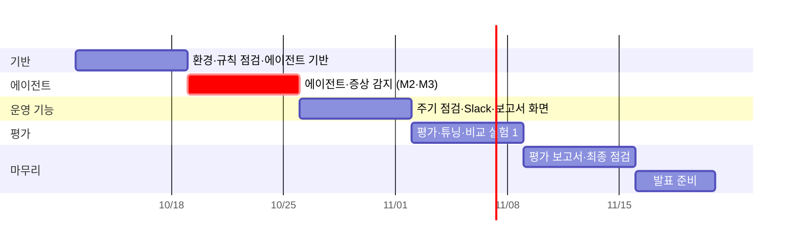

# KubeGuardian AI — 실행 계획서

> 기획서: [01-project-proposal.md](01-project-proposal.md) v3.2 (2026-10-12 피드백 반영: 보고서 화면·점검 실행·조사 과정, 심각도별 재알림은 W2~W3에 반영)
> 1인 · **2026-10-12 ~ 11-20** (개발 4주 W1~W4 + 평가 보고서·최종 점검 W5 + 발표 준비) · 주마다 분량을 다르게 배치(주 약 20~30시간). 각 주는 **종료 조건(Exit)** 을 만족해야 다음 주로 넘어간다. 못 채운 분량은 다음 주로 넘겨 채운다.

## 0. 계획의 기준

### 0.1 시간 예산

| 항목 | 시간 |
|---|---|
| 개발·평가 (W1~W4) | 10/12~11/8, 총 약 98시간. W1 34.5 · W2 19.5 · W3 25 · W4 17.5 (§3). 평가·튜닝은 W4 |
| 기능 완료 | **11/8** (W4 말). 이후 새 기능은 넣지 않는다 |
| 평가 보고서·최종 점검 (W5) | 11/9~11/15. 평가 결과 보고서 작성, 최종 점검·보강·테스트·UI 수정·산출물 제작 |
| 발표 준비 | 11/16~11/20. 데모 리허설·발표 자료 |
| 버퍼 | 별도 버퍼 없이 W5가 지연을 흡수한다. 남으면 선택 비교 실험(§4)에 쓴다 |
| 매주 고정 | 학습 노트 0.5시간 (각 주 시간에 포함) |

- 범위를 줄이지 않고 주마다 분량을 바꿔 배치했다. W1은 착수 전 주에 못 한 분량까지 채워 원래 계획의 W1·W2 전체와 W3 일부(에이전트 기반·도구·평가 러너)를 맡고, 기반 계약(§1.3)을 먼저 정한다.
- 주차 작업의 시간은 추정치다. 매주 금요일에 실제 사용 시간을 기록하고, 못 채운 분량은 다음 주로 넘긴다. 넘긴 분량이 W5를 넘어설 것 같으면 §5의 축소 순서를 적용한다.

### 0.2 계획의 원칙

1. **규칙 → 에이전트 → 주기 점검·Slack 순서로 쌓는다.** 진단이 맞아야 알림이 의미가 있으므로, Slack은 에이전트가 L1·L3에서 동작한 뒤(W3~)에 붙인다.
2. **에이전트를 늦게 붙이지 않는다.** W2에 L1 시나리오로 AI 조사가 끝까지 도는 상태를 만든다 (M2 체크포인트).
3. **시나리오가 곧 테스트다.** 기능을 만들 때마다 해당 시나리오로 채점한다. 시나리오는 `expected.yaml`부터 쓴다.
4. **승인이 필요한 것은 W1에 요청한다.** Slack 앱 생성, 사내망 통신(Azure OpenAI, Slack API)은 기다리는 시간이 길다.
5. **Slack 없이도 개발·평가가 돈다.** 알림·명령 기능은 CLI와 보고서 화면의 알림 이력(dry-run으로 기록한 메시지 본문)으로 먼저 확인하고, 평가 러너는 알림 이력(SQLite)으로 채점한다. Slack 승인이 늦어도 W3까지는 막히지 않는다.

---

## 1. 레포 구성

### 1.1 템플릿 포크

템플릿 조직의 앱 레포 6개와 `shared-infra`를 개인·PoC 조직으로 포크한다. 수정은 기획서 §5.2의 F1·F2·F5·F6·F7에 한정한다.

| 포크 레포 | 수정 |
|---|---|
| shared-infra | F1 서비스 주소, F6 `kubernetes/local/` overlay (postgres·redis·로컬 이미지) |
| backend-agent | F2 검색 선택화, F7 v2 이미지 (컬럼 추가) |
| backend-admin | F5 테스트 사용자 시드 |
| backend-gateway · backend-llm-gateway · frontend | 없음 (빌드만) |

### 1.2 KubeGuardian 레포

```text
KubeGuardian/
├── app/                       # Python 루트 (import는 app/ 기준: from core.config import ...). 템플릿 backend-agent 규약: api / service / core
│   ├── main.py                # FastAPI 앱 진입 (보고서 화면 + Slack Socket Mode 시작)
│   ├── cli.py                 # kg check / investigate / report / evidence / alerts (CronJob·평가 러너 진입)
│   ├── api/                   # ── 진입점: 요청을 받아 service를 호출 ──
│   │   ├── routes/            #   보고서 화면 라우트 P1~P5, 점검 실행 (UI 정의서 §6.6)
│   │   ├── templates/         #   Jinja2 템플릿, HTMX 조각
│   │   ├── schemas/           #   요청·응답·화면 표시 모델
│   │   └── slack/             #   Socket Mode 명령 수신 (/kg check·investigate)
│   ├── service/               # ── 업무 로직: 기능별 하위 패키지 ──
│   │   ├── model/             #   도메인 모델 (§1.3): ClusterSnapshot, Evidence, Signal, SignalBoard, GateResult, InvestigationRequest, Issue, Hypothesis, Report
│   │   ├── pipeline/          #   점검 실행 흐름 (점검 → 게이트 → 조사 → 저장 → 알림), 동시 실행 제한
│   │   ├── checks/            #   결정적 점검 계층
│   │   │   ├── detectors/     #     catalog.py(05-rules.md의 코드 표현) + 장애 신호 11종·개선 권고 2종
│   │   │   ├── symptoms.py    #     API 시나리오 증상 감지
│   │   │   └── gate.py        #     경로 A / B / C 판정
│   │   ├── sensors/           #   사실 수집: collector, topology, probes, app_api
│   │   ├── tools/             #   base.py(Tool 인터페이스) + 에이전트 도구 7종 (프레임워크 독립, sensors를 감쌈)
│   │   ├── agent/             #   에이전트: <이름>/v<N>/ 폴더로 구현을 나누고 registry에서 고른다
│   │   │   ├── base.py        #     BaseAgent·AgentSpec·AgentResult (§1.3)
│   │   │   ├── registry.py    #     "investigator:v1" → 구현
│   │   │   ├── _common/       #     버전 공용: 구조화 출력 파싱 방어·재시도, 프롬프트 로더, 도구 어댑터
│   │   │   └── investigator/  #     조사 에이전트 (사전 확인 → 가설 검증 → 보고서). 이후 에이전트는 형제 폴더로
│   │   │       ├── v1/        #       LangGraph 기본 구현: agent.py, graph.py, state.py, config.py(역할별 모델·예산), prompts/
│   │   │       └── v1_loop/   #       비교 실험 1: v1과 같은 사양을 직접 구현한 도구 호출 루프
│   │   ├── alerts/            #   문제 지문, 알림 상태 (열림/해결)
│   │   ├── notify/            #   Slack 메시지 변환(M1~M9), 발송, 재알림
│   │   └── knowledge/         #   조사 지침(runbooks/, 증상 기준), 환경 설명
│   └── core/                  # ── 여러 기능이 같이 쓰는 기반 ──
│       ├── config.py          #   설정 (kubeguardian.yaml, 환경변수)
│       ├── error/             #   ErrorCode·ServiceException·에러 핸들러 (§1.3)
│       ├── log/               #   로깅 설정
│       ├── llm.py             #   build_chat_model(model) — 제공사 분기는 여기 한 곳 (사내 CA 포함)
│       ├── db/                #   SQLite 저장소 (점검 이력, 관측 기록, 조사 단계, evidence, 보고서, 알림 이력)
│       ├── k8s.py             #   Kubernetes 클라이언트 (읽기 전용, 네임스페이스 제한)
│       ├── guard/             #   redact, validate, budget
│       └── tracing.py         #   Phoenix / OpenTelemetry
├── tests/                     # app 구조와 같게 + fixtures/(K8s 스냅샷)
├── Dockerfile                 # KubeGuardian 이미지 (CronJob·Deployment 공용)
├── deploy/
│   ├── kubeguardian/          # SA·ClusterRole, PVC, CronJob, diagnostic-agent Deployment·Service, Secret 예시
│   └── chaos-mesh/            # 평가 환경 전용
├── scenarios/                 # H0, A1, A3, A5, B1, C1, C2, C5, E1 (+ 확장 후보)
│   └── <ID>/{inject.sh, reset.sh, verify_symptom.sh, expected.yaml, README.md}
├── eval/                      # 평가 러너, 채점, 리포트
├── scripts/                   # 일회성 스파이크·스모크
├── Makefile                   # up / down / inject S= / reset S= / eval S= / eval
└── docs/
    ├── adr/                   # 설계 결정 기록
    └── learning/              # 주간 학습 노트
```

**나누는 기준**: 외부 요청을 받는 진입점(화면·Slack)은 `api/`, 기능 로직은 `service/` 아래 기능별 패키지, 여러 기능이 같이 쓰는 기반(설정·저장소·K8s 클라이언트·가드레일·추적)은 `core/`에 둔다. 주기 점검(CronJob → `cli.py`), Slack 명령, 화면의 점검 실행, 평가 러너는 모두 `service/pipeline/`의 같은 함수를 호출한다. `service/checks`·`sensors`·`tools`는 에이전트 프레임워크에 묶이지 않는 일반 Python 모듈로 둔다 (기획서 §6.1).

- Python 앱이 하나뿐이라 `apps/<이름>/` 단계 없이 레포 루트에 `app/`·`tests/`를 둔다 (템플릿 backend-agent와 같음). 실행은 `cd app && python main.py`, 테스트는 pytest `pythonpath`로 맞춘다.
- **배포 단위는 Deployment 1개(FastAPI 보고서 화면 + Slack Socket Mode) + CronJob 1개(주기 점검)**다. 같은 이미지·같은 SQLite(PVC)를 쓰고 실행 명령만 다르다. Slack 알림 발송은 Web API 호출이라 결과를 만든 쪽이 직접 보낸다. 명령 수신과 조사 실행을 한 Deployment에 두는 분리 조건(조사로 인한 수신 중단, 수신부 권한 분리 필요, replicas 증가로 Postgres 전환)은 ADR-002에 기록한다.

### 1.3 기반 설계 (먼저 정하는 계약)

여러 감지기·도구·에이전트·버전을 붙여도 흔들리지 않도록, 아래 계약을 **구현보다 먼저** 정의하고 테스트로 고정한다. 바꿀 때는 ADR을 남긴다.

| 계약 | 위치 | 정하는 것 | 시점 |
|---|---|---|---|
| 도메인 모델 | `service/model/` | `ClusterSnapshot`(정규화된 수집 결과), `Evidence`, `Signal`, `SignalBoard`, `GateResult`, `InvestigationRequest`, `Issue`, `Hypothesis`, `Report` (기획서 §6.4, 상세설계 §2.1) | W1 |
| 규칙 목록 | `service/checks/detectors/catalog.py` | [규칙 점검 명세](05-rules.md)의 코드 표현. ID·이름·성격·판정 시점(지속 시간)·1차 심각도·관련 지침. **명세는 05-rules.md가 정본**이고, 명세와 목록이 일치하는지 테스트로 확인한다. 감지기 구현, `expected.yaml`의 `expected_signals`, 보고서가 이 ID를 참조한다 | W1 |
| 감지기 인터페이스 | `service/checks/detectors/` | `ClusterSnapshot` + 관측 기록 → 판정 결과(적발·관찰 중·통과·확인하지 못함)인 결정적 함수 + `@detector("S04")` 등록. 테스트는 `tests/fixtures/`의 스냅샷으로 돌린다 | W1 |
| 에러 코드 | `core/error/` | 템플릿 방식 `ErrorCode`(HTTP 상태·코드·메시지) + `ServiceException`. 영역: X0 공통·X1 수집·X2 점검·X3 에이전트·LLM·X4 가드레일·X5 알림·X6 저장소·X9 시스템. 화면·CLI 종료 코드·Slack M8에 같은 코드를 쓴다. 진단 규칙(S04 등)과 섞지 않는다 | W1 |
| LLM 생성 | `core/llm.py` | `build_chat_model(model) -> BaseChatModel`. 어디에 연결할지(`LLM_PROVIDER`, 엔드포인트·키)는 설정, **어떤 모델을 쓸지는 에이전트 버전의 `config.py`**(역할별 모델)가 정한다. 에이전트는 `bind_tools`·`with_structured_output`만 쓴다. 다른 제공사는 이 함수에 분기를 더해 붙인다 | W1 |
| 도구 인터페이스 | `service/tools/base.py` | `name`·`description`(언제 쓰는지 한 줄)·`Input`(Pydantic)·`run(input, ctx) -> ToolResult`. `ctx`가 네임스페이스 고정·마스킹·근거 저장을 강제한다. LangChain 도구로는 `agent/_common`의 어댑터가 바꾼다 (직접 구현 루프·MCP 서버도 같은 도구를 쓴다) | W1 |
| 에이전트 base | `service/agent/base.py`, `registry.py` | `AgentSpec`(이름·버전·역할별 모델·예산·프롬프트 위치), `BaseAgent.run(InvestigationRequest) -> AgentResult`(보고서·상태·조사 단계·사용량: 토큰·도구 호출·시간). LLM·도구·저장소는 생성자로 주입해 가짜 LLM으로 테스트한다 | W1 (investigator v1보다 먼저) |
| 설정 파일 | `core/config.py` | `kubeguardian.yaml`: 대상 네임스페이스, 점검 주기, API 시나리오, 앱 API 허용 목록, 알림 대상·허용 사용자 (상세설계 §7.4) | W1 |
| 저장소 | `core/db/` | SQLite(WAL 모드, CronJob·Deployment 동시 접근). 점검 이력·관측 기록·evidence(W1), 조사 단계·사용량(W2), 보고서·알림 이력(W3). LangGraph 체크포인트는 같은 파일의 별도 테이블 | W1~W3 |

**테스트 전략**: 단위 테스트(스냅샷 픽스처·가짜 LLM)는 CI에서 돈다. minikube가 필요한 통합 확인은 `make eval`로 하고 결과를 PR에 붙인다.

## 2. 주차별 계획

범위는 줄이지 않고 **주마다 분량을 다르게** 배치한다. W1에는 원래 앞 주에 했어야 할 분량까지 채워 기본 셋팅과 테스트 기반(원래 계획의 W1·W2 전체와 W3 일부)을 끝낸다. 각 작업표의 "원래" 열은 2026-10-12 이전 8주 계획의 주차다.

각 주에 **학습 초점**을 함께 적었다. 학습 노트는 그 주의 시나리오를 중심으로 쓴다.

### W1 (10/12~10/18) — 기본 셋팅, 기반 계약, 테스트 기반 (약 34.5시간)

**학습 초점**: 컨테이너 이미지와 레지스트리, Deployment·Service·ConfigMap·Secret의 관계, CRD 기반 도구(Chaos Mesh), K8s API 객체 모델(spec/status, ownerReferences, selector, EndpointSlice), RBAC 최소 권한

**① 환경 (12시간)**

| 작업 | 시간 | 산출물 | 원래 |
|---|---|---|---|
| **Day 1 스파이크**: minikube Pod 안에서 Azure OpenAI 호출 (사내 SSL CA 주입 포함). `build_chat_model`로 작성 | 2.5 | `core/llm.py`, `scripts/` | W1 |
| **승인 요청**: Slack 앱 생성(메시지 발송·슬래시 명령·Socket Mode 권한), 사내망에서 slack.com 통신 확인 | 0.5 | 요청 기록 | W1 |
| 템플릿 포크, F1·F2·F6 적용, 선택 의존성(Milvus, MinIO 등) 없이 기동 확인 | 5 | 포크 브랜치, `make up` | W1 |
| F5 테스트 사용자 시드, 로그인 → 채팅 E2E 확인 | 2 | 스모크 스크립트 | W1 |
| metrics-server, Chaos Mesh, Phoenix 설치 ([환경 설치 가이드](environment-setup.md)) | 1.5 | `deploy/chaos-mesh/` | W1 |
| H0 정의, A5(원본 템플릿 상태) 시나리오 스크립트 | 0.5 | `scenarios/H0`, `A5` | W1 |
| 학습 노트 "원본 템플릿은 왜 클러스터에서 동작하지 않았나" + 환경 설명 초안 | 1 | `docs/learning/w1-*.md`, `service/knowledge/environment.md` | W1 |

**② 기반 계약 + 규칙 점검 계층 (15시간)**

| 작업 | 시간 | 산출물 | 원래 |
|---|---|---|---|
| 도메인 모델, 규칙 목록(05-rules.md와 일치 테스트)·감지기 인터페이스, 에러 코드 (§1.3) | 2 | `service/model/`, `service/checks/detectors/catalog.py`, `core/error/` | 신규 |
| `kubeguardian.yaml` 설정 로더 (§1.3) | 0.5 | `core/config.py` | 신규 |
| 수집기 (리소스, 로그 current/previous, 이벤트) + 정규화 | 2.5 | `service/sensors/collector` | W2 |
| 점검 이력·Evidence 저장소 + id 발급 | 1 | `core/db/` | W2 |
| 토폴로지 (env URL 파싱 → declared/unresolved, 계층) | 2 | `service/sensors/topology` | W2 |
| 감지기 장애 신호 11종 + 개선 권고 2종 ([규칙 점검 명세](05-rules.md) 기준), 관측 기록(지속 시간 판정), 픽스처 단위 테스트 | 3.5 | `service/checks/detectors` | W2 |
| 게이트 v0 (경로 A·C) | 0.5 | `service/checks/gate.py` | W2 |
| 마스킹 (로그·이벤트·env) + 단위 테스트 | 1 | `core/guard/redact` | W2 |
| SA `kubeguardian` + 최소 권한 ClusterRole | 0.5 | `deploy/kubeguardian/rbac.yaml` | W2 |
| 점검 실행 흐름 v0 + CLI `kg check` (규칙 결과·게이트 판정 출력) | 0.5 | `service/pipeline/`, `cli.py` | W2 |
| A1 시나리오 | 0.5 | `scenarios/A1` | W2 |
| ADR-001 도구 계층과 에이전트 코어의 경계 | 0.5 | `docs/adr/` | W2 |

**③ 에이전트 기반과 테스트 (6.5시간)**

| 작업 | 시간 | 산출물 | 원래 |
|---|---|---|---|
| 에이전트 기반: `BaseAgent`·`AgentSpec`·`AgentResult`, `registry`, `_common`(구조화 출력 파싱 방어·재시도, 프롬프트 로더), 가짜 LLM 테스트 (§1.3) | 1.5 | `service/agent/base.py`, `registry.py`, `_common/` | W3 |
| 도구 기반: Tool 인터페이스·`ToolResult`·근거 저장·네임스페이스 강제 + LangChain 어댑터 | 0.5 | `service/tools/base.py` | 신규 |
| 도구 7종 (get_topology, get_resource, get_pod_logs, get_events, probe, run_api_scenario, query_app_api) + 단위 테스트 | 3 | `service/tools/` | W3 |
| 평가 러너 최소판: `make eval S=<ID>` = 주입 → 증상 확인 → 점검·게이트 → 채점 → 원복 (AI 단계는 W2에 연결) | 1.5 | `eval/` | W3 |

**Exit**
- `make up` 후 전 Pod Ready, front-chat 경유 로그인 → 채팅이 실제 Azure OpenAI 응답으로 성공
- `build_chat_model`로 클러스터 안에서 진단용 Azure OpenAI 호출 성공
- 도메인 모델·규칙 목록·에이전트 base가 단위 테스트로 고정되고, 규칙 목록이 05-rules.md와 일치
- A5 inject 시 채팅 실패, reset 시 복구
- A1·A5에서 해당 감지기(S01·S02 / S04)가 장애 신호로 적발, 게이트가 경로 A. H0에서 개선 권고만 나오고 경로 C
- `kubectl auth can-i`로 쓰기 권한 없음 확인
- 도구 7종 단위 테스트 통과, `make eval S=A1`이 사람 개입 없이 기준 조건(규칙만)으로 끝까지 돌고 채점 결과 출력
- Slack 앱 승인 요청 완료

### W2 (10/19~10/25) — 에이전트 + 증상 감지(경로 B) + 조사 품질 (약 19.5시간)

**학습 초점**: 가설 → 도구 검증 → 판정 루프, 근거 인용 강제, 구조화 출력, Service 라우팅과 Pod 직접 호출, 앱 층 장애가 K8s에서 어떻게 보이는가

| 작업 | 시간 | 산출물 | 원래 |
|---|---|---|---|
| 조사 지침(증상 기준, [템플릿](../app/service/knowledge/runbooks/_template.md))·환경 설명 보완 — **LangGraph 구현 전에 작성** | 2 | `service/knowledge/` | W4 |
| investigator v1 (LangGraph): 선별 → 조사 → 보고서 작성, 노드별 조사 단계 기록 | 3.5 | `service/agent/investigator/v1/` | W3 |
| 근거 검증기, 출력 파싱 방어, 호출·시간 상한 | 2 | `core/guard/` | W3 |
| Phoenix 추적 연동 (OpenTelemetry GenAI 속성) | 0.5 | `core/tracing.py` | W3 |
| A3 시나리오 | 0.5 | `scenarios/A3` | W3 |
| API 시나리오 증상 감지, 게이트 v1(경로 B), `kg investigate` | 2 | `service/checks/symptoms.py` | W4 |
| 가설 루프 + 보고서 섹션 완성 (배제 이유, 확인한 범위·확인하지 못한 것, 권장 조치, 재검증) | 3 | `service/agent/investigator/v1/` | W4 |
| C1(할당량), C2(Redis 차단) 시나리오 + `verify_symptom.sh` | 2.5 | `scenarios/` | W4 |
| B1(Pod 1개만 오류) 시나리오 | 1 | `scenarios/B1` | W4 |
| 보고서 화면 골격(FastAPI·Jinja2·HTMX) + P5 조사 과정 + P3 근거 원문 — 개발 중 에이전트 확인용으로 먼저 만듦 (Chainlit 대체) | 1.5 | `main.py`, `api/routes/`, `api/templates/` | W4 |
| 기준 조건(규칙만) 결과 기록 + 학습 노트 | 1 | `eval/history/` | W4 |

**Exit**
- L1 3개(A1·A3·A5)에서 **요약 1순위 = 주입 장애**가 3개 모두 (3회 반복 다수결), 모든 보고서가 근거 검증기 통과
- C1·C2에서 규칙은 통과하고 증상 감지가 게이트를 경로 B로 엶. L3 2개(C1·C2) 중 원인 1순위 정답 1개 이상
- 보고서만 보고 조치할 수 있는지 본인 확인 (확인한 범위·구체적 조치 포함)
- **조사 1회 실측 시간·토큰 기록** → 기획서 §9.2 잠정 목표 재설정

> **M2·M3 체크포인트 (10/25)**: L1 선별이 3개 중 2개 이하면 신호판 구조와 프롬프트부터, C1·C2 모두 원인을 못 찾으면 지침·도구 출력부터 고친다. 고치는 시간은 W3 초에 쓰고, W3 분량이 밀리면 §5 순서를 적용한다.

### W3 (10/26~11/1) — 주기 점검 + Slack + 보고서 화면 (약 25시간)

**학습 초점**: CronJob(주기 실행, 중복 실행 방지), PVC 공유, 항상 떠 있는 프로세스(Deployment)와 CronJob의 역할 분리, 비동기 처리, 외부 API 연동

| 작업 | 시간 | 산출물 | 원래 |
|---|---|---|---|
| KubeGuardian 이미지 (Dockerfile, 사내 CA, `minikube image load`) | 1 | `Dockerfile`, `Makefile` | 신규 |
| CronJob 5분 주기, `concurrencyPolicy: Forbid`, Job과 PVC(SQLite) 공유 | 1.5 | `deploy/kubeguardian/cronjob.yaml` | W5 |
| 문제 지문 + 알림 상태(열림/해결) + 진행 중 문제는 AI·알림 생략 | 3 | `service/alerts/` | W5 |
| Slack 발송: M1 이상 알림(이상 판정 직후 1차 감지 알림 → 조사 후 같은 메시지를 원인으로 갱신, M9 원인 확인 답글), M3 복구 알림, M7 점검 중단 알림 | 3 | `service/notify/` | W5 |
| 심각도별 재알림 정책(M2 리마인더: 긴급 30분 후 첫 리마인더·이후 2시간마다 총 3회, 주의 2시간 후 1회), 상황 변경 시 갱신 | 1 | `service/notify/reminder.py` | W5 |
| 평가 러너에 장애 감지 시간·원인 파악 시간 기록 (주입 시각 → 알림 이력의 1차 발송·갱신 시각), 평가 중 알림은 Slack 전송 생략(dry-run) | 1 | `eval/` | W5 |
| diagnostic-agent Deployment + Socket Mode 명령 수신 (`slack_bolt`) | 2 | `api/slack/`, `deploy/` | W6 |
| `/kg check`, `/kg investigate`: 3초 내 접수, 비동기 실행, M4~M6·M8, 허용 채널·사용자, 동시 실행 제한 | 3 | `api/slack/`, `service/pipeline/` | W6 |
| 보고서 화면 완성(서버 렌더링): P1 목록, P2 상세(근거·알림 이력 포함), P4 점검 이력 + **점검 실행 버튼**(백그라운드 실행, 동시 1건, 1분 간격), P5 진행 중 갱신, 마스킹 적용 | 4 | `api/routes/`, `api/templates/` | W6 |
| Slack 연동 테스트 (Slack API 모의 객체로 메시지 형식·스레드·오류 경로) | 1.5 | `tests/` | W6 |
| E1(미끼 신호) 시나리오 | 1.5 | `scenarios/E1` | W6 |
| H0 주기 점검 4시간(48회) 연속 실행, 기준 조정 | 2 | 기준값 기록 | W6 |
| 학습 노트 | 0.5 | | W5 |

**Exit**
- C1 주입 → 다음 주기 점검에서 1차 감지 알림 도착 **6분 이내**, 조사 후 원인으로 갱신 **7분 이내** (알림 이력 기준). AI 조사를 일부러 실패시켜도 1차 알림은 나가고 "조사 실패"로 갱신됨
- 장애가 이어지는 동안 같은 알림이 반복되지 않고 재알림 정책대로 리마인더만 발송되며, reset 후 복구 알림 1회
- Slack에서 `/kg investigate`로 B1을 조사하면 같은 스레드에 조사 계획 → 요약과 보고서 링크가 올라오고, 링크로 보고서 화면에서 보고서·근거를 확인
- 점검 이력(P4)에서 최근 점검 결과와 점검 중단 구간을 확인하고, 점검 실행 버튼으로 A1을 점검하면 P5에서 진행 과정과 결과를 확인
- H0 4시간 동안 잘못된 알림 0건, E1에서 미끼(과거 재시작)를 1순위로 올리지 않음
- Slack 승인이 안 났으면: 같은 흐름을 보고서 화면의 알림 이력(dry-run 메시지 본문)으로 확인

### W4 (11/2~11/8) — 평가 + 튜닝 + 비교 실험 1 (약 17.5시간)

**학습 초점**: 평가 설계, 결과 편차 다루기, 회귀 관리

| 작업 | 시간 | 산출물 | 원래 |
|---|---|---|---|
| C5(스키마 드리프트) 시나리오: F7 v2 이미지 빌드 | 2 | `scenarios/C5` | W5 |
| 평가 러너 확장: 전체 시나리오 × 2조건 × 3회, `eval/report.md` 자동 생성 | 3 | `eval/` | W7 |
| KPI 계산: 원인 규명 커버리지, 원인 정확도, 장애 감지 시간, 원인 파악 시간, 확인 항목 감소율, 조사 시간·비용 | 1 | `eval/report.md` | W7 |
| 근거 일치율: 보고서 10건 본인 검토 | 1.5 | 검토 기록 | W7 |
| 프롬프트·지침 튜닝 (**튜닝 후 전체 eval로 회귀 확인**) | 3 | — | W7 |
| **비교 실험 1**: 직접 구현한 도구 호출 루프로 같은 시나리오 실행 → LangGraph와 비교 | 3.5 | `service/agent/investigator/v1_loop/`, 비교표 | W7 |
| 지침 과적합 확인: 지침 작성 때 보지 않은 확장 후보 1~2개 실행 | 1 | 확인 기록 | W8 |
| 설치·실행 README 정리 (`kubeguardian.yaml` 예시, Secret 등록) | 1.5 | `README.md`, `deploy/` | W8 |
| ADR-002 문제 지문·알림 설계 + 학습 노트 | 1 | `docs/adr/` | W6 |

**Exit (기능 완료, 11/8)**
- `make eval` 한 번으로 2조건 × 레벨별 × 경로별 결과표 생성
- KPI 전 항목에 측정값 기록
- 비교 실험 1 비교표 + ADR-003 에이전트 구현 방식
- 이후 새 기능은 넣지 않는다. W5부터는 평가 보고서·점검·보강·수정만 한다

### W5 (11/9~11/15) — 평가 보고서 + 최종 점검·보강

11/9부터는 새 기능을 만들지 않는다. W4의 평가 결과로 보고서를 쓰고, W4까지 만든 것을 점검·보강한다.

| 작업 | 내용 | 시간 | 산출물 |
|---|---|---|---|
| **평가 결과 보고서** | KPI를 헤드라인으로, 기준 조건 대비. 미달 항목은 원인·후속안 | 3 | `docs/06-evaluation-report.md` |
| 최종 점검 | 전체 시나리오 × 2조건 × 3회 재실행, 성공 기준 표 판정, 회귀 확인 | — | `eval/history/`, `eval/report.md` |
| 보강 | 미달 KPI·잘못 판정한 시나리오의 원인 분석과 지침·프롬프트·도구 출력 보강 (보강 후 전체 eval) | — | 보강 기록 |
| 테스트 | 단위·Slack 연동 테스트 보완, H0 장시간 실행 재확인, 오류 경로(LLM 실패, 수집 실패, 전송 실패) 확인 | — | `tests/` |
| UI 수정 | 보고서 화면(P1~P5)과 Slack 메시지 문구·표시 개선 | — | `api/templates/`, `service/notify/` |
| 산출물 제작 | 데모 스크립트, 학습 회고, 학습 노트·ADR 정리 | — | `docs/07-demo-script.md`, `docs/08-retrospective.md` |

**Exit (11/15)**
- 평가 결과 보고서 완성: 성공 기준 표 전 항목에 측정값, 미달 항목은 원인·후속안 기재
- 학습 노트, ADR 3건 이상

### 발표 준비 (11/16~11/20)

| 작업 | 내용 | 산출물 |
|---|---|---|
| 발표 준비 | 데모 3종 리허설: C1(주기 점검 → Slack 알림 → 화면), A1(화면 점검 실행 또는 `/kg check`), B1(`/kg investigate`). 발표 자료 | 발표 자료 |
| 선택 비교 실험 | 시간이 남으면 §4 순서대로 | 비교표·ADR |

**Exit (11/20)**
- 데모 3종이 리허설에서 끝까지 동작, 발표

## 3. 주차별 시간 요약

| 주차 | 기간 | 내용 | 시간 |
|---|---|---|---|
| W1 | 10/12~10/18 | 환경 + 기반 계약 + 규칙 점검 계층 + 에이전트 기반·테스트 | 34.5 |
| W2 | 10/19~10/25 | 에이전트 + 증상 감지 + 조사 품질 (M2·M3) | 19.5 |
| W3 | 10/26~11/1 | 주기 점검 + Slack 알림·명령 + 보고서 화면 | 25 |
| W4 | 11/2~11/8 | 평가 + 튜닝 + 비교 실험 1 | 17.5 |
| **개발 합계** | | | **약 96.5** |
| W5 | 11/9~11/15 | 평가 결과 보고서 + 최종 점검·보강·테스트·UI 수정·산출물 | 보고서 3 + 남은 시간 |
| 발표 준비 | 11/16~11/20 | 데모 리허설·발표 자료 | 남은 시간 |

원래 8주 계획의 W8 중 평가 보고서(3시간)는 W5로, 데모 리허설·회고(3.5시간)와 버퍼(3시간)는 W5·발표 준비로 옮겼다.



| 체크포인트 | 시점 | 판단 |
|---|---|---|
| M1 환경 | W1 중반 (10/14) | Azure OpenAI 연결이 안 되면 사내 네트워크 담당과 협의. 그동안 규칙 계층은 LLM 없이 진행 |
| **M2 방향 검증** | W2 말 (10/25) | L1 3개 모두 선별 성공. 미달 시 신호판·프롬프트 보강 |
| M3 AI 가치 | W2 말 (10/25) | L3(C1·C2)에서 원인 1개 이상. 미달 시 지침·도구 출력 보강, E1을 확장 후보로 |
| M4 Slack | W3 초 (10/26) | Slack 승인 여부. 미승인이면 알림·명령은 보고서 화면의 알림 이력(dry-run)과 CLI로 개발·평가하고, 데모는 승인 후 |
| **M5 기능 완료** | W4 말 (11/8) | 결과표·KPI. 미달 항목은 W5의 보강 대상으로 |
| M6 평가 보고서 | W5 말 (11/15) | 성공 기준·학습 산출물 판정 |
| M7 발표 | 11/20 | 데모 3종 동작 |

## 4. 선택 비교 실험

핵심 범위가 일정대로 가면 W5·발표 준비 기간의 남는 시간으로 아래를 순서대로 진행한다. 모두 평가 러너를 그대로 쓴다.

| # | 비교 실험 | 예상 시간 | 판단 |
|---|---|---|---|
| 8 | 조사·선별 모델 조합 비교 (gpt-4.1 / gpt-4.1-mini / gpt-5 계열) | 1.5 | 여유 있으면 진행 (W2 말, 에이전트 골격 직후 L1·C1로) |
| 2 | 조사 지침 전체 주입 vs 필요한 지침만 불러오기(Skills 방식) | 2 | 여유 있으면 진행 (W2 이후) |
| 3 | 함수 직접 호출 vs MCP 서버 경유 | 2 | 여유 있으면 진행 (W2 이후) |
| 4 | 본인 채점 vs LLM-as-judge | 2 | 여유 있으면 진행 (W4, 근거 일치율 검토와 함께) |
| 7 | CronJob + API 서버 vs kagent CRD 에이전트 (설계 비교 ADR) | 1.5 | 여유 있으면 진행 (W5) |
| 5 | 도구 개별 호출 vs Code Mode + Agent Sandbox | 8 이상 | **이번 기간 안에는 어려움**. 후속 과제로 기록 |
| 6 | ITBench | 실행 가능성 확인 1 + 실행 6 이상 | **이번 기간 안에는 어려움**. 실행 가능성만 확인하고 후속 과제로 기록 |

## 5. 일정이 밀릴 때 축소 순서

범위는 줄이지 않는 것이 기본이다. 밀린 분량은 다음 주로 넘겨 채운다. 다만 체크포인트를 못 넘거나, 밀린 분량이 W5(11/9~11/15)를 넘어설 것 같으면 아래 순서로 줄인다. 위에서부터 먼저 줄인다.

1. 선택 비교 실험(§4) 전부 보류
2. 비교 실험 1을 L1 시나리오 3개로만 축소
3. E1(미끼) → 확장 후보로
4. C5(스키마 드리프트, v2 이미지 빌드 필요) → 확장 후보로
5. 화면의 점검 실행 버튼 제외 → 즉시 점검은 Slack `/kg check`와 CLI로
6. 보고서 화면 P1·P2·P4 축소 → P3 근거 원문·P5 조사 과정만 남기고, 보고서는 CLI(`kg report`)와 Slack 요약으로 대체

**줄이지 않는 것**: 규칙 점검, AI 조사·검증, 주기 점검 + Slack 알림, 근거 검증, L1·L3 시나리오(A1·A3·A5·C1·C2), 2조건 평가.

## 6. 주간 운영

- 작업은 GitHub Issue로 관리한다. 주차는 마일스톤(W1~W5, 발표 준비), 진행 상황은 [GitHub Project](https://github.com/users/skax-jihyeryu/projects/2)로 본다 (CONTRIBUTING §5·§6).
- 매주 금요일
  - Exit 조건 점검, 실제 사용 시간 기록
  - 그 주까지의 시나리오로 `make eval` 실행 (W1부터), 결과를 `eval/history/`에 누적
  - 학습 노트 작성
- 프롬프트·지침을 바꾸면 반드시 전체 eval로 회귀 확인
- 시나리오 inject 후 `verify_symptom.sh`로 증상 발생을 확인한다. 증상이 안 나면 그 실행은 무효 처리

## 7. 착수 전 준비물

- [ ] 로컬 머신 여유 메모리 ≥ 12GB, minikube·kubectl·docker 설치
- [ ] Azure OpenAI 배포 2종 이상 (진단 에이전트용, 진단 대상 서비스용) 및 PoC 사용·비용 승인. 사용 가능 모델: gpt-4.1, gpt-4.1-mini, gpt-4o, gpt-4o-mini, gpt-5, gpt-5-mini, gpt-5.4, gpt-5.6-luna, text-embedding-3-large·small, ada-002. 진단용은 서비스용과 쿼터를 분리하고, 채점용(LLM-as-judge)은 조사 모델과 다른 모델로 배포한다
- [ ] 사내 SSL 프록시 CA 인증서
- [ ] 템플릿 레포 포크 권한 (개인 또는 PoC 조직)
- [ ] **Slack 앱 생성 승인** (메시지 발송 `chat:write`, 슬래시 명령 `commands`, Socket Mode 앱 토큰) 및 알림 대상(기존 운영 채널 또는 DM)
- [ ] 사내망에서 Azure OpenAI·Slack API(slack.com) 통신 허용 여부
