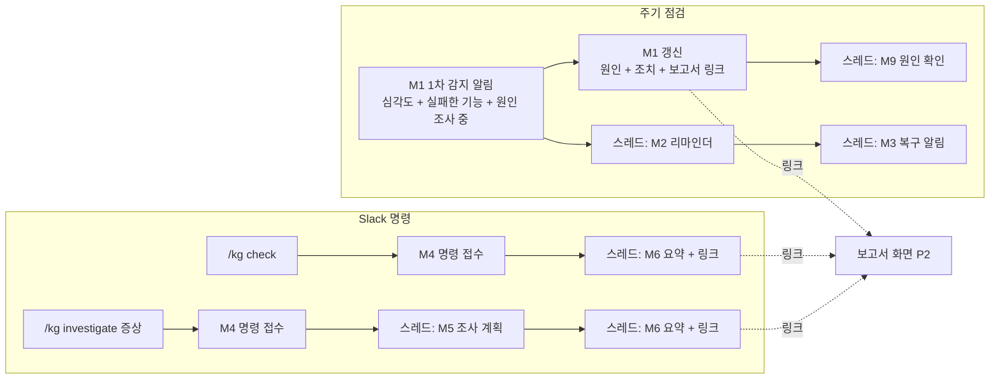

# KubeGuardian AI — UI 정의서

> [기획서](01-project-proposal.md) v3.2 + 결정 이력 10-14까지, 규칙 명세 [05-rules.md](05-rules.md) 기준. 운영자는 **Slack**(알림·명령)과 **보고서 화면**(보고서·근거·점검 이력·조사 과정 조회, 점검 실행)을 쓰고, CLI는 개발·평가용이다.
> 사용 흐름은 [시나리오 수립](산출물/03-시나리오수립.md)을 참고한다.
> 화면의 시각 디자인(레이아웃·색·컴포넌트·목업 예시)은 [UI 디자인](04-1-ui-design.md)에 있다.

## 0. 원칙

- **알림은 Slack, 확인과 처리는 화면.** 운영자는 알림을 받으면 업무 노트북에서 처리하므로, Slack은 짧은 알림과 명령만 맡고 전체 보고서·근거 원문·점검 이력·조사 과정은 보고서 화면에서 본다. 알림에는 요약과 링크만 담는다.
- **사건 하나 = 스레드 하나.** 채널에는 짧은 메시지 하나만 올리고, 진행 상황·리마인더·복구 알림은 모두 그 메시지의 스레드 답글로 단다. 채널이 도배되지 않게 한다.
- **정상이면 조용하다.** 주기 점검이 정상이면 아무것도 보내지 않는다. 같은 문제가 계속되는 동안에는 심각도별 리마인더 정책에 따라서만 다시 알린다.
- **심각도에 따라 알린다.** 긴급·주의만 알리고, 참고(잠재 위험·개선 권고)는 알림 없이 화면에만 표시한다.
- **보고서 하나로 판단이 끝나야 한다.** 원인, 근거, 배제한 가설과 이유, 확인한 범위, 구체적인 조치, 재검증 방법을 한 번에 보여준다. 후속 질문 기능은 없다.
- **사실에는 근거 번호를 붙인다.** `[근거 14]`처럼 표시하고, 원문은 보고서 화면의 근거 보기에서 연다.
- **상태 대시보드가 아니다.** 화면은 점검 시점에 고정된 판정 근거를 보여주고 점검을 실행할 뿐, 실시간 상태 조회·리소스 탐색·로그 검색·배포 기능은 없다 (§6).

### 0.1 화면의 층

| 층 | 대상 | 용도 |
|---|---|---|
| **Slack** | 운영자 | 심각도별 이상 알림, 리마인더, 복구 알림, 점검 중단 알림, 명령(`/kg check`, `/kg investigate`) |
| **보고서 화면** | 운영자, 개발자 | 보고서 목록·상세, 근거 원문, 점검 이력, 조사 과정, 점검 실행. 개발 중에는 조사 과정(P5)으로 에이전트 동작을 확인한다 |
| CLI | 개발자 | Slack 명령과 같은 기능을 터미널에서 실행. 개발·평가 러너에서 사용 |
| 실행 추적 (Phoenix) | 개발자 | 프롬프트·LLM 입출력·토큰 추적. 화면 P5에서 링크로 이동 |

별도 개발용 화면(Chainlit)은 두지 않는다. 에이전트가 무엇을 했는지는 보고서 화면의 조사 과정(P5)과 Phoenix로 보고, 같은 데이터를 두 화면에서 보여주는 중복을 피한다.

## 1. Slack 구성

### 1.1 알림 대상과 앱

| 항목 | 결정 |
|---|---|
| 알림 대상 | 기존 운영 채널(예: `#pr-service-ops`) 또는 DM에서 시작한다. 알림량·수신자가 늘면 전용 채널을 만든다 (필수 아님) |
| 명령 허용 채널 | 알림 대상 + 설정한 운영 채널. 그 외 채널의 명령은 거절 |
| 명령 허용 사용자 | 설정 파일의 `allowed_users` |
| 평가 중 | 평가 러너는 Slack 전송을 생략(dry-run)하고 알림 이력에 발송 예정 시각·내용만 기록한다. 평가용 채널은 두지 않는다 |
| Slack 앱 권한 | `chat:write`(메시지 발송), `commands`(슬래시 명령), Socket Mode 연결(앱 토큰, `connections:write`) |
| 수신 방식 | **Socket Mode** — 앱이 Slack 쪽으로 연결을 먼저 열어 명령을 받는다. 공개 URL이 없는 minikube에서도 동작 |

### 1.2 메시지 종류

| ID | 메시지 | 위치 | 언제 |
|---|---|---|---|
| M1 | 이상 알림 (1차 감지 → 원인 갱신) | 알림 대상 (부모 메시지) | 주기 점검에서 긴급·주의 새 문제를 판정한 **직후, AI 조사를 기다리지 않고** 1차 감지 알림을 보낸다. 조사가 끝나면 같은 메시지를 원인으로 갱신한다. 문제 지문이 바뀌어도 갱신 |
| M2 | 리마인더 | M1의 스레드 | 같은 문제가 미해결이고 재알림 시점이 됐을 때 |
| M3 | 복구 알림 | M1의 스레드 + 채널에도 표시 | 열린 문제가 정상으로 돌아왔을 때 |
| M4 | 명령 접수 | 명령을 입력한 곳 (부모 메시지) | `/kg check`, `/kg investigate`를 받았을 때 |
| M5 | 조사 계획 | M4의 스레드 | `/kg investigate` 조사 시작 직후 |
| M6 | 점검 결과 요약 | M4의 스레드 | `/kg check` 또는 `/kg investigate`가 끝났을 때 (요약 + 보고서 링크) |
| M7 | 점검 중단 알림 | 알림 대상 | 점검이 예정 시각을 크게 넘겨 실행되지 않을 때 |
| M8 | 오류·거절 | 본인에게만 보임 (ephemeral) | 권한 없음, 잘못된 입력, 조사 실패 |
| M9 | 원인 확인 답글 | M1의 스레드 | AI 조사가 끝나 M1을 갱신했을 때. 메시지 갱신만으로는 알림이 울리지 않으므로 답글로 다시 알린다 |

전체 보고서와 근거 원문은 Slack 메시지가 아니라 보고서 화면(§6)의 P2·P3이다.



### 1.3 상태 표시와 심각도

| 표시 | 심각도 | 뜻 | 알림 |
|---|---|---|---|
| 🔴 | 긴급 | 핵심 경로 장애 — 채팅·로그인 등 주요 기능이 전부 실패 | 즉시 + 리마인더 |
| 🟠 | 주의 | 일부 사용자 영향 — 일부 요청·일부 기능만 실패 | 즉시 + 리마인더 |
| 🟡 | 참고 | 잠재 위험 — 지금은 영향이 없지만 곧 문제가 될 수 있음 | 없음 (화면에만) |
| ⚪ | 참고 | 개선 권고 — 지금 장애와 무관 | 없음 (화면에만) |
| 🔍 | — | 점검·조사 진행 중 | — |
| ⚠️ | — | 조사 미완 또는 점검 중단 — 상한 도달·실패로 부분 결과만 있음 | 점검 중단은 M7 |
| ✅ | — | 복구됨 / 이상 없음 | 복구 알림 1회 |
| ⏰ | — | 리마인더 | — |

### 1.4 재알림 정책

| 심각도 | 알림 | 재알림 |
|---|---|---|
| 긴급 | 즉시 | 미해결 시 30분 후 첫 리마인더, 이후 2시간마다, 리마인더는 총 3회까지 |
| 주의 | 즉시 | 2시간 후 1회 |
| 참고 | 없음 | 없음 (보고서 화면에만 표시) |

- 리마인더 시각은 1차 감지 알림을 보낸 시각부터 센다. 리마인더는 기존 알림(M1)의 스레드에 "N분째 미해결" 한 줄(M2)만 달고, AI를 다시 호출하지 않는다.
- 문제 지문이 바뀌면(원인 변경, 새 신호 추가) 재조사하고 M1을 갱신한다.
- 해결되면 M3을 1회 보내고 리마인더를 멈춘다.
- 확인(ack) 시 리마인더를 멈추는 기능은 옵션이며 이번 범위에서는 만들지 않는다.

## 2. 메시지 정의

### M1 — 이상 알림 (1차 감지 → 원인 갱신)

알림은 AI 조사를 기다리지 않는다. 이상을 판정하면 먼저 1차 감지 알림을 보내고, 조사가 끝나면 **같은 메시지**를 원인으로 갱신한다(`chat.update`, 권한은 `chat:write`에 포함).

1차 감지 알림 (이상 판정 직후):

```text
🔴 긴급 [KubeGuardian] dev — 채팅이 실패하고 있습니다
감지: 14:05 점검 · 로그인 성공, 채팅 단계 실패 (규칙 점검은 모두 통과)
🔍 원인을 조사하고 있습니다. 조사가 끝나면 이 메시지를 갱신합니다.
점검 결과: <점검 이력 링크>
```

원인 갱신 (조사 완료 후, 같은 메시지):

```text
🔴 긴급 [KubeGuardian] dev — 채팅이 실패하고 있습니다 (확신도 높음)
원인: llm-gateway LLM 할당량 소진 (오늘 사용량 100%)
영향: 채팅·보도자료 초안 생성 전체
조치: llm-gateway 관리 화면에서 할당량 상향 또는 초기화
감지: 14:05 점검 · 수집된 신호 47개 중 중요 문제 1건
보고서: <보고서 화면 링크>
```

| 필드 | 내용 |
|---|---|
| 제목 | 상태 표시 + 심각도 + 네임스페이스 + 1순위 문제 한 줄 + 확신도 (1차 알림에는 확신도 없음) |
| 1차 알림 본문 | 감지 시각, 실패한 기능·규칙, "원인 조사 중", 점검 이력(P4) 링크 |
| 조사가 끝나지 못한 경우 | 상한 도달이면 제목 앞에 `⚠️ 조사 미완`, LLM 오류면 `⚠️ 조사 실패`를 붙이고 규칙·증상 결과만 담는다 |
| 원인 · 영향 · 조치 | 보고서의 결론·영향 범위·권장 조치 1순위를 각 한 줄로 |
| 감지 | 감지한 점검 시각, 원시 신호 수 → 중요 문제 수 |
| 보고서 | 보고서 화면 P2 링크. 전체 보고서는 Slack에 붙이지 않는다 |
| 중요 문제가 2건 이상 | 제목은 1순위, 본문 아래에 "그 밖의 중요 문제: 🟠 …" 한 줄씩 (최대 2건) |

### M9 — 원인 확인 답글

```text
원인을 확인했습니다: llm-gateway LLM 할당량 소진 (확신도 높음). 위 메시지에 조치와 보고서 링크를 갱신했습니다.
```

- M1 갱신과 함께 M1의 스레드에 단다. 조사 미완·실패여도 결과를 알리는 답글을 단다.

### M2 — 리마인더

```text
⏰ 🔴 긴급 [KubeGuardian] dev — 채팅 실패가 30분째 이어지고 있습니다 (14:35 기준)
보고서: <보고서 화면 링크>
```

- M1의 스레드에 답글로 단다. 재알림 정책(§1.4)에 따라서만 보낸다.

### M3 — 복구 알림

```text
✅ [KubeGuardian] dev — 채팅이 정상으로 돌아왔습니다 (14:45 점검, 장애 지속 약 40분)
```

- M1의 스레드에 답글로 달고, "채널에도 보내기" 옵션으로 채널에서도 보이게 한다.

### M4 — 명령 접수

```text
🔍 [KubeGuardian] 조사를 시작합니다 — 요청: @운영자
증상: "초안 생성이 세 번에 한 번꼴로 실패한다는 문의가 들어왔어요"
```

```text
🔍 [KubeGuardian] dev 점검을 시작합니다 — 요청: @운영자
```

- 명령을 받으면 3초 안에 접수해야 하므로, 이 메시지를 먼저 올리고 점검·조사는 비동기로 진행한다.

### M5 — 조사 계획

```text
조사 계획: ① 먼저 확인할 사실 — 채팅 API 반복 호출 결과, agent Pod 상태·Endpoint 연결.
② 확인된 사실을 바탕으로 원인 가설을 세워 Pod별 직접 호출과 로그로 검증합니다.
```

- 조사가 진행 중임을 알리는 용도다. 결과(M6)가 나오기 전에 한 번만 올린다. 가설은 사전 확인이 끝난 뒤 세우므로 계획에는 확인할 사실과 방법을 먼저 적는다.

### M6 — 점검 결과 요약 (`/kg check`, `/kg investigate`)

```text
규칙 점검: 장애 1건, 개선 권고 3건 / 증상 감지: 채팅 API 실패
지금 중요한 것 1건 (수집된 신호 47개 중)
 1. 🔴 긴급 — 채팅이 전부 실패합니다 (확신도 높음)
    agent Service의 대상 Pod 조건이 app=agnet으로 되어 있어 Endpoint가 비어 있습니다(연결된 Pod 0개) [근거 4].
    조치: Service의 대상 Pod 조건을 app=agent로 수정
참고 — 개선 권고 3건 (지금 장애와 무관)
전체 보고서: <보고서 화면 링크>
```

- 수동 실행 결과는 심각도와 관계없이 요청자에게 항상 보여준다.
- 정상이면: `✅ 이상 없음 — 규칙 점검 통과, 증상 없음. 개선 권고 3건` 한 줄만 보내고 AI는 호출하지 않는다. 점검 결과는 화면 P4에서도 볼 수 있다.
- 같은 문제가 이미 알림 대상에 열려 있으면 요약 끝에 "이미 14:05에 알린 문제입니다 (알림 링크)"를 붙인다.
- 조사가 상한에 도달했으면 `⚠️ 조사 미완`을 앞에 붙인다.

### M7 — 점검 중단 알림

```text
⚠️ [KubeGuardian] dev — 점검이 15분째 실행되지 않았습니다 (마지막 정상 점검 14:05)
점검 이력: <보고서 화면 링크>
```

- 점검이 조용히 멈추면 "이상 없음"으로 오인하기 때문에 별도로 알린다.

### M8 — 오류·거절

| 상황 | 메시지 |
|---|---|
| 허용되지 않은 채널 | 이 채널에서는 KubeGuardian 명령을 쓸 수 없습니다. 허용된 채널(#pr-service-ops)에서 실행해 주세요. |
| 허용되지 않은 사용자 | KubeGuardian 명령 권한이 없습니다. 관리자에게 요청해 주세요. |
| 증상이 비어 있음 | 증상을 함께 적어 주세요. 예) `/kg investigate 로그인이 안 돼요` |
| 이미 조사 중 | 진행 중인 조사가 있습니다 (스레드 링크). 끝난 뒤 다시 요청해 주세요. |
| 조사 실패 (LLM 연결 오류 등) | 조사 중 오류가 발생했습니다: Azure OpenAI 응답 없음. 규칙 점검 결과만 아래에 첨부합니다. |
| 수집 일부 실패 | 일부 항목을 확인하지 못했습니다 (Kubernetes API 응답 없음). 확인한 결과만 표시합니다. |

## 3. Slack 명령

| 명령 | 동작 | 결과 위치 |
|---|---|---|
| `/kg check` | 주기 점검과 같은 점검을 즉시 실행 | M4 → 스레드에 M6 (보고서 링크) |
| `/kg investigate <증상>` | 증상을 경로 B로 조사 (규칙 결과와 관계없이 AI 조사) | M4 → 스레드에 M5, M6 (보고서 링크) |
| `/kg help` | 명령 사용법 | 본인만 |

| 규칙 | 내용 |
|---|---|
| 접수 응답 | Slack은 3초 안에 응답을 요구하므로 즉시 접수하고 실행은 비동기 |
| 실행 권한 | 허용 채널·허용 사용자만 |
| 동시 실행 | 같은 사용자의 조사는 1건씩. 진행 중이면 M8로 안내. 점검은 주기 점검·Slack 명령·화면 실행을 통틀어 동시에 1건 (§6.5) |
| 입력 | 증상은 500자 이내. LLM에 보내기 전에 마스킹 적용 |
| 클러스터 변경 | 어떤 명령도 클러스터를 바꾸지 않음 (도구가 모두 조회 전용) |

근거 원문은 슬래시 명령이 아니라 보고서 화면(P3)에서 연다.

## 4. 공통 규칙

| 항목 | 규칙 |
|---|---|
| 언어 | 한국어 |
| 시각 | KST, `HH:MM` (날짜가 다르면 `MM-DD HH:MM`) |
| 근거 표기 | `[근거 N]`. 여러 개면 `[근거 14, 15]`, 연속이면 `[근거 22~25]`. 화면에서는 클릭해 원문을 연다 |
| 추정 표기 | 근거 없는 문장 끝에 _(추정)_ |
| 마스킹 | Slack과 보고서 화면에 표시하는 모든 내용(알림, 보고서, 근거 원문)에 도구 출력과 같은 마스킹 적용 |
| 길이 | Slack 알림은 한 메시지 안에서 끝나는 요약만 담는다. 길이가 필요한 내용은 화면에서 본다 |
| 메시지 ID 저장 | 부모 메시지의 채널·`ts`를 알림 이력에 저장해 리마인더·복구 알림을 스레드에 단다 |

## 5. CLI (개발용)

| 명령 | 내용 |
|---|---|
| `kg check [--namespace dev] [--notify] [--agent <이름>:<버전>]` | 점검 실행. 터미널 출력, `--notify`면 Slack으로도 보냄. `--agent`로 에이전트 구현을 바꿔 같은 입력으로 비교 (비교 실험 1). 기본 `investigator:v1`, 예 `investigator:v1_loop` |
| `kg investigate "<증상>" [--agent <이름>:<버전>]` | 증상 조사. 조사 단계를 터미널에 실시간 출력 |
| `kg report <ID>` | 저장된 보고서 출력 |
| `kg evidence <ID>` | 근거 원문 출력 |
| `kg alerts` | 알림 이력 (지문, 심각도, 열림/해결, 최초 감지 시각, 리마인더) |

평가 러너는 CLI를 호출한다. 평가 중 알림은 전송 없이 알림 이력에만 기록한다.

## 6. 보고서 화면

diagnostic-agent의 FastAPI가 **서버 렌더링 HTML**(Jinja2 템플릿 + HTMX)로 제공한다. React 같은 별도 프론트 프로젝트는 두지 않는다. Slack 알림의 링크로 들어오거나 직접 연다. 데이터는 SQLite의 점검 이력·보고서·근거·조사 단계·알림 이력이며, 표시 내용에 같은 마스킹을 적용한다.

화면에서 할 수 있는 조작은 **점검 실행** 하나다. 점검도 조회 전용 도구만 쓰므로 화면에서 클러스터를 바꿀 수는 없다.

### 6.1 페이지

| ID | 페이지 | 내용 |
|---|---|---|
| P1 | 보고서 목록 | 최근 보고서: 시각, 심각도(조사 후 심각도가 1차와 다르면 "1차 🟠 주의 → 🔴 긴급" 흔적), 제목, 확신도, 상태(열림/해결) |
| P2 | 보고서 상세 | 심각도(1차 → 최종), 중요 문제 목록, 결론, 근거(사전 확인 / 가설 검증), 가설 판정과 이유, 확인한 범위, 권장 조치, 재검증 방법, 개선 권고, 알림 이력(최초 감지, 리마인더, 복구. 보낸 메시지 본문 포함), 조사 과정(P5) 링크 |
| P3 | 근거 원문 | `[근거 N]` 하나의 종류, 대상, 수집 시각, 출처, 마스킹된 원문. `[근거 N]`을 누르면 **오른쪽 서랍**으로 열어 보고서의 스크롤 위치를 유지한다. 서랍에는 단독 페이지로 여는 링크가 있다 |
| P4 | 점검 이력 | 점검 시각, 실행 방식(주기 · `/kg check` · `/kg investigate` · 화면), 정상/이상, 규칙별 판정(적발·관찰 중·통과·확인하지 못함)과 이유, 판정에 쓴 값(점검 시점의 Pod·Service·Endpoint 상태 등), 증상 감지 결과, 보고서 링크, 점검이 멈춘 구간. **점검 실행 버튼** |
| P5 | 조사 과정 | 점검 한 건의 단계별 기록: 규칙 → 증상 → 게이트(신호판·토폴로지 연결 상태)·지문·심각도 → 사전 확인 → 계획 → 도구 호출 → 가설 판정 → 보고서·검증. 진행 중이면 현재 단계를 갱신해 보여준다 |

### 6.2 P2 보고서 상세 구성

```text
[조사 보고서] 채팅 실패 — llm-gateway 할당량 소진          🔴 긴급 · 확신도: 높음
                                                       (1차 🟠 주의 → 🔴 긴급)
■ 중요 문제            (rank 순, Slack M1·M6과 같은 순위)
    1. 🔴 채팅 실패 — llm-gateway 할당량 소진 · 확신도 높음   [근거 N]
■ 결론
■ 근거
    사전 확인 (가설 없이 확인한 사실, 사실마다 근거 1개 이상)   [근거 N]
    가설 검증                                                   [근거 N]
■ 가설 판정            (지지 / 배제 / 판단 보류 + 이유)
■ 확인한 범위          (확인함 / 확인하지 못함)
■ 권장 조치 (자동 실행하지 않음)
■ 재검증 방법
■ 참고 — 개선 권고 (지금 장애와 무관)
■ 알림 이력            14:05 최초 감지 · 14:35 리마인더 · 14:45 복구  (메시지 본문 펼치기)
───
조사 48초 · 도구 호출 9회 · 2.1만 토큰 · 참고한 지침: app-layer-failure.md · 조사 과정 보기 ▸
```

- 근거가 없는 문장은 끝에 _(추정)_ 을 붙인다 (근거 검증기 결과).
- **심각도 표시**: 제목 오른쪽에는 조사 후 심각도(1순위 문제의 `impact`에서 결정)를 보인다. 점검 때 규칙 결과로 정한 1차 심각도([05-rules §3](05-rules.md#3-1차-심각도))와 다르면 "1차 🟠 주의 → 🔴 긴급"처럼 바뀐 흔적을 함께 보인다. 같으면 흔적은 없다. Service를 읽지 못해 긴급이 주의로 낮아진 경우([05-rules §0.3](05-rules.md#03-묶음용-데이터를-수집하지-못했을-때))는 "1차 🟠 주의 (Service 수집 실패로 낮춤)"처럼 사유를 적는다.
- **중요 문제**: `Report.issues`를 rank 순으로 보인다. 항목마다 심각도, 제목, 확신도, 근거 칩을 둔다. Slack M1·M6의 순위와 같다. 문제가 하나면 한 줄이다.
- **결론 경고**: `conclusion_supported`가 false이면(결론이 인용한 근거가 없음) 결론 위에 "결론이 인용한 근거 없음" 경고를 보인다.
- **근거 구분**: 사전 확인은 `preliminary_facts`(사실마다 근거 1개 이상)이고, 가설 검증은 가설별 판정에 붙은 근거다. 두 묶음을 나눠 보인다.
- `[근거 N]`은 누르면 오른쪽 서랍에서 원문(P3)이 열린다. 보고서를 벗어나지 않는다.
- 상한에 도달했으면 제목 앞에 `⚠️ 조사 미완`을 붙이고, "확인하지 못함"에 남은 가설을 적는다.
- 알림 이력에는 실제로 보낸 메시지와 dry-run으로 기록만 한 메시지(평가 중, Slack 승인 전)를 모두 보여준다. Slack 없이도 어떤 알림이 나갔을지 확인할 수 있다.
- 전체 예시는 [시나리오 수립 SC-001](산출물/03-시나리오수립.md)을 참고한다.

### 6.3 P4 점검 이력 구성

```text
점검 이력 (dev)                                         [ 지금 점검 실행 ]
14:16  🔍 점검 중        화면 실행 · 사전 확인 중 → 조사 과정 보기
14:15  ✅ 이상 없음      주기 · 적발 0 · 관찰 중 0 · 확인 못함 0 / 11 · 증상 없음
14:10  🔴 이상            주기 · 적발 0 · 관찰 중 0 · 확인 못함 0 / 11 · 증상: 채팅 실패 → 보고서 R-0412
14:05  ✅ 이상 없음      주기 · 적발 0 · 관찰 중 1 · 확인 못함 0 / 11 · 증상 없음
                         └ W02 관찰 중 (15분 중 10분째) — 롤아웃이 멈춘 상태, 아직 적발 기준 시간 전
13:55  ⚠️ 점검 중단 구간  13:55~14:05 (점검이 실행되지 않음)
```

- 이상 없음 줄에도 "관찰 중"이 있으면 건수와 규칙을 보인다. 관찰 중은 이상이 아니라 정상 줄에 남는 예고다.
- 각 줄을 열면 규칙별 판정과, 판정에 쓴 점검 시점의 값(예: S02 Endpoint Ready 3/3)을 볼 수 있다.

규칙 판정은 4가지다 ([05-rules §0.1](05-rules.md#01-판정-결과)).

| 판정 | 표시 |
|---|---|
| 적발 | 규칙 ID, 대상, 1차 심각도, 판정에 쓴 값 |
| 관찰 중 | 조건은 만족하지만 지속 시간이 안 됨. **지속 시간 진행도**를 보인다 (예: W02 `15분 중 10분째`, 최초 관측 시각). 게이트를 열지 않는다 |
| 통과 | 판정에 쓴 값 (예: S02 Endpoint Ready 3/3) |
| 확인하지 못함 | 수집 실패. **못 읽은 리소스 종류와 사유**를 보인다 (`failed_kinds`, [05-rules §0.3](05-rules.md#03-묶음용-데이터를-수집하지-못했을-때), 예: `Service — 403 Forbidden`). 통과로 세지 않는다 |

실행 방식은 Trigger 4종이다.

| 표시 | Trigger | 시작 |
|---|---|---|
| 주기 | `schedule` | CronJob 5분 주기 |
| `/kg check` | `check` | Slack 명령 |
| `/kg investigate` | `investigate` | Slack 명령 (증상 입력, 증상 문구를 줄에 함께 보임) |
| 화면 | `ui` | P4의 "지금 점검 실행" |

### 6.4 P5 조사 과정 구성

에이전트가 무엇을 했는지 전부 보이게 하는 페이지다. 운영자는 결론을 믿어도 되는지 확인할 때, 개발자는 에이전트를 디버깅할 때 쓴다.

```text
조사 과정 — 14:10 점검 (주기)    에이전트 investigator:v1 · 모델 gpt-6.1-sol · 도구 9/20 · 48s/150s · 21k tokens
▸ 규칙 점검     장애 신호 0 · 개선 권고 3
▸ 증상 감지     채팅 API 시나리오 실패 [근거 10]
▾ 게이트        경로 B · 1차 심각도 긴급 · 문제 지문 새로 생성
                  신호판  agent 신호 0 · llm-gateway 신호 0 · (서비스별 묶음)
                  토폴로지  gateway → agent (declared) · agent → llm-gateway (declared)
▾ 사전 확인     Pod 전체 Ready · Endpoint 정상 · 채팅 502 [근거 3, 12]
▸ 계획          1) 경로 구간 호출 2) llm-gateway 응답 3) 할당량
▾ 도구 호출
    query_app_api(llm-gateway, /api/v1/quota)  → [근거 15]   (원문 ▸)
    probe(agent, /health, via=pod, times=3)    → [근거 8]
▸ 가설 판정     ① 배제 · ② 지지 · ③ 배제
▸ 보고서·검증   근거 검증 통과 · 추정 0문장 → 보고서 R-0412
                                                        Phoenix 추적 열기 ↗
```

| 기능 | 내용 |
|---|---|
| 머리말 | 에이전트 `<이름>:<버전>`, 역할별 모델, 도구 호출 수/상한(20), 소요 시간/상한(150초), 토큰. 상한은 `core/guard/budget.py`의 값이다 |
| 단계 표시 | 위 단계를 접이식으로 표시. 단계마다 시작·종료 시각, 소요 시간 |
| 게이트 단계 | 펼치면 **신호판**(원시 신호를 서비스별로 묶은 것, 서비스마다 규칙 ID·판정·1차 심각도)과 **토폴로지 연결 상태**를 보인다. 연결 상태는 `declared`(env 주소가 실제 Service·port와 맞음) · `unresolved`(없는 Service이거나 `localhost`) · `inferred`(에이전트가 추정). 일부 설정을 읽지 못한 서비스는 `unchecked`로 그 이름을 보인다 |
| 도구 호출 | 호출 인자, 요약 결과, 근거 번호. 근거 번호를 누르면 P3 원문 |
| 진행 중 갱신 | 점검이 진행 중이면 HTMX로 2초마다 단계 목록을 다시 받아온다 |
| 추적 링크 | 실행의 Phoenix 추적으로 이동 (프롬프트, LLM 입출력, 토큰) |
| 보여주지 않는 것 | 프롬프트 원문과 LLM 응답 원문은 화면에 두지 않고 Phoenix에서 본다 |

### 6.5 점검 실행

| 항목 | 규칙 |
|---|---|
| 위치 | P4의 "지금 점검 실행" 버튼 |
| 동작 | 주기 점검과 같은 점검(규칙 → 증상 → 게이트 → 필요하면 AI 조사)을 즉시 실행. 요청은 바로 `run_id`를 돌려주고 점검은 백그라운드에서 진행한다. 화면은 P5로 이동해 진행 상황을 보여준다 |
| 결과 | 수동 실행이므로 결과는 화면에서만 보여주고 Slack으로 보내지 않는다. 같은 문제가 이미 열려 있어도 결과를 보여준다 (`/kg check`와 같은 규칙) |
| 동시 실행 | 점검은 주기 점검·Slack 명령·화면 실행을 통틀어 동시에 1건. 진행 중이면 버튼을 비활성화하고 진행 중인 점검의 P5 링크를 보여준다 |
| 남용 방지 | 화면 실행은 직전 실행 후 1분이 지나야 다시 할 수 있다 (LLM 비용) |
| 증상 조사 | 증상 입력 조사(`/kg investigate`)는 이번 범위에서 화면에 넣지 않는다 |

### 6.6 라우트 (화면 API)

FastAPI 라우터가 HTML을 반환한다. 별도의 JSON API 서버는 두지 않는다. 화면 갱신이 필요한 부분만 HTMX가 HTML 조각을 받아 바꿔 끼운다.

| 메서드·경로 | 반환 | 용도 |
|---|---|---|
| `GET /` | 리다이렉트 | `/reports`로 이동 |
| `GET /reports` | 페이지 | P1 보고서 목록 (`?status=open\|resolved`) |
| `GET /reports/{report_id}` | 페이지 | P2 보고서 상세 |
| `GET /evidence/{evidence_id}` | 페이지 또는 HTML 조각 | P3 근거 원문. `HX-Request` 헤더가 있으면(HTMX 요청) 서랍용 HTML 조각, 없으면 단독 페이지(링크 공유·새 탭) |
| `GET /runs` | 페이지 | P4 점검 이력 |
| `GET /runs/{run_id}` | 페이지 | P5 조사 과정 |
| `GET /runs/{run_id}/steps` | HTML 조각 | P5 단계 목록 (진행 중 갱신용) |
| `POST /runs` | 리다이렉트 | 점검 실행 → `/runs/{run_id}`로 이동. 진행 중이면 409와 진행 중인 점검 링크 |
| `GET /healthz` | 텍스트 | Deployment readinessProbe |

- Slack 알림의 링크는 `/reports/{report_id}`, 점검 중단 알림(M7)의 링크는 `/runs`다.
- 같은 데이터를 다른 클라이언트가 써야 하면 그때 `/api/v1/...` JSON 라우트를 추가한다 (이번 범위 밖).

### 6.7 접근

| 항목 | PoC 결정 |
|---|---|
| 노출 방식 | 외부 노출(Ingress) 없이 ClusterIP Service + `kubectl port-forward`로 접근. 클러스터 접근 권한이 곧 화면 접근 권한이다 |
| 링크 주소 | Slack 링크의 기준 주소는 설정 `web.base_url` (기본 `http://localhost:8080`) |
| 인증 | PoC에서는 두지 않는다. 사내망 밖으로 노출하거나 사용자가 늘면 사내 SSO 연동을 후속으로 검토한다 |

### 6.8 경계

| 보여주는 것·할 수 있는 것 | 보여주지 않는 것·할 수 없는 것 |
|---|---|
| 점검 시각, 점검이 정상 실행됐는지 | 실시간 Pod·서비스 상태 |
| 규칙별 통과·실패와 이유, 판정에 쓴 점검 시점의 값 | 리소스 목록 탐색, 필터, 서비스 관계도 |
| 이상 시 보고서와 근거(로그 발췌·이벤트·API 응답) | 로그 검색, 전체 로그 조회 |
| 조사 과정(단계, 도구 호출, 근거) | 프롬프트·LLM 응답 원문 (Phoenix에서) |
| 점검 실행 | 배포·재시작 등 클러스터 조작, 증상 입력 조사 |

정상 상태의 상시 확인은 kubectl이나 팀의 기존 도구(ArgoCD, Kubernetes Dashboard 등)를 쓴다.

## 7. 모듈 대응

폴더 구조는 [실행 계획서 §1.2](02-execution-plan.md)를 따른다 (템플릿 backend-agent 규약 `app/api`·`app/service`·`app/core`).

| 모듈 | 역할 |
|---|---|
| `app/api/routes/` | 보고서 화면 라우트(P1~P5), 점검 실행 (§6.6) |
| `app/api/templates/` | Jinja2 템플릿, HTMX 조각 |
| `app/api/slack/` | Socket Mode 명령 수신(`slack_bolt`), 권한 확인, 접수 응답, 비동기 실행 |
| `app/service/pipeline/` | 점검 실행 흐름(점검 → 게이트 → 조사 → 저장 → 알림)과 동시 실행 제한. 주기 점검·Slack·화면·CLI가 같은 함수를 호출 |
| `app/service/notify/format.py` | 점검 결과·보고서 요약을 M1~M9 Slack 메시지로 변환 (심각도 표시, 링크, 마스킹 확인) |
| `app/service/notify/slack.py` | `chat.postMessage` 발송, 스레드 답글, 메시지 ID 저장. 평가 중에는 dry-run |
| `app/service/notify/reminder.py` | 알림 상태와 재알림 정책에 따라 리마인더·복구·점검 중단 알림 결정 |
| `app/service/alerts/` | 문제 지문, 심각도, 열림/해결 판정 |
| `app/core/db/` | SQLite 저장소: 점검 이력, 조사 단계, 보고서, 근거, 알림 이력(최초 감지 시각, 마지막 리마인더 시각, 부모 메시지 채널·`ts`) |
| `app/cli.py` | 개발용 CLI |

구현 시점은 [실행 계획서](02-execution-plan.md)에서 정한다.
