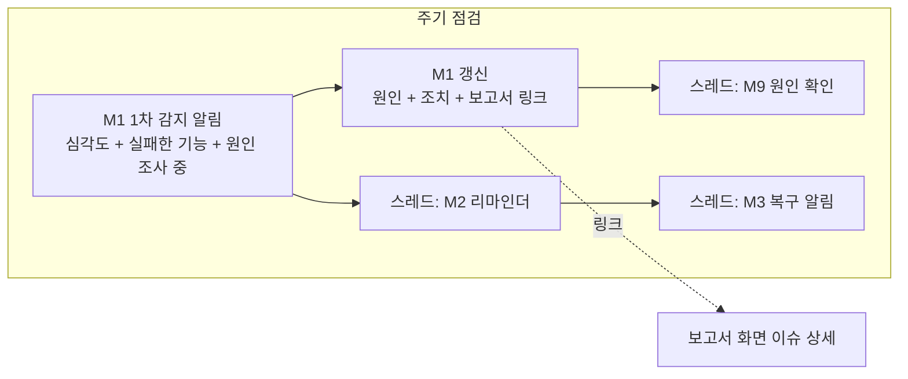

# KubeGuardian AI — UI 정의서

> 열린 항목: 후보 규칙 이름(N02·N03·P01·P02·P04·P05·P08·P09·C02·C03·C04), H01·H02 배치.


> [기획서](01-project-proposal.md) v3.2 기준. 운영자는 **Slack**(알림)과 **보고서 화면**(점검 이력·이슈·보고서·근거·점검 과정 조회, 점검 실행)을 쓰고, CLI는 개발자·운영자가 쓰는 도구이고 평가 러너도 이것을 호출한다.
> 사용 흐름은 [시나리오 수립](산출물/03-시나리오수립.md)을 참고한다.
> 화면의 시각 디자인(레이아웃 치수·색·컴포넌트·목업 예시)은 [UI 디자인](04-1-ui-design.md)에 있다.

## 0. 원칙

- **알림은 Slack, 확인과 처리는 화면.** 운영자는 알림을 받으면 업무 노트북에서 처리하므로, Slack은 짧은 알림만 맡고 전체 보고서·근거 원문·점검 이력·조사 과정은 보고서 화면에서 본다. 알림에는 요약과 링크만 담는다.
- **이슈 하나 = 스레드 하나.** 채널에는 짧은 메시지 하나만 올리고, 진행 상황·리마인더·복구 알림은 모두 그 메시지의 스레드 답글로 단다. 채널이 도배되지 않게 한다.
- **정상이면 조용하다.** 주기 점검이 정상이면 아무것도 보내지 않는다. 같은 이슈가 계속되는 동안에는 심각도별 리마인더 정책에 따라서만 다시 알린다.
- **심각도에 따라 알린다.** 긴급·주의만 알리고, 잠재 위험·개선 권고는 알림 없이 화면에만 표시한다.
- **보고서 하나로 판단이 끝나야 한다.** 원인, 근거, 배제한 가설과 이유, 확인한 범위, 구체적인 조치, 재검증 방법을 한 번에 보여준다. 누적된 이력에 대한 질문은 질의 채팅(§6.7)으로 하되, 저장된 이력만 읽는다. 새 조사가 필요한 질문은 `kg investigate`(CLI)나 `지금 점검`으로 안내한다.
- **사실에는 근거 번호를 붙인다.** `[근거 14]`처럼 표시하고, 원문은 보고서 화면의 근거 보기에서 연다.
- **용어를 하나로 쓴다.** **점검**은 5분마다(또는 직접) 남는 관측 기록, **점검 규칙**(줄여서 규칙)은 점검이 보는 항목, **기능 점검**은 등록한 API 흐름(`api_scenarios`)을 실제로 불러 보는 점검, **이슈**는 장애 신호·기능 점검 실패가 이어지는 동안 하나로 묶이는 단위(열림·해결), **문제**는 보고서 안의 선별 항목(최대 3건)이다. 보고서와 알림은 이슈에 딸린 기록이다. 코드에서 이슈는 `incident`로 부른다.
- **한 축에 어휘 하나.** 심각도, 점검 상태, 조사 상태, 이슈 상태, 점검 규칙 판정은 서로 다른 축이다. 한 배지 모양에 두 축의 뜻을 싣지 않는다 (§1.3).
- **점검 구성은 정의만, 점검 이력·상세는 결과만.** 점검 구성 화면에는 "무엇을 점검하는가"(정의)만 두고 마지막 결과·상태 열을 두지 않는다. 결과는 점검 이력과 점검 상세에서 본다. 구성 화면의 상세에서는 "최근 적발 점검" 링크로 결과 쪽으로 건너간다.
- **점검 상세는 본 것, 이슈 상세는 결론.** 점검 상세는 "그 점검에서 무엇을 보았나"(판정·점검 과정·근거)만 보여 주고, 결론·권장 조치·보고서 본문은 이슈 상세에 둔다 (§6.4).
- **상태 대시보드가 아니다.** 화면은 점검 시점에 고정된 판정 근거를 보여주고 점검을 실행하며 저장된 이력에 답할 뿐, 실시간 상태 조회·리소스 탐색·로그 검색·배포 기능은 없다 (§6).

### 0.1 화면의 층

| 층 | 대상 | 용도 |
|---|---|---|
| **Slack** | 운영자 | 심각도별 이슈 알림, 리마인더, 복구 알림, 점검 중단 알림. 명령은 받지 않는다 (10/31, 확장 후보) |
| **보고서 화면** | 운영자, 개발자 | 점검 이력·상세, 이슈 상세(보고서 포함), 근거 원문, 점검 과정, 점검 구성, 점검 실행, 이력 질의 채팅. 개발 중에는 점검 상세의 점검 과정으로 에이전트 동작을 확인한다 |
| CLI | 개발자, 운영자 | 증상 입력 조사(`kg investigate 증상`)와 즉시 점검(`kg check`). 개발·평가 러너에서도 쓴다 |
| 실행 추적 (Phoenix) | 개발자 | 프롬프트·LLM 입출력·토큰 추적. 점검 상세의 점검 과정에서 링크로 이동 (설정이 있을 때만) |

별도 개발용 화면(Chainlit)은 두지 않는다. 에이전트가 무엇을 했는지는 보고서 화면의 점검 과정(§6.4)과 Phoenix로 보고, 같은 데이터를 두 화면에서 보여주는 중복을 피한다.

## 1. Slack 구성

### 1.1 알림 대상과 앱

| 항목 | 결정 |
|---|---|
| 알림 대상 | 기존 운영 채널(예: `#pr-service-ops`) 또는 DM에서 시작한다. 알림량·수신자가 늘면 전용 채널을 만든다 (필수 아님). 설정(`slack.alert_target`)에는 채널 ID를 쓴다 (`chat.update`가 이름을 받지 않는다) |
| 평가 중 | 평가 러너는 Slack 전송을 생략(dry-run)하고 알림 이력에 발송 예정 시각·내용만 기록한다. 평가용 채널은 두지 않는다 |
| Slack 앱 권한 | `chat:write`(메시지 발송)만. 봇 토큰 하나로 보낸다 |
| 명령 | 받지 않는다 (10/31). 슬래시 명령·Socket Mode 수신은 확장 후보로 두고, 설계는 M4~M6·M8·§3에 남긴다 |

### 1.2 메시지 종류

| ID | 메시지 | 위치 | 언제 |
|---|---|---|---|
| M1 | 이슈 알림 (1차 감지 → 원인 갱신) | 알림 대상 (부모 메시지) | 주기 점검에서 긴급·주의 새 이슈를 판정한 **직후, AI 조사를 기다리지 않고** 1차 감지 알림을 보낸다. 조사가 끝나면 같은 메시지를 원인으로 갱신한다. 문제 지문이 바뀌면 같은 이슈에서 재조사하고 갱신 |
| M2 | 리마인더 | M1의 스레드 | 같은 이슈가 미해결이고 재알림 시점이 됐을 때 |
| M3 | 복구 알림 | M1의 스레드 + 채널에도 표시 | 열린 이슈가 해결됐을 때. 주기 점검뿐 아니라 직접 점검(화면·CLI)에서 해결돼도 바로 보낸다 (§6.5) |
| M4 | (확장 후보) 명령 접수 | 명령을 입력한 곳 (부모 메시지) | `/kg check`, `/kg investigate`를 받았을 때 |
| M5 | (확장 후보) 조사 계획 | M4의 스레드 | `/kg investigate` 조사 시작 직후 |
| M6 | (확장 후보) 점검 결과 요약 | M4의 스레드 | `/kg check` 또는 `/kg investigate`가 끝났을 때 (요약 + 보고서 링크) |
| M7 | 점검 중단 알림 | 알림 대상 | 점검이 예정 시각을 크게 넘겨 실행되지 않을 때 |
| M10 | 점검 일부를 확인하지 못함 | 알림 대상 | 같은 항목을 연속으로 확인하지 못해 점검을 믿기 어려울 때 (연속 n회, 처음 1회) (#85) |
| M8 | (확장 후보) 오류·거절 | 본인에게만 보임 (ephemeral) | 권한 없음, 잘못된 입력, 조사 실패 |
| M9 | 원인 확인 답글 | M1의 스레드 | AI 조사가 끝나 M1을 갱신했을 때. 메시지 갱신만으로는 알림이 울리지 않으므로 답글로 다시 알린다 |

전체 보고서와 근거 원문은 Slack 메시지가 아니라 보고서 화면(§6)에서 본다. 메시지별 링크 목적지는 아래와 같다.

| 메시지 | 링크 |
|---|---|
| M1 1차 감지, M1 원인 갱신, M9 원인 확인 | `/p/{p}/issues/{id}` (이슈 상세. 1차 때는 보고서 자리에 진행 표시가 보이고, 조사가 끝나면 같은 페이지에 결론이 나타난다) |
| M2 리마인더, M3 복구 | `/p/{p}/issues/{id}` |
| M6 (확장 후보) | `/p/{p}/issues/{id}` (이슈 상세) |
| M7 점검 중단 | `/p/{p}/checks` |
| M10 점검 일부를 확인하지 못함 | `/p/{p}/checks/{run}#s-judge` (가장 최근 점검 상세의 판정 절) |



### 1.3 상태 어휘

상태는 축마다 어휘를 하나만 쓴다. 한 배지에 두 축의 뜻을 싣지 않는다. "이상"은 점검 결과의 값으로 쓰지 않는다. 점검은 이슈를 열었거나(이슈 열림·이어짐·해결) 아니거나(이상 없음)로만 말한다.

| 축 | 붙는 곳 | 값 | 표시 |
|---|---|---|---|
| 심각도 | 이슈, 점검 행(그 점검이 연·이어 간 이슈의 것), 보고서 | 🔴 긴급 · 🟠 주의 · 🟡 잠재 위험 · ⚪ 개선 권고 (이슈가 없으면 이상 없음) | 주 배지. 1차와 최종이 다르면 `1차 주의 → 잠재 위험` |
| 이슈 상태 | 이슈 | 열림 · 해결 | `OPEN` 테두리 배지 / `✓ 해결 14:45` |
| 점검 상태 | 점검 | 진행 중 · 완료 · 일부 확인하지 못함 · 중단 | 보조 표시(작은 글자·아이콘). 심각도 색을 쓰지 않는다 |
| 조사 상태 | 점검의 조사 | 조사 중 · 완료 · 조사 미완(상한) · 조사 실패 | 보조 표시 |
| 점검 규칙 판정 | 점검 규칙 × 대상 (점검 상세 안) | 적발 · 관찰 중 · 통과 · 확인하지 못함 | 칩 |

| 심각도 | 뜻 | 알림 |
|---|---|---|
| 긴급 | 지금 실패하는 사용자가 있고 **전부** — 핵심 경로 장애(채팅·로그인 등 주요 기능이 전부 실패) | 즉시 + 리마인더 |
| 주의 | 지금 실패하는 사용자가 있고 **일부** — 일부 요청·일부 기능만 실패 | 즉시 + 리마인더 |
| 잠재 위험 | 실패하는 사용자는 없지만 **깨진 것이 있음** — 곧 문제가 될 수 있음 | 없음 (화면에만) |
| 개선 권고 | 깨진 것 없이 **관례상 위험** — 지금 장애와 무관 | 없음 (화면에만) |

- 심각도 값은 두 번 정해진다. 1차(점검 규칙·조사 판단)는 긴급·주의·참고(`critical`·`warning`·`info`) 3값이고, 조사 뒤의 **최종 심각도**는 보고서 영향 등급(`impact`) 4값으로 이슈에 저장한다. 잠재 위험은 조사 뒤에만 나온다.
- 이슈는 장애 신호나 기능 점검 실패로 조사를 시작하는 경우(조사 판단 "조사 시작")에만 열린다. 개선 권고만 나온 점검은 이슈를 열지 않고 이상 없음으로 보이며, 개선 권고는 보고서 안의 참고 항목과 점검 행의 `권고 n`으로만 보인다.
- 진행 표시: 🔍 점검·조사 진행 중, ⚠️ 조사 미완 또는 점검 중단(점검 중단은 M7), ✅ 복구됨(복구 알림 1회), ⏰ 리마인더. 이 표시는 Slack 메시지용이고, 화면에서는 위 축별 표시를 쓴다.

### 1.4 재알림 정책

| 심각도 | 알림 | 재알림 |
|---|---|---|
| 긴급 | 즉시 | 미해결 시 30분 후 첫 리마인더, 이후 2시간마다, 리마인더는 총 3회까지 |
| 주의 | 즉시 | 2시간 후 1회 |
| 잠재 위험·개선 권고 | 없음 | 없음 (보고서 화면에만 표시) |

- 리마인더 시각은 1차 감지 알림을 보낸 시각부터 센다. 리마인더는 기존 알림(M1)의 스레드에 "N분째 미해결" 한 줄(M2)만 달고, AI를 다시 호출하지 않는다.
- 문제 지문이 바뀌면(원인 변경, 새 신호 추가) 같은 이슈에서 재조사하고 M1을 갱신한다. 보고서가 하나 더 붙는다. 영향받는 기능이 다르면 새 이슈를 연다.
- 해결되면 M3을 1회 보내고 리마인더를 멈춘다. 해결은 주기 점검이든 직접 점검이든 그 이슈의 점검 규칙·기능 점검을 모두 확인한 점검 1회에서 지문이 사라졌을 때다.
- 확인(ack) 시 리마인더를 멈추는 기능은 옵션이며 이번 범위에서는 만들지 않는다.

## 2. 메시지 정의

### M1 — 이슈 알림 (1차 감지 → 원인 갱신)

알림은 AI 조사를 기다리지 않는다. 이슈를 열면 먼저 1차 감지 알림을 보내고, 조사가 끝나면 **같은 메시지**를 원인으로 갱신한다(`chat.update`, 권한은 `chat:write`에 포함).

1차 감지 알림 (이슈를 연 직후):

```text
🔴 긴급 [KubeGuardian] dev — 채팅이 실패하고 있습니다
감지: 14:05 점검 · 로그인 성공, 채팅 단계 실패 (점검 규칙은 모두 통과)
🔍 원인을 조사하고 있습니다. 조사가 끝나면 이 메시지를 갱신합니다.
이슈: <이슈 상세 링크>
```

원인 갱신 (조사 완료 후, 같은 메시지):

```text
🔴 긴급 [KubeGuardian] dev — 채팅이 실패하고 있습니다 (판단 확정)
원인: llm-gateway LLM 할당량 소진 (오늘 사용량 100%)
영향: 채팅·보도자료 초안 생성 전체
조치: llm-gateway 관리 화면에서 할당량 상향 또는 초기화
감지: 14:05 점검 · 수집된 신호 47개 중 중요 문제 1건
이슈: <이슈 상세 링크>
```

| 필드 | 내용 |
|---|---|
| 제목 | 상태 표시 + 심각도 + 네임스페이스 + 1순위 문제 한 줄 + 판단 수준 (1차 알림에는 없음) |
| 판단 | 판단 수준(확정·후보·추정, 코드가 정함, 기획서 §6.5)과 그 근거, 다음 행동 한 줄 (확정: 조치를 바로 실행해도 됨 / 후보: 조치 전에 근거 확인 / 추정: 직접 확인 필요. 조사 미완이면 확정이어도 확인 범위를 보고 조치). 판정되지 않은 보고서는 후보처럼 다룬다. LLM 확신도는 보이지 않는다 |
| 1차 알림 본문 | 감지 시각, 실패한 기능·규칙, "원인 조사 중", 이슈 상세 링크 |
| 조사가 끝나지 못한 경우 | 상한 도달이면 제목 앞에 `⚠️ 조사 미완`, LLM 오류면 `⚠️ 조사 실패`를 붙이고 점검 규칙·기능 점검 결과만 담는다 |
| 원인 · 영향 · 조치 | 보고서의 결론·영향 범위·권장 조치 1순위를 각 한 줄로 |
| 감지 | 감지한 점검 시각, 원시 신호 수 → 중요 문제 수 |
| 보고서 | 이슈 상세 링크 (보고서가 보인다). 전체 보고서는 Slack에 붙이지 않는다 |
| 중요 문제가 2건 이상 | 제목은 1순위, 본문 아래에 "그 밖의 중요 문제: 🟠 …" 한 줄씩 (최대 2건) |

### M9 — 원인 확인 답글

```text
원인을 확인했습니다: llm-gateway LLM 할당량 소진 (판단 확정). 위 메시지에 조치와 보고서 링크를 갱신했습니다.
```

- M1 갱신과 함께 M1의 스레드에 단다. 조사 미완·실패여도 결과를 알리는 답글을 단다.

### M2 — 리마인더

```text
⏰ 🔴 긴급 [KubeGuardian] dev — 채팅 실패가 30분째 이어지고 있습니다 (14:35 기준)
이슈: <이슈 상세 링크>
```

- M1의 스레드에 답글로 단다. 재알림 정책(§1.4)에 따라서만 보낸다.

### M3 — 복구 알림

```text
✅ [KubeGuardian] dev — 채팅이 정상으로 돌아왔습니다 (14:45 점검, 장애 지속 약 40분)
이슈: <이슈 상세 링크>
```

- M1의 스레드에 답글로 달고, "채널에도 보내기" 옵션으로 채널에서도 보이게 한다.
- 링크는 이슈 상세다. 직접 점검(화면·CLI)에서 이슈가 사라졌을 때도 같은 복구 알림을 그 자리에서 보낸다 (§6.5).

### M4 — 명령 접수 (확장 후보)

> 10/31 결정으로 Slack 명령은 이번 범위에서 만들지 않는다(#96). M4·M5·M6·M8과 §3은 확장 때 쓸 설계로 남긴다.

```text
🔍 [KubeGuardian] 조사를 시작합니다 — 요청: @운영자
증상: "초안 생성이 세 번에 한 번꼴로 실패한다는 문의가 들어왔어요"
```

```text
🔍 [KubeGuardian] dev 점검을 시작합니다 — 요청: @운영자
```

- 명령을 받으면 3초 안에 접수해야 하므로, 이 메시지를 먼저 올리고 점검·조사는 비동기로 진행한다.

### M5 — 조사 계획 (확장 후보)

```text
조사 계획: ① 먼저 확인할 사실 — 채팅 API 반복 호출 결과, agent Pod 상태·Endpoint 연결.
② 확인된 사실을 바탕으로 원인 가설을 세워 Pod별 직접 호출과 로그로 검증합니다.
```

- 조사가 진행 중임을 알리는 용도다. 결과(M6)가 나오기 전에 한 번만 올린다. 가설은 사전 확인이 끝난 뒤 세우므로 계획에는 확인할 사실과 방법을 먼저 적는다.

### M6 — 점검 결과 요약 (`/kg check`, `/kg investigate`, 확장 후보)

```text
점검 규칙: 장애 1건, 개선 권고 3건 / 기능 점검: 채팅 API 실패
지금 중요한 것 1건 (수집된 신호 47개 중)
 1. 🔴 긴급 — 채팅이 전부 실패합니다 (판단: 확정)
    agent Service의 대상 Pod 조건이 app=agnet으로 되어 있어 Endpoint가 비어 있습니다(연결된 Pod 0개) [근거 4].
    조치: Service의 대상 Pod 조건을 app=agent로 수정
참고 — 개선 권고 3건 (지금 장애와 무관)
전체 보고서: <이슈 상세 링크>
```

- 수동 실행 결과는 심각도와 관계없이 요청자에게 항상 보여준다.
- 정상이면: `✅ 이상 없음 — 점검 규칙 통과, 기능 점검 이상 없음. 개선 권고 3건` 한 줄만 보내고 AI는 호출하지 않는다. 점검 결과는 화면의 점검 이력에서도 볼 수 있다.
- 같은 이슈가 이미 알림 대상에 열려 있으면 요약 끝에 "이미 14:05에 알린 문제입니다 (알림 링크)"를 붙인다.
- 조사가 상한에 도달했으면 `⚠️ 조사 미완`을 앞에 붙인다.

### M7 — 점검 중단 알림

```text
⚠️ [KubeGuardian] dev — 점검이 15분째 실행되지 않았습니다 (마지막 정상 점검 14:05)
점검 이력: <점검 이력 링크>
```

- 점검이 조용히 멈추면 "이상 없음"으로 오인하기 때문에 별도로 알린다.

### M10 — 점검 일부를 확인하지 못함

```text
⚠️ [KubeGuardian] dev — 점검 일부를 확인하지 못했습니다 (연속 3회)
기능 점검 chat이 부르는 대상을 클러스터에서 찾지 못해 이 기능을 확인하지 못했습니다.
점검 상세: <가장 최근 점검 상세 판정 절 링크>
```

- 같은 항목은 처음 1회만 알리고, 연속 횟수는 점검 상세에서 확인한다 (#85).
- 이유와 수정 제안은 Slack이 아니라 링크의 점검 상세 **판정 절**에 있다. 점검은 확인하지 못한 항목만 빼고 계속 돌며, 점검 과정은 그대로 남는다. 수정 제안은 설정의 대상을 클러스터 리소스와 비교할 수 있을 때만 붙고, 비교할 수 없으면 이유만 보인다. 대상 API 문서와의 비교는 하지 않는다.
- 옛 "설정 확인 필요" 상태와 `/p/{p}/setup#health` 주소는 없앴다.

### M8 — 오류·거절 (확장 후보)

| 상황 | 메시지 |
|---|---|
| 허용되지 않은 채널 | 이 채널에서는 KubeGuardian 명령을 쓸 수 없습니다. 허용된 채널(#pr-service-ops)에서 실행해 주세요. |
| 허용되지 않은 사용자 | KubeGuardian 명령 권한이 없습니다. 관리자에게 요청해 주세요. |
| 증상이 비어 있음 | 증상을 함께 적어 주세요. 예) `/kg investigate 로그인이 안 돼요` |
| 이미 조사 중 | 진행 중인 조사가 있습니다 (스레드 링크). 끝난 뒤 다시 요청해 주세요. |
| 조사 실패 (LLM 연결 오류 등) | 조사 중 오류가 발생했습니다: Azure OpenAI 응답 없음. 점검 규칙 결과만 아래에 첨부합니다. |
| 수집 일부 실패 | 일부 항목을 확인하지 못했습니다 (Kubernetes API 응답 없음). 확인한 결과만 표시합니다. |

## 3. Slack 명령 (확장 후보)

> 이번 범위에서 만들지 않는다 (10/31, #96). 즉시 점검은 화면의 지금 점검(§6.5)과 CLI `kg check`, 증상 입력 조사는 CLI `kg investigate 증상`으로 한다.

| 명령 | 동작 | 결과 위치 |
|---|---|---|
| `/kg check` | 주기 점검과 같은 점검을 즉시 실행 | M4 → 스레드에 M6 (보고서 링크) |
| `/kg investigate <증상>` | 입력한 증상을 조사 시작으로 처리 (점검 규칙 결과와 관계없이 AI 조사) | M4 → 스레드에 M5, M6 (보고서 링크) |
| `/kg help` | 명령 사용법 | 본인만 |

| 규칙 | 내용 |
|---|---|
| 접수 응답 | Slack은 3초 안에 응답을 요구하므로 즉시 접수하고 실행은 비동기 |
| 실행 권한 | 허용 채널·허용 사용자만 |
| 동시 실행 | 같은 사용자의 조사는 1건씩. 진행 중이면 M8로 안내. 점검은 주기 점검·화면 실행·CLI를 통틀어 동시에 1건 (§6.5) |
| 입력 | 증상은 500자 이내. LLM에 보내기 전에 마스킹 적용 |
| 클러스터 변경 | 어떤 명령도 클러스터를 바꾸지 않음 (도구가 모두 조회 전용) |

근거 원문은 슬래시 명령이 아니라 보고서 화면의 근거 서랍에서 연다.

## 4. 공통 규칙

| 항목 | 규칙 |
|---|---|
| 언어 | 한국어 |
| 시각 | KST, `HH:MM` (날짜가 다르면 `MM-DD HH:MM`) |
| 근거 표기 | `[근거 N]`. 여러 개면 `[근거 14, 15]`, 연속이면 `[근거 22~25]`. 화면에서는 클릭해 원문을 연다 |
| 추정 표기 | 근거 없는 문장 끝에 _(추정)_ |
| 마스킹 | Slack과 보고서 화면에 표시하는 모든 내용(알림, 보고서, 근거 원문)에 도구 출력과 같은 마스킹 적용 |
| 길이 | Slack 알림은 한 메시지 안에서 끝나는 요약만 담는다. 길이가 필요한 내용은 화면에서 본다 |
| 메시지 ID 저장 | 부모 메시지의 채널·`ts`를 알림 이력에 저장해 리마인더·복구 알림을 스레드에 단다 |

## 5. CLI

| 명령 | 내용 |
|---|---|
| `kg check [--config <kubeguardian.yaml>] [--db <SQLite>] [--trigger check\|schedule]` | 규칙 점검을 한 번 실행하고 결과를 터미널에 출력. `--trigger schedule`은 CronJob이 쓰며, 다른 점검이 진행 중이면 실패하지 않고 건너뜀 |
| `kg investigate ["<증상>"] [--config] [--db] [--trigger investigate\|schedule]` | 점검 뒤 조사 게이트가 열리면 조사 에이전트 실행. 증상(최대 500자)을 주면 증상 조사. 조사 단계를 터미널에 출력 |
| `kg ask "<질문>" [--conversation <대화 ID>] [--config] [--db]` | 저장된 점검·이슈·알림 이력에 질문 (질의 채팅과 같은 에이전트, 질문 최대 500자) |
| `kg worker [--once] [--config] [--db]` | 조사 대기 이슈를 집어 조사하고 점검 중단을 감시 (diagnostic-agent 작업자). `--once`는 한 번만 처리 |
| `kg slack-test [--config] [--db]` | Slack 알림이 실제로 가는지 테스트 메시지로 확인 |

보고서·근거·알림 이력은 CLI가 아니라 보고서 화면(§6)에서 본다.

평가 러너는 CLI를 호출한다. 평가 중 알림은 전송 없이 알림 이력에만 기록한다.

## 6. 보고서 화면

diagnostic-agent의 FastAPI가 **서버 렌더링 HTML**(Jinja2 템플릿 + HTMX)로 제공한다. React 같은 별도 프론트 프로젝트는 두지 않는다. Slack 알림의 링크로 들어오거나 직접 연다. 데이터는 SQLite의 점검 이력·이슈·보고서·근거·조사 단계·알림 이력이며, 표시 내용에 같은 마스킹을 적용한다.

화면에서 할 수 있는 조작은 **점검 실행**, **이력 질문**(질의 채팅), **규칙 선택**(점검할 규칙 고르기, §6.4) 셋이다. 점검도 조회 전용 도구만 쓰고, 질의 채팅은 저장된 이력만 읽고, 규칙 선택은 점검 대상만 정하므로 화면에서 클러스터를 바꿀 수는 없다.

이 절은 "무엇을 어디에 어떤 순서로 보여 주는가"를 정한다. 색·글꼴·컴포넌트 모양은 [UI 디자인](04-1-ui-design.md)이 정한다.

### 6.1 정보 구조와 용어

```text
프로젝트 (클러스터 + 네임스페이스. 지금은 하나, 선택 화면 없음)
├─ 점검 (5분 주기·직접 실행·CLI)         ← "본 것"
│   ├─ 점검 판정 (점검 규칙 × 대상: 적발·관찰 중·통과·확인하지 못함 / 기능 점검: 성공·실패·확인하지 못함)
│   ├─ 점검 과정 (항상 있음)
│   │    ├─ 점검: 점검 규칙 점검 → 기능 점검 → 조사 판단
│   │    └─ 조사 (조사 판단이 "조사 시작"일 때만 붙음: 사전 확인 → 계획 → 가설 검증 → 멈춤 검사)
│   └─ 근거 ev-N (모든 사실의 원문)
├─ 이슈 (점검 여러 개에 걸침: 열림 → 해결, 1차 → 최종 심각도)   ← "결론"
│   ├─ 보고서 (조사 1회마다 1개). 이슈 상세 본문의 중심
│   └─ 알림 이력 (최초 감지·원인 갱신·리마인더·복구, 보낸 본문) = 타임라인
└─ 점검 구성: 대상 서비스 · 점검 규칙 · 기능 점검의 정의 (결과 없음)
```

**조사 판단** (옛 "게이트"). 점검 규칙과 기능 점검 결과를 보고 조사를 시작할지 정한다. 화면에는 경로 A/B/C 대신 아래 말을 쓴다. (코드·[점검 규칙 문서](05-rules.md)의 경로 A/B/C는 그대로 둔다.)

| 화면 표기 | 뜻 | 이슈 |
|---|---|---|
| 조사 시작 — 장애 신호 | 점검 규칙이 장애 신호를 적발 | 열림·이어짐 |
| 조사 시작 — 기능 점검 실패 | 기능 점검이 실패 | 열림·이어짐 |
| 조사 안 함 — 장애 신호 없음 | 모두 정상 (개선 권고만 있을 수 있음) | 열린 이슈의 지문이 사라졌으면 해결 |

- 점검과 이슈는 **다대다**다. 한 점검이 여러 이슈를 열고·잇고·해결할 수 있고, 한 이슈는 여러 점검에 걸친다.
- 점검 행마다 이슈와의 관계를 하나로 표시한다: **이슈 열림 / 이슈 이어짐 / 이슈 해결 / 관계없음(이상 없음)**. 여러 이슈와 얽히면 가장 높은 심각도의 이슈를 보이고 나머지는 `+n`으로 줄인다.
- 이슈는 조사 판단이 "조사 시작"일 때만 열린다. **개선 권고만 나온 점검은 이슈를 열지 않고** '이상 없음'으로 보이며, 행에 작은 숫자(`권고 6`)만 붙는다.
- 보고서는 **이슈에 딸린다.** 저장할 때 `incident_id`와 조사한 점검의 `run_id`를 모두 둔다 (화면은 이슈 상세에서 보고서를 보여 주고, 어느 점검에서 나왔는지 링크한다).
- **확인하지 못함.** 점검 규칙이나 기능 점검을 실행하지 못했거나 설정 때문에 판단하지 못한 항목이다. 점검은 그 항목만 빼고 계속되고, 점검 과정은 그대로 남는다 (옛 "설정 상태/설정 확인 필요"를 대체).
- 코드에서 이슈는 `incident`로 부른다. 보고서 모델의 `Issue`(선별 항목)와 겹치지 않게 하려는 것이다.

### 6.2 전체 레이아웃

```text
┌────┬───────────────────────────────────────────────────────────────────────────┐
│ KG │ GNB  dev · minikube │ 마지막 점검 14:05 · 다음 14:10 │ [지금 점검] │ 채팅 │ 사용자 │
├────┼───────────────────────────────────────────────────────────────────────────┤
│ ▤  │ 상단 띠: 열린 이슈 🔴 1 · 🟠 0   │  ⚠ 확인하지 못함 1                        │
│ ◎  ├───────────────────────────────────────────────────────────────────────────┤
│ ⚙︎  │ 헤더: 제목 · 빵부스러기 (dev > 점검 이력 > 10/26 14:05)                      │
│    │ 절 바로가기(상세에서만)                                                       │
│    │ 본문: 목록 | 상세(오른쪽 패널, 넓은 화면) — 좁으면 상세가 전체 화면              │
└────┴───────────────────────────────────────────────────────────────────────────┘
 레일: ▤ 점검 이력 · ◎ 이슈 · ⚙︎ 점검 구성
```

| 영역 | 내용 |
|---|---|
| GNB | **전역 정보만** 둔다: 로고, 프로젝트 표시(지금은 고정 값, 누를 수 없음), 마지막·다음 점검 시각(점검이 멈췄으면 경고), **지금 점검** 버튼(§6.5), 이력 질의 채팅 버튼(§6.7), 사용자 자리. 이동 탭은 두지 않는다 |
| 레일(LNB) | 약 56px 아이콘 + 마우스를 올리면 이름. **점검 이력**(홈) · **이슈** · **점검 구성** 세 개. 현재 위치를 강조하고, 펼치기 버튼으로 이름까지 보이게 넓힐 수 있다 |
| 상단 띠 | 열린 이슈 수(심각도별, 누르면 이슈 목록 필터), **확인하지 못함 n**(가장 최근 점검에서 확인하지 못한 항목 수. 누르면 그 점검 상세의 판정 절로 이동. 0이면 숨김). 레일 아이콘에는 점을 달지 않는다 |
| 헤더 | 페이지 제목, 빵부스러기, 페이지 단위 행동 |
| 절 바로가기 | 상세 패널 위쪽에 한 줄(점검 상세: 판정 · 점검 과정 · 근거 / 이슈 상세: 결론·조치 · 근거 · 가설 판정 · 확인한 범위 · 타임라인 · 이전 보고서). 탭이 아니라 같은 페이지 안 이동이다 |
| 본문 | **목록-상세 분할**: 목록을 왼쪽에 남기고 상세를 오른쪽에 연다. 보던 목록·필터·스크롤이 그대로라 돌아오기가 필요 없다 |
| 개발 링크 | 평가 결과·Phoenix는 설정이 있을 때만 사용자 메뉴 안에 둔다. 운영에는 필요 없고, 점검에 `trace_id`만 저장한다 |

프로젝트 선택·로그인 화면은 그리지도 구현하지도 않는다. 대신 주소(`/p/{project}/...`)와 GNB·사용자 자리를 비워 둔다.

### 6.3 페이지와 주소

주소는 처음부터 프로젝트를 앞에 둔다. 지금 `{p}`는 설정의 대상 이름 하나(예: `dev`)다. 화면·Slack이 배포된 적이 없어 옛 주소(`/reports`, `/runs`, `/p/{p}/reports/{id}`, `/p/{p}/setup#health`)는 두지 않고 넘겨주기도 만들지 않는다. 보고서 단독 페이지는 없앴다 (이슈 상세가 보고서의 자리).

| 페이지 | 주소 | 내용 |
|---|---|---|
| **점검 이력** (홈) | `/p/{p}/checks` | 필터 막대 + 점검 목록 + (선택 시) 점검 상세 패널 |
| 점검 상세 | `/p/{p}/checks/{run}` | 탭 없는 한 페이지: 상태 머리 → 점검 판정 → 점검 과정 → 근거 (§6.4). 결론·조치는 이슈 상세로 링크 |
| 점검 단계 조각 | `GET /p/{p}/checks/{run}/steps` | 점검 과정 단계 목록 HTML 조각 (진행 중 폴링용) |
| **이슈** | `/p/{p}/issues` | 필터 막대(상태 열림·해결, 심각도, 기간) + 이슈 목록 + 상세 패널 |
| 이슈 상세 | `/p/{p}/issues/{id}` | 탭 없는 한 페이지: 상태 머리 → **보고서(결론·조치·근거·가설 판정·확인한 범위·개선 권고)** → 타임라인 → 이전 보고서 (§6.4). 특정 보고서는 `?report={rid}` |
| 근거 | 어디서든 `[근거 N]` → 오른쪽 서랍, 주소 `?ev=N` | 종류, 대상, 수집 시각, 출처, 마스킹된 원문 |
| **점검 구성** | `/p/{p}/setup/services`, `/setup/rules`, `/setup/features` | 탭 3개: 대상 서비스 · 점검 규칙 · 기능 점검 (§6.4). 점검 규칙은 `?view=stage\|kind`. 규칙 선택 저장은 `POST /p/{p}/setup/rules`. `/p/{p}/setup`은 `/setup/services`로 리다이렉트 |
| 질의 채팅 패널 | `GET /p/{p}/chat` (HTML 조각) | GNB 오른쪽 패널. 보던 맥락(선택한 점검·이슈, 필터)을 요청에 실어 보낸다 |
| 질문 | `POST /p/{p}/chat/messages` (HTML 조각) | 질문(`question`, 선택 맥락) → 답변 조각. 스트리밍 없음 |
| 점검 실행 | `POST /p/{p}/checks` | 새 점검을 시작하고 `/p/{p}/checks/{run}`으로 이동. 진행 중이면 409와 진행 중인 점검 링크 (§6.5) |
| 헬스 체크 | `GET /healthz` | Deployment readinessProbe (프로젝트와 무관) |
| `/` | 리다이렉트 | `/p/{p}/checks` |
| (나중) | `/login`, `/projects` | 그리지 않음 |

- 같은 데이터를 다른 클라이언트가 써야 하면 그때 `/api/v1/...` JSON 라우트를 추가한다 (이번 범위 밖). 질의 채팅 1단계의 `POST /api/v1/chat/messages`는 이미 있다.
- 화면 갱신이 필요한 부분만 HTMX가 HTML 조각을 받아 바꿔 끼운다. 진행 중인 점검의 점검 과정은 수 초마다 다시 받는다 (조사 단계마다 SQLite에 바로 기록한다).

### 6.4 페이지 구성

**점검 이력 (홈)**

필터는 주소 쿼리에 남겨 돌아와도 유지한다.

| 필터 | 값 | 쓸모 |
|---|---|---|
| 기간 | 최근 1시간 · 오늘 · 7일 · 직접 지정 | 언제부터 문제였나 |
| 심각도 | 긴급 · 주의 · 잠재 위험 · 개선 권고 · 이상 없음 (복수) | 급한 것만 보기 |
| 이슈 관계 | 이슈 열림 · 이어짐 · 해결 | 장애가 시작·끝난 지점 찾기 |
| 실행 방식 | 주기 · 직접(화면) · CLI | 배포 직후 직접 점검 찾기 |
| 점검 상태 | 일부 확인하지 못함 · 중단 | 점검 자체를 믿을 수 있나 |
| 검색어 | 서비스 이름, 점검 규칙 ID, 이슈 제목, 실패한 기능 | "gateway 관련만" |

```text
시각    │ 심각도 배지 │ 요약 (실패한 기능 또는 주요 신호)   │ 이슈 관계     │ 실행 │ 보조 상태
14:05   │ 🔴 긴급     │ 채팅 실패 · 기능 점검 chat 2단계    │ 이슈 열림 #12 │ 주기 │ 조사 중
14:10   │ 🔴 긴급     │ 채팅 실패                           │ 이어짐 #12    │ 주기 │
14:16   │ 이상 없음   │                                     │ 해결 #12      │ 직접 │
13:00~14:00  이상 없음 12회 (접힘)
```

- 주 분류는 이슈 심각도다. 점검 상태는 작은 글자·아이콘의 보조 표시로만 둔다.
- 연속된 이상 없음은 한 줄로 접는다 (5분 주기라 하루 288행). 개선 권고만 나온 점검도 이상 없음으로 접고 `권고 n`만 붙인다.
- 행을 누르면 오른쪽에 점검 상세가 열리고 목록·필터·스크롤은 그대로다.
- 점검이 멈춘 구간(예정 시각을 크게 넘긴 구간)은 행으로 표시한다.

**점검 상세 (탭 없이 한 페이지) — "그 점검에서 본 것"**

운영자의 흐름은 판정 → 점검 과정 → (이슈 상세의) 보고서로 이어진다. 점검 상세는 **본 것**만 보여 주고, 결론·권장 조치·보고서 본문은 이슈 상세에 둔다.

```text
① 상태 머리   🔴 긴급 (1차 🔴) · 판단: 확정 · [이슈 #12 열림 →] 링크 · OPEN · 10/26 14:05 주기 점검 · 완료 48초
              조사 중이면 "조사 중: 도구 호출 4/8", 끝났으면 "결론은 이슈 #12에서" 한 줄
              (결론·권장 조치는 여기 두지 않는다)
② 점검 판정   적발·관찰 중·확인하지 못함인 점검 규칙과 실패한 기능 점검만 펼친다. 통과 n건은 한 줄로 접힘
              확인하지 못함 항목은 이유를 여기 두고, 설정 대상을 클러스터 리소스와 비교할 수 있으면 수정 제안도 붙인다 (API 문서 비교는 하지 않음) (상단 띠 칩과 Slack M10의 도착점)
              조사 판단: "조사 시작 — 기능 점검 실패" / "조사 안 함 — 장애 신호 없음"
③ 점검 과정   항상 보인다 (§아래). 점검 규칙 점검 · 기능 점검 · 조사 판단,
              조사를 시작했으면 사전 확인 · 계획 · 도구 호출(가설 검증) · 보고서 검증이 이어 붙는다
④ 근거        본문의 [근거 N]을 누르면 오른쪽 서랍. 이 점검의 근거 전체 목록은 맨 아래 접힘
```

| 상황 | 점검 상세에서 펼쳐진 부분 |
|---|---|
| 조사 진행 중 (Slack 1차 알림 직후) | ① 진행 표시, ② 판정, ③ 점검 과정(조사 단계가 수 초마다 갱신). "도구 호출 4/8"의 분모는 문제당 예산이다. 조사 끝나면 결론은 이슈 상세에 나타난다 |
| 조사 끝남 | ① "이슈 #12에서 결론 보기", ② 적발 항목만, ③ 점검 과정(접힘) |
| 이상 없음 | ① "이상 없음", ② 통과 요약(접힘), ③ 점검 과정(점검 3단계만, 조사 판단 "조사 안 함") |
| 일부 확인하지 못함 | ② 판정에 확인하지 못함 항목·이유(비교할 수 있으면 수정 제안), ③ 점검 과정은 그대로 |

**점검 과정 (점검 상세의 ③)**

점검이 무엇을 했는지 전부 보이게 한다. 운영자는 결론을 믿어도 되는지 확인할 때, 개발자는 에이전트를 디버깅할 때 쓴다. 조사를 하지 않은 점검과 확인하지 못한 항목이 있는 점검에도 **점검 과정은 항상 있다.**

```text
점검 과정 — 14:10 점검 (주기)
점검
▸ 점검 규칙 점검  적발 0 · 관찰 중 0 · 개선 권고 3
▸ 기능 점검       채팅 API 점검 실패 [근거 10]
▸ 조사 판단       조사 시작 — 기능 점검 실패 · 1차 심각도 긴급 · 새 문제
조사 (조사 시작일 때만)     에이전트 investigator:v1 · 도구 9/20 · 48s/150s · 21k tokens
▾ 사전 확인       Pod 전체 Ready · Endpoint 정상 · 채팅 502 [근거 3, 12]
▸ 계획            1) 경로 구간 호출 2) llm-gateway 응답 3) 할당량
▾ 도구 호출 (가설 검증)
    query_app_api(llm-gateway, /api/v1/quota)  → [근거 15]   (원문 ▸)
    probe(agent, /health, via=pod, times=3)    → [근거 8]
▸ 가설 판정       ① 배제 · ② 지지 · ③ 배제
▸ 보고서·검증     근거 검증 통과 · 추정 0문장
                                                        Phoenix 추적 열기 ↗ (설정이 있을 때만)
```

| 기능 | 내용 |
|---|---|
| 단계 표시 | 위 단계를 접이식으로 표시. 단계마다 시작·종료 시각, 소요 시간 |
| 도구 호출 | 호출 인자, 요약 결과, 근거 번호. 근거 번호를 누르면 근거 서랍 |
| 진행 중 갱신 | 점검이 진행 중이면 HTMX로 수 초마다 단계 목록을 다시 받아온다 |
| 완료 뒤 접힘 | 점검 상세에서는 "점검 과정"이 접혀 있고, 펼치면 위 전체가 보인다 |
| 보여주지 않는 것 | 프롬프트 원문과 LLM 응답 원문은 화면에 두지 않고 Phoenix에서 본다 |

**이슈 상세 (탭 없이 한 페이지) — "결론과 보고서"**

보고서가 중심이다. 위에서 아래로 읽으면 판단이 끝난다.

```text
① 상태 머리   🔴 긴급 (1차 🟠) · OPEN · 판단: 확정 · 제목(최신 보고서 1순위 문제, 없으면 실패한 기능·주요 신호)
              판단 근거(예: 원인 리소스 설정 인용 · 근거 출처 3종(설정·상태, 로그, 앱 API))와 다음 행동 한 줄
              영향 기능 · 최초 감지 14:05 · 지속 25분 (해결이면 "14:05~14:45, 40분")
② 보고서      최신 보고서 R-0412 (14:12 · 점검 10/26 14:05에서 나옴 → 점검 상세 링크)
              결론
              문제 n건 (최대 3, 순위순: 심각도 · 판단 수준 · 근거 번호)
              권장 조치 (자동 실행하지 않음) · 재검증 방법
              근거: 사전 확인(가설 없이 확인한 사실) / 가설 검증 — 각 [근거 N]
              가설 판정 (지지 / 배제 / 판단 보류 + 이유 + 근거)
              확인한 범위 (구동·설정·연결·로그·조사 도구: 확인함 / 확인하지 못함 / 해당 없음 + 사유)
              개선 권고 (지금 장애와 무관, 참고)
              푸터: 에이전트 · 모델 · 조사 시간·도구 호출·토큰 · 참고한 지침 · 점검 과정 보기 ▸(점검 상세로 이동)
              조사 중이면 결론 자리에 "원인을 조사하고 있습니다 · 도구 호출 4/8" 진행 표시
③ 타임라인    시각순: 이슈를 연 점검 → Slack 1차 알림(보낸 본문 펼침) → 조사 완료·원인 갱신 알림
              → 리마인더 → (지문 변경·재조사) → 해결한 점검 → 복구 알림
              사이의 "이어짐" 점검은 "이어짐 n회"로 접힘. 점검 항목을 누르면 점검 상세
④ 이전 보고서 지문이 바뀌어 재조사했으면 이전 보고서가 접혀 쌓임 (최신이 위)
```

- 보고서 본문은 위 ②에 들어 있고 별도 페이지가 없다. 보고서 형식:

```text
[조사 보고서] 채팅 실패 — llm-gateway 할당량 소진          🔴 긴급 · 판단: 확정
              (원인 리소스 설정 인용 · 근거 출처 3종(설정·상태, 로그, 앱 API))

■ 결론
■ 문제 (최대 3, 순위순)
■ 권장 조치 (자동 실행하지 않음) · 재검증 방법
■ 근거  사전 확인 [근거 N] / 가설 검증 [근거 N]
■ 가설 판정            (지지 / 배제 / 판단 보류 + 이유)
■ 확인한 범위          구동·설정·연결·로그·조사 도구
■ 참고 — 개선 권고 (지금 장애와 무관)
───
조사 48초 · 도구 호출 9회 · 2.1만 토큰 · 모델 gpt-6.1-sol · 참고한 지침: app-layer-failure.md · 점검 과정 보기 ▸
```

- 근거가 없는 문장은 끝에 _(추정)_ 을 붙인다 (근거 검증기 결과).
- 상한에 도달했으면 제목 앞에 `⚠️ 조사 미완`을 붙이고, "확인하지 못함"에 남은 가설을 적는다.
- 리마인더·복구·1차 알림의 링크가 여기로 온다 (§1).
- 해결된 이슈도 같은 구성이다. ① 상태가 `✓ 해결 14:45`로 바뀌고 보고서 제목 옆에 "해결됨"이 붙는다.
- 알림 이력(타임라인)에는 실제로 보낸 메시지와 dry-run으로 기록만 한 메시지(평가 중, Slack 승인 전)를 모두 보여준다.
- 전체 예시는 [시나리오 수립 SC-001](산출물/03-시나리오수립.md)을 참고한다.

**점검 구성 — 정의만 (탭 3개)**

"KubeGuardian이 무엇을 점검하는가"에 답한다. **결과·상태 열은 두지 않는다.** 목록-상세 분할이고, 상세 아래에는 그 정의로 적발된 점검으로 가는 "최근 적발 점검" 링크가 있다.

탭 예외: 이동 탭은 두지 않는 원칙(§6.2)의 예외로, 점검 구성에만 같은 종류의 정의를 나누는 탭 3개를 둔다.

```text
탭 ① 대상 서비스   서비스 이름 · 필수 설정(required_config) · 이 서비스를 보는 점검 규칙 · 조사 허용 API · 최근 이슈 링크
탭 ② 점검 규칙     [단계별 | 구성별] 토글(?view=stage|kind), 번호(ID) 순서
                   단계별: 점검 지도 0 환경 ~ 9 점검 순서 (각 점검 규칙은 한 단계에 속함. H01·H02 개선 권고는 별도 묶음)
                   구성별: Node · Pod · Workload · Service · Config · 개선 권고
                   행: ID · 이름 · 무엇을 보나(한 줄) · 지속 시간 · 장애 신호/개선 권고 · 1차 심각도
                   아직 구현되지 않은 후보는 "준비 중"으로 보이며 선택할 수 없다 ("확장 후보"라는 말은 쓰지 않는다)
                   점검할 규칙 선택: 행마다 체크박스, 전체 선택/해제, 저장/되돌리기
탭 ③ 기능 점검     이름 · 지키는 기능 · 단계 흐름(login → chat) · 원본 YAML · 최근 실패 점검 링크
```

- **원칙의 예외.** 점검 구성은 읽기 전용이 원칙이고 원본은 `kubeguardian.yaml`이었으나, **점검할 규칙을 고르는 조작만** 화면에서 할 수 있다. 이 선택은 DB의 `rule_selection` 테이블에 저장한다. 행이 없으면 모든 규칙이 켜진 것이고, 설정 파일은 바꾸지 않는다.
- 정의 그 외(서비스, 기능 점검 YAML, 핵심 경로)는 화면에서 바꾸지 않는다. 사람이 설정 파일에 반영한다.
- 기능 점검 정의 방법은 아래 "기능 점검 정의 방법"을 따른다.

**기능 점검 정의 방법 (문서 범위)**

| 방법 | 내용 | 비고 |
|---|---|---|
| A (기본) | 운영자가 `kubeguardian.yaml`의 `api_scenarios`를 직접 쓴다. 작성 가이드를 함께 제공한다 | 이번 범위 |
| B | 등록할 때 시험 실행을 해 결과를 바로 보여 준다. 불러지지 않으면 점검 판정과 같은 모양으로 "확인하지 못함 + 이유"를 보인다 | #85의 새 범위 |
| C | "기능 점검 작성 skill"(md)이 `api_scenarios` YAML 초안을 만들고, 운영자가 검토한 뒤 B로 확인한다. 점검할 때마다 LLM이 실행하지는 않는다 | 후속 |

### 6.5 점검 실행

| 항목 | 규칙 |
|---|---|
| 위치 | GNB의 **지금 점검** 버튼 |
| 실행 위치 | 화면 서버(diagnostic-agent) 프로세스의 **백그라운드 작업**. 요청은 바로 `run_id`를 돌려주고 점검은 뒤에서 진행한다. 화면은 그 점검의 상세로 이동해 진행 상황을 보여준다 |
| DB | 5분 주기 CronJob과 같은 PVC의 SQLite를 쓴다 |
| 동시 실행 | 점검은 주기 점검·화면 실행·CLI를 통틀어 동시에 1건이다. 겹침은 **공유 잠금**(#88)으로 막는다. 진행 중이면 버튼을 비활성화하고 진행 중인 점검 링크를 보여준다. 겹친 주기 점검은 건너뛰고, 점검 이력에 건너뜀으로 보조 표시한다 (점검 이력 행이 아니라 별도 `aux` 행. 구현은 T4). 잠금은 270초 뒤 만료되어, 점검이 중간에 죽어도 다음 점검이 막히지 않는다 (상세설계 §2.4) |
| 남용 방지 | 화면 실행은 직전 실행 후 1분이 지나야 다시 할 수 있다 (LLM 비용) |
| 결과 | 결과는 **화면에서만** 보여주고 Slack으로 보내지 않는다. 같은 문제가 이미 열려 있어도 결과를 보여준다 (CLI `kg check`와 같은 규칙) |
| 이슈 해결 | **예외: 직접 점검에서 이슈가 사라졌으면 그 자리에서 이슈를 해결로 바꾸고 Slack 복구 알림(M3)을 바로 보낸다.** 주기 점검을 기다리지 않는다. 해결 조건은 기획서 §6.6(그 이슈의 점검 규칙·기능 점검을 모두 확인한 점검 1회)을 따르며, 일부를 확인하지 못했거나 중단된 점검은 해결하지 않는다. 이슈를 새로 열거나 리마인더를 보내는 일은 하지 않는다 |
| 증상 조사 | 증상 입력 조사는 이번 범위에서 화면에 넣지 않고 CLI(`kg investigate 증상`)로 한다 |

### 6.6 사용자 흐름

| # | 흐름 | 경로 |
|---|---|---|
| F1 | **긴급 알림 → 조치 → 복구** | Slack 1차 알림 링크 → 이슈 상세(진행 표시, 보고서 자리) → 조사 끝나면 같은 페이지에 결론·조치 → (본 것이 궁금하면 "점검 상세 →") → 조치(화면 밖) → GNB **지금 점검** → 새 점검이 목록 맨 위에 생기고 진행 표시 → 이상 없음이면 이슈 해결 + Slack 복구 알림 |
| F2 | 평상시 훑기 | 홈 → 상단 띠로 열린 이슈 확인 → 기간 "오늘" + 심각도 필터 → 행 선택 |
| F3 | 배포 직후 확인 | GNB 지금 점검 → 점검 상세(진행) → 결과. 이상이 있으면 F1의 조사 단계로 이어짐 |
| F4 | 이슈 돌아보기 | 레일 이슈 → 상태 "해결" 필터 → 이슈 상세 타임라인 → 보고서·알림 본문 |
| F5 | 확인하지 못함 | Slack "점검 일부를 확인하지 못함"(1회) 또는 상단 띠 칩 → 가장 최근 점검 상세의 판정 절(이유, 비교할 수 있으면 수정 제안) → 사람이 설정 반영 → 다음 점검에서 정상 |
| F6 | 개발자 디버깅 | 점검 상세의 점검 과정 → 단계별 도구 호출 → (설정 시) Phoenix 링크 |

1차 알림 때는 보고서가 아직 없다. 알림 링크는 이슈 상세로 가며 보고서 자리에 진행 표시가 보이고, 조사가 끝나면 같은 자리에 결론이 나타난다.

### 6.7 이력 질의 채팅 패널

누적된 점검·이슈·보고서를 질문으로 찾고 비교하는 오른쪽 패널이다. **저장된 이력만** 읽는다. 클러스터를 조회하지 않고, 두 번째 조사 에이전트가 되지 않는다.

| 항목 | 규칙 |
|---|---|
| 열기·배치 | GNB 오른쪽 버튼으로 열고 닫는다. 열리면 상세 패널 위에 겹치는 오른쪽 패널(약 400px)이고, 닫기 전까지 화면을 옮겨도 유지된다. 960px 이하에서는 전체 폭. 레일 메뉴에는 넣지 않는다 |
| 맥락 | 질문할 때 보던 맥락(프로젝트, 이력 필터, 선택한 점검·이슈)을 함께 넘기고, 패널 위쪽에 칩(`이슈 #12 ✕`)으로 보인다. ✕로 전체 이력으로 넓힌다 |
| 데이터 | SQLite의 점검·이슈·보고서·근거·알림·조사 단계. 클러스터 조회 도구는 쓰지 않는다 |
| 새 조사가 필요한 질문 | "지금 상태가 어떤가"에는 단정하지 않고 `지금 점검` 안내와 마지막 점검 링크를 붙인다. 증상을 적어 조사를 요청하면 CLI `kg investigate 증상`을 안내한다 |
| 인용 | 답변은 `[근거 N]`·이슈·보고서 ID를 인용한다. 기존 근거 검증기를 재사용하고, 근거가 없는 문장은 끝에 _(추정)_ |
| 링크 | 답의 점검·이슈·근거 링크를 누르면 아래 화면이 그 대상으로 이동한다. `[근거 N]`은 패널 안에서 원문이 펼쳐진다 (근거 서랍과 겹치지 않게) |
| 마스킹 | 입력을 마스킹한 뒤 LLM에 보내고, 출력에도 마스킹을 적용한다. 질문은 500자 이내. 대화는 마스킹해서 SQLite에 저장한다 |
| 예시 질문 | 대화가 비어 있을 때 칩으로 보인다: "이번 주 긴급 이슈 몇 건?", "llm-gateway 관련 이슈 모아줘", "이 장애 전에 비슷한 일 있었나?" |

**구현 구조.** 에이전트는 `service/agent/history_qa/v1/`에 두고 `BaseAgent`를 상속해 `registry.py`에 등록한다(`history_qa:v1`). 모델 이름은 그 버전의 `config.py`에 둔다. 도구는 모두 DB 읽기 전용이다. 호출 상한은 조사 에이전트와 따로 둔다(값은 구현 이슈에서 정한다). 구현 시기와 도구 범위는 #100(ui: 이력 질의 채팅 패널과 보고서 도구)에서 정한다.

| 도구 | 설명 |
|---|---|
| `list_runs(since?, filter?)` | 점검 목록 (결과·실행 방식) |
| `get_snapshot(run_id, kind?, name?)` | 점검 시점의 스냅샷 (kind별 개수, kind를 주면 객체와 `total`(전체 개수)) |
| `get_evidence(evidence_id? \| run_id?)` | `evidence_id`면 근거 원문 (마스킹된 값), `run_id`면 그 점검의 근거 목록 (번호·종류·대상). 둘 중 하나만 준다 |
| `list_issues(since?, status?, keyword?)` | 이슈 목록 (심각도·상태·지속 시간). `as_of_run`으로 조회 기준 점검을 함께 준다 |
| `list_alerts(since?, issue_id?)` | 알림 이력 (보냄·dry-run 포함). `as_of_run`을 함께 준다 |
| `read_knowledge(name?)` | 환경 문서와 런북 (name이 없으면 문서 이름 목록) |
| `search_reports(query?, since?, severity?, service?)` | (#100에서 추가) 보고서 검색 (제목·결론·원인 서비스) |
| `get_report(report_id)` | (#100에서 추가) 보고서 하나 (문제·근거 번호 포함) |

### 6.8 접근

| 항목 | PoC 결정 |
|---|---|
| 노출 방식 | 외부 노출(Ingress) 없이 ClusterIP Service + `kubectl port-forward`로 접근. 클러스터 접근 권한이 곧 화면 접근 권한이다 |
| 링크 주소 | Slack 링크의 기준 주소는 설정 `web.base_url` (기본 `http://localhost:8080`) |
| 인증 | PoC에서는 두지 않는다. 사내망 밖으로 노출하거나 사용자가 늘면 사내 SSO 연동을 후속으로 검토한다 |

### 6.9 경계

| 보여주는 것·할 수 있는 것 | 보여주지 않는 것·할 수 없는 것 |
|---|---|
| 점검 시각, 점검이 정상 실행됐는지 | 실시간 Pod·서비스 상태 |
| 규칙별 판정과 이유, 판정에 쓴 점검 시점의 값 | 리소스 목록 탐색, 서비스 관계도 |
| 이슈 심각도·관계, 이슈 타임라인 | 로그 검색, 전체 로그 조회 |
| 이슈의 보고서와 근거(로그 발췌·이벤트·API 응답) | 프롬프트·LLM 응답 원문 (Phoenix에서) |
| 점검 과정(점검 단계, 조사 단계, 도구 호출, 근거) | 배포·재시작 등 클러스터 조작, 증상 입력 조사 |
| 점검 실행, 점검할 점검 규칙 선택 | 로그인·프로젝트 선택 화면 |
| 저장된 이력에 대한 질문과 근거 인용 답변 (질의 채팅) | 클러스터 조회(채팅은 DB만 읽는다), 새 조사 (`kg investigate`·`지금 점검`으로 안내) |

정상 상태의 상시 확인은 kubectl이나 팀의 기존 도구(ArgoCD, Kubernetes Dashboard 등)를 쓴다.

## 7. 모듈 대응

폴더 구조는 [실행 계획서 §1.2](02-execution-plan.md)를 따른다 (템플릿 backend-agent 규약 `app/api`·`app/service`·`app/core`).

| 모듈 | 역할 |
|---|---|
| `app/api/routes/` | 보고서 화면 라우트(§6.3), 점검할 규칙 선택 저장(§6.4), 점검 실행 (§6.5), 질의 채팅 (§6.7) |
| `app/api/templates/` | Jinja2 템플릿, HTMX 조각 |
| `app/api/slack/` | (확장 후보) Socket Mode 명령 수신. 이번 범위에서는 비워 둔다 |
| `app/service/pipeline/` | 점검 실행 흐름(점검 → 조사 판단 → 조사 → 저장 → 알림)과 동시 실행 제한(잠금). 주기 점검·화면·CLI가 같은 함수를 호출 |
| `app/service/notify/messages.py` | 점검 결과·보고서 요약을 M1~M10 Slack 메시지로 변환 (심각도 표시, 링크, 마스킹 확인) |
| `app/service/notify/sender.py` | `chat.postMessage` 발송, 스레드 답글, 메시지 ID 저장. 평가 중에는 dry-run |
| `app/service/notify/notifier.py` | 이슈 상태와 재알림 정책에 따라 리마인더·복구·점검 중단 알림 결정 |
| `app/service/alerts/` | 문제 지문, 이슈(`incident`) 열기·해결, 심각도 |
| `app/service/agent/history_qa/v1/` | 이력 질의 에이전트 (BaseAgent 상속, `registry.py` 등록, 모델은 `config.py`). DB 읽기 전용 도구와 별도 호출 상한 (§6.7) |
| `app/core/db/` | SQLite 저장소: 점검 이력, 조사 단계, 보고서, 근거, 이슈, 알림 이력(최초 감지 시각, 마지막 리마인더 시각, 부모 메시지 채널·`ts`), 질의 채팅 대화(마스킹 후) |
| `app/cli.py` | 개발용 CLI |

구현 시점은 [실행 계획서](02-execution-plan.md)에서 정한다.
