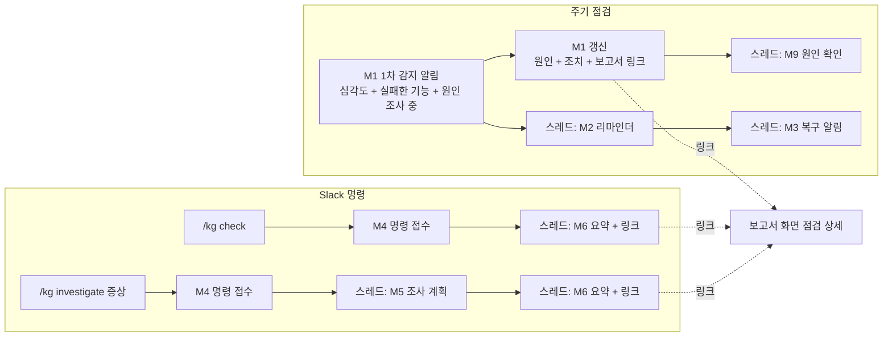

# KubeGuardian AI — UI 정의서

> [기획서](01-project-proposal.md) v3.2 기준. 운영자는 **Slack**(알림·명령)과 **보고서 화면**(점검 이력·이슈·보고서·근거·조사 과정 조회, 점검 실행)을 쓰고, CLI는 개발·평가용이다.
> 사용 흐름은 [시나리오 수립](산출물/03-시나리오수립.md)을 참고한다.

## 0. 원칙

- **알림은 Slack, 확인과 처리는 화면.** 운영자는 알림을 받으면 업무 노트북에서 처리하므로, Slack은 짧은 알림과 명령만 맡고 전체 보고서·근거 원문·점검 이력·조사 과정은 보고서 화면에서 본다. 알림에는 요약과 링크만 담는다.
- **이슈 하나 = 스레드 하나.** 채널에는 짧은 메시지 하나만 올리고, 진행 상황·리마인더·복구 알림은 모두 그 메시지의 스레드 답글로 단다. 채널이 도배되지 않게 한다.
- **정상이면 조용하다.** 주기 점검이 정상이면 아무것도 보내지 않는다. 같은 이슈가 계속되는 동안에는 심각도별 리마인더 정책에 따라서만 다시 알린다.
- **심각도에 따라 알린다.** 긴급·주의만 알리고, 잠재 위험·개선 권고는 알림 없이 화면에만 표시한다.
- **보고서 하나로 판단이 끝나야 한다.** 원인, 근거, 배제한 가설과 이유, 확인한 범위, 구체적인 조치, 재검증 방법을 한 번에 보여준다. 후속 질문 기능은 없다.
- **사실에는 근거 번호를 붙인다.** `[근거 14]`처럼 표시하고, 원문은 보고서 화면의 근거 보기에서 연다.
- **용어를 하나로 쓴다.** **점검**은 5분마다(또는 직접) 남는 관측 기록, **이슈**는 장애 신호·증상이 이어지는 동안 하나로 묶이는 단위(열림·해결), **문제**는 보고서 안의 선별 항목(최대 3건)이다. 보고서와 알림은 이슈에 딸린 기록이다. 코드에서 이슈는 `incident`로 부른다.
- **한 축에 어휘 하나.** 심각도, 점검 상태, 조사 상태, 이슈 상태, 규칙 판정은 서로 다른 축이다. 한 배지 모양에 두 축의 뜻을 싣지 않는다 (§1.3).
- **상태 대시보드가 아니다.** 화면은 점검 시점에 고정된 판정 근거를 보여주고 점검을 실행할 뿐, 실시간 상태 조회·리소스 탐색·로그 검색·배포 기능은 없다 (§6).

### 0.1 화면의 층

| 층 | 대상 | 용도 |
|---|---|---|
| **Slack** | 운영자 | 심각도별 이슈 알림, 리마인더, 복구 알림, 점검 중단 알림, 명령(`/kg check`, `/kg investigate`) |
| **보고서 화면** | 운영자, 개발자 | 점검 이력·상세, 이슈·보고서, 근거 원문, 조사 과정, 점검 구성, 점검 실행. 개발 중에는 점검 상세의 조사 과정으로 에이전트 동작을 확인한다 |
| CLI | 개발자 | Slack 명령과 같은 기능을 터미널에서 실행. 개발·평가 러너에서 사용 |
| 실행 추적 (Phoenix) | 개발자 | 프롬프트·LLM 입출력·토큰 추적. 점검 상세의 조사 과정에서 링크로 이동 (설정이 있을 때만) |

별도 개발용 화면(Chainlit)은 두지 않는다. 에이전트가 무엇을 했는지는 보고서 화면의 조사 과정(§6.4)과 Phoenix로 보고, 같은 데이터를 두 화면에서 보여주는 중복을 피한다.

## 1. Slack 구성

### 1.1 알림 대상과 앱

| 항목 | 결정 |
|---|---|
| 알림 대상 | 기존 운영 채널(예: `#pr-service-ops`) 또는 DM에서 시작한다. 알림량·수신자가 늘면 전용 채널을 만든다 (필수 아님) |
| 명령 허용 채널 | 알림 대상 + 설정한 운영 채널. 그 외 채널의 명령은 거절 |
| 명령 허용 사용자 | 설정 파일의 `allowed_users` |
| 평가 중 | 평가 러너는 Slack 전송을 생략(dry-run)하고 알림 이력에 발송 예정 시각·내용만 기록한다. 평가용 채널은 두지 않는다 |
| Slack 앱 권한 | `chat:write`(메시지 발송), `commands`(슬래시 명령), Socket Mode 연결(앱 토큰, `connections:write`) |
| 수신 방식 | **Socket Mode** — 앱이 Slack 쪽으로 연결을 먼저 열어 명령을 받는다. 공개 URL이 없는 minikube에서도 동작 |

### 1.2 메시지 종류

| ID | 메시지 | 위치 | 언제 |
|---|---|---|---|
| M1 | 이슈 알림 (1차 감지 → 원인 갱신) | 알림 대상 (부모 메시지) | 주기 점검에서 긴급·주의 새 이슈를 판정한 **직후, AI 조사를 기다리지 않고** 1차 감지 알림을 보낸다. 조사가 끝나면 같은 메시지를 원인으로 갱신한다. 문제 지문이 바뀌면 같은 이슈에서 재조사하고 갱신 |
| M2 | 리마인더 | M1의 스레드 | 같은 이슈가 미해결이고 재알림 시점이 됐을 때 |
| M3 | 복구 알림 | M1의 스레드 + 채널에도 표시 | 열린 이슈가 해결됐을 때. 주기 점검뿐 아니라 직접 점검(화면·`/kg check`)에서 해결돼도 바로 보낸다 (§6.5) |
| M4 | 명령 접수 | 명령을 입력한 곳 (부모 메시지) | `/kg check`, `/kg investigate`를 받았을 때 |
| M5 | 조사 계획 | M4의 스레드 | `/kg investigate` 조사 시작 직후 |
| M6 | 점검 결과 요약 | M4의 스레드 | `/kg check` 또는 `/kg investigate`가 끝났을 때 (요약 + 보고서 링크) |
| M7 | 점검 중단 알림 | 알림 대상 | 점검이 예정 시각을 크게 넘겨 실행되지 않을 때 |
| M10 | 점검 설정 확인 필요 | 알림 대상 | 등록한 시나리오·API가 실제로 불리지 않는 등 점검을 믿을 수 없는 설정이 확인됐을 때 1회 (#85) |
| M8 | 오류·거절 | 본인에게만 보임 (ephemeral) | 권한 없음, 잘못된 입력, 조사 실패 |
| M9 | 원인 확인 답글 | M1의 스레드 | AI 조사가 끝나 M1을 갱신했을 때. 메시지 갱신만으로는 알림이 울리지 않으므로 답글로 다시 알린다 |

전체 보고서와 근거 원문은 Slack 메시지가 아니라 보고서 화면(§6)에서 본다. 메시지별 링크 목적지는 아래와 같다.

| 메시지 | 링크 |
|---|---|
| M1 1차 감지 | `/p/{p}/checks/{run}` (그 점검 상세. 이때는 보고서가 아직 없다) |
| M1 원인 갱신, M9 원인 확인 | 같은 점검 상세 (보고서가 보임) |
| M2 리마인더, M3 복구 | `/p/{p}/issues/{id}` |
| M6 점검 결과 요약 | `/p/{p}/checks/{run}` |
| M7 점검 중단 | `/p/{p}/checks` |
| M10 점검 설정 확인 필요 | `/p/{p}/setup#health` |



### 1.3 상태 어휘

상태는 축마다 어휘를 하나만 쓴다. 한 배지에 두 축의 뜻을 싣지 않는다. "이상"은 점검 결과의 값으로 쓰지 않는다. 점검은 이슈를 열었거나(이슈 열림·이어짐·해결) 아니거나(이상 없음)로만 말한다.

| 축 | 붙는 곳 | 값 | 표시 |
|---|---|---|---|
| 심각도 | 이슈, 점검 행(그 점검이 연·이어 간 이슈의 것), 보고서 | 🔴 긴급 · 🟠 주의 · 🟡 잠재 위험 · ⚪ 개선 권고 (이슈가 없으면 이상 없음) | 주 배지. 1차와 최종이 다르면 `1차 주의 → 잠재 위험` |
| 이슈 상태 | 이슈 | 열림 · 해결 | `OPEN` 테두리 배지 / `✓ 해결 14:45` |
| 점검 상태 | 점검 | 진행 중 · 완료 · 일부 확인하지 못함 · 중단 | 보조 표시(작은 글자·아이콘). 심각도 색을 쓰지 않는다 |
| 조사 상태 | 점검의 조사 | 조사 중 · 완료 · 조사 미완(상한) · 조사 실패 | 보조 표시 |
| 규칙 판정 | 규칙 × 대상 (점검 상세 안) | 적발 · 관찰 중 · 통과 · 확인하지 못함 | 칩 |
| 설정 상태 | 프로젝트 | 정상 · 확인 필요 | 상단 띠 |

| 심각도 | 뜻 | 알림 |
|---|---|---|
| 긴급 | 지금 실패하는 사용자가 있고 **전부** — 핵심 경로 장애(채팅·로그인 등 주요 기능이 전부 실패) | 즉시 + 리마인더 |
| 주의 | 지금 실패하는 사용자가 있고 **일부** — 일부 요청·일부 기능만 실패 | 즉시 + 리마인더 |
| 잠재 위험 | 실패하는 사용자는 없지만 **깨진 것이 있음** — 곧 문제가 될 수 있음 | 없음 (화면에만) |
| 개선 권고 | 깨진 것 없이 **관례상 위험** — 지금 장애와 무관 | 없음 (화면에만) |

- 심각도 값은 두 번 정해진다. 1차(규칙·게이트)는 긴급·주의·참고(`critical`·`warning`·`info`) 3값이고, 조사 뒤의 **최종 심각도**는 보고서 영향 등급(`impact`) 4값으로 이슈에 저장한다. 잠재 위험은 조사 뒤에만 나온다.
- 이슈는 장애 신호·증상(게이트 A·B)일 때만 열린다. 개선 권고만 나온 점검은 이슈를 열지 않고 이상 없음으로 보이며, 개선 권고는 보고서 안의 참고 항목과 점검 행의 `권고 n`으로만 보인다.
- 진행 표시: 🔍 점검·조사 진행 중, ⚠️ 조사 미완 또는 점검 중단(점검 중단은 M7), ✅ 복구됨(복구 알림 1회), ⏰ 리마인더. 이 표시는 Slack 메시지용이고, 화면에서는 위 축별 표시를 쓴다.

### 1.4 재알림 정책

| 심각도 | 알림 | 재알림 |
|---|---|---|
| 긴급 | 즉시 | 미해결 시 30분 후 첫 리마인더, 이후 2시간마다, 리마인더는 총 3회까지 |
| 주의 | 즉시 | 2시간 후 1회 |
| 잠재 위험·개선 권고 | 없음 | 없음 (보고서 화면에만 표시) |

- 리마인더 시각은 1차 감지 알림을 보낸 시각부터 센다. 리마인더는 기존 알림(M1)의 스레드에 "N분째 미해결" 한 줄(M2)만 달고, AI를 다시 호출하지 않는다.
- 문제 지문이 바뀌면(원인 변경, 새 신호 추가) 같은 이슈에서 재조사하고 M1을 갱신한다. 보고서가 하나 더 붙는다. 영향받는 기능이 다르면 새 이슈를 연다.
- 해결되면 M3을 1회 보내고 리마인더를 멈춘다. 해결은 주기 점검이든 직접 점검이든 그 이슈의 규칙·증상을 모두 확인한 점검 1회에서 지문이 사라졌을 때다.
- 확인(ack) 시 리마인더를 멈추는 기능은 옵션이며 이번 범위에서는 만들지 않는다.

## 2. 메시지 정의

### M1 — 이슈 알림 (1차 감지 → 원인 갱신)

알림은 AI 조사를 기다리지 않는다. 이슈를 열면 먼저 1차 감지 알림을 보내고, 조사가 끝나면 **같은 메시지**를 원인으로 갱신한다(`chat.update`, 권한은 `chat:write`에 포함).

1차 감지 알림 (이슈를 연 직후):

```text
🔴 긴급 [KubeGuardian] dev — 채팅이 실패하고 있습니다
감지: 14:05 점검 · 로그인 성공, 채팅 단계 실패 (규칙 점검은 모두 통과)
🔍 원인을 조사하고 있습니다. 조사가 끝나면 이 메시지를 갱신합니다.
점검 결과: <점검 상세 링크>
```

원인 갱신 (조사 완료 후, 같은 메시지):

```text
🔴 긴급 [KubeGuardian] dev — 채팅이 실패하고 있습니다 (확신도 높음)
원인: llm-gateway LLM 할당량 소진 (오늘 사용량 100%)
영향: 채팅·보도자료 초안 생성 전체
조치: llm-gateway 관리 화면에서 할당량 상향 또는 초기화
감지: 14:05 점검 · 수집된 신호 47개 중 중요 문제 1건
보고서: <점검 상세 링크>
```

| 필드 | 내용 |
|---|---|
| 제목 | 상태 표시 + 심각도 + 네임스페이스 + 1순위 문제 한 줄 + 확신도 (1차 알림에는 확신도 없음) |
| 1차 알림 본문 | 감지 시각, 실패한 기능·규칙, "원인 조사 중", 점검 상세 링크 |
| 조사가 끝나지 못한 경우 | 상한 도달이면 제목 앞에 `⚠️ 조사 미완`, LLM 오류면 `⚠️ 조사 실패`를 붙이고 규칙·증상 결과만 담는다 |
| 원인 · 영향 · 조치 | 보고서의 결론·영향 범위·권장 조치 1순위를 각 한 줄로 |
| 감지 | 감지한 점검 시각, 원시 신호 수 → 중요 문제 수 |
| 보고서 | 점검 상세 링크 (보고서가 보인다). 전체 보고서는 Slack에 붙이지 않는다 |
| 중요 문제가 2건 이상 | 제목은 1순위, 본문 아래에 "그 밖의 중요 문제: 🟠 …" 한 줄씩 (최대 2건) |

### M9 — 원인 확인 답글

```text
원인을 확인했습니다: llm-gateway LLM 할당량 소진 (확신도 높음). 위 메시지에 조치와 보고서 링크를 갱신했습니다.
```

- M1 갱신과 함께 M1의 스레드에 단다. 조사 미완·실패여도 결과를 알리는 답글을 단다.

### M2 — 리마인더

```text
⏰ 🔴 긴급 [KubeGuardian] dev — 채팅 실패가 30분째 이어지고 있습니다 (14:35 기준)
이슈: <이슈 상세 링크>
```

- M1의 스레드에 답글로 단다. 재알림 정책(§1.4)에 따라서만 보낸다.

### M3 — 복구 알림

```text
✅ [KubeGuardian] dev — 채팅이 정상으로 돌아왔습니다 (14:25 점검, 장애 지속 약 20분)
```

- M1의 스레드에 답글로 달고, "채널에도 보내기" 옵션으로 채널에서도 보이게 한다.
- 링크는 이슈 상세다. 직접 점검(화면·`/kg check`)에서 이슈가 사라졌을 때도 같은 복구 알림을 그 자리에서 보낸다 (§6.5).

### M4 — 명령 접수

```text
🔍 [KubeGuardian] 조사를 시작합니다 — 요청: @운영자
증상: "초안 생성이 세 번에 한 번꼴로 실패한다는 문의가 들어왔어요"
```

```text
🔍 [KubeGuardian] dev 점검을 시작합니다 — 요청: @운영자
```

- 명령을 받으면 3초 안에 접수해야 하므로, 이 메시지를 먼저 올리고 점검·조사는 비동기로 진행한다.

### M5 — 조사 계획

```text
조사 계획: ① 먼저 확인할 사실 — 채팅 API 반복 호출 결과, agent Pod 상태·Endpoint 연결.
② 확인된 사실을 바탕으로 원인 가설을 세워 Pod별 직접 호출과 로그로 검증합니다.
```

- 조사가 진행 중임을 알리는 용도다. 결과(M6)가 나오기 전에 한 번만 올린다. 가설은 사전 확인이 끝난 뒤 세우므로 계획에는 확인할 사실과 방법을 먼저 적는다.

### M6 — 점검 결과 요약 (`/kg check`, `/kg investigate`)

```text
규칙 점검: 장애 1건, 개선 권고 3건 / 증상 감지: 채팅 API 실패
지금 중요한 것 1건 (수집된 신호 47개 중)
 1. 🔴 긴급 — 채팅이 전부 실패합니다 (확신도 높음)
    agent Service의 대상 Pod 조건이 app=agnet으로 되어 있어 Endpoint가 비어 있습니다(연결된 Pod 0개) [근거 4].
    조치: Service의 대상 Pod 조건을 app=agent로 수정
참고 — 개선 권고 3건 (지금 장애와 무관)
전체 보고서: <점검 상세 링크>
```

- 수동 실행 결과는 심각도와 관계없이 요청자에게 항상 보여준다.
- 정상이면: `✅ 이상 없음 — 규칙 점검 통과, 증상 없음. 개선 권고 3건` 한 줄만 보내고 AI는 호출하지 않는다. 점검 결과는 화면의 점검 이력에서도 볼 수 있다.
- 같은 이슈가 이미 알림 대상에 열려 있으면 요약 끝에 "이미 14:05에 알린 문제입니다 (알림 링크)"를 붙인다.
- 조사가 상한에 도달했으면 `⚠️ 조사 미완`을 앞에 붙인다.

### M7 — 점검 중단 알림

```text
⚠️ [KubeGuardian] dev — 점검이 15분째 실행되지 않았습니다 (마지막 정상 점검 14:05)
점검 이력: <점검 이력 링크>
```

- 점검이 조용히 멈추면 "이상 없음"으로 오인하기 때문에 별도로 알린다.

### M10 — 점검 설정 확인 필요

```text
⚠️ [KubeGuardian] dev — 점검 설정 확인이 필요합니다 (1건)
등록한 시나리오 chat이 대상 API 문서에 없는 경로를 부르고 있어 해당 증상 점검이 '확인하지 못함'입니다.
설정 상태: <점검 구성 설정 상태 링크>
```

- 같은 항목은 1회만 알린다 (#85). 링크는 `/p/{p}/setup#health`다.

### M8 — 오류·거절

| 상황 | 메시지 |
|---|---|
| 허용되지 않은 채널 | 이 채널에서는 KubeGuardian 명령을 쓸 수 없습니다. 허용된 채널(#pr-service-ops)에서 실행해 주세요. |
| 허용되지 않은 사용자 | KubeGuardian 명령 권한이 없습니다. 관리자에게 요청해 주세요. |
| 증상이 비어 있음 | 증상을 함께 적어 주세요. 예) `/kg investigate 로그인이 안 돼요` |
| 이미 조사 중 | 진행 중인 조사가 있습니다 (스레드 링크). 끝난 뒤 다시 요청해 주세요. |
| 조사 실패 (LLM 연결 오류 등) | 조사 중 오류가 발생했습니다: Azure OpenAI 응답 없음. 규칙 점검 결과만 아래에 첨부합니다. |
| 수집 일부 실패 | 일부 항목을 확인하지 못했습니다 (Kubernetes API 응답 없음). 확인한 결과만 표시합니다. |

## 3. Slack 명령

| 명령 | 동작 | 결과 위치 |
|---|---|---|
| `/kg check` | 주기 점검과 같은 점검을 즉시 실행 | M4 → 스레드에 M6 (보고서 링크) |
| `/kg investigate <증상>` | 증상을 경로 B로 조사 (규칙 결과와 관계없이 AI 조사) | M4 → 스레드에 M5, M6 (보고서 링크) |
| `/kg help` | 명령 사용법 | 본인만 |

| 규칙 | 내용 |
|---|---|
| 접수 응답 | Slack은 3초 안에 응답을 요구하므로 즉시 접수하고 실행은 비동기 |
| 실행 권한 | 허용 채널·허용 사용자만 |
| 동시 실행 | 같은 사용자의 조사는 1건씩. 진행 중이면 M8로 안내. 점검은 주기 점검·Slack 명령·화면 실행을 통틀어 동시에 1건 (§6.5) |
| 입력 | 증상은 500자 이내. LLM에 보내기 전에 마스킹 적용 |
| 클러스터 변경 | 어떤 명령도 클러스터를 바꾸지 않음 (도구가 모두 조회 전용) |

근거 원문은 슬래시 명령이 아니라 보고서 화면의 근거 서랍에서 연다.

## 4. 공통 규칙

| 항목 | 규칙 |
|---|---|
| 언어 | 한국어 |
| 시각 | KST, `HH:MM` (날짜가 다르면 `MM-DD HH:MM`) |
| 근거 표기 | `[근거 N]`. 여러 개면 `[근거 14, 15]`, 연속이면 `[근거 22~25]`. 화면에서는 클릭해 원문을 연다 |
| 추정 표기 | 근거 없는 문장 끝에 _(추정)_ |
| 마스킹 | Slack과 보고서 화면에 표시하는 모든 내용(알림, 보고서, 근거 원문)에 도구 출력과 같은 마스킹 적용 |
| 길이 | Slack 알림은 한 메시지 안에서 끝나는 요약만 담는다. 길이가 필요한 내용은 화면에서 본다 |
| 메시지 ID 저장 | 부모 메시지의 채널·`ts`를 알림 이력에 저장해 리마인더·복구 알림을 스레드에 단다 |

## 5. CLI (개발용)

| 명령 | 내용 |
|---|---|
| `kg check [--namespace dev] [--notify] [--impl langgraph\|loop]` | 점검 실행. 터미널 출력, `--notify`면 Slack으로도 보냄. `--impl`로 에이전트 구현을 바꿔 같은 입력으로 비교 (비교 실험 1) |
| `kg investigate "<증상>" [--impl langgraph\|loop]` | 증상 조사. 조사 단계를 터미널에 실시간 출력 |
| `kg report <ID>` | 저장된 보고서 출력 |
| `kg evidence <ID>` | 근거 원문 출력 |
| `kg alerts` | 알림 이력 (지문, 심각도, 열림/해결, 최초 감지 시각, 리마인더) |

평가 러너는 CLI를 호출한다. 평가 중 알림은 전송 없이 알림 이력에만 기록한다.

## 6. 보고서 화면

diagnostic-agent의 FastAPI가 **서버 렌더링 HTML**(Jinja2 템플릿 + HTMX)로 제공한다. React 같은 별도 프론트 프로젝트는 두지 않는다. Slack 알림의 링크로 들어오거나 직접 연다. 데이터는 SQLite의 점검 이력·이슈·보고서·근거·조사 단계·알림 이력이며, 표시 내용에 같은 마스킹을 적용한다.

화면에서 할 수 있는 조작은 **점검 실행** 하나다. 점검도 조회 전용 도구만 쓰므로 화면에서 클러스터를 바꿀 수는 없다.

이 절은 "무엇을 어디에 어떤 순서로 보여 주는가"를 정한다. 색·글꼴·컴포넌트 모양은 별도의 시각 규칙(PR #69 `04-1-ui-design.md`)이 정하며, 이 구조에 맞춰 고친 뒤 쓴다.

### 6.1 정보 구조와 용어

```text
프로젝트 (클러스터 + 네임스페이스. 지금은 하나, 선택 화면 없음)
├─ 점검 (5분 주기·직접 실행·Slack 명령·CLI)
│   ├─ 규칙 판정 (규칙 × 대상: 적발·관찰 중·통과·확인하지 못함, 판정에 쓴 값)
│   ├─ 증상 (API 시나리오별 성공·실패·확인하지 못함, 실패 단계)
│   ├─ 게이트 (경로 A·B·C)
│   ├─ 조사 과정 (있으면: 사전 확인 → 계획 → 도구 호출 → 멈춤 검사)
│   └─ 근거 ev-N (모든 사실의 원문)
├─ 이슈 (점검 여러 개에 걸침: 열림 → 해결, 1차 → 최종 심각도)
│   ├─ 보고서 (조사 1회마다 1개, 이슈를 처음 연 점검 또는 지문이 바뀐 점검에서)
│   └─ 알림 이력 (최초 감지·원인 갱신·리마인더·복구, 보낸 본문)
└─ 점검 구성: 규칙·증상 시나리오·대상 설정과 설정 상태 (#85)
```

- 점검과 이슈는 **다대다**다. 한 점검이 여러 이슈를 열고·잇고·해결할 수 있고, 한 이슈는 여러 점검에 걸친다.
- 점검 행마다 이슈와의 관계를 하나로 표시한다: **이슈 열림 / 이슈 이어짐 / 이슈 해결 / 관계없음(이상 없음)**. 여러 이슈와 얽히면 가장 높은 심각도의 이슈를 보이고 나머지는 `+n`으로 줄인다.
- 이슈는 게이트 A·B(장애 신호·증상)일 때만 열린다. **개선 권고만 나온 점검은 이슈를 열지 않고** '이상 없음'으로 보이며, 행에 작은 숫자(`권고 6`)만 붙는다.
- 코드에서 이슈는 `incident`로 부른다. 보고서 모델의 `Issue`(선별 항목)와 겹치지 않게 하려는 것이다.

### 6.2 전체 레이아웃

```text
┌────┬───────────────────────────────────────────────────────────────────────────┐
│ KG │ GNB  dev · minikube │ 마지막 점검 14:05 · 다음 14:10 │ [지금 점검] │ 채팅 │ 사용자 │
├────┼───────────────────────────────────────────────────────────────────────────┤
│ ▤  │ 상단 띠: 열린 이슈 🔴 1 · 🟠 0   │  ⚠ 설정 확인 필요 1                       │
│ ◎  ├───────────────────────────────────────────────────────────────────────────┤
│ ⚙︎  │ 헤더: 제목 · 빵부스러기 (dev > 점검 이력 > 10/26 14:05)                      │
│    │ 절 바로가기(상세에서만)                                                       │
│    │ 본문: 목록 | 상세(오른쪽 패널, 넓은 화면) — 좁으면 상세가 전체 화면              │
└────┴───────────────────────────────────────────────────────────────────────────┘
 레일: ▤ 점검 이력 · ◎ 이슈 · ⚙︎ 점검 구성(설정 확인 필요면 점 표시)
```

| 영역 | 내용 |
|---|---|
| GNB | **전역 정보만** 둔다: 로고, 프로젝트 표시(지금은 고정 값, 누를 수 없음), 마지막·다음 점검 시각(점검이 멈췄으면 경고), **지금 점검** 버튼(§6.5), 이력 질의 채팅 버튼(§6.7), 사용자 자리. 이동 탭은 두지 않는다 |
| 레일(LNB) | 약 56px 아이콘 + 마우스를 올리면 이름. **점검 이력**(홈) · **이슈** · **점검 구성** 세 개. 현재 위치를 강조하고, 펼치기 버튼으로 이름까지 보이게 넓힐 수 있다 |
| 상단 띠 | 열린 이슈 수(심각도별, 누르면 이슈 목록 필터), 설정 확인 필요(누르면 점검 구성의 설정 상태 절) |
| 헤더 | 페이지 제목, 빵부스러기, 페이지 단위 행동 |
| 절 바로가기 | 상세 패널 위쪽에 한 줄(조치 · 판정 · 조사 · 근거). 탭이 아니라 같은 페이지 안 이동이다 |
| 본문 | **목록-상세 분할**: 목록을 왼쪽에 남기고 상세를 오른쪽에 연다. 보던 목록·필터·스크롤이 그대로라 돌아오기가 필요 없다 |
| 개발 링크 | 평가 결과·Phoenix는 설정이 있을 때만 사용자 메뉴 안에 둔다. 운영에는 필요 없고, 점검에 `trace_id`만 저장한다 |

프로젝트 선택·로그인 화면은 그리지도 구현하지도 않는다. 대신 주소(`/p/{project}/...`)와 GNB·사용자 자리를 비워 둔다.

### 6.3 페이지와 주소

주소는 처음부터 프로젝트를 앞에 둔다. 지금 `{p}`는 설정의 대상 이름 하나(예: `dev`)다. 화면·Slack이 배포된 적이 없어 옛 주소(`/reports`, `/runs`)는 두지 않고 넘겨주기도 만들지 않는다.

| 페이지 | 주소 | 내용 |
|---|---|---|
| **점검 이력** (홈) | `/p/{p}/checks` | 필터 막대 + 점검 목록 + (선택 시) 점검 상세 패널 |
| 점검 상세 | `/p/{p}/checks/{run}` | 탭 없는 한 페이지: 상태 머리 → 권장 조치 → 점검 판정 → 조사 → 근거 (§6.4) |
| 점검 단계 조각 | `GET /p/{p}/checks/{run}/steps` | 조사 단계 목록 HTML 조각 (진행 중 폴링용) |
| **이슈** | `/p/{p}/issues` | 필터 막대(상태 열림·해결, 심각도, 기간) + 이슈 목록 + 상세 패널 |
| 이슈 상세 | `/p/{p}/issues/{id}` | 탭 없는 한 페이지: 상태 머리 → 지금 결론·조치 → 타임라인 → 보고서 목록 (§6.4) |
| 보고서 | `/p/{p}/reports/{id}` | 단독 주소(공유용). 점검 상세의 상태 머리·조치·조사와 같은 구성 |
| 근거 | 어디서든 `[근거 N]` → 오른쪽 서랍, 주소 `?ev=N` | 종류, 대상, 수집 시각, 출처, 마스킹된 원문 |
| **점검 구성** | `/p/{p}/setup` (설정 상태 절은 `#health`) | 설정 상태 → 규칙 → 증상 시나리오 → 대상 설정 (§6.4) |
| 점검 실행 | `POST /p/{p}/checks` | 새 점검을 시작하고 `/p/{p}/checks/{run}`으로 이동. 진행 중이면 409와 진행 중인 점검 링크 (§6.5) |
| 헬스 체크 | `GET /healthz` | Deployment readinessProbe (프로젝트와 무관) |
| `/` | 리다이렉트 | `/p/{p}/checks` |
| (나중) | `/login`, `/projects` | 그리지 않음 |

- 같은 데이터를 다른 클라이언트가 써야 하면 그때 `/api/v1/...` JSON 라우트를 추가한다 (이번 범위 밖).
- 화면 갱신이 필요한 부분만 HTMX가 HTML 조각을 받아 바꿔 끼운다. 진행 중인 점검의 단계 목록은 수 초마다 다시 받는다 (조사 단계마다 SQLite에 바로 기록한다).

### 6.4 페이지 구성

**점검 이력 (홈)**

필터는 주소 쿼리에 남겨 돌아와도 유지한다.

| 필터 | 값 | 쓸모 |
|---|---|---|
| 기간 | 최근 1시간 · 오늘 · 7일 · 직접 지정 | 언제부터 문제였나 |
| 심각도 | 긴급 · 주의 · 잠재 위험 · 개선 권고 · 이상 없음 (복수) | 급한 것만 보기 |
| 이슈 관계 | 이슈 열림 · 이어짐 · 해결 | 장애가 시작·끝난 지점 찾기 |
| 실행 방식 | 주기 · 직접(화면) · Slack · CLI | 배포 직후 직접 점검 찾기 |
| 점검 상태 | 일부 확인하지 못함 · 중단 | 점검 자체를 믿을 수 있나 |
| 검색어 | 서비스 이름, 규칙 ID, 이슈 제목, 실패한 기능 | "gateway 관련만" |

```text
시각    │ 심각도 배지 │ 요약 (실패한 기능 또는 주요 신호)   │ 이슈 관계     │ 실행 │ 보조 상태
14:05   │ 🔴 긴급     │ 채팅 실패 · 증상 chat 2단계         │ 이슈 열림 #12 │ 주기 │ 조사 중
14:10   │ 🔴 긴급     │ 채팅 실패                           │ 이어짐 #12    │ 주기 │
14:16   │ 이상 없음   │                                     │ 해결 #12      │ 직접 │
13:00~14:00  이상 없음 12회 (접힘)
```

- 주 분류는 이슈 심각도다. 점검 상태는 작은 글자·아이콘의 보조 표시로만 둔다.
- 연속된 이상 없음은 한 줄로 접는다 (5분 주기라 하루 288행). 개선 권고만 나온 점검도 이상 없음으로 접고 `권고 n`만 붙인다.
- 행을 누르면 오른쪽에 점검 상세가 열리고 목록·필터·스크롤은 그대로다.
- 점검이 멈춘 구간(예정 시각을 크게 넘긴 구간)은 행으로 표시한다.

**점검 상세 (탭 없이 한 페이지)**

운영자의 흐름은 판정 → 진행 중인 조사 → 보고서로 이어지므로 칸으로 쪼개지 않고 위에서 아래로 한 번에 읽히게 한다. 맨 위는 지금 알아야 할 것, 그 아래는 점검이 진행된 순서다.

```text
① 상태 머리   🔴 긴급 (1차 🔴) · 이슈 #12 열림 · 10/26 14:05 주기 점검 · 완료 48초
              결론 한 줄 (조사가 끝났으면) / "조사 중: 도구 호출 4/8" (진행 중이면) / "이상 없음" (정상)
② 권장 조치   (조사가 끝났을 때만) 조치 · 재검증 방법
③ 점검 판정   적발·관찰 중·확인하지 못함인 규칙과 실패한 증상만 펼친다. 통과 n건은 한 줄로 접힘
              게이트 경로와 이유
④ 조사        진행 중: 단계 목록이 갱신되며 펼쳐짐
              끝남: 보고서 본문 — 문제(최대 3) · 근거(사전 확인/가설 검증) · 가설 판정과 배제 이유
                    · 확인한 범위(구동·설정·연결·로그) · 개선 권고(참고)
              조사 과정 단계는 "조사 과정 보기"로 접혀 있다
⑤ 근거        본문의 [근거 N]을 누르면 오른쪽 서랍. 이 점검의 근거 전체 목록은 맨 아래 접힘
```

| 상황 | 펼쳐진 부분 |
|---|---|
| 조사 진행 중 (Slack 1차 알림 직후) | ① 진행 표시, ③ 판정, ④ 단계 목록(갱신). "도구 호출 4/8"의 분모는 문제당 예산이다 |
| 조사 끝남 | ① 결론, ② 조치, ④ 보고서. ③은 적발 항목만 |
| 이상 없음 | ① "이상 없음", ③ 통과 요약(접힘). ②④ 없음 |

- 보고서 단독 주소(`/p/{p}/reports/{id}`)도 같은 ①②④ 구성을 쓴다.
- 보고서 본문 구성은 아래와 같다.

```text
[조사 보고서] 채팅 실패 — llm-gateway 할당량 소진          🔴 긴급 · 확신도: 높음

■ 결론
■ 근거
    사전 확인 (가설 없이 확인한 사실)   [근거 N]
    가설 검증                           [근거 N]
■ 가설 판정            (지지 / 배제 / 판단 보류 + 이유)
■ 확인한 범위          구동·설정·연결·로그 네 영역 각각 (확인함 / 확인하지 못함 / 해당 없음 + 사유)
■ 권장 조치 (자동 실행하지 않음)
■ 재검증 방법
■ 참고 — 개선 권고 (지금 장애와 무관)
───
조사 48초 · 도구 호출 9회 · 2.1만 토큰 · 참고한 지침: app-layer-failure.md · 조사 과정 보기 ▸
```

- 근거가 없는 문장은 끝에 _(추정)_ 을 붙인다 (근거 검증기 결과).
- 상한에 도달했으면 제목 앞에 `⚠️ 조사 미완`을 붙이고, "확인하지 못함"에 남은 가설을 적는다.
- 전체 예시는 [시나리오 수립 SC-001](산출물/03-시나리오수립.md)을 참고한다.

**조사 과정 ("조사 과정 보기")**

에이전트가 무엇을 했는지 전부 보이게 한다. 운영자는 결론을 믿어도 되는지 확인할 때, 개발자는 에이전트를 디버깅할 때 쓴다.

```text
조사 과정 — 14:10 점검 (주기)            impl: langgraph · 도구 9/20 · 48s · 21k tokens
▸ 규칙 점검     장애 신호 0 · 개선 권고 3
▸ 증상 감지     채팅 API 시나리오 실패 [근거 10]
▸ 게이트        경로 B · 심각도 긴급 · 문제 지문 새로 생성
▾ 사전 확인     Pod 전체 Ready · Endpoint 정상 · 채팅 502 [근거 3, 12]
▸ 계획          1) 경로 구간 호출 2) llm-gateway 응답 3) 할당량
▾ 도구 호출
    query_app_api(llm-gateway, /api/v1/quota)  → [근거 15]   (원문 ▸)
    probe(agent, /health, via=pod, times=3)    → [근거 8]
▸ 가설 판정     ① 배제 · ② 지지 · ③ 배제
▸ 보고서·검증   근거 검증 통과 · 추정 0문장
                                                        Phoenix 추적 열기 ↗ (설정이 있을 때만)
```

| 기능 | 내용 |
|---|---|
| 단계 표시 | 위 단계를 접이식으로 표시. 단계마다 시작·종료 시각, 소요 시간 |
| 도구 호출 | 호출 인자, 요약 결과, 근거 번호. 근거 번호를 누르면 근거 서랍 |
| 진행 중 갱신 | 점검이 진행 중이면 HTMX로 수 초마다 단계 목록을 다시 받아온다 |
| 보여주지 않는 것 | 프롬프트 원문과 LLM 응답 원문은 화면에 두지 않고 Phoenix에서 본다 |

**이슈 상세 (탭 없이 한 페이지)**

```text
① 상태 머리   🔴 긴급 (1차 🟠) · OPEN · 제목(최신 보고서 1순위 문제, 없으면 실패한 기능·주요 신호)
              영향 기능 · 최초 감지 14:05 · 지속 25분 (해결이면 "14:05~14:45, 40분")
② 지금 결론   최신 보고서의 결론 한 줄 + 권장 조치·재검증. 조사 중이면 진행 표시
③ 타임라인    시각순: 이슈를 연 점검 → Slack 1차 알림(보낸 본문 펼침) → 조사 완료·원인 갱신 알림
              → 리마인더 → (지문 변경·재조사) → 해결한 점검 → 복구 알림
              사이의 "이어짐" 점검은 "이어짐 n회"로 접힘. 점검 항목을 누르면 점검 상세
④ 보고서      이 이슈에서 나온 보고서 목록 (지문이 바뀌어 재조사했으면 여러 개, 최신이 위)
```

- 리마인더·복구 알림의 링크가 여기로 온다 (§2).
- 해결된 이슈도 같은 구성이다. ① 상태가 `✓ 해결 14:45`로 바뀐다.
- 알림 이력에는 실제로 보낸 메시지와 dry-run으로 기록만 한 메시지(평가 중, Slack 승인 전)를 모두 보여준다. Slack 없이도 어떤 알림이 나갔을지 확인할 수 있다.

**점검 구성 (탭 없이 한 페이지)**

규칙 목록과 설정 상태를 합친 페이지다. "KubeGuardian이 무엇을 점검하고, 그 점검을 믿을 수 있나"에 답한다.

```text
① 설정 상태   확인 필요 항목이 있으면 맨 위에: 무엇이(시나리오·API·대상 서비스), 언제부터,
              어떤 점검이 '확인하지 못함'이 되는지, 수정 제안(대상 API 문서와 비교).
              정상이면 "설정 정상 · 마지막 확인 14:05" 한 줄 (#85)
② 규칙        점검 지도 단계 순서로: ID · 이름 · 무엇을 보나(한 줄) · 지속 시간
              · 장애 신호/개선 권고 · 1차 심각도 · 마지막 점검 결과(적발 n · 관찰 중 n)
③ 증상 시나리오  이름 · 지키는 기능 · 단계 · 마지막 결과
④ 대상 설정   핵심 경로(core_paths), 선언한 필수 설정(required_config). 읽기 전용, 원본은 kubeguardian.yaml
```

- 화면에서 설정을 바꾸지 않는다. 수정 제안은 사람이 설정 파일에 반영한다 (#85).

### 6.5 점검 실행

| 항목 | 규칙 |
|---|---|
| 위치 | GNB의 **지금 점검** 버튼 |
| 실행 위치 | 화면 서버(diagnostic-agent) 프로세스의 **백그라운드 작업**. 요청은 바로 `run_id`를 돌려주고 점검은 뒤에서 진행한다. 화면은 그 점검의 상세로 이동해 진행 상황을 보여준다 |
| DB | 5분 주기 CronJob과 같은 PVC의 SQLite를 쓴다 |
| 동시 실행 | 점검은 주기 점검·Slack 명령·화면 실행·CLI를 통틀어 동시에 1건이다. 겹침은 **공유 잠금**(#88)으로 막는다. 진행 중이면 버튼을 비활성화하고 진행 중인 점검 링크를 보여준다. 겹친 주기 점검은 건너뛰고, 점검 이력(P4)에 건너뜀으로 보조 표시한다 (점검 이력 행이 아니라 별도 건너뜀 기록). 잠금은 270초 뒤 만료되어, 점검이 중간에 죽어도 다음 점검이 막히지 않는다 (상세설계 §2.4) |
| 남용 방지 | 화면 실행은 직전 실행 후 1분이 지나야 다시 할 수 있다 (LLM 비용) |
| 결과 | 결과는 **화면에서만** 보여주고 Slack으로 보내지 않는다. 같은 문제가 이미 열려 있어도 결과를 보여준다 (`/kg check`와 같은 규칙) |
| 이슈 해결 | **예외: 직접 점검에서 이슈가 사라졌으면 그 자리에서 이슈를 해결로 바꾸고 Slack 복구 알림(M3)을 바로 보낸다.** 주기 점검을 기다리지 않는다. 해결 조건은 기획서 §6.6(그 이슈의 규칙·증상을 모두 확인한 점검 1회)을 따르며, 일부를 확인하지 못했거나 중단된 점검은 해결하지 않는다. 이슈를 새로 열거나 리마인더를 보내는 일은 하지 않는다 |
| 증상 조사 | 증상 입력 조사(`/kg investigate`)는 이번 범위에서 화면에 넣지 않는다 |

### 6.6 사용자 흐름

| # | 흐름 | 경로 |
|---|---|---|
| F1 | **긴급 알림 → 조치 → 복구** | Slack 1차 알림 링크 → 점검 상세(진행 중: 판정과 조사 단계가 보임) → 조사 끝나면 같은 페이지 맨 위에 결론·조치 → 조치(화면 밖) → GNB **지금 점검** → 새 점검이 목록 맨 위에 생기고 진행 표시 → 이상 없음이면 이슈 해결 + Slack 복구 알림 |
| F2 | 평상시 훑기 | 홈 → 상단 띠로 열린 이슈 확인 → 기간 "오늘" + 심각도 필터 → 행 선택 |
| F3 | 배포 직후 확인 | GNB 지금 점검 → 점검 상세(진행) → 결과. 이상이 있으면 F1의 조사 단계로 이어짐 |
| F4 | 이슈 돌아보기 | 레일 이슈 → 상태 "해결" 필터 → 이슈 상세 타임라인 → 보고서·알림 본문 |
| F5 | 설정 문제 | Slack "점검 설정 확인 필요"(1회) 또는 상단 띠 → 점검 구성의 설정 상태 절 → 수정 제안 → 사람이 설정 반영 → 다음 점검에서 정상 |
| F6 | 개발자 디버깅 | 점검 상세의 조사 과정 보기 → 단계별 도구 호출 → (설정 시) Phoenix 링크 |

1차 알림 때는 보고서가 아직 없다. 알림 링크는 그 점검으로 가고, 조사가 끝나면 같은 페이지에 결론이 나타난다.

### 6.7 이력 질의 채팅 패널

- GNB 오른쪽 버튼으로 열고 닫는 오른쪽 패널이다. 열리면 상세 패널 위에 겹친다. 레일 메뉴에는 넣지 않는다.
- 질문할 때 보던 맥락(프로젝트, 이력 필터, 선택한 점검·이슈)을 함께 넘긴다.
- 답의 점검·이슈·근거 링크를 누르면 아래 화면이 그 대상으로 이동한다.
- 구현 범위·시기는 이 문서 밖이다. 여기서는 자리와 맥락 전달만 정한다.

### 6.8 접근

| 항목 | PoC 결정 |
|---|---|
| 노출 방식 | 외부 노출(Ingress) 없이 ClusterIP Service + `kubectl port-forward`로 접근. 클러스터 접근 권한이 곧 화면 접근 권한이다 |
| 링크 주소 | Slack 링크의 기준 주소는 설정 `web.base_url` (기본 `http://localhost:8080`) |
| 인증 | PoC에서는 두지 않는다. 사내망 밖으로 노출하거나 사용자가 늘면 사내 SSO 연동을 후속으로 검토한다 |

### 6.9 경계

| 보여주는 것·할 수 있는 것 | 보여주지 않는 것·할 수 없는 것 |
|---|---|
| 점검 시각, 점검이 정상 실행됐는지 | 실시간 Pod·서비스 상태 |
| 규칙별 판정과 이유, 판정에 쓴 점검 시점의 값 | 리소스 목록 탐색, 서비스 관계도 |
| 이슈 심각도·관계, 이슈 타임라인 | 로그 검색, 전체 로그 조회 |
| 이슈의 보고서와 근거(로그 발췌·이벤트·API 응답) | 프롬프트·LLM 응답 원문 (Phoenix에서) |
| 조사 과정(단계, 도구 호출, 근거) | 배포·재시작 등 클러스터 조작, 증상 입력 조사 |
| 점검 실행 | 로그인·프로젝트 선택 화면 |

정상 상태의 상시 확인은 kubectl이나 팀의 기존 도구(ArgoCD, Kubernetes Dashboard 등)를 쓴다.

## 7. 모듈 대응

폴더 구조는 [실행 계획서 §1.2](02-execution-plan.md)를 따른다 (템플릿 backend-agent 규약 `app/api`·`app/service`·`app/core`).

| 모듈 | 역할 |
|---|---|
| `app/api/routes/` | 보고서 화면 라우트(§6.3), 점검 실행 (§6.5) |
| `app/api/templates/` | Jinja2 템플릿, HTMX 조각 |
| `app/api/slack/` | Socket Mode 명령 수신(`slack_bolt`), 권한 확인, 접수 응답, 비동기 실행 |
| `app/service/pipeline/` | 점검 실행 흐름(점검 → 게이트 → 조사 → 저장 → 알림)과 동시 실행 제한(잠금). 주기 점검·Slack·화면·CLI가 같은 함수를 호출 |
| `app/service/notify/format.py` | 점검 결과·보고서 요약을 M1~M9 Slack 메시지로 변환 (심각도 표시, 링크, 마스킹 확인) |
| `app/service/notify/slack.py` | `chat.postMessage` 발송, 스레드 답글, 메시지 ID 저장. 평가 중에는 dry-run |
| `app/service/notify/reminder.py` | 이슈 상태와 재알림 정책에 따라 리마인더·복구·점검 중단 알림 결정 |
| `app/service/alerts/` | 문제 지문, 이슈(`incident`) 열기·해결, 심각도 |
| `app/core/db/` | SQLite 저장소: 점검 이력, 조사 단계, 보고서, 근거, 이슈, 알림 이력(최초 감지 시각, 마지막 리마인더 시각, 부모 메시지 채널·`ts`) |
| `app/cli.py` | 개발용 CLI |

구현 시점은 [실행 계획서](02-execution-plan.md)에서 정한다.
