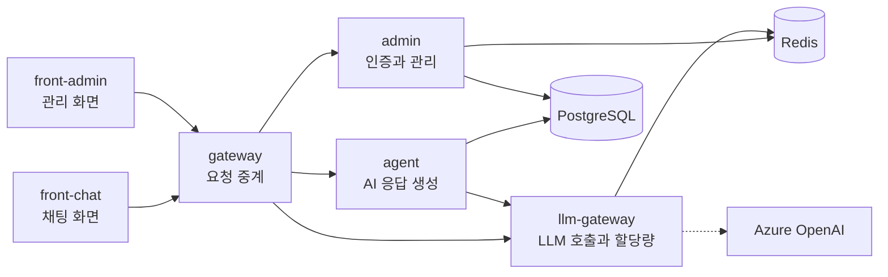
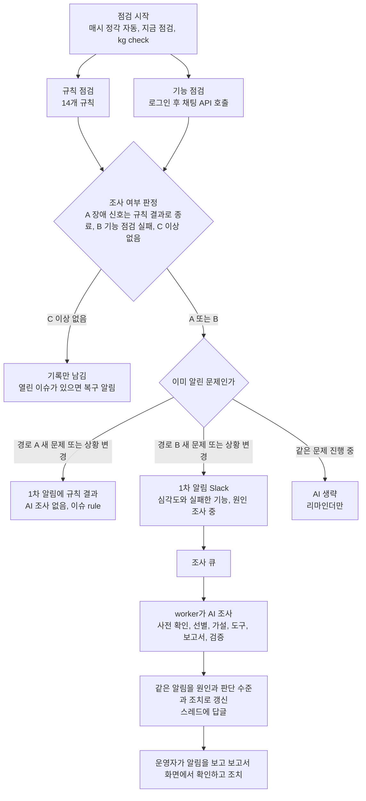

# 2. 문제 정의 및 서비스 기획 (상세본)

> 제출본은 [양식/02](양식/02-문제정의및서비스기획.md)이다. 이 문서에는 제출본에 다 담지 못한 현재 방식과 서비스 구조, 목표 수치의 근거, 점검과 알림 흐름, 설계 판단의 이유만 둔다. 기획서는 [기획서](../01-project-proposal.md)에 있다.

## 1. 현재 방식과 서비스 구조

장애가 나면 지금은 다음 순서로 진행된다.

| 단계 | 현재 방식 |
|---|---|
| 인지 | PR 담당자 같은 사용자가 문의해야 장애를 안다 |
| 확인 | 운영자가 kubectl get, describe, logs와 대시보드를 오가며 앱마다 하나씩 수작업으로 확인한다 |
| 원인 파악 | 증상이 나타난 곳과 원인이 있는 곳이 달라 숙련자의 경험에 의존한다 |
| 소요 시간 | 장애 발생부터 원인 파악까지 약 3~5일(사용자 문의 대기와 수작업 진단 포함, 경험 기반 추정) |

앱 6개는 각각 별도 레포로 나뉘어 있고 Kubernetes 배포 설정은 공용 레포에서 관리한다. 새 AI 서비스는 이 템플릿을 복제해서 시작한다.

실제 운영에서 겪은 장애는 여러 레포가 공유 설정(ConfigMap)을 덮어써서 생긴 장애, agent 메모리 부족으로 인한 강제 종료, gateway 응답 시간 초과(504), DB 스키마 불일치다. 모두 kubectl 한 번으로는 원인이 보이지 않았다. 원본 템플릿에는 클러스터에 그대로 배포하면 gateway가 하위 서비스를 찾지 못하는 설정 누락도 있는데, 템플릿을 고쳐서 해결할 문제라 문제 정의의 중심에서는 빼고 데모 시나리오로만 썼다.

## 2. 목표 수치의 근거와 평가 방식

제출본은 기획 당시 KPI를 기준으로 하고, 실제 측정 결과는 07 산출물에서 다룬다. 각 목표를 그렇게 정한 이유는 다음과 같다.

| 지표 | 목표 근거 |
|---|---|
| 장애 감지 시간 | 기획 때는 점검 주기 5분과 점검 실행 1분을 더해 6분으로 잡았다. 주기가 1시간이 되어 11월 9일 정리 때 참고 기준을 점검 시작 기준 1분 이내로 다시 잡았다. 1차 알림은 점검이 끝나는 대로 나가고 AI 조사를 기다리지 않는다. 다만 기능 점검이 느린 경우가 있어 평가 러너의 첫 점검에서 C2는 70~142초가 걸렸고, 이 경우 1분 기준은 넘는다. 장애가 점검 직후에 생기면 다음 정시까지 최대 약 1시간을 기다리며, 이 대기는 참고 기준에 넣지 않았다. 바로 확인하려면 직접 점검을 쓴다 |
| 원인 파악 시간 | 기획 때는 6분에 조사 시간 약 1분을 더해 7분이었다. 참고 기준은 점검 약 1분, 조사 상한 150초, 재조사를 시작할 때 더해지는 60초를 합친 5분 이내다. 재조사 한 건의 최악 시간은 약 310초(추정)로 이 기준을 넘을 수 있다 |
| 원인 규명 커버리지 | K8s 상태만으로는 원인이 보이지 않는 시나리오가 규칙만 쓴 조건에서는 정상으로 보인다. 그 시나리오에서 원인을 맞히는 비율이 AI 조사의 핵심 효과라서 60%로 정했다 |
| 확인 항목 감소율 | 기획 기준은 신호판의 원시 신호 수 대비 보고서의 중요 문제 수다. 신호판은 통과 판정을 제외한 규칙별·대상별 관찰을 담는다. 저장된 점검 DB의 비통과 판정과 보고서의 중요 문제를 대조해 기존 배치를 사후 집계했다. 집계 범위와 0건 처리 기준은 [07 제출본](양식/07-E2E서비스개발.md)에 있다 |
| 조사 시간과 비용 | 상한은 문제당 도구 호출 8회, 전체 20회, 150초다. 처음에는 상한에서 역산해 10만 토큰으로 잡았으나, 도구를 부를 때마다 대화가 쌓여 입력 토큰이 커지는 점을 빠뜨린 값이었다. 첫 실측(조사 약 106초, 약 13.5만 토큰)을 보고 20만 토큰을 조정안으로 검토했다 |
| 근거 일치율 | 보고서의 모든 사실 문장에 근거를 붙이는 것은 검증 코드가 강제하므로 지표로 쓰지 않고, 붙은 근거가 문장을 뒷받침하는지를 지표로 쓴다 |

사람의 정확도 추정치(약 69%, 커버리지 50%)는 계획 시점의 시나리오 8개를 K8s 상태로 원인이 보이는지로 나누어, 보이는 것은 맞히고 안 보이는 것은 절반만 맞힌다고 가정한 값이다. 과거 장애의 진단 시간 기록이 없고, 시나리오를 설계한 본인이 다시 진단하면 기억이 섞여 실측이 의미 없기 때문에 실측하지 않았다. 그래서 효과의 기준선은 같은 시나리오를 규칙 점검만으로 돌린 조건의 측정값이다.

정확도 채점은 네 가지를 본다. 보고서 1순위 원인 리소스가 정답과 일치하는지(코드), 결론 문장이 정답과 같은 원인을 말하는지(gpt-4.1), 정답에 필요한 결정적 근거를 에이전트가 직접 손에 넣었는지(코드), 금지 원인을 올리지 않았는지(코드)다. 조사에 쓰는 모델과 채점 모델을 일부러 다르게 두었다. 세부는 06 산출물에서 다룬다.

### 목표 수치 조정 검토 내역

- **장애 감지 시간(원인 파악 포함)** — 제출 목표는 기획 당시 7분(점검 주기 5분 + 처리 2분)이다. 정각 점검으로 변경된 뒤 다음 점검 대기 최대 약 60분과 처리 참고치 5분을 합해 65분을 조정안으로 검토했다.
- **AI 조사 시간·비용** — 제출 목표는 120초, 10만 토큰 이하(잠정)다. 도구 호출을 반복할 때 입력이 누적되는 점과 첫 실측을 반영해 20만 토큰을 조정안으로 검토했다.
- **원인 정확도와 확인 항목 감소율** — 각각 70% 이상과 90% 이상이다.
- 제출본의 사람 정확도 약 40%와 조사 시간 1~2시간은 작성자가 제시한 참고값이다. 사람 진단의 실측 자료가 없어 07에서는 이 값으로 개선 폭을 산정하지 않는다. 위 표의 약 69%는 별도의 기획 당시 가정이다.

## 3. 점검과 알림 흐름

CLI의 kg investigate는 이 흐름을 쓰지 않는다. 점검을 한 번 돌린 뒤 이슈, 알림, 조사 대기열 없이 같은 프로세스에서 바로 조사하고 결과를 터미널에 출력한다. 규칙이 장애를 적발한 경우에는 AI를 부르지 않고 규칙 결과만 출력한다. 열린 이슈가 있으면 연결만 한다.

| 단계 | 담당 | 내용 |
|---|---|---|
| 점검 | 자동(매시 정각) 또는 직접 | 규칙 점검과 기능 점검. 동시에 한 건만 돌고, 정상이면 기록만 남긴다 |
| 이상 판정 | 코드 | 조사 여부 판정(A, B, C), 1차 심각도, 문제 지문(원인 신호를 요약한 값)으로 새 문제인지 같은 문제인지 가린다 |
| 1차 알림 | Slack | 이상 판정 직후 AI 조사를 기다리지 않고 보낸다. 새 문제, 상황 변경, 원인 갱신, 리마인더, 복구 때만 발송한다 |
| 조사와 원인 갱신 | AI와 Slack | 규칙 신호 없이 기능 점검이 실패한 새 문제나 상황 변경만 조사한다. 규칙이 장애를 적발한 경우는 조사하지 않고 1차 알림에 규칙 결과를 담아 끝낸다. 조사가 끝나면 1차 알림을 원인, 판단 수준, 조치로 갱신하고 스레드에 답글을 단다. 조사가 실패해도 1차 알림은 이미 나간 상태다 |
| 인지와 확인 | 운영자 | 알림을 보고 긴급이면 확인 버튼을 누르고, 보고서 화면에서 원인과 근거를 확인한다 |
| 조치 | 운영자 | 보고서의 권장 조치를 사람이 실행한다. 자동 실행은 없다 |
| 복구 | 자동 | 다음 점검에서 정상이면 복구 알림을 한 번 보낸다. 직접 점검에서 해결돼도 즉시 보낸다 |

심각도와 재알림 정책은 다음과 같다. 알림은 긴급과 주의만 보내고, 잠재 위험과 개선 권고는 화면에만 표시한다.

| 심각도 | 해당 | 알림 | 재알림 |
|---|---|---|---|
| 긴급 | 핵심 경로 장애, 기능 점검 실패 | 즉시, 확인 버튼 | 30분 뒤 첫 리마인더, 이후 확인할 때까지 30분마다. 확인 수단이 없으면(앱 토큰 없음, 전송 생략) 총 3회 |
| 주의 | 일부 요청이나 기능만 실패 | 즉시 | 2시간 뒤 1회 |
| 잠재 위험, 개선 권고 | 깨진 것이 있거나 관례상 위험 | 없음 | 없음 |

- 같은 지문의 문제는 AI를 다시 부르지 않는다. 지문이 바뀌거나 지문이 같아도 심각도가 오르면 같은 이슈에서 다시 조사하고 알림을 갱신한다. 심각도가 내려가는 경우에는 이미 알린 심각도를 유지한다.
- 알림에는 보고서를 붙이지 않고 이슈 상세 링크만 담는다.
- 리마인더 판단은 점검과 무관하게 조사 작업자(worker)가 루프(5초)마다 한다. 30분은 재알림 간격이다.

## 4. 설계 판단

| 항목 | 결정 | 이유 | 선택하지 않은 대안 |
|---|---|---|---|
| 주기 실행 | Kubernetes CronJob(매시 정각, 이전 점검이 끝나지 않았으면 건너뜀). 점검만 하고 조사는 worker가 한다 | 별도 스케줄러가 필요 없고, 270초 실행 제한에 조사가 잘리지 않는다 | 외부 스케줄러, CronJob 안에서 조사 |
| Kubernetes 접근 | Python 클라이언트(API), 조회 전용 | 응답이 구조화되어 파싱이 필요 없고 RBAC가 그대로 적용된다. 쉘 실행이 없다 | kubectl CLI 호출 |
| 관측 스택 | Prometheus 미도입 | 대상 장애가 상태와 선언 기반이고, 자원과 시간 제약이 있다 | Prometheus와 Alertmanager |
| 알림 | Slack 알림 전용. 긴급 알림의 확인 버튼 클릭만 수신 | 알림이 핵심 가치이고 명령은 화면과 CLI로 대신한다. 수신 구성과 권한 관리를 줄여 다른 기능에 시간을 썼다 | 슬래시 명령 |
| 보고서 확인 | 웹 화면(FastAPI 서버 렌더링), 알림에는 링크만 | 알림은 짧게, 보고서는 근거를 열어 보며 읽는 구조가 맞다 | Slack 스레드에 전체 보고서 첨부 |
| 평가 중 알림 | Slack 전송 생략, 알림 이력에만 기록 | 반복 실행에서 알림이 쌓이지 않게 한다 | 평가 전용 채널 |

## 5. 계획했던 비교 실험과 실제

기획 때는 에이전트 기술을 같은 시나리오와 같은 지표로 비교하는 실험을 일정 여유에 따라 하기로 했다. 실제로는 하지 않았다.

| 계획한 비교 | 실제 |
|---|---|
| LangGraph와 직접 구현한 도구 호출 루프 | 하지 않았다. 직접 구현 쪽은 빈 패키지만 남아 있다 |
| 조사 지침 전체 주입과 필요한 것만 불러오는 방식 | 하지 않았다. 전체 주입만 구현했다 |
| 함수 직접 호출과 MCP 서버 경유 | 하지 않았다 |
| 사람 채점과 모델 채점의 일치도 | 하지 않았다. 사람 라벨이 없어 보정하지 않았다 |
| 모델 조합 비교 | 하지 않았다. 조사는 gpt-6.1-sol 하나로 고정했다 |
| 코드 실행 방식 도구 호출, 공개 벤치마크, kagent 설계 비교 | 계획 단계부터 후속 과제였다 |

대신 한 번 주입한 장애에서 조사를 3회 돌려 조사 보강 전후를 같은 지표로 비교했다. 결과는 07 산출물에서 다룬다.

## 6. 예외 처리 방침

| 상황 | 처리 |
|---|---|
| Kubernetes API나 앱 API 수집 실패 | 해당 항목을 확인하지 못함으로 표시하고 나머지 점검은 계속한다. 수집 실패는 통과로 보지 않는다 |
| 호출 상한 초과 | 제목에 조사 미완을 붙이고 확인한 데까지의 원인과 조치를 담으며 상한에 닿았다는 문구를 덧붙인다 |
| LLM 실패 | 제목에 조사 실패를 붙이고 점검 상세 링크만 남긴다. 1차 알림은 이미 나간 상태다 |
| 근거 불충분 | 원인을 확정하지 못하면 판단 수준을 후보나 추정으로 낮춘다 |
| 점검기 자체 중단 | 마지막 점검이 주기의 3배(3시간)보다 오래되면 점검 중단 알림을 한 번 보낸다 |
| Slack 전송 실패 | 한 번 재시도하고, 끝내 실패하면 알림 이력에 오류와 함께 남긴다. 점검과 조사는 계속한다 |
