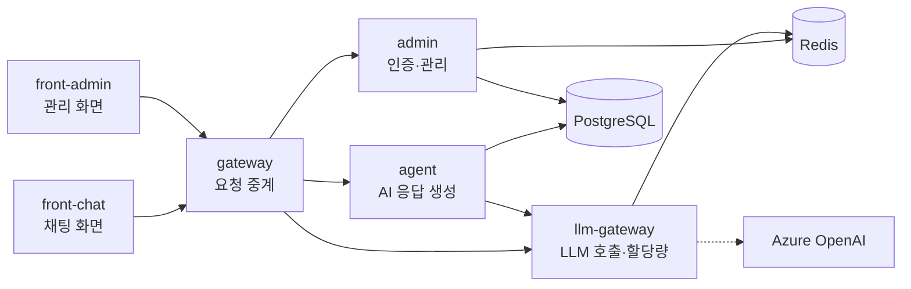
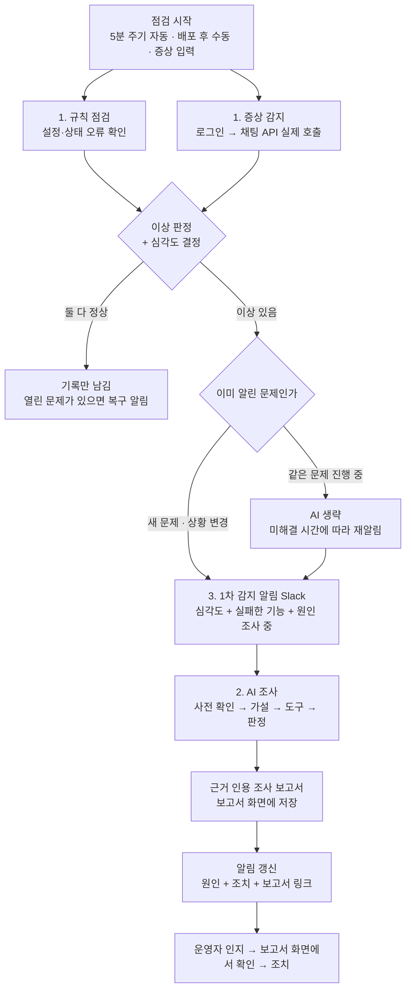

# 2. 문제 정의 및 서비스 기획

> 작성일: 2026-10-04 · 개정: 2026-10-12 (피드백 반영) · 투입: 1인 · 2026-10-12 ~ 11-20 (개발 4주 + 마무리 2주)
> 상세: [기획서](../01-project-proposal.md), [외부 서비스 분석](../03-market-analysis.md)

---

## 프로젝트 명

**KubeGuardian AI** — AI 기반 Kubernetes 서비스 환경 진단 Agent

> Kubernetes 위에서 돌아가는 AI 서비스를 **규칙으로 먼저 점검**하고, 규칙이 문제를 찾았거나 **규칙은 통과했는데 실제로는 서비스가 안 될 때** AI 에이전트가 조사에 들어가 **무엇이 중요한지 골라내고 원인을 근거와 함께 설명**하는 진단 에이전트

---

## 배경 및 문제 정의

### 현재 상황 (As-Is)

**우리 팀의 문제: 장애를 사용자 문의로 알게 되고, 원인은 사람이 앱마다 수작업으로 찾는다.**

우리 팀은 AI 서비스를 빠르게 시작하기 위해 MSA 구조의 템플릿(agent-template-apps-lite)을 직접 만들어 사용한다. 직접 구축·운영한 **SK Inc. PR 보도자료 자동화 서비스**도 이 템플릿에서 출발해 Kubernetes(AWS EKS)에서 운영되고 있다. 이 서비스에서 장애가 나면 지금은 다음 순서로 진행된다.

| 단계 | 현재 방식 |
|---|---|
| 인지 | PR 담당자 같은 사용자가 문의해야 장애를 안다 |
| 확인 | 운영자가 `kubectl get / describe / logs`와 대시보드를 오가며 **앱마다 하나씩 수작업**으로 확인한다 |
| 원인 파악 | 증상이 나타난 곳과 원인이 있는 곳이 달라, 숙련자의 경험에 의존한다 |
| 소요 시간 | 장애 발생부터 원인 파악까지 **약 3~5일** (사용자 문의 대기 + 수작업 진단 포함, 경험 기반 추정) |

**우리 서비스의 구조.** 앱 6개가 각각 별도 레포로 나뉘어 있고, Kubernetes 배포 설정은 공용 레포(shared-infra)에서 관리한다. 새 AI 서비스는 이 템플릿을 복제해서 시작한다.

**일반화: 이 문제는 우리 서비스만의 것이 아니다.** 요즘 서비스는 화면, 요청 중계, 핵심 로직, 인증, 외부 연동을 각각 독립된 서비스로 나누는 MSA(마이크로서비스 아키텍처)로 개발하는 것이 일반적이다. 그래서 Kubernetes 위에서 서비스 하나를 운영하려면 보통 다음을 함께 관리해야 한다.

- 서비스 조각마다 따로 있는 **여러 개의 코드 레포와 컨테이너 이미지**
- 조각마다 따로 뜨는 **여러 개의 Pod**(앱 실행 단위)와 이들을 잇는 Service(내부 주소)
- 여러 조각이 함께 쓰는 **공유 설정**(ConfigMap·Secret), DB, 캐시

조각끼리 네트워크로 서로 호출하기 때문에, 한 곳의 문제가 호출 경로를 타고 **다른 곳의 증상으로** 나타난다. 이 구조의 서비스를 운영하는 팀이라면 같은 어려움을 겪는다.

### Pain Point

| 구분 | 고통점 |
|---|---|
| **보이지 않음** | Pod(앱 실행 단위)가 모두 Running·Ready로 정상 표시되는데 서비스는 안 된다. Kubernetes 상태만 봐서는 장애가 보이지 않는다 |
| **멀리 있음** | 증상이 나타난 곳과 원인이 있는 곳이 다르다. 사용자는 gateway에서 502 오류를 보지만, 원인은 llm-gateway의 LLM 할당량 소진이나 admin과 Redis 사이의 연결 끊김이다 |
| **너무 많음** | 경고·이벤트·재시작 기록이 쌓여 있지만 대부분 지금 장애와 무관하다. 무엇이 중요한지 고르는 일이 숙련자의 경험에 의존한다 |
| **시간** | 위 세 가지에 더해 사용자 문의를 기다려야 하므로, 장애 발생부터 원인 파악까지 약 3~5일(추정)이 걸린다. PR 업무는 보도 시점과 위기 대응처럼 시간에 민감해서, 서비스 중단이 곧 업무 중단이다 |

> 실제 운영 사례: 여러 레포가 공유 설정(ConfigMap)을 덮어써서 생긴 장애, agent 메모리 부족으로 인한 강제 종료, gateway 응답 시간 초과(504), DB 스키마 불일치. 모두 **kubectl 한 번으로는 원인이 보이지 않았던** 장애다.
>
> 참고: 원본 템플릿에는 클러스터에 그대로 배포하면 gateway가 하위 서비스를 찾지 못하는 설정 누락도 있다. 이는 템플릿을 고쳐서 해결할 문제라 문제 정의의 중심에서는 제외하고, 데모 시나리오로만 사용한다.

### 기회 요인

- **규칙으로 풀 수 있는 것은 규칙으로**: 서비스와 Pod의 연결 불일치(Endpoint가 비어 있음), 포트 불일치, 이미지 받기 실패처럼 조건이 명확한 문제는 코드로 확정할 수 있다.
- **규칙이 못 하는 것은 AI로**: 여러 신호를 연결하고, 증상에서 원인을 거슬러 올라가고, 소음 속에서 중요한 것을 고르는 일은 LLM 에이전트의 **추론 + 도구 호출**로 자동화할 수 있다.
- **검증된 구조**: 룰로 먼저 거르고 필요할 때만 LLM을 쓰는 구조는 BeingAX 뉴스 판정에서 비용·일관성 효과를 이미 확인했다.
- **재사용**: 같은 템플릿에서 출발한 서비스가 여럿이라, 템플릿 구조를 아는 진단 도구는 여러 서비스에 적용할 수 있다.

---

## 목표 사용자 (Target User)

| 사용자 | 역할·업무 특성 | 주요 사용 방식 |
|---|---|---|
| **템플릿 기반 AI 서비스의 개발·운영 담당자** (주 사용자) | 서비스 코드를 개발·배포하고 운영까지 맡는다. Kubernetes 배포는 할 줄 알지만 장애 원인 분석 경험은 많지 않다 | 이상 알림을 Slack으로 받고 보고서 화면에서 원인 확인, 배포 직후 점검, 자동 점검이 못 잡는 증상은 직접 입력 |
| **장애 1차 대응 담당자** | 장애 알림을 받고 가장 먼저 상황을 파악해야 한다. 쌓인 신호 중 무엇부터 볼지 판단이 필요하다 | Slack 알림의 심각도와 "지금 중요한 것" 요약으로 무엇부터 볼지 판단 |

---

## 프로젝트 목표

### 정성적 목표

- **목표 1: 반복 진단 업무 자동화** — 운영자가 kubectl로 하던 확인(상태·이벤트·로그·호출 경로)을 **5분마다 자동으로** 수행하고, 이상이 있을 때만 운영자에게 알린다
- **목표 2: 의사결정 지원** — 수십 개 신호 중 "지금 중요한 것"을 사용자 영향 순으로 고르고, 원인을 **근거(도구가 수집한 원본 데이터) 인용**과 함께 설명해 조치 판단을 돕는다
- **목표 3: 정량 평가 체계 구축** — 원인을 미리 아는 장애를 일부러 만들어 넣고 정답과 비교하는 방식으로, 에이전트의 효과를 숫자로 증명한다

### 정량적 목표 (KPI)

**비교 기준은 "현재 방식"이다.** 현재 방식은 사용자 문의로 장애를 알고 사람이 수작업으로 원인을 찾는 것(약 3~5일, 추정)이다. 같은 장애 시나리오를 두 조건으로 실행해 비교하고, 효과는 이 현재 방식 대비 전/후로 보고한다.
- **기준 조건**: 규칙 점검만 실행 (AI 없음). 현재 방식에서 자동화할 수 있는 부분
- **비교 조건**: 규칙 점검 + AI 조사

| **성과 지표** | **전: 현재 수준** (경험 기반 추정, 실측 아님) | **후: 목표 수치** | **개선** | **측정 방법** | **평가 주체** |
|---|---|---|---|---|---|
| **원인 파악 시간** | **약 3~5일** (4,320~7,200분. 사용자 문의 대기 + 수작업 진단) | **7분 이내** (점검 주기 5분 + 2분) | **약 99.8~99.9% 단축** | 장애를 주입한 시점부터 원인이 담긴 알림 갱신까지의 시간. 평가 러너가 주입 시각과 알림 이력의 갱신 시각을 자동 기록 | 자동 측정 |
| **원인 규명 커버리지** | **50%** (Kubernetes 상태로 원인이 안 보이는 시나리오 4개 중 2개를 사람이 맞힌다고 판단. 규칙만 쓴 기준 조건은 0%에 가까움) | 60% 이상 | **+10%p 이상** | Kubernetes 상태 조회(`kubectl get·describe`, 이벤트)만으로는 원인이 드러나지 않는 시나리오 중, 원인을 맞힌 비율 | 사람 기준 (아래 참고) |
| **7분 이내 원인 정확도** | 거의 0% (사용자 문의가 와야 조사가 시작되고, 7분 안에 수작업으로 원인을 찾을 수 없음) | 70% 이상 | **+70%p 이상** | 장애 주입 후 7분 이내에 발송된 알림·보고서의 1순위 원인이 미리 정해 둔 정답과 일치하는 비율. 시나리오마다 3회 반복 | 사람 기준 (아래 참고) |
| 원인 정확도 (시간 제한 없음) | **약 69%** (시나리오 8개 판단: 보임 3개 모두, 일부 보임 1개 반반, 안 보임 4개 중 2개 → 5.5/8) | 전체 시나리오 70% 이상 | **사람과 비슷한 수준 유지, 시간만 단축** | 조사 보고서의 1순위 원인이 미리 정해 둔 정답과 일치하는 비율. 시나리오마다 3회 반복하고 신뢰구간과 반복 일관성을 함께 기록 | 사람 기준 (아래 참고) |
| 확인 항목 감소율 | 0% (모든 항목을 사람이 직접 확인) | 90% 이상 (예: 47개 → 중요 문제 2건) | **확인 항목 90% 이상 감소** | 장애 때 사람이 직접 훑어봐야 하는 항목(경고·이벤트·재시작 기록 등)이 KubeGuardian이 골라준 중요 문제 수로 얼마나 줄었는지. 1 − (중요 문제 수 / 확인할 항목 수). 예: 47개 → 2건이면 95.7% | 자동 계산 |
| **장애 감지 시간** (1차 알림) | 사용자 문의 후 인지 (위 3~5일에 포함) | 6분 이내 (점검 주기 5분 + 점검 실행 1분, 잠정) | **사후 인지 → 사전 인지** | 장애를 주입한 시점부터 1차 감지 알림이 발송되기까지의 시간 (알림 이력 기준). AI 조사를 기다리지 않는다 | 자동 측정 |
| 잘못된 알림 | 해당 없음 (알림 체계 없음) | 0건 | — | 장애가 없는 정상 환경에서 주기 점검을 연속 4시간(48회) 실행하는 동안 알림 이력에 기록된 알림 수 | 자동 측정 |
| 근거 일치율 | — | 90% 이상 (잠정) | — | 보고서에 인용된 근거가 실제로 그 문장의 내용을 뒷받침하는 비율. 예: "429를 반환한다" 문장에 붙은 근거를 열었을 때 정말 429 로그가 있는가. 보고서 샘플 10건 검토 | 사람 기준 → 비교 실험 4 이후 AI 기준 |
| AI 조사 시간·비용 | 위 3~5일에 포함 (분리 측정 안 함) | 중앙값 120초 이내, 1회 10만 토큰 이하 (잠정) | — | 평가 러너가 자동 기록 | 자동 측정 |

- "전"은 경험 기반 추정치이므로 개선 폭도 **추정치 기준**이다. W4 평가에서 같은 시나리오의 기준 조건(규칙만) 측정값과 실제 감지 시간으로 교체한다.
- **사람의 정확도(약 69%, 커버리지 50%)는 판단 기반 추정이다.** 시나리오 8개를 "Kubernetes 상태로 원인이 보이나"로 나눠, 보이는 3개(A1·A3·A5)는 맞히고, 일부 보이는 1개(B1)는 반반, 보이지 않는 4개(C1·C2·C5·E1)는 2개를 맞히는 것으로 가정했다 ((3 + 0.5 + 2) / 8 = 5.5/8). 실측값이 아니며 평가 결과와 비교해 교체한다.
- 개선율은 같은 구간(장애 발생부터 원인 파악까지)의 전/후만 비교한다. 사용자 문의 대기 시간이 3~5일의 상당 부분을 차지할 수 있어, 인지 단축과 원인 파악 단축의 효과를 따로 나누어 주장하지는 않는다.

#### 정확도를 어떤 기준으로 평가하는가: 사람 기준 vs AI 기준

| 구분 | 내용 | 쓰임 |
|---|---|---|
| **사람 기준** (주 지표) | 시나리오 설계 단계에서 사람이 정답 원인을 정해 두고(`expected.yaml`), 보고서의 1순위 원인이 그 정답과 일치하는지 판정한다. 샘플은 본인이 직접 검토한다 | 원인 규명 커버리지, 원인 정확도, 근거 일치율(초기) |
| **AI 기준** (보조 지표) | LLM이 보고서가 정답과 의미상 일치하는지, 인용 근거가 문장을 뒷받침하는지 채점한다(LLM-as-judge) | 비교 실험 4에서 사람 기준과의 일치도를 확인하고, 일치하면 전체 채점을 대체 |

- 에이전트 평가 지표(커버리지·정확도 등)는 AI 에이전트 평가에 쓰이는 방식을 그대로 쓰되, **효과의 기준선은 항상 현재 방식**이다. "에이전트가 몇 점"이 아니라 "현재 방식 대비 무엇이 얼마나 달라졌나"를 보고한다.
- 사람 기준과 AI 기준이 다르게 나오는 시나리오는 그 차이 자체를 평가 결과에 분석으로 남긴다.
- **사람은 시간만 있으면 원인을 대부분 찾는다**(그래서 3~5일이 걸린다). 그래서 정확도는 두 가지로 본다. 시간 제한이 없을 때는 사람 추정(약 69%)과 비슷한 수준을 유지하고, **7분 이내 정확도**(사람은 거의 0%)에서 차이를 만든다. 이 프로젝트가 주장하는 가치는 정확도 우위가 아니라 **같은 수준의 정확도를 3~5일이 아니라 7분에 내는 것**이다. 정확도가 사람에 못 미치는 구간(예: 복합 원인)은 한계로 따로 적고, 최종 판단은 사람이 보고서를 검토해 내린다는 전제를 둔다.
- 시나리오 8개 × 3회로 표본이 작아 시나리오 1개가 12.5%p에 해당한다. 정확도는 신뢰구간(Wilson 구간)과 반복 일관성(같은 시나리오 3회 중 일치 횟수)을 함께 기록한다.

> **현재 수준은 경험 기반 추정치이며 실측값이 아니다.** 과거 장애의 진단 시간 기록이 없고, 시나리오를 설계한 본인이 다시 진단하면 증상만 보고도 어떤 시나리오인지 알아보게 되어 실측값이 진단 능력이 아니라 기억을 반영하기 때문이다. 그래서 문서에는 추정치를 "추정"으로 명시하고, 같은 시나리오를 규칙만으로 돌린 기준 조건 측정값을 함께 보고한다. "사람이 하던 일 중 얼마나 대신했나"는 원인 규명 커버리지(대신 찾아준 원인)와 확인 항목 감소율(대신 걸러준 항목)로 측정한다.
>
> **잠정 목표의 근거**
> - 장애 감지 시간·원인 파악 시간: 장애가 점검 직후에 생기면 다음 점검까지 최대 5분을 기다리고, 점검 실행(규칙 점검 + API 시나리오 호출)에 최대 약 1분이 걸린 뒤 1차 감지 알림이 나간다(6분). AI 조사는 알림 뒤에 이어서 진행되고(잠정 120초) 끝나면 알림을 원인으로 갱신한다(7분). 평가 중에는 Slack 전송을 생략하고 알림 이력의 발송·갱신 시각으로 측정한다.
> - 조사 시간·비용: 조사 1건의 도구 호출 상한을 20회로 두었다. LLM 판단 1회에 3~6초, 입력 2천~5천 토큰(지침 + 누적된 도구 결과)으로 보면 상한까지 썼을 때 60~120초, 4만~10만 토큰이다. 즉 지금 값은 측정값이 아니라 상한에서 역산한 값이며, W2에 에이전트가 처음 동작하면 실제 측정값으로 다시 정한다.
> - 근거 일치율: 샘플 10건 중 1건 정도의 어긋남까지 허용하는 수준이다. 비교 실험의 LLM 채점이 본인 채점과 일치하면 이후에는 LLM 채점으로 전체를 측정한다.
> - 보고서의 모든 사실 문장에 근거를 붙이는 것 자체는 검증 코드가 강제하므로(항상 100%) 지표로 쓰지 않고, 붙은 근거가 맞는지를 지표로 쓴다.

---

## 핵심 기능 정의

점검, 이상 판정, 알림, 인지, 확인, 조치, 복구를 서로 다른 단계로 나눈다.

### 프로세스: 점검 주기와 알림 주기

| 단계 | 담당 | 내용 |
|---|---|---|
| ① 점검 | 자동(5분) / 수동 | 규칙 점검 + 증상 감지. **점검 주기는 5분 고정**이고, 정상이면 기록만 남긴다 |
| ② 이상 판정 | 코드 | 장애 신호·증상 여부와 **심각도**를 결정한다. 이미 알린 문제인지(문제 지문) 확인한다 |
| ③ 1차 알림 | Slack | **이상 판정 직후, AI 조사를 기다리지 않고** 심각도와 실패한 기능을 알린다. 알림 주기는 점검 주기와 별개다: 새 문제, 상황 변경, 원인 갱신, 복구, 미해결 리마인더 때만 발송한다 |
| ④ 조사·원인 갱신 | AI → Slack | 새 문제 또는 상황이 바뀐 경우에만 조사하고, 끝나면 1차 알림을 원인·조치·보고서 링크로 갱신한다. 조사가 실패하거나 상한에 도달해도 1차 알림은 이미 나간 상태다. 같은 문제가 진행 중이면 AI를 다시 호출하지 않는다 |
| ⑤ 인지·확인 | 운영자 | 알림을 보고(인지), 보고서 화면에서 원인과 근거를 확인한다 |
| ⑥ 조치 | 운영자 | 보고서의 권장 조치를 사람이 실행한다 (자동 실행 없음) |
| ⑦ 복구 확인 | 자동 | 다음 점검에서 정상이 되면 복구 알림 1회를 보낸다 |

- 이상을 **감지**하는 것(②)과 운영자에게 **알리는** 것(④), 운영자가 **인지**하고 원인을 **확인**하는 것(⑤)은 서로 다른 단계다. 단계마다 시각을 기록해 어디서 시간이 걸리는지 구분한다. 인지 시각은 확인(ack) 기능을 넣는 경우에만 기록한다(옵션).

### 알림 정책: 심각도와 재알림

| 심각도 | 표시 | 해당 | 알림 | 재알림 |
|---|---|---|---|---|
| **긴급** | 🔴 | 핵심 경로 장애 (로그인·채팅이 전부 실패) | 즉시 | 미해결 시 30분 후 첫 리마인더, 이후 2시간마다, 리마인더는 총 3회까지 |
| **주의** | 🟠 | 일부 사용자·일부 기능 실패 | 즉시 | 2시간 후 1회 |
| **참고** | 🟡 ⚪ | 잠재 위험, 개선 권고 | 없음 | 보고서 화면에만 표시 |

- 같은 문제(문제 지문 동일)는 AI를 다시 호출하지 않고, 리마인더는 기존 알림에 "N분째 미해결" 한 줄만 단다.
- 문제 지문이 바뀌면(원인 변경, 새 신호 추가) 다시 조사하고 같은 알림을 갱신한다.
- 해결되면 복구 알림 1회를 보내고 리마인더를 멈춘다.
- 알림에는 보고서를 붙이지 않고 **링크만** 담는다. 보고서 알림(메일 등)은 옵션이며 이번 범위에서는 만들지 않는다.
- 확인(ack) 시 리마인더를 멈추는 기능은 옵션이다. 이번에는 시간 기반 리마인더만 쓴다.

### 1. 주기 점검: 규칙 점검 + 증상 감지

- **5분마다 자동으로 실행**한다 (Kubernetes CronJob). 배포 직후에는 Slack에서 `/kg check`로 바로 실행할 수도 있다.
- Kubernetes 리소스를 **Kubernetes API(Python 클라이언트)로 읽기 전용 수집**해, 서비스·Pod 연결(Endpoint), 포트, 설정 참조, Pod 기동 상태 같은 **명확한 오류를 규칙 약 10종으로 확정**한다.
- 동시에 **로그인 → 채팅 API를 실제로 호출**해 "Kubernetes는 정상인데 서비스가 안 되는" 증상을 잡는다. 자동 점검으로 재현되지 않는 증상(예: 특정 사용자만 실패)은 운영자가 Slack에서 `/kg investigate 증상`으로 직접 입력해 조사를 시작할 수 있다.
- 결과를 보고 AI 조사 여부를 코드로 판정한다. 정상이면 LLM을 호출하지 않는다.

### 2. AI 조사·검증 에이전트

- **가설 없이 확인할 것을 먼저 확인한다.** Pod 상태, Service의 Endpoint 연결, 이벤트, API 호출 결과처럼 가설 없이도 확정할 수 있는 사실을 먼저 정리한다.
- 그다음 원시 신호 수십 개에서 **사용자 영향 순으로 중요한 문제를 골라내고**, 원인 가설(최대 3개)을 세운다.
- 읽기 전용 도구 약 7종(서비스 호출 관계 조회, 로그 조회, 이벤트 조회, API 직접 호출, 앱 상태 조회 등)으로 가설을 하나씩 확인하고 지지 / 배제 / 판단 보류로 판정한다.
- 보고서의 모든 사실 문장은 도구가 수집한 데이터(근거)를 인용해야 하며, 검증 코드가 이를 강제한다. 인용이 없는 문장은 "추정"으로 표시한다.
- **보고서 하나로 판단이 끝나도록** 쓴다. 후속 질문 없이도 원인을 믿고 조치할 수 있게, 원인과 근거뿐 아니라 배제한 가설과 그 이유, 확인한 범위와 확인하지 못한 것, 구체적인 조치 방법과 재검증 방법을 함께 담는다.

### 3. 이상 알림 (Slack)

- 이상을 판정하면 **AI 조사를 기다리지 않고 1차 감지 알림**(심각도, 실패한 기능, 원인 조사 중)을 Slack으로 보낸다. 조사가 끝나면 같은 알림을 **원인·조치·보고서 화면 링크로 갱신**한다. 정상이면 알리지 않는다.
- 같은 문제는 위 알림 정책에 따라 재알림하고, 해결되면 복구 알림을 한 번 보낸다.

### 4. 정답 기반 평가 체계

- 원인을 미리 아는 장애 시나리오 8개와 정상 환경 1개를 장애 주입 도구(Chaos Mesh 등)로 재현하고, 정답 파일과 비교해 자동 채점한다.
- 시나리오는 난이도별로 구성한다: 신호 하나로 원인이 확정되는 것, 여러 신호를 연결해야 하는 것, **증상과 원인이 다른 서비스에 있고 Kubernetes 상태는 정상인 것**(핵심), 무관한 신호가 섞여 헷갈리게 만드는 것.
- 평가 러너 실행 중에는 Slack 전송을 생략하고 알림 이력에 기록한다 (반복 실행으로 인한 알림 노이즈 방지).

### 서비스 결과물

정성적 목표 1·2를 위해 사용자가 실제로 받는 결과물은 다음과 같다. **알림은 Slack으로, 보고서와 점검 기록은 보고서 화면에서 확인한다.** 주기 점검에서 이상이 나오면 알림 대상(채널 또는 DM)으로, Slack 명령(`/kg check`, `/kg investigate 증상`)으로 직접 실행하면 명령을 입력한 곳의 스레드로 요약과 화면 링크를 받는다. 알림을 받은 운영자는 업무 노트북에서 화면을 열어 처리하므로, 자세한 확인은 Slack이 아니라 화면에서 한다. CLI는 개발·평가용이다.

| 결과물 | 언제 받나 | 담기는 내용 | 대응 목표 |
|---|---|---|---|
| **① 이상 알림** (Slack) | 주기 점검에서 이상이 나왔을 때, 또는 `/kg check`를 실행했을 때 | 심각도, 한 줄 요약("지금 중요한 것" 최대 3건: 사용자 영향 순, 확신도 포함), 보고서 화면 링크. 나머지는 개선 권고로 분리 | 목표 1, 2 |
| **② 조사 보고서** (화면) | 알림의 링크, 또는 `/kg investigate` 결과 메시지의 링크 | 결론(원인)과 확신도, 영향 범위, 근거 목록, 가설별 판정(지지 / 배제 / 판단 보류)과 그 이유, 확인한 범위와 확인하지 못한 것, 권장 조치(실행할 명령 수준), 재검증 방법 | 목표 2 |
| **③ 점검 결과 이력** (화면) | 언제든 | 점검 시각, 규칙별 통과·실패와 이유, 증상 감지 결과, 판정에 쓴 값(점검 시점의 Pod·Service·Endpoint 상태 등), 이상 시 보고서 링크 | 목표 1 |

**보고서 화면**은 웹 화면 5페이지로 구성한다: 보고서 목록, 보고서 상세(근거 포함), 근거 원문, 점검 이력, 조사 과정. 근거 번호(`[근거 14]`)의 원문(도구가 수집한 로그·이벤트·API 응답, 마스킹 후)은 화면에서 열어 본다. 조사 과정 페이지에서는 에이전트가 어떤 순서로 무엇을 확인했는지(단계, 도구 호출, 근거) 볼 수 있다. 화면의 조작은 **점검 실행** 하나이며, 점검도 조회 전용 도구만 쓴다.

**화면의 경계.** 점검 결과에는 판정에 쓴 값(점검 시점의 Pod·Service 상태, 문제가 된 로그 발췌)이 포함된다. 그러나 이는 점검 시점에 고정된 **판정 근거**이며, 실시간 상태 조회·리소스 탐색·로그 검색·배포 기능은 제공하지 않는다. 정상 상태의 상시 확인은 kubectl이나 팀의 기존 도구를 쓴다.

**목표 1 (반복 진단 자동화)** — 사람이 kubectl로 하던 확인을 5분마다 대신하고, 이상이 있을 때만 ①로 알린다.

| 사람이 하던 일 | KubeGuardian이 대신 하는 것 |
|---|---|
| `kubectl get pods`, `describe`로 상태 확인 | Pod·Deployment 상태 규칙 점검 |
| `kubectl get events`, `logs` 훑어보기 | 이벤트·로그 수집 (마스킹) |
| Service와 Pod 라벨, 포트, 설정 주소를 눈으로 대조 | 설정 대조 규칙 점검 (Endpoint 연결 포함) |
| curl로 로그인 → 채팅 직접 호출 | API 실제 호출 (증상 감지) |
| 앱별 상태·할당량 화면 확인 | 허용된 앱 API 조회 |

**목표 2 (의사결정 지원)** — "무엇부터 볼지"는 ①의 심각도와 요약이, "왜 그런지, 무엇을 할지"는 ②의 보고서가, "그 판단을 믿어도 되는지"는 ②의 가설 판정·확인 범위와 근거 원문이 답한다.

---

## 설계 판단

PoC에서 선택한 방식과 그 이유다. 상세는 ADR로 남긴다 (1~3번 우선).

| # | 항목 | 결정 | 이유 | 선택하지 않은 대안 |
|---|---|---|---|---|
| 1 | 주기 실행 | **Kubernetes CronJob** (`*/5 * * * *`, 이전 점검이 끝나지 않았으면 건너뜀) | 한 Job이 규칙 점검, API 호출, AI 조사를 모두 수행한다. 별도 스케줄러나 관측 스택이 필요 없고, Kubernetes 운영 기능을 직접 익히는 학습 목적과도 맞다 | 외부 스케줄러, Prometheus Alertmanager를 점검 트리거로 사용 |
| 2 | Kubernetes 접근 | **Python `kubernetes` 클라이언트(API)**, 읽기 전용 | 응답이 구조화(JSON)되어 파싱이 필요 없고, 클러스터 안 인증·RBAC가 그대로 적용된다. 쉘 호출이 없고 읽기 전용 호출만 코드로 제한하기 쉬우며 테스트가 쉽다 | kubectl CLI 호출 (출력 파싱, 쉘 실행 위험). kubectl은 사람이 직접 확인할 때만 사용 |
| 3 | 관측 스택 | **Prometheus 미도입** | 대상 장애가 상태·선언 기반이다. 메트릭 추세가 필요한 시간 의존 장애는 범위 밖이고, minikube 자원과 주 10~15시간 제약에서 학습 비용이 크다. 점검 시작 지점을 분리해 두어 후속에서 Alertmanager 알림을 점검 트리거로 연결할 수 있다 | Prometheus + Alertmanager 도입 |
| 4 | 알림 대상 | **기존 운영 채널 또는 DM에서 시작**, 알림량·수신자가 늘면 전용 채널 개설 | 정상이면 알림이 없고 장애 때만 오므로, PoC 단계에서는 별도 채널이 필수가 아니다 | 전용 채널 즉시 개설 |
| 5 | 보고서 확인 | **웹 화면**(조회 + 점검 실행, FastAPI 서버 렌더링), 알림에는 링크만 | 알림은 짧게, 보고서는 근거를 열어 보며 읽는 구조가 맞다 | Slack 스레드에 전체 보고서 첨부, 메일 발송(옵션으로 후속) |
| 6 | 평가 중 알림 | **Slack 전송 생략**, 알림 이력에 기록 | 장애 감지 시간·원인 파악 시간은 알림 이력의 발송·갱신 시각으로 측정한다. 반복 실행에서 알림이 쌓이지 않게 한다. 실제 전송은 스모크 1회와 데모 때만 확인한다 | 평가 전용 채널로 전송 |

---

## 비교 실험

기능과 별도로, 에이전트 기술을 **같은 시나리오·같은 지표로 비교**해 효과를 숫자로 남긴다. 위 평가 체계를 그대로 사용하므로 추가 비용은 구현 부분에 한정된다. 일정 여유에 따라 위에서부터 진행한다.

| 순서 | 비교 대상 | 비교 내용 | 비용 |
|---|---|---|---|
| 1 | 에이전트 구현 방식 | LangGraph vs 직접 구현한 도구 호출 루프 — 정확도, 토큰, 코드량 | 중 |
| 2 | 조사 지침 주입 방식 | 지침 전체를 프롬프트에 넣기 vs 필요한 지침만 불러오기(Skills 방식) — 정확도, 토큰 | 하 |
| 3 | 도구 연결 방식 | 함수 직접 호출 vs MCP 서버 경유 — 외부 에이전트(Claude Code 등)에서 같은 도구 재사용 확인 | 하 |
| 4 | 보고서 채점 방식 | 사람 기준 채점 vs LLM 채점(LLM-as-judge) — 일치도 | 하 |
| 5 | 도구 호출 방식 | 도구를 하나씩 호출 vs 코드를 써서 한 번에 실행(Code Mode, Agent Sandbox 격리) — 정확도, 토큰, 호출 수 | 상 |
| 6 | 외부 벤치마크 | 자체 시나리오 vs 공개 SRE 벤치마크(ITBench) 방식 채점 | 상 (실행 가능성 확인 후) |
| 7 | 에이전트 운영 방식 | API 서버 배포 vs Kubernetes CRD 기반 에이전트(kagent) — 설계 비교 문서로만 | 하 |
| 8 | 모델 조합 | 조사·선별 모델 조합(gpt-4.1 단일 / 조사 gpt-4.1 + 선별 gpt-4.1-mini / 추론 계열 gpt-5 계열) — 정확도, 조사 시간, 토큰 | 하 |

---

## 기대 효과

- **업무 효율화**
  - 사용자 문의를 기다리지 않고 **장애 발생 후 6분 안에 감지 알림, 7분 안에 원인**을 받음 (현재: 인지부터 원인 파악까지 약 3~5일, 추정 → **약 99.8% 이상 단축**)
  - 사람이 직접 확인해야 할 항목을 **90% 이상 줄임** (예: 47개 → 중요 문제 2건)
  - 원인 조사를 **2분 안에** 1차 보고서로 받음 (현재 수작업 진단은 위 3~5일에 포함)
- **품질 향상**
  - 규칙만으로는 원인을 짚지 못하는 장애(증상과 원인이 다른 서비스에 있는 경우)에서 **원인 규명 60% 이상**
  - 모든 판단에 근거 원문이 연결되어 **검증 가능한 진단**
- **비용 절감**
  - 숙련자에게 집중되던 원인 분석을 서비스 개발·운영 담당자가 1차로 수행
  - 정상일 때 LLM을 호출하지 않는 구조로 **평상시 LLM 비용 0**, 조사 1회 10만 토큰 이하

---

## 범위 및 제약사항

### In Scope

- 진단 대상: 템플릿 앱 6개(front-chat, front-admin, gateway, agent, admin, llm-gateway) + PostgreSQL·Redis를 minikube(로컬 단일 노드 Kubernetes)에 올린 **단일 네임스페이스**. 시나리오는 로그인 → 채팅 **핵심 경로**를 기준으로 한다
- 5분 주기 자동 점검(Kubernetes CronJob)과 수동 점검: 규칙 점검(약 10종), 증상 감지(로그인 → 채팅 API 호출), Slack 명령으로 즉시 점검·증상 입력, AI 조사 여부 판정
- Kubernetes API(Python 클라이언트) 기반 읽기 전용 수집
- AI 조사·검증 에이전트, 조사 보고서
- Slack 알림 (심각도별 알림·재알림, 같은 문제 중복 알림 방지, 복구 알림. 알림 대상은 기존 채널 또는 DM)
- **보고서 화면** (보고서 목록·상세, 근거 원문, 점검 이력, 조사 과정, 점검 실행)
- 읽기 전용 도구 계층, 민감정보 마스킹·근거 검증·호출 횟수 상한
- 장애 시나리오 8개 + 정상 환경 1개, 자동 평가 러너
- Slack 앱: 알림 발송 + 명령 수신(`/kg check`, `/kg investigate`), 허용 채널·사용자 제한
- CLI — 개발·평가용
- 비교 실험 (일정 여유에 따라 우선순위순)

### Out of Scope

- **조치 에이전트** — 보고서의 권장 조치를 실제로 실행하는 에이전트. 이번에는 원인과 권장 조치·재검증 방법만 제시하고 클러스터를 변경하지 않는다. 조사 보고서를 입력으로 받는 **다음 단계 과제**로 둔다
- 보고서에 대한 후속 질문(대화) — 보고서 하나로 판단이 끝나도록 만드는 데 집중
- **변경 검증** (배포 전후 비교·영향 범위 재검증)
- **상태 대시보드** — 실시간 리소스 상태 조회, 리소스 탐색, 로그 검색 화면(ArgoCD, Kubernetes Dashboard 영역). 정상 상태의 상시 확인은 kubectl·기존 도구를 사용한다
- 보고서의 메일 발송, 알림 확인(ack) 기능 — 후속 옵션
- 부하나 시간이 지나야 나타나는 장애 (CPU 제한에 따른 연쇄 타임아웃, 점진적 메모리 증가)
- 멀티 클러스터, 실제 운영 클러스터(AKS·EKS) 적용
- **Prometheus**·서비스 메시 등 별도 관측 스택 구축 — 대상 장애가 상태·선언 기반이고 시간 의존 장애가 범위 밖이며 자원·시간 제약이 있다. 후속에서 점검 트리거로 연결하는 것을 검토한다
- 다른 서비스에 바로 붙이는 범용 애드온 배포, 원본 템플릿 기여
- 과거 조사 기억(Memory)

### 제약사항

| 구분 | 제약 |
|---|---|
| 인력·기간 | 1인 · **2026-10-12 ~ 11-20** (개발 4주 + 마무리 2주, 주마다 분량 조절) |
| 실행 환경 | 로컬 minikube 단일 노드 (CPU 4, 메모리 10GB) |
| 외부 통신 | Slack API(slack.com)로 나가는 통신이 사내망에서 허용되어야 함. Slack 앱 생성 승인이 필요함 (메시지 발송, 슬래시 명령, Socket Mode 권한). 전용 채널 개설은 필수가 아니며, 알림 대상(기존 채널 또는 DM)이 필요하다 |
| LLM | Azure OpenAI만 사용. 사내 SSL 프록시 때문에 클러스터 안에 CA 인증서 주입 필요 |
| 보안 | 에이전트 권한은 조회(get/list/watch)만 허용, Secret은 목록을 받되 값은 즉시 버리고 키 이름만 남김, 로그·이벤트는 마스킹 후 LLM에 전송. 화면과 Slack에 표시하는 내용에도 같은 마스킹을 적용 |
| 결과 편차 | LLM 응답이 매번 달라질 수 있어 temperature 0, 시나리오당 3회 반복으로 평가 |
| 과거 데이터 | 과거 장애의 진단 시간 기록이 없음 → 현재 수준은 경험 기반 추정치(약 3~5일)로 표기하고, 효과는 기준 조건(규칙만) 대비 측정값으로 보완 |

### 예외 처리 방침

예상하지 못한 상황은 점검과 알림이 조용히 실패하지 않도록 아래 방침으로 처리한다. 세부 구현은 상세 설계에서 정한다.

| 상황 | 처리 방침 |
|---|---|
| Kubernetes API·앱 API 수집 실패 | 해당 항목을 "확인하지 못함"으로 표시하고 나머지 점검은 계속한다 |
| LLM 실패·호출 상한 초과 | 규칙·증상 결과만으로 알림하고 보고서에 "조사 미완"을 표시한다 |
| 규칙에 없는 이상, 근거 불충분 | 증상 기반으로 조사하되, 원인을 확정하지 못하면 "원인 미확정"으로 보고하고 확신도를 낮춘다 |
| 점검기 자체 장애 (CronJob 실패 등) | "점검 중단" 알림을 별도로 보낸다. 점검이 조용히 멈추면 정상으로 오인하기 때문이다 |
| Slack 전송 실패 | 재시도 후에도 실패하면 알림 이력에 남기고, 보고서 화면에서 확인할 수 있게 한다 |
