# 08. 시연 영상 스크립트

**영상(자막·내레이션·슬라이드)에는 시나리오 ID(A7, C8 등)를 쓰지 않고 장애 내용(서비스 주소명 오류, LLM 배포명 변경 등)으로 부른다. 장면 제목과 운영 설명에는 촬영하는 사람을 위해 ID를 남긴다.**
시연 영상의 촬영, 편집, 내레이션(자막) 대본이다. 녹화는 세 묶음(0 슬라이드 다섯 장: R0 시나리오 소개 네 장·R13 성과 요약 한 장, ① R1~R6(R1 화면 둘러보기, R6 원복 포함), ② R7~이력 질의)으로 나눠 **무음으로** 찍고 5분 이내로 편집한 뒤, **편집이 끝난 영상에 맞춰 내레이션을 따로 후시 녹음한다.** 이 문서는 **녹화 순서대로** 구성했다. 창 배치는 이 문서 §2의 레이아웃 프리셋을 따르고, 촬영 전 준비와 복구 방법은 [07-demo-script.md](../07-demo-script.md)의 해당 절을 따른다. 11월 9일 반영된 [PR #228](https://github.com/skax-jihyeryu/KubeGuardian/pull/228)부터 규칙이 적발한 장애(경로 A)는 규칙 기반 진단 결과로 마무리한다. **경로 A에서도 근거 요약 LLM은 백그라운드에서 동작한다. 원인 조사 AI는 규칙 장애 신호 없이 기능 점검이 실패한 경로 B에서만 실행한다.** 07-demo-script는 촬영 전 준비(§2), A7 원복과 복구(§4~5)에 참고한다. 장면마다 보여 줄 창이 달라 화면 배치를 고정하지 않고 프리셋 3개(L1~L3)로 나누고, 프리셋마다 macOS 데스크톱(Spaces) 하나를 배정해(L1=데스크톱 1, L2=2, L3=3) 촬영 중에는 창을 옮기지 않고 `⌃←`/`⌃→`(또는 `⌃1`~`⌃3`)으로 이웃 데스크톱 한 칸씩만 넘긴다. **장애 주입과 증상 확인 명령은 데스크톱 2의 ③ 명령 터미널에서 화면에 보이게 친다(R3, R8의 점검은 데스크톱 3 브라우저 창 B의 "지금 점검" 버튼으로 한다).** 서비스 주소명 오류의 원복(R6: reset 명령)도 ③에서 화면에 보이게 짧게 치고, 정상 확인은 이어서 데스크톱 1(L1) 창 A의 "지금 점검" 버튼으로 점검을 돌려 판정이 "정상"으로 돌아오고 이슈가 해결되는 것(열린 이슈 없음)을 보인 뒤, 데스크톱 2의 Slack에서 복구 알림을 확인한다. LLM 배포명 변경의 원복과 정상 확인은 영상에서 빼고 녹화 밖에서 한다. 로그 명령 교체 같은 나머지 준비는 녹화를 멈춘 뒤 같은 ③에서 한다(영상에 안 나온다).

## 1. 영상 개요

- 보여 주는 것: 시작 슬라이드(시나리오 소개 R0)로 세 가지 시나리오를 소개하고, 실제 화면 둘러보기(R1)로 화면의 네 영역을 보인 뒤 두 장면과 이력 질의를 보인다. 두 장면이다. 첫째, 서비스 주소에 점 하나가 들어간 장애(A7)는 규칙이 적발해 규칙 기반 진단 결과를 보여 준다. 둘째, Kubernetes에 흔적이 없어 규칙이 못 잡는 장애(C8, 잘못된 LLM 배포명)는 기능 점검 실패로 AI 조사 에이전트가 열려 사실 수집, 가설 계획과 도구 검증을 거쳐 근거가 붙은 보고서를 작성한다. 끝에는 이력 질의 에이전트가 과거 비슷한 장애를 채팅으로 답하고, 마지막은 성과 요약 슬라이드(R13)로 맺는다. 시작은 시나리오 소개 슬라이드(R0)와 실제 화면 둘러보기(R1)다.
- 방식: **녹화는 세 묶음으로 나눠 무음으로 찍는다(FocuSee 마이크 끔).** 묶음 0은 PPT 슬라이드 다섯 장을 슬라이드쇼로 이어서 찍는다(1~4장 R0 시나리오 소개: 1장 전체 개요, 2장 시나리오 1 강조, 3장 시나리오 2 강조, 4장 시나리오 3 강조 / 5장 R13 성과 요약 Outro. 편집에서 R13을 영상 끝으로 옮긴다). 묶음 ① R1~R6(화면 둘러보기, 규칙, A7, 원복)을 찍고 녹화를 끈다. **Slack 알림이 오는 장면(R5-1, R8, R10)은 L3에서 작업하는 동안 macOS 알림 배너가 뜨고, 배너가 보이는 채로 컷 없이 `⌃←` 데스크톱 전환 애니메이션 그대로 Slack이 있는 데스크톱(2)으로 넘어간다(한 테이크).** R6의 원복과 정상 확인(L1의 "지금 점검"으로 점검이 "정상"이 되고 이슈가 해결됨, 이어 L2 Slack의 복구 알림)은 영상에 나오고, 그 뒤 녹화 밖에서 로그 명령 교체 등 준비를 하고, 묶음 ② R7~이력 질의(C8)를 찍는다(LLM 배포명 변경의 원복과 정상 확인은 영상에서 뺐고 R11-7 뒤 녹화 밖에서 한다). 편집에서 세 묶음을 이어 5분 이내(목표 4분 55초 이하, 현재 편집 지도 4분 54.1초, 파일은 표지 3.5초가 붙어 4분 57.6초)로 줄이고, 자막·기능 라벨 카드·강조 박스·배속을 넣는다. 대기 구간은 편집에서 지운다. **내레이션은 녹화 중에 읽지 않는다. 편집이 끝난 영상을 틀어 놓고 장면별로 따로 후시 녹음하며, 읽을 문장과 시각·길이는 [§8 녹음 대본](#8-녹음-대본-후시-녹음)에 모았다.**
- 구간은 가이드의 권장 구성(소개, 실행, 핵심 로그, 결과, 성과 요약)을 규칙 경로와 AI 조사 경로로 다시 묶은 것이다. 핵심 로그와 결과는 C8 장면 안에 들어 있고, 성과 요약은 편집 카드가 아니라 Outro 슬라이드(R13)다. 기능이 처음 나올 때는 화면 왼쪽 위에 '기능 라벨 카드'(기능 이름과 한 줄 설명, 2~3초)를 넣고 그 기능을 짚는 자막과 내레이션 한 문장을 붙인다([§5 기능 소개 지도](#기능-소개-지도)).
- 파일: `[사번]_[성명]_시연영상.mp4`, MP4, 500MB 이하.
- 화면 사진은 이 서비스의 실제 기록(A7 = 이슈 #15·점검 #90, C8 = 이슈 #16·점검 #92)을 11/12에 캡처한 것이다. 촬영 때 번호와 시각은 달라진다.

### 장면 × 레이아웃

로그가 필요한 장면(R5-2, R8, R9)에서만 로그 창을 짚는다(L3의 창 B 장면은 로그 창이 곁에 보이기는 한다). 주입과 증상 확인 명령은 **데스크톱 2의 ③ 명령 터미널**에서 치므로 영상에 나온다(점검은 R3, R8 모두 데스크톱 3의 브라우저 창 B의 "지금 점검" 버튼이다). 서비스 주소명 오류의 원복(R6)도 ③에서 짧게 쳐 영상에 나오고, 정상 확인은 데스크톱 1 창 A의 "지금 점검" 버튼으로 한 뒤 데스크톱 2 Slack에서 복구 알림을 확인한다. LLM 배포명 변경의 원복·정상 확인은 영상에 없다(녹화 밖). 로그 명령 교체 같은 나머지 준비도 녹화 밖이다. 모든 데스크톱 전환은 이웃 한 칸이다. 프리셋 L1~L3와 데스크톱 배치의 정의는 §2다.

| 장면 | 데스크톱 | 레이아웃 | 보이는 창 | 로그를 보여 주는(또는 안 보이는) 이유 |
|---|---|---|---|---|
| R0 시나리오 소개 | 0 | 슬라이드쇼 | PPT 슬라이드 1~4장(시나리오 소개) 전체 화면 | 로그 필요 없음. 1장 전체 개요 → 2장(시나리오 1 강조) → 3장(시나리오 2 강조) → 4장(시나리오 3 강조)으로 넘기며 강조된 경로를 포인터로 따라간다 |
| R1 화면 둘러보기(R1-1 설정, R1-2 점검 이력, R1-3 이슈, R1-4 이력 채팅) | 1 | L1 | 브라우저 전체 | 왼쪽 메뉴 아이콘(설정, 점검 이력, 이슈)과 상단 "질문" 버튼을 차례로 클릭해 네 영역을 보인다. 로그 필요 없음 |
| R2 A7 주입 | 2 | L2 | Slack + ③ + ⑤ | ③에서 주입 명령을 치고 ⑤에서 gateway 새 Pod가 ContainerCreating → Running, 이전 Pod가 Terminating이 되는 것을 본다. Pod는 Ready라 알림은 아직 없다. 롤아웃이 끝나면 gateway Pod가 바뀌어 ④의 `logs -f`가 끊기므로, 대기 구간에서 `⌃→`로 데스크톱 3으로 가 ④를 새 Pod 기준으로 다시 켠다(편집에서 삭제). 이어 R3은 그 데스크톱 3에서 한다 |
| R3 점검 실행 | 3 | L3 | 창 B(왼쪽 2/3) + ②(오른쪽 위 3/4, 곁에 둠) + ④(오른쪽 아래 1/4, 곁에 둠) | 창 B에서 "지금 점검" 버튼으로 점검하고 점검 상세의 S04 적발을 보인다. 직접 점검은 web 컨테이너에서 돌아 Job 로그가 없어 ②·④는 곁에 둘 뿐이다. 창 B는 묶음 시작 전에 점검 이력 화면을 열어 둔다(주소 복사·붙이기 없음). 점검 직후 뜨는 Slack 배너는 누르지 않고 무시한다 |
| R4 A7 결과 화면 | 3 | L3 | 창 B + ② + ④ | 결과는 화면이 증거다. 창 B 안에서 점검 상세 → 이슈 상세 → 근거 서랍을 보인다(창 B가 화면 왼쪽 2/3라 편집에서 창 B 안을 확대한다). ②·④는 곁에 둘 뿐이다 |
| R5-2 A7 작업자·서비스 로그 | 3 | L3 | 창 B(R4의 이슈 상세) + ②(오른쪽 위 3/4) + ④(오른쪽 아래 1/4) | ②에는 알림 발송과 근거 요약만 찍히고 AI 조사 줄이 없는 것으로 규칙 경로로 끝나 AI 조사가 시작되지 않았음을, ④의 `agent.` 주소 호출 실패 줄로 gateway가 바뀐 주소를 부르다 실패했음을 보인다. 줄이 작아 편집에서 오른쪽 1/3 칸을 확대한다. 끝에서 배너가 보이는 채로 `⌃←` |
| R5-1 Slack | 3 → 2 | L3 → L2 | Slack + ③(빈 프롬프트) + ⑤ | 점검이 끝나면 화면 오른쪽 위에 Slack 알림 배너가 뜨고(알림 스타일 "알림"이라 L3의 R3~R5-2 내내 남아 있다), R5-2를 마친 뒤 배너가 보이는 채로 컷 없이 `⌃←` 전환 애니메이션 그대로 Slack(데스크톱 2)으로 넘어간다. 1차 알림을 Slack이 증거로 보이고, 편집에서 알림 메시지를 확대하고 제목·사유·규칙 진단 줄에 박스를 붙인다. ⑤는 롤아웃이 끝난 마지막 상태. 이어 같은 L2에서 R6 |
| R6 A7 원복 · 정상 확인 · 복구 알림 | 2 → 1 → 2 | L2 → L1 → L2 | Slack + ③ + ⑤, 점검 이력(L1) | ③에서 `bash scenarios/A7/reset.sh`를 쳐 원복하고, `⌃←`로 L1에 가 창 A에서 "지금 점검"으로 점검을 돌려 새 점검 줄이 "정상"이고 "열린 이슈 없음"(이슈 해결)인 것을 보인다. `⌃→`로 L2에 돌아와 Slack의 복구 알림을 확인하고 녹화를 끈다(모두 영상에 나온다). ④ 교체 같은 나머지 준비는 녹화 밖(④는 데스크톱 3) |
| R7 C8 주입 | 2 | L2 | Slack + ③ + ⑤ | ③에서 주입, `kubectl get pods -n dev`(Pod가 모두 Running · Ready), 증상 확인(`chat_failed`)을 차례로 친다. ⑤에 Pod 변화가 없는 것이 "Pod는 그대로인데 채팅 실패"의 근거. ④ llm-gateway 로그는 데스크톱 3에서 계속 켜 둔다 |
| R8 C8 점검 실행 | 2 → 3 → 2 → 3 | L2 → L3 → L2 → L3 | 창 B(점검 이력 · 점검 상세 · 조사 중 표시, 데스크톱 3), Slack(데스크톱 2), 창 B + ② + ④(데스크톱 3) | R7 끝에서 `⌃→`로 L3에 가 창 B의 "지금 점검" 버튼으로 점검하고(R3과 같은 방식, L1로 가지 않는다), 점검 상세에서 기능 점검 chat 실패, "조사 시작", 제목 옆 "조사 중"과 "조사 중: 도구 호출 N/20" 진행 표시를 보인다. 알림 배너가 뜨면 컷 없이 `⌃←` 전환으로 Slack 1차 알림의 "조사 중" 안내를 보이고(R10 전후 비교의 '전'), 이어 `⌃→`로 L3에 돌아와 ④ 서비스 로그(llm-gateway)에 이미 찍힌 `403 … deployment_not_allowed` 줄과 ②의 `[조사 #N] 시작` 줄을 본다(창 B에는 같은 점검의 조사 중 화면이 열려 있다) |
| R9 조사 로그 · R9-2 점검 이력 결과 | 3 | L3 | 창 B(왼쪽 2/3) + ②(오른쪽 위 3/4) + ④(오른쪽 아래 1/4) | 조사 과정(사전 확인, 계획, 도구, 보고서 작성, 근거 번호 대조, 재조사, 가설 판정, 결론)이 이 영상의 핵심이라 로그를 가장 크게. ④는 곁에 두기만 하고, 창 B에는 같은 점검의 조사 중 표시(도구 호출 횟수)가 함께 보인다. 조사가 끝나면 같은 창 B에서 점검 이력 결과(조사 완료 표시)를 한 번 훑는다(R9-2) |
| R10 Slack 갱신 | 3 → 2 → 1 | L3 → L2 → L1 | Slack + ③(빈 프롬프트) + ⑤, 창 A(L1) | 조사가 끝나면 알림 배너(스레드 후속 답글)가 뜨고, 배너가 보이는 채로 `⌃←` 전환 그대로 Slack으로 넘어간다. Slack의 알림 갱신(전후 비교), 스레드 답글, 보고서 링크가 증거다. 링크를 누르면 기본 브라우저의 창 A에서 이슈 상세(보고서)가 열리고 macOS가 데스크톱 1(L1)로 이동한다(R11). ⑤는 Pod 변화 없음 |
| R11 C8 보고서 | 1 | L1 | 브라우저 전체(창 A) | 링크가 연 보고서(이슈 상세) 화면만 보인다 |
| R11-7 이력 질의 | 1 | L1 | 브라우저 전체(창 A) | R11-5 뒤 같은 L1의 이슈 상세(보고서 화면)에서 채팅 패널을 연다(맥락 칩에 현재 이슈가 붙는다). 채팅 패널만 보인다. 영상은 여기서 끝나고, LLM 배포명 변경의 원복·정상 확인은 녹화 밖이다 |
| R13 성과 요약 | 0 | 슬라이드쇼 | PPT 슬라이드 5장(Outro) 전체 화면 | 로그 필요 없음. 카드 번호 ①②③④를 차례로 짚는다. 묶음 0에서 R0 다음 장(5장)으로 찍고 편집에서 끝으로 옮긴다 |

### 사진의 표시 범례

| 표시 | 뜻 |
|---|---|
| 빨간 실선 박스와 빨간 원 속 숫자 1, 2, 3 | 그 장면에서 누르거나 이동하는 곳. 숫자는 누르는 순서 |
| 노란 점선 박스와 노란 원 속 글자 A, B | 누르지 않고 "여기를 보라"는 강조(편집에서도 박스를 붙이는 자리) |
| 회색 박스 | 가린 영역(외부 LLM 호스트 이름) |

사진은 `assets/08-demo/NN-이름.png`이고 번호는 녹화 순서다. 사진의 목록 화면에는 "기간 11/09" 같은 필터를 걸어 두었다. 촬영 화면에서도 같은 필터를 걸어 두면 목록 맨 위의 11/12 점검 줄(`해결 #18` 등)을 피할 수 있다.

## 2. 레이아웃 프리셋

녹화 캔버스는 1920×1080(16:9)이다. 화면을 하나로 고정하지 않고 장면에 따라 프리셋 3개를 바꿔 쓰며, 프리셋마다 macOS 데스크톱 하나를 배정한다. 로그가 필요 없는 장면에서는 브라우저를 크게 보이고, 로그가 필요한 장면에서는 브라우저(창 B)를 왼쪽 2/3에 두고 오른쪽 1/3에 작업자 로그(②, 위 3/4)와 서비스 로그(④, 아래 1/4)를 함께 보이고, 장애를 넣는 장면에서는 Slack을 왼쪽 2/3에, 명령 터미널(③, 위)과 Pod 감시(⑤, 아래)를 오른쪽 1/3에 함께 보인다(읽는 순서는 명령 → Pod 변화 → Slack 알림이다). **로그만 보이는 화면은 없다.** 그림 원본은 [00-layout.svg](assets/08-demo/00-layout.svg)이다.

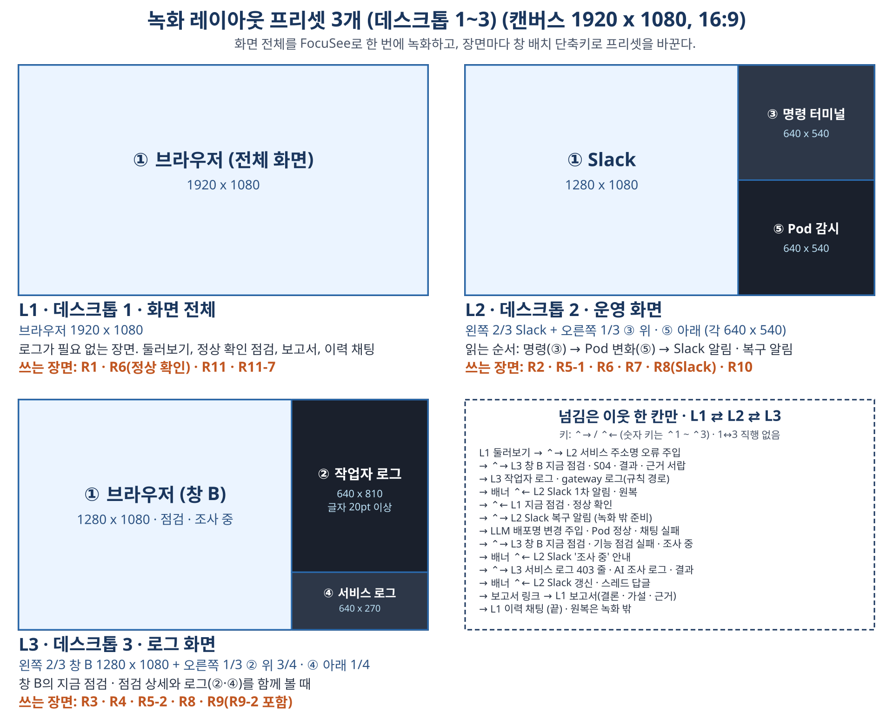

| 프리셋 | 이름 | 영역 | 들어갈 내용 | 쓰는 장면 |
|---|---|---|---|---|
| L1 | 화면 전체 | ① 브라우저 1920×1080(창 A) | 로그가 필요 없는 장면. 화면 둘러보기(설정, 점검 이력, 이슈, 이력 채팅 패널), C8 보고서, 이력 질의. 글자가 가장 크게 보인다. 원복 뒤 정상 확인 점검(R6)은 직접 점검이라 Job 로그가 없어 여기서 한다. Slack 보고서 링크(R10)가 이 창 A에서 열린다 | R1(R1-1~R1-4), R6(정상 확인), R11, R11-7 |
| L2 | 운영 화면 | 왼쪽 2/3: Slack 1280×1080, 오른쪽 1/3: 위 ③ 명령 터미널 640×540 + 아래 ⑤ 대상 서비스 Pod 감시 640×540 | 장애 주입 명령과 Pod 변화, Slack 알림을 함께 볼 때. 읽는 순서는 명령(③) → Pod 변화(⑤) → Slack 알림이다 | R2, R5-1, R6(원복 · Slack 복구 알림), R7, R8(Slack "조사 중" 안내), R10 |
| L3 | 로그 화면 | 왼쪽 2/3: 브라우저 창 B 1280×1080, 오른쪽 1/3: 위 3/4 ② 작업자 로그 640×810 + 아래 1/4 ④ 서비스 로그 640×270 | 작업자 로그와 서비스 로그를 한 화면에서 볼 때, 그리고 이 장면들의 "지금 점검"과 점검 상세·결과 화면을 창 B에서 볼 때. 서비스 주소명 오류(R3~R5-2)는 창 B에서 점검 실행·결과 화면을, ②에 알림 발송·근거 요약만 있고 조사 줄이 없는 것과 ④의 `agent.` 주소 호출 실패 줄을, LLM 배포명 변경(R8, R9)은 창 B의 점검 상세(조사 중 표시, 점검 이력 결과)와 조사 로그, ④의 403 줄을 보인다. 창 B는 묶음 시작 전에 점검 이력 화면을 열어 두고 그 장면의 "지금 점검"부터 이어서 쓴다 | R3, R4, R5-2, R8(창 B · ④ 403 줄 · ② 조사 시작), R9(R9-2 포함) |

- Slack은 L2의 왼쪽 2/3 자리에 둔다. 데스크톱 2에는 Slack 창만 두므로 `⌘` + `` ` ``로 앞으로 가져올 필요가 없다.
- 터미널 글꼴: L2의 오른쪽 640×540 칸(③·⑤)과 L3의 오른쪽 아래 640×270 칸(④)은 16pt 이상, L3의 오른쪽 위 640×810 칸 ②는 20pt 이상이다. **640×540 칸은 16pt에서 약 18줄(640×270 칸은 약 9줄, 640×810 칸의 ②는 20pt에서 약 21줄)이라, 긴 줄이 줄바꿈되면 더 줄어든다. 리허설 녹화에서 읽히는지 꼭 확인한다.** 읽기 어려우면 글자를 키우는 대신 ② 명령에 `| grep --line-buffered -v '"GET '`를 붙이거나 필터를 줄인다.
- 자막 띠는 따로 두지 않는다. 자막과 구간 이름은 편집에서 올린다.
- 터미널에 환경 변수나 비밀값이 찍히지 않게 한다. `env`, `printenv`, `kubectl get ... -o yaml`(Deployment, Secret)을 치지 않는다. 프롬프트는 짧게(`$`) 바꾸고, 시작 전에 `clear`로 화면을 비우고, 셸 기록(↑ 키)에 비밀값이 든 명령이 없는지 확인한다.
- **명령 터미널(③)은 데스크톱 2의 오른쪽 위 칸**이고 영상에 나온다. 주입, 증상 확인(R7) 명령은 여기서 화면에 보이게 친다(점검은 L3 창 B의 "지금 점검" 버튼으로 한다). 서비스 주소명 오류의 원복(R6)은 ③에서 짧게 쳐 영상에 나오고, 정상 확인은 L1 창 A의 "지금 점검"으로 한다(LLM 배포명 변경의 원복은 녹화 밖이다). 로그 명령 교체는 녹화를 멈춘 뒤 같은 ③에서 하므로 영상에 나오지 않는다. 장면마다 "할 일"에 칠 명령과 시점을 적었다. 명령 줄에 비밀값이 들어가지 않게 한다.

### 데스크톱 배치

macOS 데스크톱(Spaces) 3개에 프리셋을 하나씩 미리 만들어 두고(R0, R13 슬라이드쇼는 데스크톱 0, 곧 번호 밖의 별도 전체 화면이다), 촬영 중에는 창을 옮기지 않고 `⌃←`/`⌃→`로 이웃 데스크톱 한 칸씩 넘긴다(`⌃1`~`⌃3`도 같은 번호다). 배치를 만드는 절차는 §3 "데스크톱 준비"다. **슬라이드쇼를 전체 화면으로 열면 macOS가 새 Space를 하나 만들어 `⌃1`~`⌃3` 번호가 밀릴 수 있다.** 묶음 0은 따로 녹화하므로, 묶음 0을 찍은 뒤 슬라이드쇼를 `Esc`로 끝내 Space가 사라진 것을 확인하고 묶음 ①을 시작한다.

| 데스크톱 | 레이아웃 | 창 | 장면 |
|---|---|---|---|
| 0 | 슬라이드쇼 전체 화면 | PowerPoint(또는 Keynote) 슬라이드쇼, [00-intro-scenario.pptx](assets/08-demo/00-intro-scenario.pptx)(1~4장 시나리오 소개, 5장 Outro) | R0, R13 |
| 1 | L1 화면 전체 | 브라우저 창 A 최대화 | R1(R1-1~R1-4), R6(정상 확인), R11, R11-7 |
| 2 | L2 운영 화면 | Slack 왼쪽 2/3 + ③ 명령 터미널 오른쪽 1/3 위 반 + ⑤ 대상 서비스 Pod 감시 오른쪽 1/3 아래 반(각 16pt) | R2, R5-1, R6(원복 · 복구 알림), R7, R8(Slack "조사 중" 안내), R10 |
| 3 | L3 로그 화면 | 브라우저 창 B 왼쪽 2/3 + ② 작업자 로그 오른쪽 1/3 위 3/4(20pt) + ④ 서비스 로그 오른쪽 1/3 아래 1/4(16pt) | R3, R4, R5-2, R8(창 B · ④ 403 줄 · ② 조사 시작), R9(R9-2 포함) |

### 전환 방법

녹화 도구는 FocuSee 하나다. 마이크는 끈다(내레이션은 편집 뒤 후시 녹음). 화면 전체를 묶음마다 처음부터 끝까지 한 번에 녹화하고, 장면이 바뀔 때마다 `⌃←`/`⌃→`(또는 `⌃1`~`⌃3`)로 이웃 데스크톱을 넘긴다. 창은 촬영 중에 옮기지 않는다. **일반 장면 사이의 넘김(1~2초)은 편집에서 잘라 낸다. 단, Slack으로 넘어가는 전환(R5-1, R8, R10)은 자르지 않는다.** 알림 배너가 뜬 화면에서 `⌃→`/`⌃←` 데스크톱 전환 애니메이션이 그대로 보이게 한 테이크로 넘어가므로 컷이 없다(§3 "Slack 알림 배너와 데스크톱 전환").

- 장면 순서에 따른 넘김(모든 전환이 이웃 한 칸): 1(R1 화면 둘러보기, 묶음 ① 시작) → `⌃→` 2(R2) → `⌃→` 3(R2 롤아웃 뒤 ④ 다시 켜기, 편집에서 삭제. 이어 창 B에서 R3의 "지금 점검", R4, R5-2의 ② 알림 발송·근거 요약 줄과 ④ 주소 호출 실패 줄) → `⌃←` 2(R5-1, R5-2 끝에서 알림 배너가 뜬 채로 `⌃←` 전환 애니메이션 그대로. 이어 R6의 원복) → `⌃←` 1(R6의 "지금 점검"으로 정상 확인) → `⌃→` 2(R6의 Slack 복구 알림, 녹화 끄기) → (R6 뒤 준비는 녹화 밖) → 2(R7) → `⌃→` 3(R8의 창 B "지금 점검", 점검 상세, 조사 중 표시) → `⌃←` 2(R8의 Slack "조사 중" 안내, 배너가 뜬 뒤 전환 그대로) → `⌃→` 3(R8의 ④ 403 줄, ②의 `[조사 #N] 시작`, 창 B의 조사 중 표시, 이어 R9와 R9-2의 점검 이력 결과) → `⌃←` 2(R10, 배너가 뜬 뒤 전환 그대로) → 1(R11, R10의 보고서 링크가 창 A에서 열려 macOS가 데스크톱 1로 이동) → R11-7(같은 L1, 녹화 끄기) → (녹화 밖: LLM 배포명 변경 원복 · 정상 확인). 숫자 키로는 `⌃1`~`⌃3`이다. ②는 데스크톱 3의 한 창에서, ⑤는 데스크톱 2에서 가려져도 계속 돌고 있어 줄이 이어져 있다.
- **확대(줌) 규격(전 장면 공통).** 클릭·강조 확대는 FocuSee 자동 줌처럼 부드럽게 한다. **줌 인 약 0.5초(ease) → 유지 → 줌 아웃 약 0.5초**로 원래 크기로 돌아온다. 이 문서 표의 '확대' 칸은 `배율 / 중심 / 유지`로 적는다. 배율은 1.3~1.5배, 중심은 강조할 줄·메시지의 가운데 위치(1920×1080 화면 기준)이며, 유지는 줌 인이 끝난 뒤 머무는 시간이다(확대에 드는 전체 시간은 0.5초 + 유지 + 0.5초). 앞 확대가 줌 아웃한 뒤 다음 줌 인을 시작한다. 촬영 때는 화면과 클릭·커서 위치만 기록하고, FocuSee가 클릭 위치를 기준으로 만든 자동 줌을 이 규격에 맞게 조정한다(FocuSee 버전에 따라 메뉴 이름이 다르므로 리허설 녹화로 확인한다).
- **확대를 쓰는 곳과 쓰지 않는 곳.** L1(브라우저 전체. R1, R6, R11, R11-7)과 L2의 Slack 칸(R5-1, R6의 복구 알림, R8의 Slack 안내, R10)은 확대한다. L3의 창 B(왼쪽 2/3, 1280×1080. R3, R4, R8, R9-2)는 화면의 2/3라 L1보다 글자가 작으므로 1.3~1.5배로 확대하고, 중심은 창 B 안(x 0~1280)의 위치로 잡는다(오른쪽 1/3 터미널은 확대에서 잘려도 된다). R5-2의 L3(오른쪽 1/3 칸의 로그 줄)와 R8의 L3 로그 부분은 ④ 칸의 줄(R8은 403 줄)이 주인공이라 확대한다. R9(L3)는 **짧은 핵심 줄만 확대하고, 640폭 칸에서 여러 줄로 접히는 긴 줄(계획, 근거 번호 대조, 가설 판정, 결론)은 확대하지 않고 박스를 쓴다**(확대하면 줄 끝이 화면 밖으로 잘려 읽을 수 없기 때문이다). 이유와 배율은 R9 표에 줄마다 적었다.
- 화면 비율: 녹화 결과는 16:9(1920×1080)로 내보낸다. 맥북 내장 화면(16:10)이면 위아래가 조금 남으므로, FocuSee 내보내기 설정에서 16:9로 맞추는 방식(여백 또는 잘라내기)을 고른다. 잘라내기를 고르면 맨 위 메뉴 막대와 맨 아래 Dock 근처에 중요한 내용을 두지 않는다.
- 선명도: Retina 화면은 2배 해상도로 녹화되므로, 편집에서 일부를 확대해도 글자가 크게 흐려지지 않는다. 그래도 터미널 글자 크기(L2의 640×540 칸과 L3의 640×1080 칸 16pt, L3의 ② 20pt 이상)는 녹화 전에 맞춰 둔다.

### 터미널 명령

**② 작업자 로그** (항상 켜 둔다. 데스크톱 3의 오른쪽 1/3 위 3/4 한 창(20pt)에서 돌린다)

```bash
kubectl -n kubeguardian logs -f deploy/diagnostic-agent --all-containers --since=1s
```

- web, worker, listener가 역할 표시와 함께 섞여 나온다. [#275](https://github.com/skax-jihyeryu/KubeGuardian/pull/275)의 새 로그 형식이라 `grep` 필터는 필요 없다. web의 `/healthz`, `/static` 접속 줄은 이미 빠져 있다. 화면 접속 줄 `[web] … "GET …" 200`이 섞여 거슬리면 `| grep --line-buffered -v '"GET '`를 붙일 수 있다. 서비스 주소명 오류 구간(R5-2)에서는 R4의 화면 조작 접속 줄이 알림 줄을 위로 밀어낼 수 있으므로, 밀려나면 이 필터를 붙인 명령으로 켠다(묶음 ②에도 그대로 써도 된다) [촬영 시 확인].
- 새 형식 실측(11/16 18:57 배포 후): 한 줄은 `YYYY-MM-DD HH:MM:SS INFO [역할] 내용`이다.

```text
2026-11-16 18:57:47 INFO [worker] 작업자 시작: /data/kubeguardian.db (알림 Slack)
2026-11-16 18:57:49 INFO [web] Uvicorn running on http://0.0.0.0:8080 (Press CTRL+C to quit)
2026-11-16 18:57:57 INFO [web] 127.0.0.1:60386 - "GET /llm-gateway/checks HTTP/1.1" 200
2026-11-16 18:57:49 INFO [listener] 확인 버튼 수신 시작 (Socket Mode)
```

- 이전 실측(18:35, 옛 형식)을 새 형식으로 옮긴 줄: `2026-11-16 18:35:58 INFO [web] [알림] M1 발송 이슈 #21 (Slack)`, `2026-11-16 18:36:03 INFO [worker] 근거 요약: ev-0663 done 3.4초 입력 339 출력 177`. 지금 점검(직접 점검)은 web 컨테이너에서 돌아 알림 줄이 `[web]`로 나온다.
- 이 문서의 `[조사 #N] …` 리허설 줄은 옛 형식 원문에 `YYYY-MM-DD HH:MM:SS INFO [worker] ` 접두를 붙여 옮긴 **형식 변환**이다(리허설 원문은 옛 형식이다). 실측이 아닌 줄은 장면마다 출처를 밝혔다.

**④ 서비스 로그** (L3의 오른쪽 아래 1/4, 데스크톱 3. 대상 앱 로그라 형식은 그대로다)

```bash
# 서비스 주소명 오류 장면(R5-2): 기능 점검이 채팅을 부를 때 gateway가 점이 붙은 주소로 호출하다 실패하는 줄
kubectl -n dev logs -f deploy/gateway -c gateway --since=1s

# LLM 배포명 변경 장면(R8): 기능 점검이 채팅을 시도할 때 찍히는 403 줄
kubectl -n dev logs -f deploy/llm-gateway -c llm-gateway --since=1s | grep --line-buffered -E 'deployment_not_allowed|provider call failed' | perl -pe 'BEGIN{$|=1} s#https?://[^/\s"]+#<외부 호스트>#g'
```

- gateway(서비스 주소명 오류): 네임스페이스 `dev`, 디플로이먼트 `gateway`, 컨테이너 `gateway`다(`kubectl -n dev get deploy`로 확인했고 컨테이너는 하나다). 필터 없이 전체 로그를 띄우고, 아래 두 줄은 촬영 때 커서로 짚고 편집에서 박스·확대로 강조한다(2026-11-19 실측 기준 `GET /health` 줄은 10분에 14줄 정도라 두 줄을 덮을 만큼 많지 않다). 장애 때 실측(2026-11-19, gateway Pod 로그를 읽기 전용으로 확인): `2026-11-19 11:10:28 [INFO] gateway - 프록시 요청: POST /api/v1/agent/invoke -> http://agent.:8006/api/v1/invoke`, `[ERROR] gateway - 업스트림 요청 최종 실패: http://agent.:8006/api/v1/invoke - [Errno -2] Name or service not known`. 같은 호출에서 `[WARNING] … 업스트림 요청 실패 (시도 1/2)`와 `[ERROR] … ServiceException: CONNECTION_ERROR | path=/api/v1/agent/invoke …` 줄도 함께 보인다(강조는 위 두 줄만). 정상 줄(11/16 실측)은 `-> http://agent:8006/…`처럼 점이 없다. gateway 시각은 UTC라 작업자 로그의 한국 시각과 9시간 어긋난다. 외부 호스트 주소가 없어 가림 처리는 필요 없다. 접힌 줄이 읽히는지는 [촬영 시 확인]이다.
- gateway Pod가 주입·원복으로 교체되면 `logs -f`가 끊긴다. 서비스 주소명 오류 구간에서는 **R2 롤아웃이 끝나 L3에 도착한 뒤 새 Pod 기준으로 다시 켠다**(대기 구간이라 편집에서 삭제. `⌃→`로 데스크톱 3에 도착해 `Ctrl+C`, `↑` `↩`를 누르고, 이어 L3의 창 B에서 R3을 한다). 녹화 시작 전에도 이 gateway 명령으로 켜 둔다. R6 원복으로 Pod가 다시 바뀌어 끊기는데, 그 뒤 녹화 밖에서 llm-gateway 명령으로 바꿔 켠다. ⑤의 `-w`는 끊기지 않는다.
- llm-gateway(LLM 배포명 변경): 11/18 평가 기록(`eval/history/20261118T201216Z-C8`, 근거 ev-0009)에서 llm-gateway Pod 로그에 `[llm-gateway(ERROR)] - chat_completions provider call failed | trace_id=… | 403: Azure OpenAI API 호출 실패 (403): {"error": {"code": "deployment_not_allowed", …`와 `ServiceException: 403 … deployment_not_allowed … Deployment 'gpt-4.1-next' 은(는) 허용되지 않습니다` 줄이 있는 것을 확인했고(조사가 같은 grep `deployment_not_allowed|provider call failed`로 읽은 줄), 11/19 사용자가 서비스 로그에 403 줄이 찍히는 것을 확인했다.
- httpx 줄에 외부 LLM 호스트 주소가 그대로 찍히므로 `perl`로 `<외부 호스트>`로 가린다. 실측 정상 줄 예: `INFO:     10.244.120.82:55586 - "POST /api/v1/chat/completions HTTP/1.1" 200 OK`, `2026-11-16 15:00:09,294 [httpx(INFO)] - HTTP Request: POST <외부 호스트>/openai/deployments/gpt-4.1/chat/completions?api-version=2024-10-21 "HTTP/1.1 200 OK"`. 장애 때 403 줄 문구는 위 11/18 평가 기록의 줄이고, 화면 확인은 **[촬영 시 확인]**이다.

**③ 명령 터미널** (L2의 왼쪽 위, 데스크톱 2. 저장소 루트에서 친다. 영상에 나오는 명령과 녹화 밖 명령을 나눠 적었다)

```bash
# 영상에 나온다
KG_TYPO=dot bash scenarios/A7/inject.sh          # R2 서비스 주소명 오류 주입
bash scenarios/A7/reset.sh                       # R6 서비스 주소명 오류 원복(이어서 L1 "지금 점검"으로 정상 확인, L2 Slack 복구 알림 확인)
bash scenarios/C8/inject.sh                      # R7 LLM 배포명 변경 주입
kubectl get pods -n dev                          # R7 Pod가 모두 Running · Ready
bash scenarios/C8/verify_symptom.sh              # R7 증상 확인(chat_failed, 403)

# 녹화 밖 (녹화를 멈춘 뒤 같은 ③에서)
bash scenarios/C8/reset.sh                       # R11-7 뒤 LLM 배포명 원복(이어서 L1 창 A의 "지금 점검"으로 정상 확인)
bash scenarios/H0/verify_symptom.sh              # 확인용(OK). 영상의 정상 확인은 L1의 "지금 점검"이다
```

- `make kg-cron-run`(Makefile 171행)은 CronJob에서 Job만 만든다. 영상에는 나오지 않고, 원복 뒤 정상 확인(R6)도 L1의 "지금 점검" 버튼으로 하므로 이 대본의 흐름에서는 쓰지 않는다. Job 로그도 영상에 쓰지 않는다. 확인만 하려면 `kubectl -n kubeguardian logs -f job/<Job 이름>`을 쓴다.
- 영상의 점검은 이 터미널이 아니라 **화면의 "지금 점검"(직접 점검) 버튼**으로 한다(R3 서비스 주소명 오류와 R8 LLM 배포명 변경은 L3의 창 B, 원복 뒤 정상 확인 R6은 L1의 창 A). 직접 점검은 web 컨테이너에서 돌아 Job 로그와 규칙 결과 줄이 터미널에 나오지 않는다.

**⑤ 대상 서비스 Pod 감시** (L2의 오른쪽 아래, 데스크톱 2. 녹화 전에 켜 두고 영상 동안 끄지 않는다)

```bash
kubectl get pods -n dev -w
```

- dev의 Pod 10개(admin, agent×3, front-admin, front-chat, gateway, llm-gateway, postgres, redis)가 먼저 목록으로 나오고, `-w`는 변화가 있을 때만 줄이 붙는다. R2(서비스 주소명 오류 주입)에서는 gateway 새 Pod가 ContainerCreating → Running이 되고 이전 Pod가 Terminating이 되는 줄이 붙는다. R7(LLM 배포명 변경 주입)에서는 줄이 붙지 않는다. DB 한 행만 바뀌어 Pod가 그대로이기 때문이고, 이것이 "Pod는 그대로인데 채팅 실패"의 근거다. Pod 이름과 시각은 촬영 때 달라지며, 사진의 줄은 모두 **형식 예시**다(Pod 이름은 `gateway-xxxxx` 형태로 적었다).

`kubectl -n kubeguardian logs deploy/diagnostic-agent -c web`만 따로 보면 접속 로그뿐이라 영상에 넣을 가치가 없다. ② 명령은 `--all-containers`로 합쳐 본다.

## 3. 녹화 전 준비 (녹화 밖)

준비 상세는 [07-demo-script.md](../07-demo-script.md) §2를 따른다. 요약은 다음이다.

- 창 띄우기: ①, ②, ④, ⑤ 창과 ③ 명령 터미널을 띄워 둔다. ② 로그, ④ 서비스 로그(묶음 ①은 gateway 명령, 묶음 ②는 llm-gateway 명령), ⑤ Pod 감시(`kubectl get pods -n dev -w`)를 먼저 켜고, ③은 빈 프롬프트로 둔다. ①은 `http://localhost:8080`(보고서)과 Slack 탭을 쓴다. 창 배치는 아래 "데스크톱 준비"로 만든다. **다른 앱의 알림은 끄되 Slack 알림은 보이게 한다(집중 모드는 끈다. 아래 "Slack 알림 배너와 데스크톱 전환").**
- port-forward: `make kg-web`으로 `http://localhost:8080`을 연다(Makefile의 `kubectl port-forward service/diagnostic-agent 8080:8080`). 촬영 도중 끊기면 R1부터 다시 찍는다.
- **브라우저 창 A·창 B와 링크 열림(R10).** 창 A(데스크톱 1)와 창 B(데스크톱 3)는 서로 다른 브라우저 앱으로 띄운다(예: 창 A = 기본 브라우저, 창 B = 다른 브라우저). 기본 브라우저의 창은 창 A 하나뿐이어야 Slack 보고서 링크(R10)가 창 A에서 열린다. macOS는 링크를 기본 브라우저의 가장 최근 창에서 열고 그 창이 있는 데스크톱으로 이동하므로(L2 → L1, 이웃 한 칸), 창 B 쪽 브라우저가 기본 브라우저이면 링크가 창 B(L3)에서 열려 화면이 작아지고 L2 → L3로 가게 된다. 기본 웹 브라우저 설정과 시스템 설정 → 데스크톱 및 Dock의 "응용 프로그램으로 전환할 때, 열려 있는 윈도우가 있는 Space로 전환" 설정을 리허설에서 확인한다. [촬영 시 확인] 링크가 창 A에서 열리고 데스크톱 1로 이동하는지, 이동 장면이 영상에 어떻게 나오는지.
- **창 B의 시작 화면.** 묶음 ①은 시작 전에, 묶음 ②는 녹화 밖 준비에서 창 B를 점검 이력 화면(`http://localhost:8080`)으로 열어 둔다. R3·R8에서 바로 "지금 점검"을 누르므로 L1로 가거나 점검 상세 주소를 복사해 붙이는 단계는 없다.
- **열린 이슈 없음**: 점검 이력 상단 띠가 "열린 이슈 없음"이어야 한다. 11/12 현재는 이슈 #18(11/10 10:02~, 채팅 실패, 긴급)이 11/12 10:55 점검 #153에서 해결되어 이 조건을 만족한다. 이 문서의 사진도 그 뒤에 캡처했다. 촬영 직전에도 확인한다. 사진 속 "열린 이슈 없음"이 아니라 "긴급 1"이 보이면 열린 이슈가 남은 것이다.
- 정시 점검: **A7 묶음(① R1~R6)은 정각(매시 정각 점검)을 피해** 시작한다. 정각 직후 5~10분 사이에 시작하면 R1-2의 "마지막 점검 · 다음 정각" 표시가 여유 있게 보이고 점검 중 정각 CronJob과 겹치지 않는다. C8 묶음(② R7~)의 R8 점검은 L3 창 B의 "지금 점검" 버튼으로 시작한다(정각을 기다리지 않아도 된다). 정각 CronJob과 겹치지 않는 때에 누른다. 조사 대기열이 비어 있어야 한다.
- 녹화 묶음: 묶음 0(R0 슬라이드 네 장, R13 슬라이드 한 장, 5장은 편집에서 끝으로 옮긴다)을 찍고 슬라이드쇼를 종료한다. 이어 묶음 ①(R1~R6)을 찍고 녹화를 끈다. R6의 원복과 정상 확인(L1의 "지금 점검"으로 "정상"·열린 이슈 없음)과 L2 Slack의 복구 알림은 영상에 나온다. 녹화 밖에서(같은 ③에서) 로그 명령을 교체하고 ③·⑤를 비우고 창 B를 점검 이력 화면으로 돌려 둔 뒤, 묶음 ②(R7~R11-7)를 찍는다. 묶음 ②는 R11-7에서 끝나고, LLM 배포명 변경의 원복(③)과 정상 확인(L1 창 A의 "지금 점검"으로 이슈 해결)은 녹화를 끈 뒤에 한다(영상에 안 나온다). 묶음마다 말은 하지 않는다(마이크 끔). 묶음 ①·②는 같은 창 배치에서 찍는다.
- H0 OK: `bash scenarios/H0/verify_symptom.sh`가 OK여야 시작한다(녹화 밖 확인용. 영상의 정상 확인은 "지금 점검"이다).
- CronJob과 diagnostic-agent는 [PR #235](https://github.com/skax-jihyeryu/KubeGuardian/pull/235)의 표시 변경과 [#275](https://github.com/skax-jihyeryu/KubeGuardian/pull/275)의 새 로그 형식을 포함한 이미지여야 한다.
- 터미널 준비: 환경 변수 출력 금지, 프롬프트 단축, 화면 비우기(§2).
- 내레이션 녹음(후시): 녹화는 무음이다(FocuSee 마이크 끔). 세 묶음을 편집해 자막·기능 라벨 카드·강조 박스·배속·중간 생략이 확정된 뒤, 그 영상을 틀어 놓고 **장면별로** 따로 녹음한다. 읽을 문장, 시작~끝 시각, 문장 길이(초)는 [§8 녹음 대본](#8-녹음-대본-후시-녹음)이다.
  - 마이크: 쓸 마이크(내장 마이크가 아니라 쓸 장치)를 고르고, 말하면서 입력 레벨이 움직이는지 본다. 시스템 소리는 녹음하지 않는다. 방해 금지 모드를 켠다.
  - 녹음 세션 시작 전에 말하지 않고 **5초 정적**을 녹음한다(편집에서 잡음 기준으로 쓴다). 묶음마다 정적을 따로 두지 않는다.
  - **문장 단위로 녹음한다.** 말을 틀리면 그 문장만 2초 쉬고 다시 읽는다. 문장 시작 시각에 맞춰 편집 화면의 해당 장면을 보면서 읽는다.
  - 문장이 구간보다 길면 먼저 읽는 속도를 조금 올리고, 그래도 넘치면 편집에서 그 장면 길이를 늘리거나 문장을 줄인다(§8의 길이는 1초에 6음절 기준의 예상값이라 실제로 읽어 보고 맞춘다).
  - 대기 구간을 잘라 낸 자리는 편집이 끝났으므로 말이 끊길 걱정이 없다. 배속·중간 생략 구간에는 말을 넣지 않는다.
- **Slack 알림 배너와 데스크톱 전환 준비.** Slack 알림이 오면 macOS 알림 배너가 화면 오른쪽 위에 뜨고, 배너가 보이는 채로 `⌃←` 전환 애니메이션을 그대로 보이며 Slack이 있는 데스크톱(2)으로 넘어간다(컷 없음, 한 테이크). R5-1(규칙 진단 1차 알림), R8(조사 중 안내가 붙은 1차 알림), R10(조사가 끝난 뒤 스레드 후속 답글)에 쓰고, 세 알림 모두 L3에서 작업하는 도중에 배너가 뜬다(`⌃←`로 넘어간다). R6의 복구 알림은 L1에서 뜨면 `⌃→`로 같은 방식으로 넘어간다. 준비는 다음이다.
  - **Slack 데스크톱 앱 알림 허용**: 시스템 설정 → 알림 → Slack에서 "알림 허용"을 켠다. Slack 앱 환경설정 → 알림에서 테스트 채널은 "모든 새 메시지"로 둔다. 앱을 로그인한 채로 데스크톱 2에 둔다(종료하면 알림이 안 온다).
  - **집중 모드(방해 금지) 끄기**: 촬영 중에는 집중 모드를 끈다(켜면 배너가 안 뜬다). 다른 앱의 알림만 끄고 Slack은 허용한다. 후시 녹음 때는 다시 켠다.
  - **알림 미리보기 표시**: 시스템 설정 → 알림 → Slack → "미리보기 보기"를 "항상"으로 한다(배너에 메시지 본문이 보여야 한다). 배너에 채널 이름과 담당자 이름이 보이면 편집에서 가린다.
  - **알림 스타일**: "알림"(스스로 사라지지 않음)으로 둔다. "배너"(약 5초 뒤 사라짐)로 두면 R3 점검 직후에 떠서 R5-2 끝의 `⌃←` 전에 사라진다. "알림" 스타일이면 배너가 남아 R3~R5-2 내내 L3 오른쪽 위(작업자 로그 터미널 ②의 윗줄)를 가릴 수 있다. 창 B(왼쪽 2/3)는 가리지 않으므로 R3·R4에는 지장이 없고, R5-2에서 ②의 알림·근거 요약 줄이 가려지면 그 장면을 찍기 전에 배너를 닫는다(Slack 알림은 남는다. 이 경우 배너 연출은 생략하고 전환만 찍는다) [촬영 시 확인]. 전환한 Slack 창에서 알림을 읽으면 사라진다.
  - **배너가 뜨는 시점과 처리**: R5-1은 점검이 끝나 1차 알림이 발송될 때(R3의 "지금 점검" 직후 약 5초, 곧 R3 대기 구간~R5-2의 L3 화면), R8은 점검이 1차 알림을 발송할 때(조사 시작 직후, 창 B의 조사 중 표시 화면), R10은 조사가 끝나 스레드 후속 답글이 올라올 때(R9의 결론 줄 뒤, R9-2의 L3 화면)다. 메시지 갱신만으로는 알림이 울리지 않으므로 R10의 배너는 갱신이 아니라 스레드 답글의 것이다. 배너가 뜬 시점에는 누르지 않고 하던 장면(R4, R5-2, R8의 조사 중 확인, R9)을 계속 찍고, 그 장면 끝에서 배너가 보이는 채로 `⌃←`로 넘어가면 편집에서 배너 → 전환 장면이 그 장면 끝에 붙는다. 배너가 이미 사라졌어도 Slack 알림은 남아 있으니 `⌃←`로 넘어가 알림을 보이면 된다(배너 연출만 빠진다) [촬영 시 확인].
  - **전환 방법**: 배너를 누르지 않는다(누르면 Slack 창이 앞으로 와서 전환 애니메이션이 사라진다). 키로 `⌃←`(R5-1, R8, R10 모두 데스크톱 3에서 2로) 한 번을 눌러 슬라이드 애니메이션을 그대로 녹화한다. 동작 줄이기를 끈 상태에서 리허설로 애니메이션이 녹화되는지 확인한다.
  - 배너가 안 뜨거나 타이밍이 어긋나면 그 장면을 다시 찍는다. 배너 없이 전환만 찍으면 "알림이 와서 넘어간다"는 흐름이 사라진다.
- Slack: 테스트 채널만 연다. 채널 이름과 담당자 이름이 보이면 가린다.

### 데스크톱 준비

§2 "데스크톱 배치" 표대로 데스크톱 3개를 한 번 만들어 두고, 촬영 중에는 창을 옮기지 않는다.

1. Mission Control에서 데스크톱을 3개로 만들고, 시스템 설정 → 키보드 → 키보드 단축키 → Mission Control에서 "데스크톱 1~3으로 전환"(`⌃1`~`⌃3`)을 켠다(`⌃→`/`⌃←`도 함께 켜 둔다). 단축키가 목록에 안 보이면 데스크톱이 그 수만큼 없는 것이다.
2. 데스크톱마다 해당 창을 띄워 Rectangle 단축키로 배치한다(배치를 한 번 만들어 둘 때만 쓴다).

| 데스크톱 | 창 배치 | Rectangle 단축키 |
|---|---|---|
| 1 | 브라우저 창 A 최대화 | `⌃⌥↩` (Maximize) |
| 2 | Slack 왼쪽 2/3 + ③ 오른쪽 1/3 위 반 + ⑤ 오른쪽 1/3 아래 반 | Slack `⌃⌥E`(First Two Thirds). ③·⑤는 아래 설명 |
| 3 | 브라우저 창 B 왼쪽 2/3 + ② 오른쪽 1/3 위 3/4 + ④ 오른쪽 1/3 아래 1/4 | 창 B `⌃⌥E`(First Two Thirds). ②·④는 아래 설명 |

   - **오른쪽 1/3의 위·아래 반(640×540)에는 Rectangle 기본 단축키가 없다.** 이 문서를 쓰며 확인하지 않았지만, 먼저 `⌃⌥F`(Last Third)로 오른쪽 1/3 전체를 만든 뒤 위 반·아래 반으로 줄이려면 Rectangle 설정(단축키 탭)에서 해당 동작(예: Top Right Sixth, Bottom Right Sixth가 있으면)에 단축키를 직접 지정하거나, 없으면 창 가장자리를 끌어 640×540으로 수동 배치한다. 배치한 뒤 창 크기가 640×540 안팎인지 확인한다.
   - **데스크톱 3의 오른쪽 1/3 위 3/4(②, 640×810)·아래 1/4(④, 640×270)도 기본 단축키가 없다.** 같은 방식으로 `⌃⌥F`로 오른쪽 1/3을 만든 뒤 창 가장자리를 끌어 640×810과 640×270으로 수동 배치하고 크기를 확인한다.
   - Rectangle은 2/3·1/3 분할이 macOS 기본 타일링에 없어서 쓴다(무료). 설치는 사용자가 하며, 이 문서를 위해 따로 설치하지 않았다. 단축키는 Rectangle 기본값이고, 설치 후 설정 화면에서 실제 값을 확인한다.
   - 터미널 글자: ④, ③, ⑤는 16pt 이상, ②는 20pt 이상으로 미리 맞춘다.
3. 준비 주의
   - 브라우저 창은 데스크톱마다 따로 띄우므로 장면 직전에 해당 창의 페이지를 맞춰 둔다(예: R6 직전 창 A는 R1을 마친 이슈 목록이라 점검 이력 아이콘을 누르고 시작한다). 창 B(데스크톱 3)는 묶음마다 시작 전(묶음 ②는 녹화 밖 준비)에 `http://localhost:8080`의 점검 이력을 열어 두고, R3(서비스 주소명 오류)·R8(LLM 배포명 변경)에서 바로 "지금 점검"을 눌러 같은 창 B에서 점검 상세까지 이어 간다(L1로 가지 않고 주소 복사·붙이기도 없다). 창 A와 창 B는 서로 다른 브라우저 앱으로 띄운다(위 "브라우저 창 A·창 B와 링크 열림").
   - ② 작업자 로그는 데스크톱 3의 한 창(20pt)에서 돌린다. 녹화 전에 켜 둔다.
   - 시스템 설정 → 손쉬운 사용 → 디스플레이 → "동작 줄이기"는 **끈다**(켜면 데스크톱 넘김이 페이드가 되어 Slack 전환의 슬라이드 애니메이션이 안 보인다). Slack으로 넘어가는 전환(R5-1, R8, R10)은 자르지 않고 그대로 쓰고, 그 밖의 넘김은 편집에서 자른다.
   - FocuSee가 데스크톱을 넘겨도 계속 녹화되는지 리허설 첫 1분에 확인한다. 끊기면 녹화 방식(전체 화면 대신 디스플레이 전체 지정 등)을 바꿔 본다.
   - ③과 ⑤는 데스크톱 2에 있고 영상에 나온다. 녹화 전에 `clear`로 ③을 비우고(프롬프트 `$`), ↑ 기록에 비밀값이 든 명령이 없는지 본다. ⑤는 `kubectl get pods -n dev -w`를 녹화 전에 켠다. 로그 명령 교체 같은 녹화 밖 명령은 녹화를 멈춘 뒤 같은 ③에서 친다. 리허설에서 ③·⑤ 글자가 읽히는지 확인한다.

## 4. 녹화 순서

장면 하나가 한 덩어리다. 덩어리마다 **레이아웃 → 할 일 → 합성 화면 사진 → 나와야 할 로그 → 자막·내레이션·편집** 순서로 적었으니, 촬영 때는 지금 찍는 장면만 읽으면 된다. 자막은 화면 아래 띠에 올릴 글이다(내레이션과 별개, 전체는 §5 뒤 "자막 전체 표"). 시각은 최종 영상 기준 예상값이고, 원본 시각도 예상이다. 편집 후 길이는 §5 편집 지도와 같다. 각 장면의 "내레이션"은 편집이 끝난 뒤 **후시 녹음**으로 읽는 문장이다(녹화 중에는 말하지 않는다). 문장은 발표자가 화면을 가리키며 안내하는 말투("여기", "이 줄")로 짧게 썼다. 읽는 시각과 길이는 §8, 기능 라벨 카드는 §5 기능 소개 지도, 확대 규격은 §2 "확대(줌) 규격"이다.

| 장면 | 데스크톱 | 레이아웃 | 사진 |
|---|---|---|---|
| R0 시나리오 소개 | 0 | 슬라이드쇼 | 미리보기 1~4장(경로 미정) |
| R1-1 둘러보기 설정 | 1 | L1 | 기존 캡처 2장 |
| R1-2 둘러보기 점검 이력 | 1 | L1 | 기존 캡처 `01-normal-checks.png` |
| R1-3 둘러보기 이슈 | 1 | L1 | 없음(촬영 때 확인) |
| R1-4 둘러보기 이력 채팅 | 1 | L1 | 기존 캡처 `15-c8-history-qa.png`(패널) |
| R2 A7 주입 | 2 | L2 | 합성 `scenes/R2` |
| R3 점검 실행 | 3 | L3 | 합성 `scenes/R3`(사진은 이전 배치: L2 합성) |
| R4 A7 결과 화면 | 3 | L3 | 기존 캡처 3장 |
| R5-2 A7 작업자·서비스 로그 | 3 | L3 | 없음(촬영 때 확인. 로그 줄은 장면 안 블록) |
| R5-1 Slack과 근거 요약 | 3 → 2 | L3 → L2 | 합성 `scenes/R5` |
| R6 A7 원복 · 정상 확인 · 복구 알림 | 2 → 1 → 2 | L2 → L1 → L2 | 없음(③ 출력, 점검 이력 화면, Slack 복구 알림) |
| R7 C8 주입 | 2 | L2 | 합성 `scenes/R7` |
| R8 C8 점검 실행 | 2 → 3 → 2 → 3 | L2 → L3 → L2 → L3 | 합성 `scenes/R8a`, `R8b`(**사진은 이전 배치**: 이전 L2 합성이라 점검 상세·④·② 위치가 지금과 다르다(지금 L3는 왼쪽 2/3 창 B, 오른쪽 위 ②, 오른쪽 아래 ④). 점검은 데스크톱 3 창 B의 "지금 점검"으로 한다). 창 B의 조사 중 표시와 Slack "조사 중" 안내는 사진 없음(촬영 때 확인) |
| R9 조사 로그 · R9-2 점검 이력 결과 | 3 | L3 | R9 합성 `scenes/R9`(사진은 이전 배치: ②가 왼쪽 1280×1080, 오른쪽 640×1080이 브라우저 한 칸이다. 지금은 왼쪽 2/3가 창 B, 오른쪽 위 3/4가 ②, 오른쪽 아래 1/4이 ④다). R9-2는 사진 없음(촬영 때 확인) |
| R10 Slack 갱신 | 3 → 2 → 1 | L3 → L2 → L1 | 합성 `scenes/R10` |
| R11 C8 보고서 화면 | 1 | L1 | 기존 캡처 6장 |
| R11-7 이력 질의 | 1 | L1 | 없음(캡처는 리허설 뒤) |
| R13 성과 요약 | 0 | 슬라이드쇼 | 미리보기 5장(경로 미정) |

**합성 화면 사진 읽는 법.** `assets/08-demo/scenes/`의 사진은 1920×1080 캔버스에 실제 창 배치대로 화면과 로그를 합친 것이다. 사진은 **이전 배치(프리셋 4개)** 기준이다. 이전 L2 사진(R3, R8a, R8b)은 왼쪽 1280×1080이 ① 브라우저, 오른쪽 위 640×540이 ④ 서비스 로그, 오른쪽 아래 640×540이 ② 작업자 로그라서 지금 배치(R3·R8의 점검과 점검 상세는 L3의 창 B(왼쪽 2/3), 로그는 같은 L3의 오른쪽 위 ② + 오른쪽 아래 ④)와 다르다. 이전 L4 사진(지금의 L2: R2, R5, R7, R10)은 왼쪽 1280×1080이 Slack, 오른쪽 위 640×540이 ③ 명령 터미널, 오른쪽 아래 640×540이 ⑤ Pod 감시라서, 지금 L2(왼쪽 2/3에 Slack, 오른쪽 1/3에 ③·⑤)와 같다. 이전 L3 사진(R9)은 왼쪽 1280×1080이 ② 작업자 로그, 오른쪽 640×1080이 브라우저(점검 상세)라서 지금 L3(왼쪽 2/3가 창 B, 오른쪽 위 3/4가 ②, 오른쪽 아래 1/4이 ④)와 좌우가 반대다. 노란 점선 박스는 강조할 줄이다(§1 범례와 같다). 사진의 로그 줄은 아래 "나와야 할 로그" 블록과 같고, [make_scenes.py](assets/08-demo/scenes/make_scenes.py)에서 데이터로 다시 만들 수 있다. 사진 속 브라우저는 R1 정상 상태 캡처(11/10 기준 점검 이력)나 점검 상세 캡처를 그대로 넣은 것이라, 촬영 때 화면과 번호가 다르다. L2의 Slack 자리는 실제 Slack 캡처([16-slack-example.png](assets/08-demo/16-slack-example.png), 가림 처리)를 잘라 넣었다. R2·R7의 Slack은 자리를 채운 이전 알림이라 이번 장애의 알림이 아니고, 사진에 박힌 A·B·C·D 표시는 R5·R10에서만 의미가 있다. ⑤의 Pod 줄은 모두 형식 예시다. ④는 리허설 전이라 실측이 없는 곳에 "(리허설에서 확인)"을 적었다.

**로그 출처 표기.** 각 장면 로그 블록 위에 출처를 적었다. "실측"은 11/09~11/16 리허설에서 실제로 찍힌 줄이고, "형식 변환"은 옛 형식 실측을 새 형식 접두(`YYYY-MM-DD HH:MM:SS INFO [worker] `)로 옮긴 줄(리허설 원문은 옛 형식, 사진의 날짜·시각 일부는 형식 맞춤)이고, "스크립트 문구"는 `scenarios/*`가 echo하는 문장이고, "형식 예시"는 형식만 확인했고 값은 지어낸 것이다. 모든 장면에서 이슈·점검·근거 번호, Pod 이름, 시각은 촬영 때 달라진다.

### R0. 시나리오 소개 (PPT 슬라이드 1~4장, 묶음 0 · 원본 0:00~0:30 → 편집 24초)

1. **레이아웃**: 데스크톱 0 · 슬라이드쇼 — PPT를 슬라이드쇼 전체 화면(1920×1080)으로 띄워 녹화를 시작한다. 첫 장은 어두운 표지(가운데 로고와 KubeGuardian, 오른쪽 아래 가이드 캐릭터)이고, 편집에서 영상 맨 앞 3.5초로 쓴다. 성과 요약(5장)도 표지와 같은 어두운 배경에 흰 글씨다. 로그는 없다. 표지 다음 소개는 네 장이다. 1장은 전체 개요(번호 1·2·3이 모두 보이고 강조 없음), 2장은 시나리오 1 경로 강조, 3장은 시나리오 2 경로 강조, 4장은 시나리오 3(쌓인 이력) 강조다. 강조 장에서는 해당 경로의 상자와 화살표가 테마 노란색으로 두드러지고 나머지는 흐리다. 성과 요약은 맨 뒤 5장(R13)이다. 파일은 [00-intro-scenario.pptx](assets/08-demo/00-intro-scenario.pptx)(표지 + 1~5장, 실제 슬라이드 6장)다.
2. **할 일**: 클릭은 없고 `→`로 장을 넘긴다. 녹화 중에는 말하지 않고(마이크 끔), 1장에서 처음 4초는 포인터를 가만히 둔다. 이어 `→`로 2장(약 5.5초), 3장(약 7.6초), 4장(약 5.3초)으로 넘기며 강조된 경로를 마우스 포인터나 레이저 포인터로 따라간다. 이 시각이 §8의 후시 녹음 시각과 맞는다.
   - 2장 = "A · 규칙 기반 진단" 경로. A7(서비스 주소명 오류)은 규칙이 바로 적발한다.
   - 3장 = "B · AI 조사" 경로. C8(LLM 배포명 변경)은 규칙이 못 잡아 AI 조사로 간다.
   - 4장 = "C · 점검 이력 기록", "보고서 화면" 두 상자 강조(쌓인 이력). 쌓인 점검·이슈·보고서를 채팅으로 묻는 이력 질의다.
3. **사진**: 미리보기는 경로 미정(1~4장, 생성 예정)이다. 다이어그램은 [kubeguardian-poc-workflow.png](양식/assets/kubeguardian-poc-workflow.png)이고 제목은 이미지 안에 들어 있다. 강조 색은 테마 노란색(#FCCD57), 흐린 부분은 옅은 회색이다. 2장 → 3장 → 4장 순서가 내레이션의 "첫째, 둘째, 셋째"와 맞는다.
4. **나와야 할 로그**: 없음.
5. **자막·내레이션·편집**
   - 자막 표지 0.2~3.5초: KubeGuardian 서비스 시연
   - 자막 0:00~0:04(1장): 시연은 / 장애 진단 워크플로우 기반
   - 자막 0:04~0:10(2장): ① 서비스 주소명 오류 / 규칙 기반 진단으로 바로 종료
   - 자막 0:10~0:18(3장): ② LLM 배포명 변경 / 규칙이 못 잡아 AI 조사
   - 자막 0:18~0:24(4장): ③ 쌓인 점검·이슈·보고서로 / 이력 질의 채팅
   - 내레이션(후시): `[새로 씀]` "KubeGuardian 서비스 시연을 보여 드리겠습니다."(표지 0.2~3.2초, 3.0초) `[새로 씀]` "시연은 장애 진단 워크플로우를 기반으로 진행합니다."(0:00.3~0:04.0, 3.7초) `[새로 씀]` "첫 번째는 규칙 점검으로 적발되는 서비스 주소명 오류 장애 점검 시나리오입니다."(0:04.4~0:09.9, 5.5초) `[새로 씀]` "두 번째는 LLM 배포명 변경으로, Kubernetes에서 확인되지 않는 오류에 대해 AI 조사가 진행되는 시나리오입니다."(0:10.3~0:17.8, 7.6초) `[새로 씀]` "마지막으로 세 번째는 쌓인 이력들에 대해 채팅으로 질의하는 시나리오입니다."(0:18.2~0:23.6, 5.3초)
   - 흐름: "KubeGuardian 서비스 시연을 보여 드리겠습니다"(표지) → "시연은 장애 진단 워크플로우를 기반으로 진행합니다"(1장) → 첫 번째·두 번째·세 번째 시나리오(2~4장) → "먼저 화면을 살펴보겠습니다. 화면은 네 영역으로 나뉩니다"(다음 R1-1).
   - 편집: 영상 맨 앞에 표지 3.5초를 붙인다(내레이션 한 문장, 자막 한 줄). 아래 시각은 모두 표지 뒤 기준이다(최종 파일에서는 +3.5초). 장이 넘어가는 시각(0:04, 0:10, 0:18 안팎)만 자막과 맞춘다.

### R1. 화면 둘러보기 (R1-1 설정 · R1-2 점검 이력 · R1-3 이슈 · R1-4 이력 채팅, 묶음 ① 시작 · 원본 0:00~1:30 → 편집 48초)

시나리오 소개 슬라이드 바로 뒤에, 실제 서비스 화면에서 네 영역을 **차례로 클릭**하며 보여 주는 장면이다. 설정 → 점검 이력 → 이슈 → 이력 채팅 순서로, 영역마다 왼쪽 메뉴 아이콘(이력 채팅은 상단 "질문" 버튼)을 누르는 순간 **콜아웃**(편집에서 붙이는 설명 박스: 영역 이름 굵게 + 한 줄 설명, 클릭 위치 근처, 3초)이 뜨고 FocuSee식 부드러운 줌(줌 인 0.5초 → 유지 → 줌 아웃 0.5초)을 쓴다. 이전의 "정상 상태"(R1)와 "점검 규칙 목록"(R1-2) 장면은 이 둘러보기에 합쳤다. 설정 단계에서 화면 구성(대상 서비스·점검 규칙·기능 점검 세 탭)과 점검 규칙 14종의 단계별·구성별 구성을(S04는 짚지 않는다), 점검 이력 단계에서 주기 점검과 "열린 이슈 없음"을 설명하고, 이력 채팅은 패널만 열어 보이며 실제 질의는 끝의 R11-7에서 한다.

**클릭할 실제 화면 요소(사진 01로 확인한 이름).** 왼쪽 메뉴에는 글자 없이 아이콘만 있다. 위에서부터 **점검 이력**(맥박 모양), **이슈**(깃발 모양), **설정**(슬라이더 모양)이다. 이력 채팅은 상단 오른쪽 **"질문" 버튼**(말풍선 아이콘)이다. 콜아웃에 적는 영역 이름은 "설정", "점검 이력", "이슈 이력", "이력 채팅"이고, 페이지 제목은 각각 "점검 규칙"(설정 화면의 탭), "점검 이력", "이슈", 패널은 "이력에 질문"이다.

| 클릭 순서 | 클릭할 곳 | 열리는 화면 | 콜아웃(영역 이름 · 한 줄 설명) | 편집 시간 |
|---|---|---|---|---|
| ① | 왼쪽 메뉴 **설정 아이콘**(슬라이더 모양) → "점검 규칙 14" 탭 | 설정 / "점검 규칙" | **설정** · 대상 서비스, 점검 규칙, 기능 점검 확인 | R1-1 25초 |
| ② | 왼쪽 메뉴 **점검 이력 아이콘**(맥박 모양) | "점검 이력" | **점검 이력** · 점검 결과와 근거를 확인 | R1-2 12초 |
| ③ | 왼쪽 메뉴 **이슈 아이콘**(깃발 모양) | "이슈" | **이슈 이력** · 열린 이슈와 원인 보고서 | R1-3 5초 |
| ④ | 상단 오른쪽 **"질문" 버튼**(말풍선 아이콘) | "이력에 질문" 패널(질문은 하지 않고 닫는다) | **이력 채팅** · 질문 버튼으로 과거 장애를 질문 | R1-4 6초 |

### R1-1. 화면 둘러보기: 설정 (묶음 ① 시작 · 편집 25초)

1. **레이아웃**: 데스크톱 1 · L1 — 브라우저 창 A 최대화. 로그 필요 없음, 글자를 가장 크게. 묶음 ① 녹화를 여기서 시작한다. 시작 화면은 점검 이력 첫 화면(클릭 전)이다.
2. **할 일**: ① 녹화 시작 후 3초 가만히 둔다(편집 여유). 처음 약 4초는 클릭하지 않는다(내레이션이 "화면은 네 영역으로 나뉩니다"를 말하는 구간).
   1. 왼쪽 메뉴의 설정("점검 구성") 아이콘을 누른다. **설정은 "대상 서비스" 탭으로 열린다**(`app/web/routes/setup.py`: `/setup` → `/setup/services`). 상단 탭 세 개(`대상 서비스 N` · `점검 규칙 14` · `기능 점검 1`, `app/web/templates/setup/base.html`) 위로 커서를 차례로 옮겨 화면 구성을 보인다(탭마다 약 1.5초, 총 6~7초). 대상 서비스 탭은 선언한 서비스 목록과 서비스 정의(읽기 전용)다. 서비스를 눌러 열지는 않는다. [촬영 시 확인] 첫 화면에 선택된 서비스.
   2. "점검 규칙 14" 탭을 누른다. 기본 보기는 **"단계별"**이다. 단계 머리(0 환경, 1 빌드, 2 설정, 3 배포, 4 스케줄, 5 구동, 6 연결, 7 의존, 8 요청, 9 점검)를 위에서 아래로 훑는다.
   3. 목록 위쪽의 **"구성별" 토글**을 눌러 규칙이 구성 요소(Node, Pod, Workload, Service, Config, 개선 권고)별로 다시 묶이는 것을 보인다(그룹 이름은 `app/web/viewmodels/setup.py`의 `KINDS`).
   - **이 투어에서는 S04를 짚지 않는다.** "단계별"로 되돌리거나 S04 줄까지 스크롤하지 않고, 구성별 보기에서 끝낸다(S04는 R3에서 점검 결과로 처음 짚는다).
   - 체크박스와 "저장"은 누르지 않는다. 규칙 이름을 눌러 오른쪽 설명을 바꾸는 것도 이 투어에서는 하지 않는다.
3. **사진**: 점검 규칙 탭 한 장이다(투어의 2번 화면).

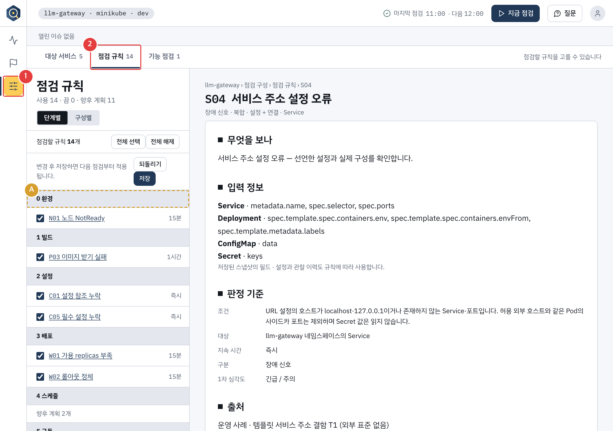

   - 1 = 왼쪽 메뉴의 설정("점검 구성") 아이콘
   - 2 = "점검 규칙 14" 탭
   - A = 단계별 규칙 목록. 회색 띠로 된 단계 묶음 머리(0 환경, 1 빌드, …)가 생애 주기 순서다. 편집에서 머리 전체를 훑는다.
   - 사진 오른쪽의 규칙 설명은 이 투어에서 짚지 않는다(S04가 선택된 사진이라 편집에서 오른쪽을 가리거나 자르고, 촬영 화면은 기본 선택 규칙으로 열린다 [촬영 시 확인]). 예전 사진 `01c-setup-rules-s04.png`(S04 줄)는 이 투어에서 쓰지 않는다.
4. **나와야 할 로그**: 없음. 보이는 것은 상단 탭 "대상 서비스 5 / 점검 규칙 14 / 기능 점검 1"(숫자는 촬영 때 확인), "사용 14 · 끔 0 · 향후 계획 11", 서비스 생애 주기 10단계(0 환경 ~ 9 점검)별 규칙 목록, 구성별 보기의 구성 요소 묶음이다.
5. **자막·내레이션·편집**
   - 콜아웃 0:28.0~0:31.0(클릭 위치 근처): **설정** · 대상 서비스, 점검 규칙, 기능 점검 확인
   - 자막 0:24~0:28: 먼저 화면 둘러보기 / 화면은 네 영역으로 나뉨
   - 자막 0:28~0:35: 설정: 대상 서비스 · 점검 규칙 / 기능 점검을 확인
   - 자막 0:35~0:45: 설정: 점검 규칙은 단계별 / 서비스 생애 주기 10단계
   - 자막 0:45~0:49: 구성별 보기로도 확인 / Pod · Service · Config 등
   - 내레이션(후시): `[새로 씀]` "먼저 화면을 살펴보겠습니다. 화면은 네 영역으로 나뉩니다."(0:24.3~0:28.3, 4.0초) `[새로 씀]` "설정 화면에서는 점검 대상 서비스의 구성과 점검 규칙, 기능 점검을 확인할 수 있습니다."(0:28.7~0:34.5, 5.8초) `[새로 씀]` "점검 규칙은 설정부터 구동까지 서비스 생애 주기 단계별로 정의했고, 각 규칙은 Pod, Service 같은 Kubernetes 구성 요소를 기준으로 수립했습니다."(0:35.0~0:44.8, 9.8초) `[새로 씀]` "같은 규칙을 구성별 보기로도 확인할 수 있습니다."(0:45.2~0:48.5, 3.3초)
   - 이전 판의 S04 문장("첫 번째 장애에서 적발할 S04는, 존재하지 않는 Service를 가리키는 주소를 적발합니다.")과 S04 콜아웃·박스·자막은 뺐다(S04는 R3 점검 결과에서 처음 말한다).
   - **편집 표시(최종 영상 시각)**

| 시각 | 강조 대상 | 표시 방법 | 확대(배율 / 중심 / 유지) | 자막·라벨 |
|---|---|---|---|---|
| 0:24~0:28 | 브라우저 첫 화면(점검 이력, 클릭 전) | 표시 없음. 커서는 왼쪽 메뉴 가까이에 두고 움직이지 않는다 | — | 자막 1(먼저 화면 둘러보기) |
| 0:28~0:35 | 왼쪽 메뉴의 **설정 아이콘** 클릭 → 설정 화면(대상 서비스 탭). 상단 세 탭 | **콜아웃** "**설정** · 대상 서비스, 점검 규칙, 기능 점검 확인"을 클릭한 아이콘 오른쪽 옆에 3초. 이어 노란 점선 박스를 세 탭에 차례로(탭마다 1.5초) | 1.3배 / 클릭한 아이콘과 상단 탭이 함께 들어오는 화면 왼쪽 위 1/4(약 (500, 350)) / 유지 2초(전체 3초) | 자막 2(설정: 대상 서비스 · 점검 규칙) |
| 0:35~0:45 | "점검 규칙 14" 탭 클릭 → "단계별" 보기의 단계 머리(0 환경, 1 빌드, 2 설정, 3 배포, 4 스케줄, 5 구동, 6 연결 …)를 위에서 아래로 훑는다(A) | 노란 점선 박스를 단계 머리에 옮겨 가며 붙인다(머리마다 1.2초). 규칙 줄(N01, P03, C01, W01, P06 …)을 짚지 않고 머리 이름만 읽는다 | — (훑는 동안 스크롤이라 박스만) | 자막 3(설정: 점검 규칙은 단계별) |
| 0:45~0:49 | 목록 위쪽 **"구성별" 토글** 클릭 → 규칙이 구성 요소별(Node, Pod, Workload, Service, Config, 개선 권고)로 다시 묶인다 | 토글에 노란 점선 박스 2초, 이어 묶음 머리를 훑는 동안 박스를 옮긴다 | 1.3배 / 목록 위쪽 토글 부근(약 (450, 450)) / 유지 3초(전체 4초) | 자막 4(구성별 보기로도 확인) |

### R1-2. 화면 둘러보기: 점검 이력 (편집 12초)

1. **레이아웃**: 데스크톱 1 · L1 — 브라우저 창 A 최대화(R1-1에서 그대로 이어서). 로그 필요 없음.
2. **할 일**: 왼쪽 메뉴의 **점검 이력 아이콘**(맥박 모양, 맨 위)을 누른다. 목록의 **"주기 점검" 줄들**(정각 시각 `09:00`, `07:00`, `06:00` …, 정각마다 쌓인 줄) 위에 커서를 두고 정각 점검 안내 한 줄을 말하는 동안 줄들을 따라 천천히 훑는다(8초, 콜아웃 3초 포함). 이어 상단 "열린 이슈 없음" 띠와 오른쪽 위 "마지막 점검 11:00 · 다음 12:00", 목록 첫 줄의 "정상" 점검으로 옮긴다. **화면에는 '정각 점검'이라는 글자가 없다. 정각마다 도는 점검은 목록에서 "주기 점검" 라벨이고, "직접 점검"은 "지금 점검" 버튼으로 돌린 것이다**(사진 01로 확인). 필터가 "정상"이면 정상이 아닌 회차는 목록에서 빠지므로, 촬영 때 매시 정각 줄이 이어져 보이는지 확인하고 빠지면 필터를 "모든 심각도"로 둔다. 촬영 때는 열린 이슈가 0이어야 한다(§3).
3. **사진**: 점검 이력에서 심각도 "정상", 기간 11/10으로 거른 화면이다. 번호 없이 강조만 쓴다.

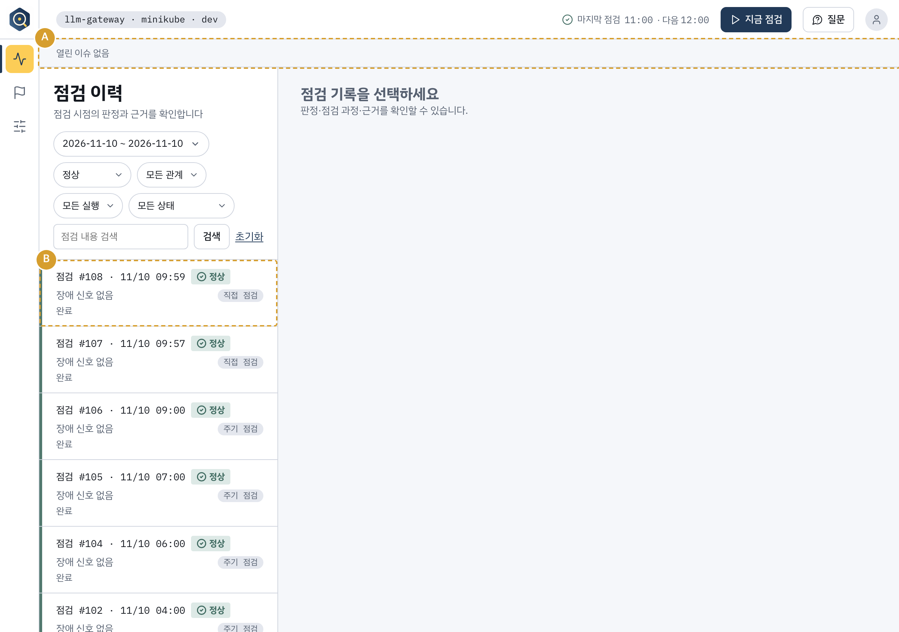

   - A = 상단 "열린 이슈 없음" 띠. 박스를 편집에서 크게 붙인다.
   - B = 목록 첫 줄의 "정상" 점검.
   - 11/12 현재 이슈 #18이 이미 해결되어 있다. 11/12 10:55 점검 #153 줄에 `해결 #18`이 보이므로, 촬영 화면에서는 기간 필터를 걸거나 위에서 스크롤해 그 줄을 피한다.
4. **나와야 할 로그**: 없음. 터미널을 화면에 두지 않는다.
5. **자막·내레이션·편집**
   - 콜아웃 0:49.0~0:52.0(클릭 위치 근처): **점검 이력** · 점검 결과와 근거를 확인
   - 자막 0:49~0:57: 점검 이력: 주기 점검이 정각마다 기록 / 동작은 직접 점검으로 시연
   - 자막 0:57~1:01: 판정과 근거가 남음 / 열린 이슈 없음 · 정상 상태
   - 내레이션(후시): `[새로 씀]` "두 번째는 점검 이력입니다. 이력 화면에서 보시듯 정각마다 점검이 돌고 있고, 동작은 직접 점검을 통해 보여드리겠습니다."(0:49.3~0:57.3, 8.0초) `[새로 씀]` "판정과 근거가 남고, 지금은 정상이라 열린 이슈가 없습니다."(0:57.5~1:01.0, 3.5초). 정각 점검은 명령어 장면 없이 이 한 줄로만 말한다
   - **편집 표시(최종 영상 시각)**

| 시각 | 강조 대상 | 표시 방법 | 확대(배율 / 중심 / 유지) | 자막·라벨 |
|---|---|---|---|---|
| 0:49~0:52 | 왼쪽 메뉴의 **점검 이력 아이콘**(맥박 모양, 메뉴 맨 위) 클릭 → 점검 이력 화면 | **콜아웃** "**점검 이력** · 점검 결과와 근거를 확인"를 클릭한 아이콘 오른쪽 옆에 3초 | 1.3배 / 아이콘과 "점검 이력" 제목이 함께 들어오는 화면 왼쪽 위 1/4(약 (500, 350)) / 유지 2초(전체 3초) | 자막 1(점검 이력: 점검 결과가 쌓임) |
| 0:52~0:57 | 목록의 "주기 점검" 줄들(B, 정각 시각 09:00, 07:00 … 이 매시 정각으로 이어진 것). 화면 포인터는 이 줄들을 위에서 아래로 가리킨다 | 노란 점선 박스(줄 묶음 전체)와 시각 부분 화살표 | 1.3배 / 목록 영역(화면 왼쪽 위 1/3, 약 (450, 700)) / 유지 4초(전체 5초) | 자막 1 |
| 0:57~1:01 | 점검 한 줄의 판정("정상" 배지)과 상단 "열린 이슈 없음" 띠(A), 오른쪽 위 "마지막 점검 11:00 · 다음 12:00" | 박스 A 1.5초 → 판정 배지 1.2초 → "마지막 점검 … 다음 12:00" 1.3초 | 1.3배 / 상단 띠(화면 위쪽 가운데, 약 (960, 130)) / 유지 3초(전체 4초) | 자막 2(판정과 근거가 남음) |

### R1-3. 화면 둘러보기: 이슈 (편집 5초)

1. **레이아웃**: 데스크톱 1 · L1 — 브라우저 창 A 최대화. 로그 필요 없음.
2. **할 일**: 왼쪽 메뉴의 **이슈 아이콘**(깃발 모양, 위에서 두 번째)을 누른다. 이슈 목록(과거 이슈가 쌓인 화면)이 열리면 목록 위에 커서를 둔다. 이슈를 열지는 않는다(보고서는 R4, R11에서 본다).
3. **사진**: 없음(목록 화면은 촬영 때 확인한다. 이슈 상세 화면은 R4-2의 사진 `03-a7-issue-15-report.png`, R11-1의 사진 `06-c8-issue-16-conclusion.png`이다).
4. **나와야 할 로그**: 없음.
5. **자막·내레이션·편집**
   - 콜아웃 1:01.0~1:04.0(클릭 위치 근처): **이슈 이력** · 열린 이슈와 원인 보고서
   - 자막 1:01~1:06: 이슈 이력: 장애가 적발되면 / 이슈가 열리고 보고서가 모임
   - 내레이션(후시): `[새로 씀]` "세 번째는 이슈입니다. 열린 이슈와 원인 보고서가 여기에 모입니다."(1:01.3~1:05.8, 4.5초)
   - **편집 표시(최종 영상 시각)**

| 시각 | 강조 대상 | 표시 방법 | 확대(배율 / 중심 / 유지) | 자막·라벨 |
|---|---|---|---|---|
| 1:01~1:04 | 왼쪽 메뉴의 **이슈 아이콘**(깃발 모양) 클릭 → 이슈 화면 | **콜아웃** "**이슈 이력** · 열린 이슈와 원인 보고서"를 클릭한 아이콘 오른쪽 옆에 3초 | 1.3배 / 아이콘과 "이슈" 제목이 함께 들어오는 화면 왼쪽 위 1/4(약 (500, 350)) / 유지 2초(전체 3초) | 자막 1(이슈 이력) |
| 1:04~1:06 | 이슈 목록(과거 이슈가 쌓인 화면. 열린 이슈는 없다) | 박스 없음. 커서를 목록 위에 둔다 | — | 자막 1 |

### R1-4. 화면 둘러보기: 이력 채팅 (편집 6초)

1. **레이아웃**: 데스크톱 1 · L1 — 브라우저 창 A 최대화. 로그 필요 없음.
2. **할 일**: 화면 오른쪽 위 **"질문" 버튼**(말풍선 아이콘)을 눌러 "이력에 질문" 패널을 연다(맥락 칩이 붙는다). **질문은 입력하지 않는다.** 패널을 2~3초 보인 뒤 닫기(X)를 누른다. 실제 질의는 끝의 R11-7에서 한다. 이 장면 뒤 `⌃→`로 데스크톱 2(R2)로 넘어간다.
3. **사진**: R11-7의 사진 [15-c8-history-qa.png](assets/08-demo/15-c8-history-qa.png)의 1("질문" 버튼)과 열린 패널을 본다(질문과 답이 들어 있지 않은 패널 화면은 촬영 때 확인한다).
4. **나와야 할 로그**: 없음.
5. **자막·내레이션·편집**
   - 콜아웃 1:06.0~1:09.0(클릭 위치 근처): **이력 채팅** · 질문 버튼으로 과거 장애를 질문
   - 자막 1:06~1:12: 이력 채팅: 상단 질문 버튼 / 쌓인 기록으로 과거 장애 질문
   - 내레이션(후시): `[새로 씀]` "네 번째는 이력 채팅입니다. 쌓인 기록을 근거로 과거 장애를 물어볼 수 있습니다."(1:06.3~1:11.6, 5.3초)
   - **편집 표시(최종 영상 시각)**

| 시각 | 강조 대상 | 표시 방법 | 확대(배율 / 중심 / 유지) | 자막·라벨 |
|---|---|---|---|---|
| 1:06~1:09 | 화면 오른쪽 위 **"질문" 버튼** 클릭 → "이력에 질문" 패널이 열린다(질문은 하지 않는다) | **콜아웃** "**이력 채팅** · 질문 버튼으로 과거 장애를 질문"를 질문 버튼 왼쪽 아래에 3초 | 1.3배 / 질문 버튼과 열린 패널이 함께 들어오는 화면 오른쪽 위 1/4(약 (1500, 300)) / 유지 2초(전체 3초) | 자막 1(이력 채팅) |
| 1:09~1:12 | 열린 "이력에 질문" 패널(맥락 칩과 입력창) | 박스 2초 → 패널 닫기(X) 클릭 | — | 자막 1 |

### R2. 서비스 주소명 오류 주입 [A7] (원본 1:20~2:50 → 편집 11.8초, 롤아웃 대기는 2배속)

1. **레이아웃**: 데스크톱 2 · L2 — Slack 왼쪽 2/3 + ③ 명령 터미널 오른쪽 위 + ⑤ Pod 감시 오른쪽 아래. R1-4에서 `⌃→`로 넘어온다. ③은 빈 프롬프트이고 ⑤는 `kubectl get pods -n dev -w`가 돌고 있다. 작업자는 아직 아무것도 하지 않는다.
2. **할 일**: 저장소 루트 기준으로 ③에서 명령을 친다(화면에 보인다). 영상에서는 자막("장애 주입: 서비스 주소명 오류")을 함께 올린다. **주입 장면에서는 오타("점", 끝에 붙은 점)를 말하지도 자막에 쓰지도 않는다.** 오타는 R4-3 근거 서랍에서 처음 짚는다.
   1. ③에서 주입한다. `inject.sh`가 롤아웃이 끝나길 기다렸다가 끝난다.

      ```bash
      KG_TYPO=dot bash scenarios/A7/inject.sh
      ```

   2. ⑤에서 gateway 새 Pod가 ContainerCreating → Running이 되고 이전 Pod가 Terminating이 되는 줄이 붙는 것을 보인다. ⑤는 끄지 않는다.
   3. 롤아웃이 끝나면 gateway Pod가 바뀌어 ④의 `logs -f`가 끊겼으므로 **④를 새 Pod 기준으로 다시 켠다.** `⌃→`로 데스크톱 3으로 가 ④에서 `Ctrl+C` 후 `↑` `↩`로 gateway 명령(§2 "④ 서비스 로그")을 다시 실행한다. 새 줄이 올라오지 않는 것이 정상이다(점검 전이라 gateway가 agent를 부르지 않는다). 이 이동과 다시 켜기는 롤아웃 대기와 함께 편집에서 자르고, 도착한 데스크톱 3의 창 B에서 R3을 이어 간다(L2로 돌아오지 않는다).
   - Slack은 누르지 않는다.
   - ⚠ 주입 명령의 출력 한 줄(`… AGENT_SERVICE_URL http://agent:8006 → http://agent.:8006`)에 바뀐 주소(점)가 그대로 찍힌다. 말은 하지 않지만 화면에 읽히므로, 편집에서 그 줄의 `→` 뒤를 흐리게 가리거나(블러) 출력 줄을 짧게 보인 뒤 넘긴다. 명령 줄의 `KG_TYPO=dot`도 흐리게 가리는 것을 권한다. [촬영 시 확인] 가려도 화면이 어색하지 않은지.
3. **사진**: `scenes/R2-a7-inject.png`. 사진의 왼쪽은 Slack 자리(이전 알림), 오른쪽 위가 ③, 오른쪽 아래가 ⑤다(지금 L2와 같은 배치). ⑤의 Pod 줄은 **형식 예시**(Pod 이름은 `gateway-xxxxx` 형태)이고 ③의 출력은 `inject.sh`의 echo 문구다.


4. **나와야 할 로그**
   - ③ 출력(`scenarios/A7/inject.sh`가 echo하는 문구. 호스트 값은 스크립트의 기본 형식 `http://agent:8006`. 위 ⚠대로 편집에서 가린다):

```text
$ KG_TYPO=dot bash scenarios/A7/inject.sh
A7 주입(dot): dev/Deployment/gateway AGENT_SERVICE_URL http://agent:8006 → http://agent.:8006
```

   - ⑤ **형식 예시**(Pod 이름과 시각은 지어낸 값, 리허설에서 확인). 박스: 새 Pod의 ContainerCreating → Running 줄과 이전 Pod의 Terminating 줄.

```text
NAME                  READY  STATUS             RESTARTS  AGE
gateway-xxxxx         1/1    Running            0         3h
gateway-yyyyy         0/1    ContainerCreating  0         0s
gateway-yyyyy         1/1    Running            0         5s
gateway-xxxxx         1/1    Terminating        0         3h
```

   - ④ gateway 로그는 이 화면(L2)에 안 보인다. R3~R5-2(L3)에서 곁에 보이고 R5-2에서 짚는다.
5. **자막·내레이션·편집**
   - 자막 1:12~1:17.8: 장애 주입: 서비스 주소명 오류 / 롤아웃 대기 2배속
   - 자막 1:17.8~1:23.8: Pod는 Ready, 알림은 없음
   - 내레이션(후시): `[새로 씀]` "먼저 규칙 점검을 보여 드리기 위해, 서비스 주소명 오류 장애를 주입하겠습니다."(1:12.3~1:17.6, 5.3초) `[새로 씀]` "Pod는 Ready이고 Service도 그대로라서, Kubernetes는 이 오류를 알지 못합니다."(1:18.1~1:23.5, 5.4초) 첫 문장은 ③에서 주입 명령을 칠 때, 둘째 문장은 ⑤에서 새 Pod가 `1/1 Running`으로 보일 때 말한다. 이전 판의 "gateway가 agent를 부르는 주소에, 점 하나를 더했습니다." 문장은 뺐다(오타는 근거 서랍에서 말한다).
   - 편집: 롤아웃 대기는 2배속 자막을 붙인다. 주입 명령은 ③에 그대로 보이고 자막이 그 행동을 말해 준다. ⑤의 새 Pod 줄과 Terminating 줄에 박스를 붙인다. 말이 남으면 마지막 프레임을 정지로 유지한다.

### R3. 점검 실행 (원본 2:50~3:10 → 편집 8.7초)

1. **레이아웃**: 데스크톱 3 · L3 — 브라우저 창 B 왼쪽 2/3 + ② 작업자 로그 오른쪽 위 3/4 + ④ 서비스 로그 오른쪽 아래 1/4. 로그는 R5-2에서 짚고 이 장면에서는 곁에 둘 뿐이다(직접 점검이라 Job 로그가 없다). R2에서 `⌃→`로 넘어온다(④ 다시 켜기는 편집에서 삭제). 창 B는 묶음 시작 전에 점검 이력 화면을 열어 둔다. 점검 상세에 S04 적발이 보인 뒤 같은 데스크톱 3의 창 B에서 R4를 이어 간다(넘김 없음).
2. **할 일**: 창 B(브라우저, 왼쪽 2/3)의 **"지금 점검"(직접 점검) 버튼**을 누른다. 점검이 끝나면 점검 이력 맨 위 새 점검을 열어(점검 완료 대기 구간이라 편집에서 잘린다. 점검 상세 주소를 복사하거나 붙이는 단계는 없다) 점검 상세에서 S04 적발 줄을 짚는다. S04는 `docs/05-rules.md`의 규칙 표(104행)와 "S04 — 서비스 주소 설정 오류" 절(249행)에 있는 규칙이다. 점검 완료까지 걸리는 시간은 리허설에서 확인한다.
   - 직접 점검은 web 컨테이너에서 돌아 **Job 로그와 규칙 결과 줄(`게이트: 경로 A …`, `이슈 #N 새로 열림 (규칙 진단)`)이 터미널에 나오지 않는다.** 규칙 적발은 화면의 점검 상세(S04 적발)로 보인다.
   - 점검이 끝나 알림이 발송되면(점검 직후 약 5초 안) 화면 오른쪽 위에 Slack 배너가 뜬다. 대기 구간에 뜨므로 누르지 않고 계속 찍는다(§3 "Slack 알림 배너와 데스크톱 전환"). 배너는 오른쪽 1/3의 ② 위에 놓이고 창 B는 가리지 않는다.
3. **사진**: `scenes/R3-a7-check-run.png`. **사진은 이전 배치(L2)다.** 왼쪽 1280×1080은 점검 #90 상세(A7 캡처, 우상단 "지금 점검" 버튼이 보인다)로 지금 L3의 창 B와 크기가 같다. 오른쪽은 사진이 위 ④ · 아래 ②(각 640×540)이고 지금은 위 ②(3/4) · 아래 ④(1/4)라 순서와 크기가 다르다.

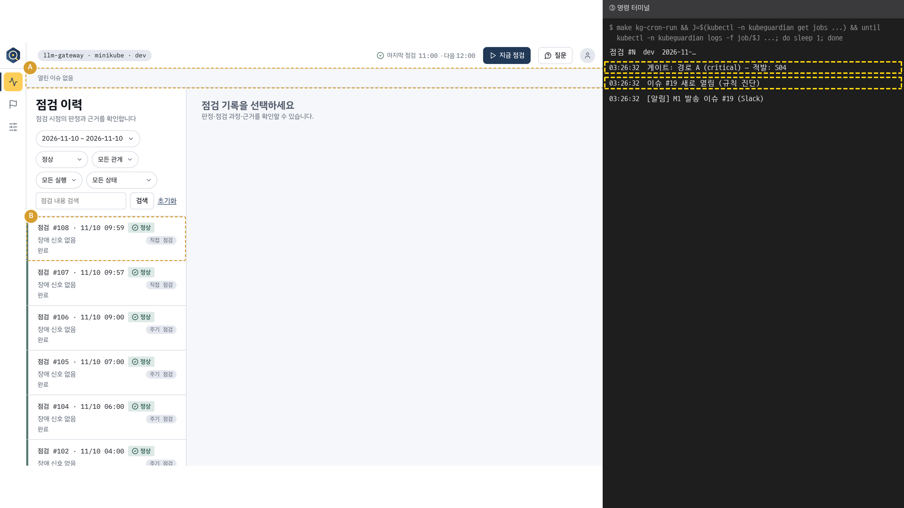

4. **나와야 할 로그**: 이 장면에서 로그 창은 곁에 보일 뿐 짚지 않는다. 아래는 참고용이다.
   - ② 작업자 로그(데스크톱 3, 오른쪽 위에 곁에 보일 뿐 짚지 않는다): 화면 접속 줄(새 형식 실측, 11/16 18:57)과 알림 줄(18:35 옛 형식 실측을 새 형식으로 옮긴 **형식 변환**, 직접 점검이라 `[web]`로 나온다). 직접 점검 POST 줄(`"POST /llm-gateway/checks HTTP/1.1" 303`)과 알림·근거 요약 줄의 11/19 실측은 R5-2의 로그 블록을 본다.

```text
2026-11-16 18:57:57 INFO [web] 127.0.0.1:60386 - "GET /llm-gateway/checks HTTP/1.1" 200
2026-11-16 18:35:58 INFO [web] [알림] M1 발송 이슈 #21 (Slack)
```

   박스: 점검 상세의 `S04 적발` 줄(점검 규칙 · 서비스 주소 설정 오류).
5. **자막·내레이션·편집**
   - 자막 1:23.8~1:32.5: 점검 실행 → 규칙이 적발 / S04: 서비스 주소 설정 오류
   - 내레이션(후시): `[새로 씀]` "지금 점검을 눌러 점검을 실행합니다."(1:24.1~1:26.6, 2.5초) `[새로 씀]` "여기, 점검 규칙 중 서비스 주소 설정 오류 규칙, S04 위반으로 적발되었습니다."(1:27.0~1:32.2, 5.2초) 둘째 문장은 점검 상세의 `S04 적발` 줄(규칙 ID와 이름 "서비스 주소 설정 오류")을 짚으며 말한다.
   - 편집: 창 B의 점검 상세 S04 적발 줄에 박스를 붙이고 1.4배로 확대한다(창 B 안 중심 약 (640, 500), 유지 3초. 창 B가 화면 왼쪽 2/3라 L1보다 글자가 작다) [촬영 시 확인]. 이 줄이 S04를 영상에서 처음 짚는 곳이다.

### R4. 서비스 주소명 오류 결과 화면 [A7] (원본 3:10~4:40 → 편집 23.1초)

레이아웃은 데스크톱 3 · L3 — 브라우저 창 B 왼쪽 2/3(1280×1080) + ② 오른쪽 위 + ④ 오른쪽 아래. 결과 화면이 증거라 로그는 필요 없고(②·④는 곁에 둘 뿐, R5-2에서 짚는다), 창 B가 화면의 2/3라 L1보다 글자가 작으므로 편집 확대는 창 B 안(x 0~1280)을 중심으로 1.3~1.5배로 잡는다. R3에서 점검 상세의 S04 적발을 보인 뒤 같은 데스크톱 3의 창 B에서 이어 간다. 점검 상세 → 이슈 상세 → 근거 서랍 순서다. **오타(주소 끝의 점)는 R4-3 근거 서랍에서 처음 말한다.** R4-2 표의 "확인한 사실" 칸에는 값이 그대로 보이지만 말과 자막은 그 칸을 오타라고 부르지 않는다.

**R4-1. 점검 상세 #90 (4.5초)**

- 할 일: 창 B에서 사진의 번호 순서대로 1 점검 이력 아이콘, 2 목록의 점검 #90, 3 "이슈 #15 열림" 링크.
- 기능 라벨 카드 1:32.9~1:35.9(화면 왼쪽 위): **기능 점검** · 채팅이 실제로 되는지 직접 호출해 확인
- 자막(1:32.5~1:37.0): 기능 점검: 채팅을 직접 호출 / 조사 안 함 · 규칙 기반 진단 결과

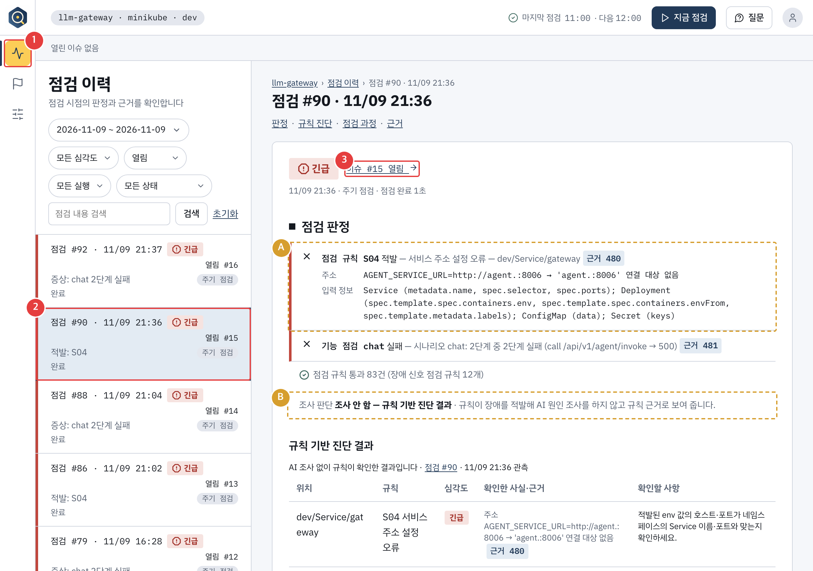

- 1 = 왼쪽 메뉴의 "점검 이력" 아이콘
- 2 = 목록의 점검 #90 줄
- A = 판정: `S04` 적발(서비스 주소 설정 오류)과 기능 점검 chat 실패
- B = "조사 안 함 — 규칙 기반 진단 결과"
- 3 = "이슈 #15 열림" 링크(다음 이동)
- 편집: A와 B 줄을 1.3배 확대한다(창 B 안 중심 약 (640, 450), 유지 3초) [촬영 시 확인].
- 내레이션(후시): `[새로 씀]` "기능 점검은 채팅이 실제로 되는지 직접 호출해 봅니다."(1:32.9~1:36.6, 3.7초) 선택 문장: "여기, 채팅 기능 점검도 실패했습니다."(2.5초, §8 선택 문장).

**R4-2. 이슈 상세 #15 (9.1초)**

- 할 일: 1 이슈 아이콘, 2 목록의 #15, 3 표 안의 "근거 480" 배지(R4-3으로).
- 기능 라벨 카드 1:37.0~1:40.0(화면 왼쪽 위): **규칙 기반 진단 결과** · AI 호출 없이 규칙이 찾은 원인 표
- 자막(1:37.0~1:41.9): AI 보고서 대신 규칙 기반 진단 결과 / (1:41.9~1:46.1): 표: 적발 규칙 · 위치 · 확인한 사실

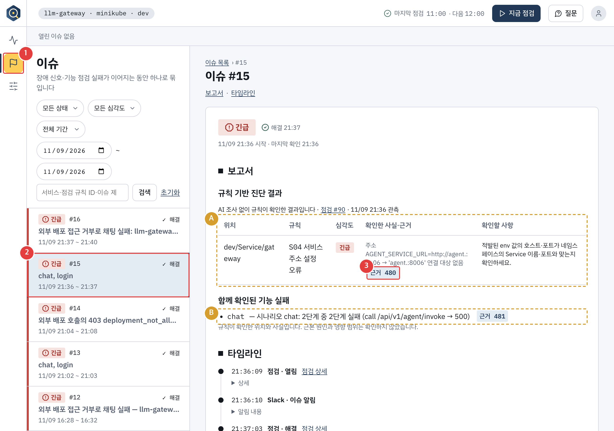

- 1 = 왼쪽 메뉴의 "이슈" 아이콘
- 2 = 이슈 목록의 #15
- A = 보고서 자리의 "규칙 기반 진단 결과" 표(위치, 규칙, 심각도, 확인한 사실·근거, 확인할 사항)
- B = "함께 확인된 기능 실패" 절
- 3 = 표 안의 "근거 480" 배지(눌러서 R4-3으로)
- 내레이션(후시): "보고서 자리에는 AI 보고서 대신, 규칙 기반 진단 결과가 나옵니다."(1:37.4~1:41.7, 4.3초) `[새로 씀]` "표에는 적발된 규칙과 위치, 확인한 사실이 정리됩니다."(1:42.1~1:45.8, 3.7초)

**R4-3. 근거 서랍 (9.5초)**

- 할 일: 표 안의 "근거 N" 배지를 눌러 서랍을 연다. 서랍에서 머리(`규칙 점검 결과`) → "AI 요약" 속 `agent.` 대목 순으로 커서를 옮긴 뒤 닫기(X)를 누른다. 서랍은 `app/web/templates/_drawer.html`로, 머리(근거 번호·종류), 대상·수집 시각·출처, "AI 요약", "원본 JSON" 순서다.
- 기능 라벨 카드 1:46.1~1:48.6(화면 왼쪽 위): **근거 서랍** · 근거 번호를 누르면 원문이 열림
- 자막(1:46.1~1:49.9): 근거 번호를 누르면 원문이 열림 / (1:49.9~1:55.6): 근거 서랍: agent 주소 끝의 점 오타 / 연결 대상 없음으로 판정
- 내레이션(후시): `[새로 씀]` "근거 번호를 누르면, 원문이 서랍으로 열립니다."(1:46.5~1:49.7, 3.2초) `[새로 씀]` "여기 agent 주소 끝에 점이 붙은 오타가 있어, 연결 대상을 찾지 못했습니다."(1:50.1~1:55.3, 5.2초) 둘째 문장은 서랍의 "AI 요약"에서 `agent.`(점이 붙은 주소)와 "미해결" 대목을 가리키며 말한다. 이것이 영상에서 오타를 처음 말하는 곳이다.


- 1 = "근거 480"을 누르면 오른쪽에 열린 서랍의 닫기(X). 서랍을 보여 준 뒤 닫는다.
- A = 서랍 머리(근거 번호와 종류 `규칙 점검 결과`). 대상 `dev/Service/gateway`, 출처 `detector S04`, AI 요약, 원본 JSON이 보인다. 사진 속 AI 요약에 "AGENT_SERVICE_URL의 대상 `agent.`와 포트 8006은 미해결"이 들어 있다. 편집에서 그 대목에 노란 박스를 붙이고 "원본 JSON"을 펼친 화면에 `agent.:8006`이 보이면 함께 짚는다 [촬영 시 확인] 실제 AI 요약 문구와 원본 JSON의 주소 표기.
- 서랍은 화면 안에서만 바뀌는 GET이다. 누를 때 상태가 바뀌지 않는다. AI 요약이 아직 없는 근거를 열면 요약 생성 POST가 나가므로, 요약이 이미 있는 근거를 연다. 사진은 점검 #90 상세에서 연 서랍이다. 이슈 상세의 배지를 누르면 같은 서랍이 점검 상세 위에 열린다. 서랍은 창 B(왼쪽 2/3) 안의 오른쪽에 열리므로 확대 중심은 창 B 오른쪽 가장자리(약 (1000, 450))다 [촬영 시 확인].

### R5-2. 작업자 로그와 서비스 로그 [A7] (R4 뒤 · 편집 5.6초)

1. **레이아웃**: 데스크톱 3 · L3 — 브라우저 창 B 왼쪽 2/3 + ② 작업자 로그 오른쪽 위 3/4 + ④ 서비스 로그 오른쪽 아래 1/4. R4(L3, 창 B)에서 이어서 찍고(넘김 없음), 끝나면 알림 배너가 보이는 채로 `⌃←`로 L2에 넘어가 R5-1(Slack 1차 알림)로 이어진다. **이 위치(R4 뒤, R5-1 앞)를 고른 이유**: 점검이 끝난 뒤라 ②에 알림 발송·근거 요약 줄이 이미 찍혀 있고(규칙 경로로 끝나 AI 조사가 시작되지 않았음이 보인다), ④에는 기능 점검 때 gateway가 바뀐 주소로 호출하다 실패한 줄이 남아 있다. R6 원복 전이라 gateway Pod가 아직 교체되지 않아 ④가 끊기지 않는다. R5-2 → R5-1 → R6은 L3 → L2 → L2로 이웃 한 칸만 오간다.
2. **할 일**:
   1. 오른쪽 위 ②에서 `[알림] M1 발송 …` 줄 → `근거 요약: ev-… done` 줄에 커서를 1.2초씩, 그 아래 빈 자리(`[조사 #N]` 줄이 없는 곳)에 0.8초(총 3.2초).
   2. 오른쪽 아래 ④에서 `프록시 요청: POST /api/v1/agent/invoke -> http://agent.:8006/…` 줄 → `업스트림 요청 최종 실패 … Name or service not known` 줄에 커서를 1.1초씩(총 2.2초, 말 끝과 겹친다. 서비스 로그는 말하지 않고 자막으로 짚는다).
   3. `⌃←`로 L2에 넘어가 R5-1로 이어 간다(알림 배너가 떠 있으면 보인 채로, 컷 없이). 녹화는 끄지 않는다.
   - 640×270 ④ 칸은 줄이 접혀 약 9줄이다. 필터가 없어 두 줄이 밀려 올라갔으면 터미널을 위로 조금 스크롤해 칸 안에 둔다. 편집에서 두 줄에 박스를 붙이고 오른쪽 1/3 칸을 확대한다 [촬영 시 확인].
   - R4에서 화면을 여는 접속 줄(`[web] … "GET …" 200`)이 ②의 알림 줄을 위로 밀어낼 수 있다. 밀려나면 ② 명령에 `| grep --line-buffered -v '"GET '`를 붙여 켠다(§2 "② 작업자 로그") [촬영 시 확인].
   - 오른쪽 위에 남아 있는 Slack 배너가 ②의 윗줄(알림·근거 요약 줄)을 가릴 수 있다. 가리면 이 장면을 찍기 전에 배너를 닫아 로그가 읽히게 하고(Slack 알림은 남는다), `⌃←` 전환은 배너 없이 찍는다(배너 연출 생략) [촬영 시 확인].
3. **사진**: 없음(촬영 때 확인). 합성 사진은 만들지 않았다.
4. **나와야 할 로그**
   - ④ (§2 "④ 서비스 로그"의 gateway 명령. 2026-11-19 같은 장애의 gateway Pod 로그를 읽기 전용으로 확인한 **실측**. gateway 시각은 UTC라 ②의 한국 시각과 9시간 어긋난다):

```text
2026-11-19 11:10:28 [INFO] gateway - 프록시 요청: POST /api/v1/agent/invoke -> http://agent.:8006/api/v1/invoke
2026-11-19 11:10:28 [ERROR] gateway - 업스트림 요청 최종 실패: http://agent.:8006/api/v1/invoke - [Errno -2] Name or service not known
```

   - ② ("지금 점검" 직후. 2026-11-19 20:10 같은 장애의 직접 점검 때 `kubectl -n kubeguardian logs deploy/diagnostic-agent --all-containers`로 읽기 전용 확인한 **실측**. 이슈·근거 번호와 시각은 촬영 때 달라진다):

```text
2026-11-19 20:10:24 INFO [web] 127.0.0.1:58314 - "POST /llm-gateway/checks HTTP/1.1" 303
2026-11-19 20:10:29 INFO [web] [알림] M1 발송 이슈 #30 (Slack)
2026-11-19 20:10:29 INFO [worker] 근거 요약: ev-0833 done 2.1초 입력 397 출력 79
2026-11-19 20:10:33 INFO [worker] 근거 요약: ev-0834 done 3.0초 입력 339 출력 168
```

   - 규칙 경로(A)는 조사 대기열에 요청을 넣지 않으므로 `[작업] 조사 대기 집음`·`[조사 #N] 시작` 줄이 나오지 않는다(`app/service/pipeline/investigate.py`의 `queue_investigations`는 경로 A면 이슈를 규칙 진단으로 표시만 한다). `app/service/pipeline/worker.py`의 `[작업] 이슈 #N 규칙 감지 요청이라 AI 조사 생략` 줄은 배포 전에 쌓인 요청이 있을 때만 나오므로 이 장면에는 없다. 알림 줄이 `[web]`인 것은 "지금 점검"이 web 컨테이너에서 돌기 때문이다. 그 줄이 ②에 안 나오면(위 GET 줄에 밀렸거나 필터로 빠졌으면) 장면을 다시 찍는다.
5. **자막·내레이션·편집**
   - 자막 1:55.6~2:01.2: 작업자 로그: 알림·근거 요약만, 조사 줄 없음 / 서비스 로그: agent. 주소 호출 실패
   - 내레이션(후시): `[새로 씀]` "작업자 로그에는 알림 발송과 근거 요약만 있고, AI 조사 줄은 없습니다."(1:55.9~2:00.9, 5.0초, 30음절) ②의 알림 줄과 근거 요약 줄을 짚으며 시작해 끝에 조사 줄이 없음을 말한다. 서비스 로그의 `agent.` 줄은 말 없이 자막으로 짚는다(문장 하나로 제한했다).
   - 편집 표시(최종 영상 시각):

| 시각 | 강조 대상 | 표시 방법 | 확대(배율 / 중심 / 유지) | 자막·라벨 |
|---|---|---|---|---|
| 1:55.6~2:01.2 | ②의 `[알림] M1 발송` 줄 → `근거 요약 … done` 줄 → 줄이 없는 빈 자리, ④의 `프록시 요청 … agent.` 줄 → `업스트림 요청 최종 실패` 줄 | 노란 점선 박스를 순서대로 붙인다: 알림 줄(1:55.9~) → 근거 요약 줄(1:57.1~) → ④ 프록시 요청 줄(1:59.1~) → 최종 실패 줄(2:00.2~). 라벨 카드는 쓰지 않는다 | 1.3배 / 오른쪽 1/3 칸 가운데(약 (1600, 540)) / 유지 4.6초(전체 5.6초) [촬영 시 확인] 줄이 읽히는지 | 자막 21 |

### R5-1. Slack 1차 알림과 근거 요약 (R5-2 뒤 · 원본 4:00~4:30 → 편집 9.3초)

1. **레이아웃**: 데스크톱 3 → 2 · L3 → L2 — Slack 왼쪽 2/3 + ③ 명령 터미널 오른쪽 위(빈 프롬프트) + ⑤ Pod 감시 오른쪽 아래(롤아웃이 끝난 마지막 상태). R3의 점검이 끝나며 발송된 Slack 1차 알림의 **macOS 알림 배너는 R3~R5-2를 L3에서 찍는 동안 화면 오른쪽 위에 떠 있다**(점검 직후 약 5초 안. 알림 스타일이 "알림"이라 사라지지 않는다). 배너를 누르지 않고 하던 장면(R5-2)을 마친 뒤, 배너가 보이는 채로 **컷 없이 `⌃←` 전환 애니메이션 그대로** 데스크톱 2(Slack)로 넘어온다(`⌃←` 한 번, 한 테이크). 배너 준비는 §3 "Slack 알림 배너와 데스크톱 전환"이다.
2. **할 일**:
   1. R3에서 점검이 끝나면 Slack 1차 알림이 발송되고 배너가 뜬다. 배너가 R5-2 끝까지 남아 있게 알림 스타일을 "알림"으로 둔다. 배너를 누르지 말고 키로 전환한다. 넘어간 데스크톱 2의 Slack을 테스트 채널로 맞춘다. 채널 이름과 담당자 이름은 가린다.
   2. Slack 1차 알림에서 "규칙 기반 진단 결과입니다. 근본 원인은 확인하지 않았습니다." 줄을 강조한다. 그 앞에 적발 규칙 ID, 이름, 위치가 최대 3줄 나온다(`app/service/notify/messages.py` 108행).
   3. ③은 빈 프롬프트로, ⑤는 마지막 상태 그대로 둔다. 이 장면이 끝나면 같은 L2에서 R6의 원복을 이어 간다(녹화는 끄지 않는다). ②의 `근거 요약` 줄은 앞의 R5-2(데스크톱 3)에서 이미 보였고 이 장면 화면에는 보이지 않는다.
3. **사진**: `scenes/R5-a7-slack-evidence-summary.png`(사진은 지금 L2와 같은 배치다). 사진의 왼쪽 1280×1080은 실제 Slack 캡처([16-slack-example.png](assets/08-demo/16-slack-example.png), 2026-11-16 리허설 기록)의 아래쪽이다. 외부 LLM 호스트가 든 줄과 담당·확인한 사람 이름은 회색 박스로 가렸다. **A** = 6:35 PM 1차 알림의 "규칙 기반 진단 결과입니다. 근본 원인은 확인하지 않았습니다." 줄(그 앞에 적발 규칙이 나온다), **B** = "✅ 확인" 줄(Slack 확인 버튼을 누른 기록), **C** = 7:03 PM 스레드의 "✅ 복구" 답글이다. 오른쪽 위가 ③(빈 프롬프트), 오른쪽 아래가 ⑤(마지막 상태, **형식 예시**)다.


4. **나와야 할 로그**
   - ② 작업자 로그는 데스크톱 3에서 확인하며(앞의 R5-2에서 본다) R5-1 화면에는 안 보인다(18:35 옛 형식 실측을 새 형식으로 옮긴 **형식 변환**. 직접 점검이라 알림은 `[web]`, 근거 요약은 `[worker]`로 나온다)

```text
2026-11-16 18:35:58 INFO [web] [알림] M1 발송 이슈 #21 (Slack)
2026-11-16 18:36:03 INFO [worker] 근거 요약: ev-0663 done 3.4초 입력 339 출력 177
```

   - ⑤ Pod 감시: 롤아웃이 끝난 마지막 상태로 새 줄이 없다(형식 예시). 원인 조사 줄(`[조사 …]`)은 ②에도 나오지 않는다.


   - 위 사진 12는 옛 형식의 원본 샘플이다(시각은 `kubectl logs --timestamps`).
   - 근거가 있는 문구(PR #228의 `app/service/notify/messages.py`, `app/api/templates/_rule_report.html`, `app/api/viewmodels/checks.py`, `docs/04-ui-spec.md`):
     - Slack 1차 알림의 규칙 진단 안내: "규칙 기반 진단 결과입니다. 근본 원인은 확인하지 않았습니다." 앞에 적발 규칙 ID, 이름, 위치가 최대 3줄 나온다.
     - 이슈 보고서 자리와 점검 상세 모두 소제목이 "규칙 기반 진단 결과"이고, 기능 점검이 함께 실패하면 "함께 확인된 기능 실패" 절이 붙는다.
     - 점검 상세의 조사 판단은 "조사 안 함 — 규칙 기반 진단 결과"로 표시된다.
     - A7은 원인 조사 대기열에 들어가지 않는다. 작업자 로그에서는 `근거 요약`을 보여 준다.
   - **2026-11-09 재배포 후 실측.** 점검 #90에서 채팅 호출이 500으로 실패했고, S04 적발로 경로 A에 진입했다. CLI는 `이슈 #15 새로 열림 (규칙 진단)`을 표시했다. 이슈 #15와 점검 #90 화면에 `AGENT_SERVICE_URL=http://agent.:8006 → 'agent.:8006' 연결 대상 없음`이 표시됐다. 이 점검에 연결된 근거 요약 LLM 작업 2건이 완료됐고, 원인 조사 기록은 0건이었다. 원복 후 H0 채팅이 성공했고 점검 #91에서 이슈 #15가 해결됐다.
5. **자막·내레이션·편집**
   - 기능 라벨 카드 2:01.7~2:04.7(화면 왼쪽 위): **Slack 알림** · 장애를 적발하면 1차 알림을 보냄
   - 자막 2:01.2~2:05.5: 점검 직후 Slack 알림 도착 / macOS 알림 배너 → 데스크톱 전환
   - 자막 2:05.5~2:10.5: Slack: 규칙 기반 진단 결과 / 근본 원인은 확인하지 않음
   - 내레이션(후시): `[새로 씀]` "점검이 끝나자, Slack으로 1차 알림이 도착했습니다."(2:01.7~2:05.3, 3.6초) `[새로 씀]` "여기 적발된 규칙과 위치가 나오고, 규칙 기반 진단 결과라고 안내합니다."(2:05.7~2:10.2, 4.5초) 선택 문장: "근거 요약은 LLM이 하고, 원인 조사 AI는 규칙이 못 잡을 때만 실행됩니다."(4.8초, §8 선택 문장. 시간 때문에 본편에서 뺐고, "규칙이 못 잡는 장애" 설명은 R0와 R7 문장이 한다).
   - **Slack 알림에 보이는 것.** 규칙이 적발한 1차 알림(M1)은 제목 줄(심각도 이모지 · 긴급 · 네임스페이스 · 장애 이름), `감지` 시각, `사유`(적발 규칙 ID·이름·위치), 규칙 진단 안내 줄, `담당`, `이슈` 링크로 이뤄진다(근거: [16-slack-example.png](assets/08-demo/16-slack-example.png)의 6:35 PM 알림, `app/service/notify/messages.py`의 `first_alert`·`rule_summary`). 배너 미리보기에는 이 가운데 앞부분이 보인다(어디까지 보이는지는 촬영 때 확인). 담당과 확인한 사람 이름은 가린다.
   - **편집 표시(최종 영상 시각)**

| 시각 | 강조 대상 | 표시 방법 | 확대(배율 / 중심 / 유지) | 자막·라벨 |
|---|---|---|---|---|
| 2:01.2~2:05.5 | 데스크톱 3 화면 오른쪽 위의 macOS 알림 배너(Slack 1차 알림 미리보기) | 배너에 노란 점선 박스. 줌 아웃 뒤 `⌃←` 전환 애니메이션(약 0.7초)을 **컷 없이** 그대로 둔다 | 1.4배 / 화면 오른쪽 위 배너(약 (1650, 130)) / 유지 1.5초(전체 2.5초) | 자막 1(점검 직후 Slack 알림 도착) |
| 2:01.7~2:04.7 | 화면 왼쪽 위 | 기능 라벨 카드 페이드 인 0.3초·유지 2.4초·아웃 0.3초 | — | 라벨 "Slack 알림" |
| 2:05.5~2:10.5 | Slack 칸의 1차 알림 메시지 전체(제목 줄 ~ 이슈 링크) | 아래 박스를 순서대로 붙인다: 제목 줄(1.5초) → `사유` 줄(1.5초) → "규칙 기반 진단 결과입니다. 근본 원인은 확인하지 않았습니다." 줄(A, 나머지 시간 유지). 줌은 중간에 줄이지 않는다 | 1.4배 / 메시지 블록 가운데(Slack 칸 가운데, 약 (640, 540)) / 유지 4.0초(전체 5.0초) | 자막 2(Slack: 규칙 기반 진단 결과) |

   - 편집: ⑤ 롤아웃 줄과 ③은 작게 그대로 두고, ②의 `근거 요약` 줄은 이 장면 화면에 없다. 배너가 R5-2 끝에서 이미 사라졌으면(알림 스타일이 "배너"이거나 닫았으면) 배너 연출 없이 전환만 쓴다(Slack 알림은 남아 있다) [촬영 시 확인].

### R6. 서비스 주소명 오류 원복 · 정상 확인 · Slack 복구 알림 (데스크톱 2 → 1 → 2 · 편집 6.0초, 일부는 녹화 밖)

1. **레이아웃**: 데스크톱 2 · L2(Slack 왼쪽 2/3 + ③·⑤ 오른쪽 1/3)에서 시작해 데스크톱 1 · L1을 거쳐 L2로 돌아온다. R5-1을 마친 뒤 **녹화를 끄지 않고** 같은 L2에서 이어 찍는다. ③에서 원복하고, `⌃←`로 L1에 가 창 A의 "지금 점검"으로 정상 확인 점검을 돌린 뒤, `⌃→`로 L2의 Slack에서 복구 알림을 확인하고 녹화를 끈다(묶음 ① 끝. R7이 L2에서 시작하므로 L2에서 끝낸다). 모든 전환은 이웃 한 칸이다.
2. **할 일(영상에 나오는 부분)**
   1. R5-1 끝(L2)에서 이어 ③에 아래 명령을 친다. ⑤에서는 gateway 새 Pod가 다시 올라오고 이전 Pod가 Terminating이 되는 줄이 붙는다.

      ```bash
      bash scenarios/A7/reset.sh
      ```

   2. `⌃←`로 L1에 가서(전환은 편집에서 자른다) 왼쪽 메뉴 점검 이력 아이콘(맥박 모양)을 눌러 점검 이력 화면으로 가고(창 A는 R1을 마친 이슈 목록 화면이다), 우상단 "지금 점검"을 클릭한다. 점검이 끝나면 맨 위 새 점검 줄의 판정이 "정상"이고 상단에 "열린 이슈 없음"(이슈 해결) 띠가 보이는 것에 커서를 둔다. 실제 이슈 해결 표시 문구는 [촬영 시 확인]이다.
   3. `⌃→`로 L2에 돌아와(복구 알림 배너가 L1에 떠 있으면 배너가 보이는 채로 `⌃→`) Slack에서 **복구(해결) 알림**을 확인한다. 코드(`app/service/notify/messages.py`의 `recovery`)에서 확인한 문구는 제목 줄 `✅ 복구 · {네임스페이스} — {대상 기능}이 정상으로 돌아왔습니다`, `확인: {HH:MM} 점검`, `장애 지속: 약 {N}분`, `이슈` 링크이고, 스레드 답글이면서 채널에도 보이게 발송된다(`notifier.py`). 제목 줄 → `장애 지속` 줄 위에 커서(총 약 2.8초). 그 뒤 녹화를 끈다. [촬영 시 확인] 실제 대상 기능 이름과 줄 순서, 알림이 스레드·채널 어느 쪽에 보이는지.

   - `reset.sh`는 저장된 원래 `AGENT_SERVICE_URL`로 되돌리고 롤아웃이 끝나길 기다린다(최대 180초). 롤아웃 대기는 편집에서 삭제한다. 출력은 `A7 원복: dev/Deployment/gateway AGENT_SERVICE_URL=http://agent:8006`(스크립트 echo 문구) 한 줄이다. 터미널 줄에 시나리오 ID가 찍히지만 말과 자막에는 쓰지 않는다.
   - 정상 확인은 시연의 점검과 같은 방식인 "지금 점검" 버튼이다. 점검이 "정상"으로 돌아오면 열린 이슈가 해결되고 복구 알림(M3)이 발송된다. 점검 완료 대기는 편집에서 삭제한다.
3. **할 일(녹화 밖, 영상에 안 나온다)**: 녹화를 끈 뒤 아래를 마치고 묶음 ②(R7)를 녹화한다.
   1. (선택) `bash scenarios/H0/verify_symptom.sh`로 `OK`를 한 번 더 확인한다. 화면의 점검에서 이미 정상을 보았으므로 건너뛰어도 된다.
   2. 데스크톱 3에서 ④의 gateway 명령을 `Ctrl+C`로 끄고(원복으로 Pod가 바뀌어 이미 끊겼을 수 있다) LLM 배포명 변경용 `llm-gateway` 로그 명령(§2)으로 바꿔 켠다(주입 전에 켜야 403 줄이 처음부터 잡힌다). 창 B는 R4의 이슈 상세가 열려 있으므로 점검 이력 화면으로 돌려 둔다(R8에서 바로 "지금 점검"을 누른다).
   3. 데스크톱 2로 돌아와 ③을 `clear`로 비우고, ⑤를 `Ctrl+C` 후 같은 명령으로 다시 켠다. 원복 때 생긴 gateway 교체 줄을 지워야 R7의 "Pod 변화 없음"이 보인다.
4. **사진·나와야 할 로그**: 사진 없음. ⑤ 줄은 R2와 같은 형식의 **형식 예시**(Pod 이름은 촬영 때 달라진다). 해결된 점검에는 `이슈 #N 해결`과 `[알림] M3 발송 이슈 #N (Slack)`이 나온다. Slack 복구 알림은 코드 기준 형식이다(실제 화면 문구는 [촬영 시 확인]). 복구 알림 배너가 L1 오른쪽 위에 뜰 수 있으니, 채널·담당자 이름이 보이면 편집에서 가린다.

```text
✅ 복구 · {네임스페이스} — {대상 기능}이 정상으로 돌아왔습니다
• 확인: {HH:MM} 점검
• 장애 지속: 약 {N}분
🔗 이슈: {주소}/issues/{번호}
```

5. **자막·내레이션·편집**
   - 자막 2:10.5~2:16.5: 장애 원복 → 직접 점검 / 정상 복구 · 복구 알림 확인
   - 내레이션(후시): `[새로 씀]` "장애를 원복하고, 직접 점검과 Slack 복구 알림으로 정상 복구를 확인합니다."(2:10.9~2:15.9, 5.0초, 30음절) 원복 명령 → 점검 결과("정상", "열린 이슈 없음") → Slack 복구 알림 순서로 말하고, 마지막 약 1.0초는 복구 알림 정지 프레임이다. 기존 문장 "장애를 원복하고, 직접 점검으로 정상 복구를 확인합니다."(3.5초)에 Slack 복구 알림 확인을 더했다.
   - 편집: ③ 입력, 점검 결과 줄, Slack 복구 알림 제목 줄에 박스. 화면이 늘어나는 롤아웃·점검 대기는 삭제하고, 명령 입력과 클릭은 배속해 6.0초에 맞춘다(말 5.0초 + 앞 0.4초 + 뒤 0.6초): 원복 명령 약 1.4초 → L1 점검 결과 약 1.8초(마지막 0.8초 정지) → Slack 복구 알림 약 2.8초(마지막 1.0초 정지). 데스크톱 전환(`⌃←`, `⌃→`)은 자른다(복구 알림 배너가 뜬 경우의 `⌃→`만 자르지 않는다).

### R7. LLM 배포명 변경 주입 [C8] (원본 6:30~7:00 → 편집 14초)

1. **레이아웃**: 데스크톱 2 · L2 — 묶음 ② 녹화를 시작한다. Slack 왼쪽 2/3 + ③ 명령 터미널 오른쪽 위(빈 프롬프트) + ⑤ Pod 감시 오른쪽 아래(R6 뒤 녹화 밖에서 다시 켠 상태). ④ llm-gateway 로그(데스크톱 3)는 R6 뒤 녹화 밖에서 켜 두었고 이 장면 화면에는 보이지 않는다.
2. **할 일**: 명령은 ③에서 저장소 루트 기준으로 친다(화면에 보인다). 영상에서는 자막("장애 주입: LLM 배포명 하나가 바뀜")을 함께 올린다. 이 장면이 보일 것은 **"LLM 배포명을 바꿔 Pod는 모두 정상인데 채팅은 안 되는 상태"**다.
   1. (녹화 시작 전) `bash scenarios/H0/verify_symptom.sh`로 정상(`OK`)을 확인하고 ③을 `clear`로 비운다. 이 확인은 영상에 안 나온다.
   2. ③에서 주입한다.

      ```bash
      bash scenarios/C8/inject.sh
      ```

   3. **③에서 Pod 상태를 확인한다**(`clear` 뒤). 모든 Pod의 `STATUS`가 `Running`이고 `READY`가 가득 찬 상태(`1/1`)인지 본다(촬영 때 실제 값 [촬영 시 확인]). 출력을 3초 가만히 두고 편집에서 정지·박스를 붙인다.

      ```bash
      kubectl get pods -n dev
      ```

   4. **③에서 증상을 확인한다.** 출력에서 `chat_failed`가 `true`이고 `upstream_error`가 `403 deployment_not_allowed`인지 본다. 640×540 칸은 약 18줄이라 Pod 줄이 위로 밀려 올라갈 수 있다. 3번 출력 장면을 먼저 확보했으므로 괜찮고, 이 단계에서는 `chat_failed` 줄만 보이면 된다.

      ```bash
      bash scenarios/C8/verify_symptom.sh
      ```

   5. ⑤에 새 줄이 붙지 않은 것을 커서로 2초 보인다. DB 한 행만 바뀌므로 Pod 변화는 없다. 이어 `⌃→`로 데스크톱 3으로 넘어가 R8을 이어 간다.
   - 활성 Azure `gpt-4.1` 배포 행의 `deployment_name`만 `gpt-4.1-next`로 바뀌어 LLM 게이트웨이가 403 `deployment_not_allowed`로 거절하고, Pod와 Service는 정상이다. 실행 절차는 [C8 README](../../scenarios/C8/README.md)를 참고한다. `verify_symptom.sh`는 DB 주입 상태, 대상 Pod Ready, 실제 채팅 실패, 서버 측 감사 로그를 모두 확인하며(`scenarios/C8/scenario.py`의 `verify`) Pod Ready가 아니면 실패하므로 "Pod 정상"도 이 스크립트가 함께 보증한다.
3. **사진**: `scenes/R7-c8-inject.png`(사진은 지금 L2와 같은 배치다). 사진의 왼쪽은 Slack 자리(이전 알림), 오른쪽 위가 ③(주입과 증상 확인 출력), 오른쪽 아래가 ⑤(**형식 예시**, 변화 없는 Running 목록과 "Pod 변화 없음" 표시)다. 사진에는 `kubectl get pods -n dev` 출력이 없다(촬영 때 확인).

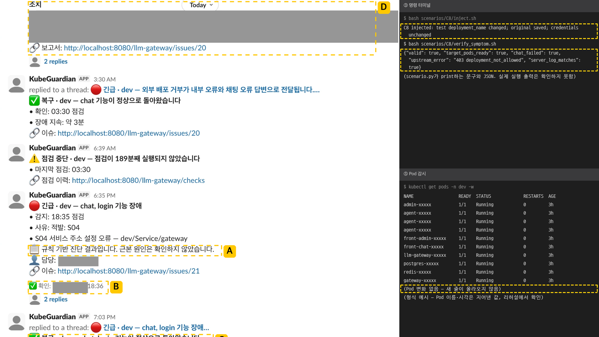

4. **나와야 할 로그**
   - ③ 출력: `scenarios/C8/scenario.py`가 print하는 문구와 JSON이다(`inject`와 `verify`의 출력 문구는 코드 기준, 실제 실행 출력은 촬영 때 확인). `kubectl get pods -n dev` 출력은 Pod 이름과 AGE가 **형식 예시**다(dev의 Pod 10개: admin, agent×3, front-admin, front-chat, gateway, llm-gateway, postgres, redis). `OK`(H0)는 녹화 전에 확인한 출력이라 영상에 안 나온다.
   - ⑤ Pod 감시: 새 줄이 붙지 않는다.
   - ④ llm-gateway 로그(데스크톱 3, 이 화면에는 안 보임): 주입만으로는 새 줄이 없다.
   - ② 작업자 로그: 새 줄 없음.

```text
$ bash scenarios/C8/inject.sh
C8 injected: test deployment_name changed; original saved; credentials unchanged
$ kubectl get pods -n dev
NAME                         READY   STATUS    RESTARTS   AGE
admin-xxxxxxxxxx-xxxxx       1/1     Running   0          3d
agent-xxxxxxxxxx-xxxxx       1/1     Running   0          3d
(agent 두 줄 더 …)
front-admin-xxxxxxxxxx-xxxxx 1/1     Running   0          3d
front-chat-xxxxxxxxxx-xxxxx  1/1     Running   0          3d
gateway-xxxxxxxxxx-xxxxx     1/1     Running   0          1h
llm-gateway-xxxxxxxxx-xxxxx  1/1     Running   0          3d
postgres-xxxxxxxxxx-xxxxx    1/1     Running   0          3d
redis-xxxxxxxxxx-xxxxx       1/1     Running   0          3d
$ bash scenarios/C8/verify_symptom.sh
{"valid": true, "target_pods_ready": true, "chat_failed": true, "upstream_error": "403 deployment_not_allowed", "server_log_matches": true}
```

5. **자막·내레이션·편집**
   - 자막 2:16.5~2:21: 장애 주입: LLM 배포명 하나가 바뀜
   - 자막 2:22.5~2:29: Pod는 모두 Running · Ready / 그런데 채팅 요청은 실패
   - 내레이션(후시): `[새로 씀]` "규칙이 못 잡는 장애를 위해, LLM 배포명 변경 장애를 주입합니다."(2:16.8~2:21.1, 4.3초) `[새로 씀]` "LLM 배포명을 바꿔, Pod는 모두 정상인데 채팅은 안 되는 상태를 만들었습니다."(2:22.3~2:28.3, 6.0초) 첫 문장은 ③에서 주입 명령을 칠 때, 둘째 문장은 `kubectl get pods -n dev`의 `Running` 줄들이 보일 때 시작해 `chat_failed` 줄을 짚으며 끝낸다. 이전 판의 "배포명만 바뀌어 채팅은 실패하지만, Pod와 Service는 정상입니다." 문장은 이 문장으로 바꿨다.
   - 편집: ③의 `kubectl get pods -n dev` 출력의 `READY`·`STATUS` 열(`1/1`, `Running`)에 박스(3초), 이어 `chat_failed` 줄에 박스를 붙이고 ⑤의 "Pod 변화 없음" 자리에 박스를 붙인다. 확대는 `chat_failed` 줄에 1.4배 / ③ 칸 출력 줄(화면 오른쪽 위 칸, 약 (1600, 300)) / 유지 2초(전체 3초)로 한다(2:25.5~2:28.5).

### R8. C8 점검 실행 (원본 7:00~7:40 → 편집 17.5초)

1. **레이아웃**: 데스크톱 2 · L2 → 데스크톱 3 · L3 → 데스크톱 2 · L2 → 데스크톱 3 · L3 — R7 끝(데스크톱 2)에서 `⌃→`로 데스크톱 3으로 넘어가 브라우저 창 B의 **"지금 점검" 버튼**을 눌러 점검을 시작한다(R3과 같은 방식이고, 점검 명령을 ③에 치지 않으며, L1로 가지 않는다). 창 B의 점검 상세에서 점검 단계가 채워지고, 기능 점검 chat 실패 줄과 "조사 시작"이 나온 뒤, 제목 옆 "조사 중" 스피너와 본문 "조사 중: 도구 호출 N/20" 진행 표시를 3~4초 보인다(조사 중에는 3초마다 자동 갱신된다. 근거: `app/web/templates/checks/detail.html` 14행, `checks/_parts.html` 15~20행). 이때 점검이 1차 알림(조사 중 안내)을 발송하면 화면 오른쪽 위에 Slack **알림 배너가 뜬다. 배너를 누르지 않고 컷 없이 `⌃←` 한 번(데스크톱 3 → 2)의 전환 애니메이션 그대로** Slack으로 넘어가 "조사 중" 안내를 보인다. 이어 `⌃→`로 데스크톱 3으로 돌아와 ④에 이미 찍혀 있는 403 줄을 가리키고 ②의 `[조사 #N] 시작` 줄을 본 뒤 R9로 이어 간다. 창 B(왼쪽 2/3)에는 같은 점검의 상세(조사 중 표시)가 계속 열려 있다. 모든 전환이 이웃 한 칸이다(2→3, 3→2, 2→3).
2. **할 일**:
   1. `⌃→`로 데스크톱 3으로 넘어와 창 B 우상단 "지금 점검" 버튼을 누른다(L1로 가지 않는다. 영상에서는 자막 "점검 실행"을 함께 올린다). 정각 CronJob과 겹치지 않는 때에 누르고, 조사 대기열이 비어 있어야 한다. 창 B는 R7 전(녹화 밖 준비)에 점검 이력 화면에 맞춰 둔다. 점검 완료 대기는 편집에서 삭제한다.
   2. 점검 이력 맨 위 새 점검 줄을 눌러 점검 상세를 연다(점검 완료 대기 구간이라 편집에서 잘린다. 점검 상세 주소를 복사하거나 붙이는 단계는 없다). 점검 단계가 채워지고 기능 점검 chat 실패 줄과 "조사 시작 — 기능 점검 실패 · 1차 심각도 긴급"이 보이면 커서로 짚은 뒤(약 4.5초), 제목 옆 "조사 중" 스피너와 본문 "조사 중: 도구 호출 N/20" 위에 커서를 3~4초 둔다(N이 늘어나는 것이 보인다. 근거: `web/viewmodels/check_list.py`의 live 기본값 False, `checks/_steps.html`·`issues/detail.html`은 live일 때 3초 갱신). 사진 번호대로 1 점검 이력 아이콘, 2 목록의 점검 #N 줄이다. 3 "이슈 #N 열림" 링크는 R11에서 이슈 상세로 갈 때 누른다.
   3. (필수) 이 사이 화면 오른쪽 위에 Slack 알림 배너가 뜨면 누르지 않고 키 `⌃←`로 데스크톱 2의 Slack으로 넘어가 1차 알림의 "원인을 조사하고 있습니다. 조사가 끝나면 이 메시지를 갱신합니다." 줄을 보인다(`messages.py` 150행). **R10의 전후 비교에 쓸 '전' 화면이므로 이 Slack 장면의 마지막 프레임을 정지 화면으로 저장해 둔다.** 이 알림에는 규칙 진단 안내가 아니라 이 조사 중 안내가 붙는다. 사진은 없다(촬영 때 확인).
   4. `⌃→`로 데스크톱 3으로 돌아온다. 창 B는 앞서 연 점검 상세 그대로이다(주소를 붙일 필요가 없고, 조사 중에는 3초마다 자동 갱신되므로 새로고침도 필요 없다). **오른쪽 아래 ④에서 실제 서비스 Pod 로그(llm-gateway)에 이미 찍힌 403 오류 줄을 가리킨다.** 기능 점검이 채팅을 시도하는 동안 llm-gateway가 외부 LLM 호출에서 받은 거부가 로그에 남았고, 그 줄이 ④ 칸에 남아 있다(지난 일로 말한다). ④는 R6 뒤 녹화 밖에서 아래 명령으로 켜 두었다(§2 "④ 서비스 로그"의 LLM 배포명 변경 장면 명령과 같다). ④의 줄 위에 커서를 약 4초 둔다.

      ```bash
      kubectl -n dev logs -f deploy/llm-gateway -c llm-gateway --since=1s | grep --line-buffered -E 'deployment_not_allowed|provider call failed' | perl -pe 'BEGIN{$|=1} s#https?://[^/\s"]+#<외부 호스트>#g'
      ```

      - 네임스페이스 `dev`, 디플로이먼트 `llm-gateway`, 컨테이너 `llm-gateway`다(`eval/history/20261118T201216Z-C8`에서 조사가 같은 Pod·컨테이너를 읽었다). grep 패턴 `deployment_not_allowed|provider call failed`는 그 조사가 llm-gateway 로그를 찾을 때 쓴 것과 같다.
      - ④는 640×270 칸이라 줄이 길어 접히고 약 9줄만 보인다(16pt). 읽히는지 리허설에서 확인하고, 안 읽히면 편집에서 ④ 칸을 확대한다(이 장면은 ④ 줄이 주인공이라 L3여도 확대한다). [촬영 시 확인]
      - 점검 상세와 조사 중 표시는 창 B(왼쪽 2/3)라 L1보다 글자가 작아 편집에서 1.3배 안팎 확대한다. 도구 호출 N/20이 3초 갱신으로 실제 늘어나는지 리허설에서 확인한다. [촬영 시 확인]
   5. 이어 오른쪽 위 ②에서 `[조사 #N] 시작` 줄에 커서를 1.5초 둔다. 줄이 아직 없으면 `[조사 #N] 사전 확인` 줄이 보일 때 R9로 넘어간다.
3. **사진**: `scenes/R8a-c8-check-run.png`(점검 직후), `scenes/R8b-c8-investigation-start.png`(조사 시작). **사진은 이전 배치(L2)** 라서 지금 배치와 다르다. 지금 R8의 점검 상세와 조사 중 표시는 L3의 창 B(왼쪽 2/3)이고, 로그는 같은 L3의 오른쪽 위 3/4 ②, 오른쪽 아래 1/4 ④다. 사진의 왼쪽은 점검 #92 상세 캡처, 오른쪽 위가 ④, 오른쪽 아래가 ②다. 두 사진의 ④는 예전 필터(`chat/completions … 500`)의 화면이라 이번 ④(403 줄)와 다르다(사진은 갱신 전). 사진은 조사 완료 후 화면이라 "판단: 후보" 배지가 보이지만, 촬영 시점(조사 시작 직후)에는 배지가 아직 없고 대신 "조사 중"과 도구 호출 N/20 표시가 보인다. 조사 중 표시 화면의 사진은 없다(촬영 때 확인).


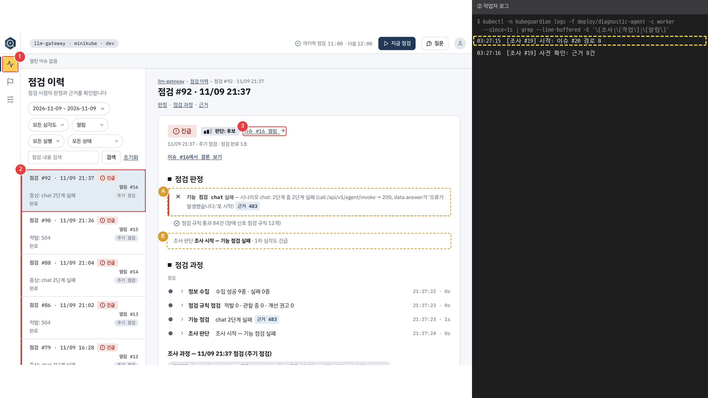

   기존 캡처 (점검 상세 화면의 마커):

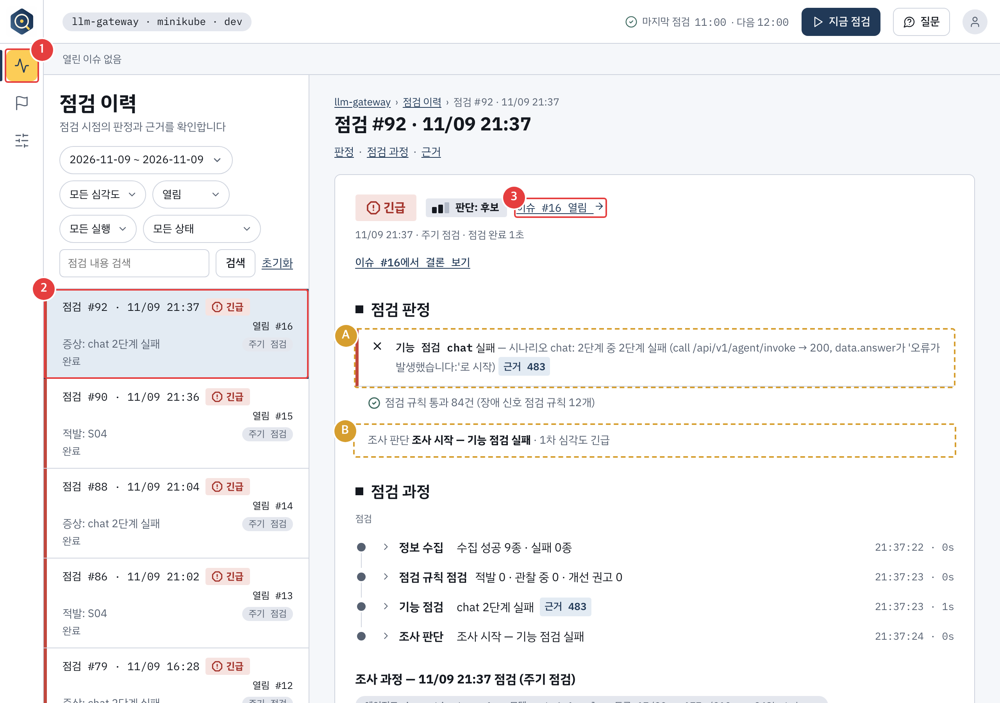

   - 1 = 왼쪽 메뉴의 "점검 이력" 아이콘
   - 2 = 목록의 점검 #92 줄
   - A = 판정: 기능 점검 chat 실패(`call /api/v1/agent/invoke → 200`, `data.answer`가 '오류가 발생했습니다:'로 시작)
   - B = "조사 시작 — 기능 점검 실패 · 1차 심각도 긴급"
   - 3 = "이슈 #16 열림" 링크(다음 이동, R11에서 이슈 상세로 간다)
4. **나와야 할 로그**
   - ④ (오른쪽 아래 칸. **11/18 평가 기록의 실측을 줄이고 옮긴 것**: `eval/history/20261118T201216Z-C8/steps-0.json`의 근거 ev-0009, llm-gateway Pod 로그. 평가 도구가 긴 줄을 잘라 보이므로 줄 끝은 `…`로 둔다. 11/19 사용자 확인: 서비스 로그에 403 줄이 찍힌다):

```text
2026-11-18 20:12:35,754 [llm-gateway(ERROR)] - chat_completions provider call failed | trace_id=… | elapsed=0.109s | 403: Azure OpenAI API 호출 실패 (403): {"error": {"code": "deployment_not_allowed", …
  core.error.service_exception.ServiceException: 403: Azure OpenAI API 호출 실패 (403): {"error": {"code": "deployment_not_allowed", "message": "Deployment 'gpt-4.1-next' 은(는) 허용되지 않습니다. 관리자에게 문의하세요.", …
```

   - 위 줄은 점검 직후 조사 도구(`get_pod_logs`)가 같은 grep `deployment_not_allowed|provider call failed`로 llm-gateway Pod 로그에서 읽어 온 줄이라 서비스 Pod 로그에 실제로 있는 줄이다. 첫 줄의 `403 … deployment_not_allowed`는 평가 도구가 중간에서 자른 표기다.
   - 11/19 사용자 확인: llm-gateway 서비스 로그에 `403 … deployment_not_allowed` 줄이 찍힌다. [C8 README](../../scenarios/C8/README.md)의 옛 서술(11/09)은 이에 맞게 고쳤다.
   - 주의: ④ 필터가 외부 LLM 호스트 주소가 섞인 줄을 통과시킬 수 있다. `perl`은 `http(s)://호스트`만 가리므로 스킴 없는 호스트 표기가 남으면 편집에서 가린다.
   - ② (**형식 변환**, 리허설 원문은 옛 형식이다. "지금 점검"은 web 컨테이너에서 돌아 `게이트: 경로 B …`, `[알림] M1 발송` 줄은 `[web]` 줄로 ②에 나올 수 있다. 실제 줄은 [촬영 시 확인]):

```text
2026-11-12 03:27:12 INFO [worker] [작업] 조사 대기 집음: 이슈 #20 (점검 #92)
2026-11-12 03:27:15 INFO [worker] [조사 #19] 시작: 이슈 #20 경로 B
2026-11-12 03:27:16 INFO [worker] [조사 #19] 사전 확인: 근거 8건
```

   박스: `[조사 #N] 시작` 줄. 첫 줄의 이슈·점검 번호는 사진 13의 번호에 맞춘 **형식 예시**다.


5. **자막·내레이션·편집**
   - 기능 라벨 카드 2:32.5~2:35.5(화면 왼쪽 위): **AI 조사** · 규칙이 못 잡은 장애의 원인을 조사
   - 자막 2:30.5~2:35.5.5: 점검 실행: 규칙 신호 없음 / 기능 점검 chat 실패 → AI 조사
   - 자막 2:36.0~2:39.5.1: 조사 중: 도구 호출 횟수 표시 / 점검 상세가 3초마다 갱신
   - 자막 2:39.6~2:41.5.3: Slack 1차 알림에 조사 중 안내 / macOS 배너 → 데스크톱 전환
   - 자막 2:41.8~2:47.5.5: 서비스 로그에도 403 오류 / llm-gateway · deployment_not_allowed
   - 내레이션(후시): `[새로 씀]` "이제 지금 점검을 누릅니다."(2:30.7~2:32.5, 1.8초) `[새로 씀]` "기능 점검은 실패했지만 규칙 신호는 없어서, AI 조사가 시작됩니다. 화면에 조사 진행이 보입니다."(2:32.9~2:39.6, 6.7초) `[새로 씀]` "기능 점검이 채팅을 시도하는 동안, 서비스 로그에 403 거부 오류가 찍혔습니다."(2:42.2~2:47.7, 5.5초) 첫 문장은 L3 창 B에서 "지금 점검"을 누를 때, 둘째 문장은 점검 상세의 기능 점검 실패와 "조사 시작"에서 시작해 끝 2초에 "조사 중" 표시와 도구 호출 횟수를 가리키며 끝낸다. 셋째 문장은 L3에서 ④(오른쪽 아래)에 이미 찍힌 403 줄을 가리키며 지난 일로 말한다. 점검 직후 조사 시작 전은 편집에서 이미 잘라 냈다. Slack 안내 장면(2:39.6~2:41.8, 2.2초)은 자막만 올린다. 선택 문장: "Slack 1차 알림에는 조사 중이라는 안내가 붙습니다."(3.6초, §8 선택 문장. Slack 장면 2.2초에 말이 얹히므로 읽으려면 장면을 1.5초 늘린다).
   - **편집 표시(최종 영상 시각)**

| 시각 | 강조 대상 | 표시 방법 | 확대(배율 / 중심 / 유지) | 자막·라벨 |
|---|---|---|---|---|
| 2:30.5~2:32.9 | 창 B 우상단의 "지금 점검" 버튼 | 노란 점선 박스 1.5초 → 클릭 링 0.3초 | 1.3배 / 창 B 안 우상단(약 (1100, 130)) / 유지 1초(창 B가 화면 왼쪽 2/3라 L1보다 글자가 작다) [촬영 시 확인] | 자막 1 시작 |
| 2:32.5~2:35.5 | 화면 왼쪽 위 | 기능 라벨 카드 3초 | — | 라벨 "AI 조사" |
| 2:32.9~2:36.0 | 점검 상세의 A(기능 점검 chat 실패)와 B("조사 시작 — 기능 점검 실패 · 1차 심각도 긴급") | 박스 A → 박스 B | 1.3배 / 창 B 점검 상세 판정 영역(창 B 안 약 (640, 450)) / 유지 2초 [촬영 시 확인] | 자막 1 |
| 2:36.0~2:39.6 | 제목 옆 "조사 중" 스피너와 본문 "조사 중: 도구 호출 N/20" | 노란 점선 박스 + 숫자가 늘어나는 곳에 화살표(2:38.1부터 화면 오른쪽 위에 알림 배너가 겹쳐 보이면 그대로 둔다) | 1.3배 / 진행 표시 위치(창 B 안 약 (640, 300)) / 유지 1.3초 [촬영 시 확인] | 자막 2 |
| 2:39.6~2:41.8 | Slack 1차 알림의 상태 줄 "🔍 원인을 조사하고 있습니다. 조사가 끝나면 이 메시지를 갱신합니다." | `⌃←` 전환 애니메이션(약 0.7초)을 **컷 없이** 그대로 둔 뒤 상태 줄에 노란 점선 박스. 마지막 1초는 정지 화면(R10의 '전') | 1.4배 / 메시지 블록 가운데(Slack 칸 가운데, 약 (640, 540)) / 유지 1초(전체 2초) | 자막 3 |
| 2:42.2~2:47.7 | ④의 `chat_completions provider call failed … 403` 줄과 `ServiceException: 403 … deployment_not_allowed` 줄, 끝 1초는 ②의 `[조사 #N] 시작` 줄 | ④ 줄 박스. 박스는 `deployment_not_allowed`에 한 번 더 붙인다(R11-5에서 같은 줄을 근거로 다시 짚는다). 끝 1초에 ② 시작 줄 박스 | 1.5배 / ④ 칸 가운데(화면 오른쪽 아래 칸, 약 (1600, 945)) / 유지 3.5초(전체 4.5초) [촬영 시 확인] 줄이 읽히는지 | 자막 4 |

   - 알림의 나머지 필드(제목·`감지` 시각·`사유`)는 `first_alert`의 형식이고, 이번 장애의 사유 문구는 촬영 때 확인한다.

### R9. 조사 로그 (원본 7:40~10:40 → 편집 45초, 뒤에 R9-2 3.6초)

1. **레이아웃**: 데스크톱 3 · L3 — 브라우저 창 B 왼쪽 2/3(1280×1080, R8의 점검과 같은 점검 상세, 조사 중 표시) + ② 작업자 로그 오른쪽 위 3/4(640×810, 20pt) + ④ 서비스 로그 오른쪽 아래 1/4(640×270, 16pt, 이 장면에서는 곁에 둘 뿐이다). R8에서 ④의 403 줄을 가리킨 같은 데스크톱 3 화면에서 이어 간다(넘김 없음). ②는 R8부터 같은 창에서 돌고 있어 줄이 이어서 쌓여 있다. 새 형식 접두(날짜·시각·역할)가 길어 긴 줄은 여러 줄로 줄바꿈된다(②가 640폭이다). 짧은 핵심 줄만 줌 인하고(표의 확대 칸), 접히는 긴 줄은 확대하지 않고 박스를 쓴다. 점검 상세의 조사 중 표시는 R8의 L1에서 이미 보였고, 이 장면에서는 창 B에 같은 화면이 계속 열려 있어 "조사 중"과 도구 호출 횟수가 늘어나는 것이 ②와 함께 보인다(조사가 끝나면 창 B의 화면도 완료 상태로 바뀐다).
2. **할 일**: 누를 것은 없다. ②에서 로그가 올라오는 것을 그대로 녹화한다. 창 B에 열려 있는 점검 상세의 "조사 중: 도구 호출 N/20"이 늘어나는 것을 도구 줄이 올라올 때 커서로 1초 안팎 짚어도 된다(말과 장면 길이는 그대로). 원본 조사 시간은 회차마다 다르다(재배포 후 실측 약 177초). 명령은 R2와 같다(필터 없음).

   ```bash
   kubectl -n kubeguardian logs -f deploy/diagnostic-agent --all-containers --since=1s
   ```

3. **사진**: `scenes/R9-c8-investigation-log.png`(**사진은 이전 배치**: 왼쪽 1280×1080이 ② 20pt, 오른쪽 640×1080이 점검 상세 브라우저 한 칸이다. 지금은 왼쪽 2/3(1280×1080)가 창 B, 오른쪽 위 3/4(640×810)가 ②, 오른쪽 아래 1/4(640×270)가 ④다).

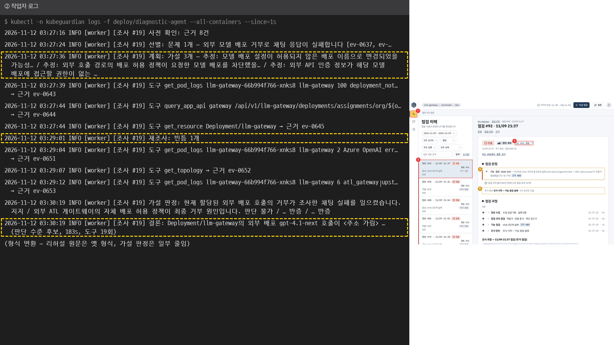

4. **나와야 할 로그** (② **형식 변환**: 로그 샘플 사진 14의 실측 줄(옛 형식)을 새 형식 접두로 옮겼다. 날짜는 형식 맞춤이다. 실제 조사 로그에서 대표 줄을 골랐다. `계획`은 두 줄, `가설 판정`은 네 줄이므로 터미널 줄바꿈을 켜고, 상세 판정은 R11 보고서에서 보여 준다. 외부 LLM 호스트 이름은 `<주소 가림>`으로 가려져 있다)

```text
2026-11-12 03:27:16 INFO [worker] [조사 #19] 사전 확인: 근거 8건
2026-11-12 03:27:24 INFO [worker] [조사 #19] 선별: 문제 1개 — 외부 모델 배포 거부로 채팅 응답이 실패합니다 [ev-0637, ev-…
2026-11-12 03:27:36 INFO [worker] [조사 #19] 계획: 가설 3개 — 추정: 모델 배포 설정이 허용되지 않은 배포 이름으로 변경되었을 가능성… / 추정: 외부 호출 경로의 배포 허용 정책이 요청한 모델 배포를 차단했을… / 추정: 외부 API 인증 정보가 해당 모델 배포에 접근할 권한이 없는 …
2026-11-12 03:27:39 INFO [worker] [조사 #19] 도구 get_pod_logs llm-gateway-66b994f766-xnks8 llm-gateway 100 deployment_not… → 근거 ev-0643
2026-11-12 03:27:44 INFO [worker] [조사 #19] 도구 query_app_api gateway /api/v1/llm-gateway/deployments/assignments/org/${o… → 근거 ev-0644
2026-11-12 03:27:44 INFO [worker] [조사 #19] 도구 get_resource Deployment/llm-gateway → 근거 ev-0645
2026-11-12 03:29:01 INFO [worker] [조사 #19] 재조사: 빈틈 1개
2026-11-12 03:29:04 INFO [worker] [조사 #19] 도구 get_pod_logs llm-gateway-66b994f766-xnks8 llm-gateway 2 Azure OpenAI err… → 근거 ev-0651
2026-11-12 03:29:07 INFO [worker] [조사 #19] 도구 get_topology → 근거 ev-0652
2026-11-12 03:29:12 INFO [worker] [조사 #19] 도구 get_pod_logs llm-gateway-66b994f766-xnks8 llm-gateway 6 atl_gateway|upst… → 근거 ev-0653
2026-11-12 03:30:19 INFO [worker] [조사 #19] 가설 판정: 현재 할당된 외부 배포 호출의 거부가 조사한 채팅 실패를 일으켰습니다. 지지 / 외부 ATL 게이트웨이의 자체 배포 허용 정책이 최종 거부 원인입니다. 판단 불가 / 최근 모델 배포 설정이 허용되지 않은 이름으로 변경되었습니다. 판단 불가 / 외부 인증 정보가 해당 배포에 접근할 수 없는 인증 대상으로 변경되었습… 판단 불가 / llm-gateway 내부에서 외부 응답 없이 배포 거부 오류를 생성했… 반증 / llm-gateway의 다운이나 반복 재시작이 이번 실패의 직접 원인입… 반증 / 할당량 초과나 요청 시간 초과가 조사한 요청의 직접 실패 사유입니다. 반증
2026-11-12 03:30:19 INFO [worker] [조사 #19] 결론: Deployment/llm-gateway의 외부 배포 gpt-4.1-next 호출이 <주소 가림> … (판단 수준 후보, 183s, 도구 19회)
```

   박스: `계획` 줄, `재조사: 빈틈 1개` 줄, `결론` 줄(`판단 수준 후보`). 사진 14는 옛 형식 원본 샘플이다. 새 형식은 접두가 길어 같은 줄이 640폭 20pt(② 칸)에서 여러 줄로 접힌다(사진 `scenes/R9` 참고).


   이전 회차의 전체 흐름(11/09 16:28 리허설 발췌, 실측. 아래는 옛 형식 원문에 새 형식 접두만 붙인 **형식 변환**이다). 알림과 `조사 마침` 줄이 있어 R10에서 보이는 줄의 예시이기도 하다. [리허설 결과는 이슈 #188](https://github.com/skax-jihyeryu/KubeGuardian/issues/188)이다. 재배포 후 C8 조사는 약 177초였고, 이 로그 예시를 남긴 이전 조사는 192초였다. 번호(#12, #14, ev-번호, Pod 이름)는 촬영 때 달라진다.

```text
YYYY-MM-DD HH:MM:SS INFO [worker] [작업] 조사 대기 집음: 이슈 #12 (점검 #79)
YYYY-MM-DD HH:MM:SS INFO [worker] [조사 #14] 시작: 이슈 #12 경로 B
YYYY-MM-DD HH:MM:SS INFO [worker] [조사 #14] 사전 확인: 근거 7건
YYYY-MM-DD HH:MM:SS INFO [worker] [조사 #14] 선별: 문제 1개 — 채팅 응답 실패: 외부 Azure OpenAI 호출의 403 오류가 l…
YYYY-MM-DD HH:MM:SS INFO [worker] [조사 #14] 계획: 가설 3개 — 추정(확신도: 중간): 외부 Azure OpenAI의 배포 접근 정책이… / 추정(확신도: 중간): LLM 배포의 엔드포인트·배포명 설정이 잘못되어… / 추…
YYYY-MM-DD HH:MM:SS INFO [worker] [조사 #14] 도구 get_resource Deployment/llm-gateway → 근거 ev-0443
YYYY-MM-DD HH:MM:SS INFO [worker] [조사 #14] 도구 get_pod_logs llm-gateway-96986c5ff-5zvs4 llm-gateway 100 deployment_not_… → 근거 ev-0447
YYYY-MM-DD HH:MM:SS INFO [worker] [조사 #14] 도구 get_events Pod/llm-gateway-96986c5ff-5zvs4 → 근거 ev-0449
YYYY-MM-DD HH:MM:SS INFO [worker] [조사 #14] 재조사: 빈틈 1개
YYYY-MM-DD HH:MM:SS INFO [worker] [조사 #14] 도구 get_pod_logs llm-gateway-96986c5ff-5zvs4 llm-gateway 100 atl_gateway|dep… → 근거 ev-0450
YYYY-MM-DD HH:MM:SS INFO [worker] [조사 #14] 도구 get_pod_logs llm-gateway-96986c5ff-5zvs4 llm-gateway 30 Azure OpenAI err… → 근거 ev-0451
YYYY-MM-DD HH:MM:SS INFO [worker] [조사 #14] 가설 판정: 활성 할당된 gpt-4.1-next 배포가 외부 호출에서 거부되는 것이… 지지 / 외부 ATL 중계 게이트웨이의 허용 정책이 잘못됐습니다. 판단 불가 / 앱 …
YYYY-MM-DD HH:MM:SS INFO [worker] [조사 #14] 결론: Deployment/llm-gateway의 외부 호출이 <외부 LLM 호스트>의 gpt-4.1-next 배포에서 403 dep… (판단 수준 후보, 192s, 도구 16회)
YYYY-MM-DD HH:MM:SS INFO [worker] [알림] M1u 발송 이슈 #12 (Slack)
YYYY-MM-DD HH:MM:SS INFO [worker] [알림] M9 발송 이슈 #12 (Slack)
YYYY-MM-DD HH:MM:SS INFO [worker] [작업] 이슈 #12 조사 마침: done
```

   실제 녹화에서 선택한 줄 사이를 자르면 "중간 생략" 자막을 붙인다.

   **코드 변경 후 새로 나오는 줄 (보고서 작성 시작·마침, 근거 번호 대조).** 위 두 블록은 보고서 작성 줄이 생기기 전 로그라 `보고서 작성`과 `근거 번호 대조` 줄이 없고 `재조사` 줄이 도구 줄 바로 뒤에 있다. 지금 코드는 보고서 작성 단계가 **시작·마침 두 줄**로 나온다. 시작 줄은 LLM이 보고서를 쓰기 시작할 때 나오고, 이후 수십 초 동안 줄이 올라오지 않는다. 촬영 본의 실제 로그 흐름은 **도구 → 보고서 작성 시작 → 마침 → 근거 번호 대조 → 빈틈 검사/재조사 → (재조사 도구) → 재조사 후 보고서 작성 → 가설 판정 → 결론** 순서다. 아래는 **형식 예시**다. 문구는 `app/service/pipeline/flow_log.py`의 형식을 따랐고, 번호·시각·숫자는 지어낸 값이라 **실측이 아니다**(재조사 후 마침 줄의 문구와 `재조사 후 근거 번호 대조` 줄의 뒷부분은 촬영 때 확인).

```text
YYYY-MM-DD HH:MM:SS INFO [worker] [조사 #N] 도구 get_resource Deployment/llm-gateway → 근거 ev-0645
YYYY-MM-DD HH:MM:SS INFO [worker] [조사 #N] 보고서 작성 시작(시도 1)
                                   (이후 수십 초 동안 줄이 올라오지 않는다)
YYYY-MM-DD HH:MM:SS INFO [worker] [조사 #N] 보고서 작성 마침(시도 1, 41s)
YYYY-MM-DD HH:MM:SS INFO [worker] [조사 #N] 근거 번호 대조: 인용 9건 중 8건 일치 · 없는 번호 제거 1건 · 강등 0건 · 결론 근거 있음
YYYY-MM-DD HH:MM:SS INFO [worker] [조사 #N] 재조사: 빈틈 1개 — 한 번 더 조사합니다
YYYY-MM-DD HH:MM:SS INFO [worker] [조사 #N] (재조사) 도구 get_pod_logs llm-gateway-… 2 Azure OpenAI err… → 근거 ev-0651
YYYY-MM-DD HH:MM:SS INFO [worker] [조사 #N] 재조사 후 보고서 작성 시작(시도 2)
                                   (다시 정적)
YYYY-MM-DD HH:MM:SS INFO [worker] [조사 #N] 재조사 후 보고서 작성 마침(시도 2, 38s)
YYYY-MM-DD HH:MM:SS INFO [worker] [조사 #N] 재조사 후 근거 번호 대조: 인용 …건 중 …건 일치 · …
YYYY-MM-DD HH:MM:SS INFO [worker] [조사 #N] 빈틈 검사: 없음
YYYY-MM-DD HH:MM:SS INFO [worker] [조사 #N] 가설 판정: … 지지 / … 판단 불가 / … 반증
YYYY-MM-DD HH:MM:SS INFO [worker] [조사 #N] 결론: … (판단 수준 후보, 183s, 도구 19회)
```

   재조사가 없으면 `재조사 …` 줄과 `재조사 후 …` 줄이 빠지고 `빈틈 검사: …`가 나온다. 본편에는 재조사가 있는 회차를 쓴다(아래 주의).

   **강조할 줄** (위 블록들에서 촬영 때 찾을 줄과 설명 한 문장)

| 줄 | 설명 한 문장 | 단계 |
|---|---|---|
| `[조사 #N] 사전 확인: 근거 8건` | 가설을 세우기 전에 호출 관계와 실패 재현을 코드로 먼저 모았다. | Planning |
| `[조사 #N] 선별: 문제 1개 — …` | 수집한 사실에서 조사할 문제를 하나로 좁혔다. | Planning |
| `[조사 #N] 계획: 가설 3개 — …` | 한 가지 원인으로 단정하지 않고 가설 3개를 세운다(Planning). | Planning |
| `[조사 #N] 도구 get_resource Deployment/llm-gateway → 근거 ev-…` | 가설마다 도구를 직접 불러 확인하고 결과는 근거 번호로 남는다(Tool Call). | ToT(가설 갈래 검증) |
| `[조사 #N] 도구 get_pod_logs … deployment_not… → 근거 ev-…` | 로그 검색 단어까지 줄에 보여 무엇을 찾았는지 알 수 있다. | ToT(가설 갈래 검증) |
| `[조사 #N] 보고서 작성 시작(시도 1)` | 근거를 다 모은 뒤 보고서 작성을 시작한다 — 이 동안의 정적은 2배속/중간 생략. | Self-Correction 준비 |
| `[조사 #N] 보고서 작성 마침(시도 1, Ns)` | LLM이 보고서를 다 썼다. 줄 끝의 N초가 생략한 정적 구간의 실제 길이다. | Self-Correction 준비 |
| `[조사 #N] 근거 번호 대조: 인용 N건 중 M건 일치 · …` | 보고서가 인용한 근거 번호를 실제로 모은 근거와 코드가 맞춰 본다(Self-Correction). | Self-Correction |
| `[조사 #N] 재조사: 빈틈 1개 — 한 번 더 조사합니다` (또는 `빈틈 검사: …`) | 코드 검증기가 빈틈을 찾아 에이전트에게 한 번 더 조사시킨다(Self-Correction). | Self-Correction |
| `[조사 #N] (재조사) 도구 …`, `재조사 후 보고서 작성 시작(시도 2)` | 빈틈을 메우려고 도구를 더 부르고 보고서를 다시 쓴다. | Self-Correction |
| `[조사 #N] 가설 판정: … 지지 / … 판단 불가 / … 반증` | 가설 갈래마다 지지·반증·판단 불가로 가지를 친다(ToT). | ToT(가설 갈래 검증) |
| `[조사 #N] 결론: … (판단 수준 후보, 183s, 도구 19회)` | 근거가 부족하면 확정 대신 후보로 내려간다. | 판단 수준 |
| `[알림] M1u 발송`, `[알림] M9 발송` | 1차 알림이 보고서 링크와 함께 갱신되고 스레드에 후속 답글이 붙는다(R10). | (R10) |

5. **자막·내레이션·편집**

   **가이드 단계와 로그 줄의 대응.** 가이드의 확대 설명 단계를 이렇게 로그에 대응시킨다.
   - **Planning** = 계획 줄(가설 3개). 사전 확인과 문제 선별은 계획을 세우기 위한 준비라 같은 단계에 묶는다.
   - **ToT(가설 갈래 검증)** = 가설을 여럿 세우고 도구로 갈래마다 검증해 지지, 반증, 판단 불가로 가지를 치는 것. 갈래를 검증하는 도구 줄에서 시작하고 가설 판정 줄에서 가지치기 결과를 보인다.
   - **Self-Correction** = 재조사 줄과 근거 번호 대조. 보고서를 쓴 뒤 코드 검증기가 근거 번호를 대조하고 빈틈이 있으면 한 번 더 조사시킨다.

   **단계 라벨 카드**(화면 왼쪽 위 작은 라벨, 각 2~3초. ② 로그 줄을 가리면 안 되므로 왼쪽 2/3의 창 B 위에 두고, 창 B의 조사 중 표시와 겹치면 라벨을 아래쪽으로 옮긴다)

| 라벨 | 최종 영상 시각 | 대응하는 로그 줄 |
|---|---|---|
| ① Planning · 사전 확인 · 문제 선별 · 가설 3개 | 2:48.0~2:51.6 | 사전 확인, 선별, 계획 |
| ② ToT(가설 갈래 검증) · 가설마다 도구로 확인 | 3:01.0~3:04.6 | 도구 줄 |
| ③ Self-Correction · 근거 번호 대조 · 재조사 | 3:14.1~3:17.6 | 보고서 작성 마침 다음의 근거 번호 대조, 재조사 |
| ② ToT 가지치기 · 지지 · 반증 · 판단 불가 | 3:25.9~3:29.4 | 가설 판정 |
| 판단 수준 · 근거 수준을 코드가 정함 | 3:29.7~3:32.6 | 결론(판단 수준 후보) |

   **줄별 편집 지시(최종 영상 시각).** 박스는 줄이 올라오는 순간(0.3초) 줄 높이에 맞춰 붙는다. 줄이 줄바꿈되어 두 줄이면 박스를 두 줄에 걸쳐 그린다. 확대는 §2 규격(줌 인 0.5초 → 유지 → 줌 아웃 0.5초)이고 `배율 / 중심 / 유지`로 적는다. 중심의 x는 ② 로그 창(화면 오른쪽 위 640×810 영역, x 1280~1920, y 0~810) 안의 위치, y는 그 줄이 있는 높이다. **짧은 한 줄(사전 확인, 보고서 작성 시작·마침, 재조사)은 확대하고, 긴 줄은 확대 대신 박스를 쓴다.** 긴 줄(선별, 계획, 도구 줄, 근거 번호 대조, 가설 판정)은 줄 끝의 근거 번호·판정 단어까지 읽혀야 하는데 1.3배 이상 확대하면 줄 끝이 화면 밖으로 잘려, 박스와 화살표로 짚는다. 결론 줄은 끝의 "판단 수준 후보" 부분만 읽히면 되므로 그 부분을 중심으로 확대한다.

| 시각 | 강조 대상 | 표시 방법 | 확대(배율 / 중심 / 유지) | 자막·라벨 |
|---|---|---|---|---|
| 2:48.0~2:55.0 | ②의 `[조사 #N] 사전 확인: 근거 N건` 줄 | 노란 점선 박스. 왼쪽 위에 ① Planning 라벨 3초 | 1.5배 / 그 줄의 왼쪽 1/3 지점(x≈1490, y=줄 높이) / 유지 5초(전체 6초) | 사전 확인: 코드로 근거 수집 |
| 2:55.0~3:01.0 | `선별: 문제 1개 — …` 줄(긴 줄)과 `계획: 가설 3개 — …` 줄(두 줄로 접힘) | 선별 줄 박스 → 계획 줄 박스(줄 안 "추정: …" 구분 지점마다 작은 화살표) | — (긴 줄: 줄 끝 근거 번호와 가설 문장이 잘려 확대 대신 박스) | 문제 선별 · Planning: 가설 3개 |
| 3:01.0~3:08.0 | `도구 get_pod_logs …`, `도구 query_app_api …`, `도구 get_resource …` 줄 | 줄마다 순서대로 노란 점선 박스, 줄 끝 `→ 근거 ev-…`에 화살표. 왼쪽 위에 ② ToT 라벨 3초. 이어지는 도구 반복은 2배속("2배속" 칩), 대기는 잘라 "중간 생략" 칩 1.5초 | — (줄 끝 `→ 근거 ev-…`까지 읽혀야 해서 박스와 화살표) | ToT(가설 갈래 검증) / 가설마다 도구로 직접 확인 |
| 3:08.0~3:14.0 | `보고서 작성 시작(시도 1)` 줄 → 정적 → `보고서 작성 마침(시도 1, Ns)` 줄 | 시작 줄 박스 → 정적 구간을 잘라 점프 컷, "⏩ 중간 생략 · 실제 약 N초" 칩 1.5초(N은 마침 줄의 값, 촬영 때 확인) → 마침 줄 박스 | 1.5배 / 시작 줄의 왼쪽 1/3(x≈1490, y=줄 높이) / 유지 2초(전체 3초) | 보고서 작성 시작 / 정적 구간 중간 생략 |
| 3:14.0~3:19.0 | `근거 번호 대조: 인용 N건 중 M건 일치 · …` 줄(긴 줄) | 노란 점선 박스, "인용 N건 중 M건 일치" 부분에 화살표. 왼쪽 위에 ③ Self-Correction 라벨 3초 | — (긴 줄: 뒤의 "결론 근거 있음"까지 읽혀야 해서 박스) | Self-Correction: 근거 번호 대조 |
| 3:19.0~3:26.0 | `재조사: 빈틈 1개 — 한 번 더 조사합니다` 줄(없으면 `빈틈 검사` 줄), 이어 `(재조사) 도구 …` 줄과 `재조사 후 보고서 작성 시작(시도 2)` 줄 | 재조사 줄 박스 + 화면 오른쪽에서 줄을 향한 화살표 → (재조사) 도구 줄 박스 → 시작 줄 박스. 시작 줄 뒤 정적은 1초 점프 컷 | 1.4배 / 재조사 줄 가운데(x≈1600, y=줄 높이) / 유지 3초(전체 4초) | 빈틈 검사 → 재조사 / 코드 검증기가 빈틈을 찾음 |
| 3:26.0~3:29.0 | `재조사 후 근거 번호 대조` 줄 → `가설 판정: … 지지 / … 판단 불가 / … 반증` 줄(매우 긴 줄) | "지지", "판단 불가", "반증" 세 곳에 작은 노란 점선 박스를 순서대로. 왼쪽 위에 ② ToT 가지치기 라벨 3초 | — (줄이 두세 줄로 접히는 매우 긴 줄: 확대하면 잘려 단어별 박스) | (자막은 결론 구간으로 이어진다) |
| 3:29.0~3:33.0 | `결론: … (판단 수준 후보, 183s, 도구 19회)` 줄의 "판단 수준 후보" | 노란 점선 박스. 왼쪽 위에 판단 수준 라벨 2.5초. 마지막 1초는 정지(말이 남으면 정지 프레임 유지로 보충) | 1.5배 / "판단 수준 후보"가 있는 둘째 줄의 오른쪽 부분(x≈1730, y=그 줄 높이) / 유지 2초(전체 3초) | 판단 수준: 후보 (확정 아님) |

   - 내레이션(후시, 구간 2:48.0~3:33.0): `[새로 씀]` "조사가 시작되면 먼저, 환경 설명과 조사 지침을 지식으로 주입합니다."(2:48.2~2:52.9, 4.7초) "이어서 사전 확인에서 호출 관계와 실패 재현을 코드로 모읍니다."(2:53.2~2:57.7, 4.5초) "선별에서 문제를 좁히고, 계획에서 가설 3개를 세웁니다."(2:58.0~3:01.8, 3.8초) `[새로 씀]` "계획에 따라 로그 조회, 설정 조회, 상태 확인 같은 도구를 직접 불러, 줄 끝의 근거 번호로 남깁니다."(3:02.2~3:08.5, 6.3초) `[새로 씀]` "근거를 모으면 보고서를 쓰는데, 이 동안 로그는 조용합니다."(3:08.9~3:12.9, 4.0초) `[새로 씀]` "보고서가 나오면 인용한 근거 번호를 실제 근거와 대조해, 없는 번호는 지우고 근거가 모자란 결론은 강등합니다."(3:13.3~3:20.6, 7.3초) "여기 재조사 줄처럼 빈틈이 남으면 한 번 더 조사하는 것이 Self-Correction입니다."(3:21.0~3:26.3, 5.3초) "근거가 모자라면 결론은 후보로 제한되고, 이 판단 수준은 코드가 정합니다."(3:26.7~3:31.7, 5.0초)
   - 로그 줄과 말의 짝: `지식 주입: 환경 설명 N건 · 조사 지침 N종 …` 줄에서 지식 주입 문장, `사전 확인` 줄, `선별`·`계획` 줄, `도구 …` 줄(아래 표), `근거 번호 대조` 줄, `재조사` 줄, `결론` 줄 순서로 짚는다. 조사 그래프의 단계는 지식 주입 → 사전 확인 → 선별 → 계획 → 도구 호출 반복 → 보고서 작성 → 근거 번호 대조(검증) → 빈틈 검사(재조사 또는 종료)이고, `app/service/agent/investigator/v1/graph.py`와 `app/service/pipeline/flow_log.py`의 로그 문구로 확인했다.
   - 도구 이름은 임원용 말로 풀어 쓴다: `get_pod_logs`는 "로그 조회", `get_resource`는 "설정 조회", `get_events`는 "이벤트 조회", `query_app_api`는 "서비스 API 조회", `probe`는 "상태 확인 호출", `get_topology`는 "서비스 연결 관계 조회", `run_api_scenario`는 "기능 점검 시나리오 실행"이다. 문장에는 로그 조회, 설정 조회, 상태 확인 세 가지만 말한다(실제로 찍힌 `도구 …` 줄의 이름을 보고 맞춘다 [촬영 시 확인]).
   - Self-Correction 설명의 근거: `validate`는 인용한 근거 번호 중 없는 번호를 지우고 근거가 비거나 부족한 문장을 "강등"하며(로그의 `근거 번호 대조: 인용 N건 중 M건 일치 · 없는 번호 제거 · 강등 N건`), `stop_check`는 빈틈이 있으면 `재조사: 빈틈 N개 — 한 번 더 조사합니다`를 남기고 한 번 더 조사시킨다. 결론에 근거 번호가 없으면 보고서를 다시 쓴다(`결론에 근거 번호가 없어 다시 씀`).
   - 배속·중간 생략 구간(도구 결과의 2배속, 보고서 작성 시작과 마침 사이의 점프, 재조사 후 작성 시작 뒤의 점프)에는 말을 넣지 않는다. 문장은 줄이 보이는 구간에 맞춰 넣었다(§8의 시작~끝).
   - 재조사는 리허설 1회에서 관찰된 것이라 매번 나온다는 보장이 없다. 본편에는 실제 `재조사` 로그와 `판단 수준 후보` 결론이 함께 나온 회차를 쓴다. 둘 중 하나라도 빠지면 원복 후 다시 찍는다. 보고서 작성 시작·마침 줄이 나오는 이미지(코드 변경 후)로 띄운 회차인지도 확인한다. C8의 반복 평가는 없다. 못 찍었을 때의 대안은 §7을 본다.

### R9-2. 점검 이력 결과 (R9 뒤 · 편집 3.6초)

1. **레이아웃**: 데스크톱 3 · L3 — R9에서 이어서(넘김 없음). 창 B(왼쪽 2/3)의 점검 상세는 3초마다 갱신되므로 조사가 끝나면 "조사 중" 표시가 사라지고 조사 결과(조사 완료 표시)가 나타난다.
2. **할 일**: 클릭은 없다. 조사 완료 뒤 창 B의 점검 상세(점검 이력에서 연 그 점검)에서 제목 옆 "조사 중"이 있던 자리 → 판정·결과 영역 순서로 커서를 옮겨 한 번 훑는다(총 3.6초). 점검 이력 목록으로 돌아가지 않고 열어 둔 점검 상세를 그대로 쓴다. 이 화면에도 오른쪽 위에 Slack 후속 알림 배너가 떠 있을 수 있다(R10으로 `⌃←` 전환하기 전). [촬영 시 확인] 점검 이력의 그 점검 상세에 나오는 실제 조사 완료 표시와 결과 문구.
3. **사진**: 없음(촬영 때 확인).
4. **나와야 할 로그**: 없음(②의 `조사 마침` 줄은 곁에 보일 뿐 짚지 않는다).
5. **자막·내레이션·편집**
   - 자막 3:33.0~3:36.6: 점검 이력에도 결과가 남음 / 조사 완료 표시
   - 내레이션(후시): `[새로 씀]` "조사가 끝나면, 점검 이력에도 결과가 남습니다."(3:33.2~3:36.4, 3.2초, 19음절)
   - 편집: 창 B 점검 상세의 조사 완료 표시와 결과 영역에 노란 점선 박스, 1.3배 / 창 B 안 점검 상세 가운데(약 (640, 450)) / 유지 2.5초(전체 3.5초) [촬영 시 확인].

### R10. Slack 갱신 (원본 10:40~11:00 → 편집 8초)

1. **레이아웃**: 데스크톱 3 → 2 · L3 → L2 — R9-2 끝(데스크톱 3)에서 조사가 끝나 스레드 후속 답글이 올라오면 화면 오른쪽 위에 Slack **알림 배너가 뜬다.** 배너를 보인 뒤 **컷 없이 `⌃←` 전환 애니메이션 그대로** 데스크톱 2로 넘어온다. 데스크톱 2는 Slack 왼쪽 2/3 + ③ 명령 터미널 오른쪽 위(빈 프롬프트) + ⑤ Pod 감시 오른쪽 아래(Pod 변화 없음)다. 메시지 갱신(M1u)만으로는 알림이 울리지 않아, **배너는 스레드 후속 답글(M9)의 것**이다(`messages.py`의 `cause_reply` 주석).
2. **할 일**: 같은 Slack 메시지가 어떻게 바뀌는지를 보이고, 스레드 답글을 열고, 보고서 링크를 눌러 R11로 넘어간다. 화면 안의 열기와 링크 이동만 하므로 상태를 바꾸지 않는다.
   1. 배너가 뜨면 보인 뒤 `⌃←`로 넘어간다(배너를 누르지 않는다).
   2. Slack 1차 알림(R8에서 "조사 중" 안내가 붙어 있던 메시지)이 새 메시지가 아니라 **같은 메시지가 갱신**된 것을 보인다(M1 → M1u).
   3. 메시지 아래 스레드 답글("N replies")을 눌러 후속 답글(M9)을 연다.
   4. 갱신된 메시지의 "🔗 보고서" 링크를 누른다. 그 화면이 R11-1이다. 링크는 기본 브라우저의 가장 최근 창, 곧 창 A에서 이슈 상세(보고서)로 열리고, macOS가 창 A가 있는 데스크톱 1(L1)로 이동한다(L2 → L1, 이웃 한 칸). 창 A와 창 B를 서로 다른 브라우저 앱으로 띄우고 기본 브라우저의 창을 창 A 하나로 만들어 두는 준비는 §3이다. [촬영 시 확인] 링크가 창 B(L3)에서 열려 L2 → L3로 가면 준비를 고치고 이 장면부터 다시 찍는다.
   5. ②의 `M1u`, `M9`, `조사 마침` 줄은 데스크톱 3에서 올라오지만 이 장면 화면에는 보이지 않는다(녹화 밖에서 확인).
3. **사진**: `scenes/R10-c8-slack-update.png`(사진은 지금 L2와 같은 배치다). 사진의 왼쪽은 같은 Slack 캡처([16-slack-example.png](assets/08-demo/16-slack-example.png))의 위쪽이다. **D** = AI 조사 보고서 알림(갱신된 1차 알림의 일부)이며 원인 "조치" 줄은 외부 호스트 주소가 있어 가렸고, 아래에 "🔗 보고서" 링크와 "2 replies"(스레드 답글)가 보인다. 이 사진은 먼저 찍은 실제 알림이라 이슈 번호와 문구가 이번 장면과 다르다. **갱신 전(R8)·갱신 후(M1u)의 전체 메시지와 스레드 답글(M9), 알림 배너는 리허설 캡처로 교체할 예정이다.** 오른쪽 위가 ③(빈 프롬프트), 오른쪽 아래가 ⑤(Pod 변화 없음, **형식 예시**)다.

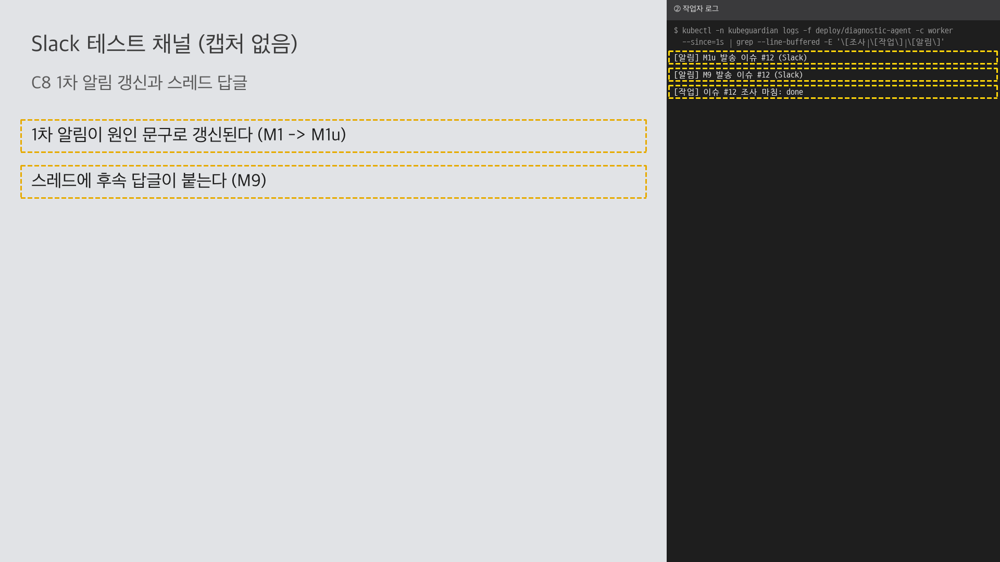

4. **나와야 할 로그** (② 줄은 데스크톱 3에서 확인하며 R10 화면에는 안 보인다. **형식 변환**. 줄 내용은 11/09 리허설 실측이고, 사진의 시각과 `[worker]` 역할 표시는 형식 맞춤이다)

```text
2026-11-12 03:30:21 INFO [worker] [알림] M1u 발송 이슈 #12 (Slack)
2026-11-12 03:30:22 INFO [worker] [알림] M9 발송 이슈 #12 (Slack)
2026-11-12 03:30:22 INFO [worker] [작업] 이슈 #12 조사 마침: done
```

   R10 화면에서는 Slack의 갱신된 알림과 스레드 답글에 박스를 붙인다(위 `M1u`, `M9` 줄이 그 알림을 낸 근거다). ⑤는 Pod 변화 없음(형식 예시)이다.
5. **자막·내레이션·편집**
   - 자막 3:36.6~3:39.1.5: 점검 종료 후 Slack 후속 알림 / macOS 배너 → 데스크톱 전환
   - 자막 3:39.6~3:42.1.5: 1차 알림이 원인으로 갱신 / 스레드에 후속 답글
   - 자막 3:42.6~3:44.1.5: 보고서 링크로 보고서 열기
   - 내레이션(후시): `[새로 씀]` "조사가 끝나자 Slack 메시지가 원인으로 갱신되고, 스레드 답글이 붙습니다."(3:36.8~3:41.8, 5.0초) `[새로 씀]` "보고서 링크로 보고서를 엽니다."(3:42.1~3:44.3, 2.2초)
   - **무엇이 바뀌는가.** 아래 표는 `app/service/notify/messages.py`의 `first_alert`(M1), `cause_update`(M1u), `cause_reply`(M9) 형식과 위 Slack 캡처에서 읽은 것이다. 이번 장애 문구와 필드가 보이는 순서는 **촬영 때 확인**한다(리허설 캡처로 교체 예정).

| 필드 | 전: 1차 알림(M1, R8의 Slack 안내 화면) | 후: 갱신(M1u) | 스레드 답글(M9) |
|---|---|---|---|
| 제목 줄 | 🔴 긴급 · dev — {대상} 장애 | 🔴 긴급 · dev — {보고서의 원인 문제 제목} (제목이 원인 문장으로 바뀐다) | 같은 제목 줄이 답글 머리에 붙는다 |
| 상태 줄 | "🔍 원인을 조사하고 있습니다. 조사가 끝나면 이 메시지를 갱신합니다." | 이 줄이 사라지고 `판단:` 줄(후보)과 "→ 조치 전에 보고서의 근거를 확인하세요"가 들어선다 | "원인 후보를 찾았습니다" + 제목 (판단 후보). 조치 전에 위 메시지의 보고서 링크에서 근거를 확인하세요. |
| 본문 | `감지` 시각, `사유` | `원인`, `영향`, `조치`(첫 조치 한 줄), `그 밖의 중요 문제`(있을 때) | — |
| 링크 | 🔗 이슈 | 🔗 보고서 | — |

   - **편집 표시(최종 영상 시각).** 노란 점선 박스는 "바뀐 필드"에만 붙인다. 확대는 §2 규격(줌 인 0.5초 → 유지 → 줌 아웃 0.5초)이다.

| 시각 | 강조 대상 | 표시 방법 | 확대(배율 / 중심 / 유지) | 자막·라벨 |
|---|---|---|---|---|
| 3:36.6~3:38.6 | 화면 오른쪽 위 Slack 알림 배너(조사가 끝난 뒤 스레드 후속 답글 "원인 후보를 찾았습니다 …" 미리보기) | 배너에 노란 점선 박스. 줌 아웃 뒤 `⌃←` 전환 애니메이션을 **컷 없이** 그대로 둔다(R9가 데스크톱 3, Slack이 데스크톱 2이므로 한 번) | 1.4배 / 화면 오른쪽 위 배너(약 (1650, 130)) / 유지 1.2초(전체 2.2초) | 자막 1(점검 종료 후 Slack 후속 알림) |
| 3:38.6~3:39.6 | 같은 Slack 메시지의 전과 후 | **전후 분할 화면**: 화면을 좌우로 나눠 왼쪽에 R8 Slack 장면의 정지 화면(상태 줄 "원인을 조사하고 있습니다"), 오른쪽에 갱신된 실제 화면을 놓고 각 쪽 위에 "전 · 조사 중" "후 · 갱신" 칩을 붙인다. 2초 유지 | —(분할이라 확대 없음) | 자막 2 |
| 3:39.6~3:40.6 | 갱신된 메시지의 바뀐 필드: ① 제목 줄(원인 문장) ② `판단:` 줄 ③ `원인`·`영향`·`조치` 블록 | 노란 점선 박스 ①②③을 순서대로, 사라진 상태 줄 자리에 화살표로 "조사 중 → 원인" | 1.4배 / 메시지 블록 가운데(Slack 칸 가운데, 약 (640, 540)) / 유지 1초(전체 2초) | 자막 2 |
| 3:40.6~3:42.6 | 스레드 "N replies" 링크 → 열리는 후속 답글("원인 후보를 찾았습니다 …") | 커서 클릭 링(0.3초) 뒤 스레드 패널의 답글 머리와 "위 메시지의 보고서 링크" 문구에 박스 | 1.3배 / 스레드 패널(Slack 칸 오른쪽, 약 (1100, 540)) / 유지 1초(전체 2초) | 자막 2 |
| 3:42.6~3:44.6 | 갱신된 메시지의 "🔗 보고서" 링크 | 링크에 노란 점선 박스 1초 → 클릭 링 → 브라우저의 보고서(이슈 상세)가 열리는 컷, 크로스 디졸브 0.3초. 이 컷이 R11-1의 첫 화면이다 | 1.3배 / 링크 줄(Slack 칸 아래쪽, 약 (640, 780)) / 유지 1.2초(전체 2.2초) | 자막 3 |

   - R11-1로 이어질 때 이슈 아이콘과 목록 선택은 건너뛴다(링크가 이슈 상세를 바로 연다).

### R11. C8 보고서 화면 (원본 11:00~13:00 → 편집 32초)

레이아웃은 데스크톱 1 · L1 — 브라우저 창 A 최대화. 로그 필요 없음(나와야 할 로그 없음, 터미널은 이 데스크톱에 없다). R10의 Slack 갱신을 보인 뒤 보고서 링크를 누르면, 링크가 창 A에서 이슈 상세(보고서)를 열고 macOS가 데스크톱 1로 이동한다(L2 → L1). 창 A는 R6의 점검 이력 화면에 있다가 링크로 보고서 화면으로 바뀐다.

**R11-1. 보고서 상단 (5초)**

- 할 일: R10의 Slack 링크가 이슈 상세(보고서)를 이미 열었으므로 이슈 아이콘·목록 이동(사진 번호 1, 2)은 건너뛴다. 3 "호출 체인 2개 지점"(눌러서 펼친다. R11-2).
- 기능 라벨 카드 3:44.6~3:47.6(화면 왼쪽 위): **보고서** · 결론 · 판단 수준 · 근거
- 자막(3:44.6~3:49.6): 결론: gpt-4.1-next 배포 403 거부 / 판단 수준: 후보
- 내레이션(후시): `[새로 씀]` "조사 결과, 결론은 LLM 배포명 호출이 거부된 지점을 짚습니다."(3:44.8~3:49.1, 4.3초) 결론이 같은 지점을 짚는다는 점은 C8 최종 평가 3회의 결론에서 확인했다(3회 모두 gpt-4.1-next 배포 호출이 403 deployment_not_allowed로 거부된 지점을 짚었고, 설정 오류라고 결론 내지는 않았다). 선택 문장: "보고서는 결론과 판단 수준으로 시작하고, 호출 체인, 가설 판정, 확인한 범위가 이어집니다."(6.0초).


- 1 = 왼쪽 메뉴의 "이슈" 아이콘
- 2 = 이슈 목록의 #16
- A = "1. 결론"(`Deployment/llm-gateway에서 외부 연동 주소의 gpt-4.1-next 배포를 호출하면 403 배포 접근 거부가 반환되어 채팅이 실패하며, 실제 거부 정책을 가진 원인 리소스는 확인하지 못했습니다.`)과 근거 배지
- B = 영향 줄의 "판단: 후보"와 판단 근거(어디까지 확인했는지)
- 3 = "호출 체인 2개 지점"(눌러서 펼친다. R11-2)
- 사진의 목록은 기간을 11/09로 걸어 #18을 뺐다.

**R11-2. 호출 체인 (8초)**

- 할 일: R11-1의 3을 눌러 펼친 상태를 보인다.
- 기능 라벨 카드 3:49.6~3:51.7(화면 왼쪽 위): **호출 체인** · 요청이 지나간 컴포넌트 순서
- 자막(3:49.6~3:54.6): 호출 체인: agent → llm-gateway / → 외부 403 수신
- 내레이션(후시): `[새로 씀]` "호출 체인은 요청이 어느 지점에서 실패했는지를 보여 줍니다."(3:50.4~3:54.6, 4.2초)

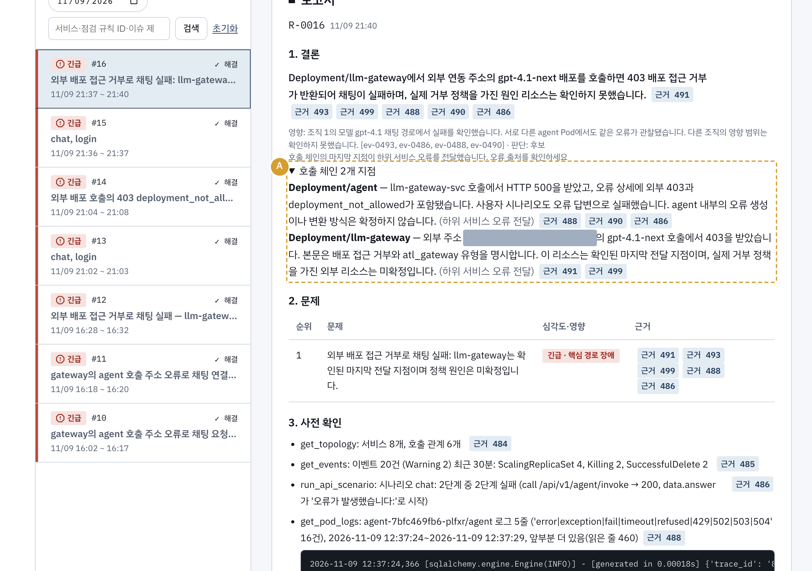

- A = 펼쳐진 호출 체인(`Deployment/agent`의 하위 컴포넌트 오류 전달, `Deployment/llm-gateway`의 외부 403 수신). 외부 LLM 호스트 이름은 회색 박스로 가렸다. 촬영 때도 같은 곳을 편집에서 가린다.
- 이 사진은 호출 체인을 누른 뒤의 화면이다. 누르는 위치는 R11-1의 3이다.

**R11-3. 가설 판정 (6.5초)**

- 할 일: 보고서를 "4. 가설 판정"까지 스크롤한다.
- 기능 라벨 카드 3:54.6~3:57.9(화면 왼쪽 위): **가설 판정** · 가설별 지지 · 미결과 이유
- 자막(3:54.6~4:01.1): 가설 판정: 지지 1 · 미결 3 / 근거가 뒷받침하면 지지, 부족하면 미결
- 내레이션(후시): `[새로 씀]` "가설은 근거가 뒷받침하면 지지, 모자라면 미결입니다. 여기 지지 한 건, 미결 세 건입니다."(3:54.8~4:00.6, 5.8초) 판정 기준은 코드에서 확인했다: 모델이 근거 번호로 뒷받침한 가설은 지지(또는 반증), 근거가 없거나 지어낸 번호뿐인 가설은 검증기가 미결로 내리고 앞에 "(추정)"을 붙인다. 화면의 판정 열은 지지·미결, 반증은 "배제한 가설" 접힘 영역에 나온다(로그에서는 "판단 불가").

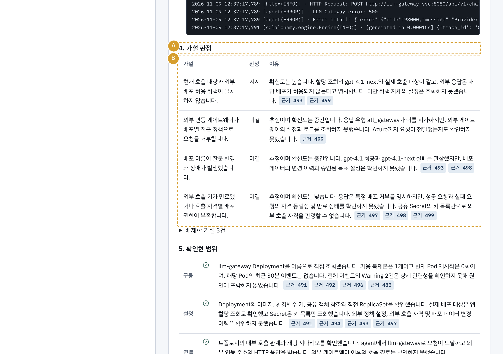

- A = "4. 가설 판정" 소제목, B = 가설 4건과 판정(지지 1, 미결 3)과 이유, 근거 배지

**R11-4. 확인한 범위 — [선택] 장면, 본편에서 뺐다**

- 6차 수정에서 시간 때문에 이 3초 장면("5. 확인한 범위", 구동·설정·연결·로그 네 항목)과 문장을 [선택]으로 옮겼다(§8 선택 문장). 되살리려면 R11-3 뒤에 3초를 넣는다(총 길이가 그만큼 늘어난다).
- 할 일(되살릴 때만): "5. 확인한 범위"까지 스크롤한다. 라벨 카드 "확인한 범위" · 어디까지 확인했는지, 자막 "확인한 범위: 구동·설정·연결·로그", 선택 문장 "확인한 범위로 AI가 어디까지 봤는지 알 수 있습니다."(3.5초).


- A = "5. 확인한 범위"(구동, 설정, 연결, 로그 네 항목). 로그 항목의 외부 호스트 이름은 회색 박스로 가렸다.

**R11-5. 근거 번호 → 원문 서랍 · 서비스 로그의 403 줄과 연결 (10초, 실시간)**

- 할 일: 호출 체인의 llm-gateway 지점에 붙은 근거 배지(llm-gateway 로그 근거, 403 deployment_not_allowed가 보이는 근거)를 눌러 서랍을 연다. 서랍 안에서 "로그" 상자의 403 줄을 짚은 뒤, **R8의 ④에서 본 같은 줄**이 근거로 쓰인 것임을 가리키며 "AI 요약"을 짚고 닫기(X)를 누른다. 아래 사진은 같은 서랍 화면의 예(근거 491, 설정 조회 근거)이며 촬영 때는 위의 llm-gateway 로그 근거를 연다.
- 자막(4:01.1~4:11.1): 근거 번호 → 원문 서랍 / 앞서 본 서비스 로그의 403 줄이 근거
- 내레이션(후시): `[새로 씀]` "호출 체인의 llm-gateway 근거 번호를 누르면,"(4:01.3~4:04.3, 3.0초) `[새로 씀]` "앞서 서비스 로그에서 본 403 deployment_not_allowed 줄이 근거로 쓰인 것을 볼 수 있습니다."(4:04.6~4:10.9, 6.3초)
- 누를 근거: 호출 체인 "llm-gateway" 지점의 근거 배지, 즉 llm-gateway Pod의 로그 발췌 근거(종류 "로그 발췌", 대상 `dev/Pod/llm-gateway-…`)다. 11/18 평가 기록(`eval/history/20261118T201216Z-C8`)에서는 같은 Pod 로그의 `deployment_not_allowed|provider call failed` 줄이 근거(ev-0009)로 인용됐고 보고서의 호출 체인·확인한 범위(로그)가 그 근거를 가리킨다. 서랍은 머리(근거 번호·종류), 대상·수집 시각·출처, "로그" 상자(일치한 줄), "AI 요약", "원본 JSON" 순서로 열리고(`app/web/templates/_drawer.html`, `checks/_evidence_content.html`), 로그 상자에 `chat_completions provider call failed … 403 … deployment_not_allowed … Deployment 'gpt-4.1-next' 은(는) 허용되지 않습니다` 줄이 들어 있다(C8 평가 기록에서 확인). 그 줄에 노란 박스를 붙이고 "AI 요약"에 화살표를 둔다. [촬영 시 확인] 실제 근거 번호, 로그 상자에 403 줄이 보이는지, R8의 ④에서 본 줄과 같은 줄(시각·`trace_id`가 같은지)인지, "AI 요약"이 이미 있는지(없으면 누르지 않고 요약이 있는 llm-gateway 로그 근거를 고른다).
- 연결 편집: 서랍의 403 줄에 박스를 붙인 뒤 약 2초 동안 R8의 ④ 403 줄 정지 프레임을 작은 창으로 옆에 보이고 "서비스 로그" 칩을 붙여 같은 줄임을 잇는다.

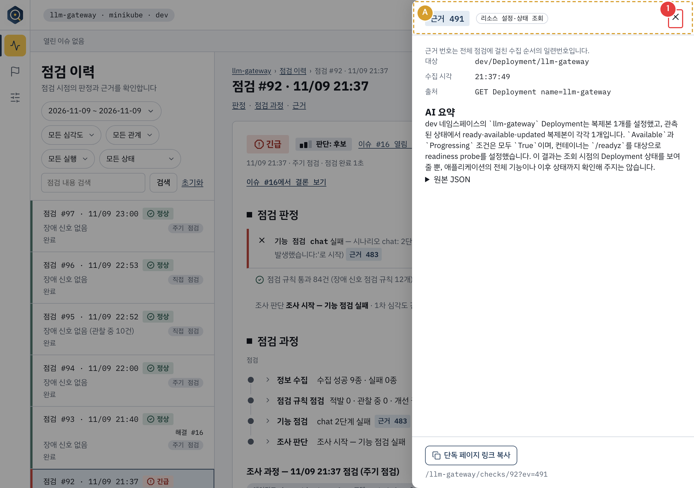

- 1 = 서랍의 닫기(X). 사진의 서랍은 결론의 "근거 491" 배지를 눌러 열었다.
- A = 서랍 머리(근거 번호 491, 종류 `리소스 설정·상태 조회`, 대상 `dev/Deployment/llm-gateway`, AI 요약).
- 주의: AI 요약이 아직 없는 근거를 열면 화면이 "요약 생성 중"이 되며 요약을 생성하는 POST가 나간다(캡처 중 근거 493에서 확인해 차단했다). 영상에서는 요약이 이미 있는 근거를 열고 요약 없는 근거는 누르지 않는다. llm-gateway 로그 근거에 "AI 요약"이 없으면 [촬영 시 확인] 요약이 있는 llm-gateway 로그 근거를 고른다.

**R11-6. (보너스) 점검 과정 (원본 포함, 편집 여유 시)**

- 할 일: 점검 상세의 "점검 과정" 절을 보인다. 필요하면 단계 줄을 눌러 펼친다(화면 안의 열기만 한다).


- A = "조사 과정 — 11/09 21:37 점검 (주기 점검)"(에이전트 investigator:v1, 도구 17/20, 177s/210s, 248k tokens). 사전 확인 7건, 계획, 도구 호출 10회, 보고서·검증 단계가 시각과 함께 나온다. 점검 상세의 "점검 과정" 절이다.
- 사진에는 단계를 펼치지 않았다.


**R11-7. 이력 질의 (원본 포함, 편집 9.5초 · R11-5 뒤)**

- 레이아웃: 데스크톱 1 · L1 — 브라우저 창 A 최대화. 로그 필요 없음. R11-5에서 서랍을 닫은 이슈 상세(보고서 화면)에서 그대로 이어서 시작한다(이슈 목록으로 다시 가지 않는다).
- 할 일: 이슈 상세(보고서 화면)의 상단 "질문" 버튼을 눌러 패널을 연다(이슈 상세에서 열었으므로 맥락 칩에 현재 이슈가 붙는다). 질문을 입력해 보낸다. 화면 안에서 답을 만드는 채팅이라 상태를 바꾸지 않는다.
  - 질문: "이 장애와 비슷한 장애가 전에도 있었나요? 그때 원인은 무엇이었나요?" (확정, 11/16 시험)
  - 답 생성에 약 30초가 걸린다. 편집에서 대기 구간을 자르고 "중간 생략" 칩을 1.5초 붙인다(질문 입력은 2배속).
  - 11/16 19:0x 시험 답의 요지: "같은 외부 배포 접근 거부 패턴이 이전 이슈 #14·#12·#9에서도 확인됩니다. 모두 llm-gateway의 gpt-4.1-next 외부 호출이 403 deployment_not_allowed로 거부되어 내부 500과 사용자 채팅 오류로 이어졌습니다. 실제 거부 정책과 최초 오류 생성 주체는 미확정입니다." 답의 문장마다 `근거 N`, `이슈 #N`, `점검 #N` 링크가 붙는다. 해석 문장 끝의 "(추정)"은 화면이 자동으로 붙이는 표시다.
  - 답은 회차마다 다르다. 촬영 때는 인용(근거, 이슈, 점검 링크)이 문장마다 붙은 회차를 쓴다.
- 사진: 11/16 시험 화면(이슈 #16 상세 + 오른쪽 "이력에 질문" 패널)에 표시를 그린 것이다. 촬영 때는 번호와 답 문장이 달라진다.

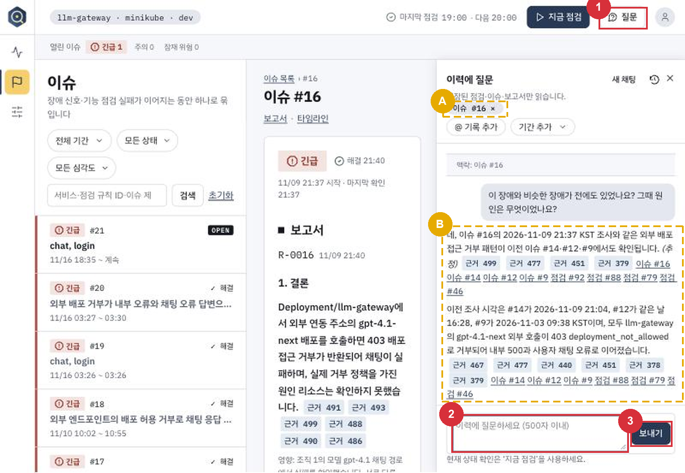

  - 1 = 상단 오른쪽 "질문" 버튼(누르면 패널이 열린다)
  - 2 = 입력창(질문을 입력한다)
  - 3 = "보내기"(질문을 보낸다)
  - A = 맥락 칩 "이슈 #16". 현재 보던 이슈가 질문 맥락으로 붙는다(누르지 않는다).
  - B = 답 영역. 문장마다 근거, 이슈, 점검 인용 배지와 링크가 붙는다(누르지 않는다).
  - 사진 속 답은 위 실측 요지와 같다. 촬영 때는 번호도 답 문장도 달라진다.
- 라벨 카드·콜아웃: 없음(이력 채팅은 R1-4에서 소개했다)
- 자막(4:11.1~4:20.6): 이력 채팅: 과거 이력에서 비슷한 장애를 찾아 답변 / 문장마다 이슈·점검 번호를 인용
- 내레이션(후시): `[새로 씀]` "이번에는 이력 채팅을 보여드리겠습니다."(4:11.3~4:14.0, 2.7초) `[새로 씀]` "문장마다 붙은 이슈·점검 번호는 참조한 과거 이력으로, 비슷한 장애를 찾아 답했습니다."(4:14.4~4:20.2, 5.8초)
- 이력 채팅 화면의 인용 표시: 답의 문장마다 끝에 `근거 N`(눌러 펼치는 배지), `이슈 #N`, `점검 #N` 링크가 붙는다(`app/web/templates/chat/_answer.html`). 이 링크가 답변이 참조한 과거 이슈·점검·근거다. 문장 끝의 "(추정)"은 해석 문장에 화면이 붙인다. [촬영 시 확인] 답 문장에 이슈·점검 링크가 붙은 회차를 쓴다.
- 나와야 할 로그: 없음.
**R11 공통**

- 나와야 할 로그: 없음.
- 내레이션(후시): 장면별 문장은 위 각 소절과 §8이다. 보고서 소절마다 짧은 문장을 붙여 결론·호출 체인·가설 판정·근거 서랍을 하나씩 짚는다(확인한 범위 소절은 본편에서 뺐다). 근거 클릭은 실시간이다.
- 사진은 이슈 #16 화면이다. 촬영 때는 번호가 다르다.
- **편집 표시(최종 영상 시각).** R11은 L1(브라우저 전체)이라 확대를 쓴다. 확대는 §2 규격(줌 인 0.5초 → 유지 → 줌 아웃 0.5초)이고, 중심은 1920×1080 화면 안의 위치다. 소절마다 시각은 그 소절의 시작을 기준으로 적는다.

**R11-1** (3:44.6~3:49.6)

| 시각 | 강조 대상 | 표시 방법 | 확대(배율 / 중심 / 유지) | 자막·라벨 |
|---|---|---|---|---|
| 3:44.6~3:47.6 | 화면 왼쪽 위 | 기능 라벨 카드 "보고서" 3초 | — | — |
| 3:44.8~3:48.3 | R11-1 A: "1. 결론" 블록과 근거 배지 | 노란 점선 박스 A 후 B(영향 줄의 "판단: 후보"와 판단 근거) | 1.3배 / 보고서 본문 위쪽 왼쪽 2/3(약 (640, 380)) / 유지 3초(전체 4초) | 자막 |
| 3:48.3~3:49.6 | 3: "호출 체인 2개 지점" | 클릭 링 0.3초 뒤 펼쳐진 화면으로 컷 | — | 자막 |

**R11-2** (3:49.6~3:54.6)

| 시각 | 강조 대상 | 표시 방법 | 확대(배율 / 중심 / 유지) | 자막·라벨 |
|---|---|---|---|---|
| 3:49.6~3:51.7 | 화면 왼쪽 위 | 기능 라벨 카드 "호출 체인" 2.5초 | — | — |
| 3:49.8~3:54.6 | R11-2 A: 펼쳐진 호출 체인(`agent` 줄 → `llm-gateway` 줄 → "외부 403 수신" 줄) | 박스 순서: `agent` 줄 → `llm-gateway` 줄 → "외부 403 수신" 줄, 줄 사이 아래 방향 화살표. 외부 호스트 회색 박스를 확인 | 1.3배 / 체인 블록 가운데(약 (700, 520)) / 유지 4.2초(전체 5.2초) | 자막 |

**R11-3** (3:54.6~4:01.1)

| 시각 | 강조 대상 | 표시 방법 | 확대(배율 / 중심 / 유지) | 자막·라벨 |
|---|---|---|---|---|
| 3:54.6~3:57.1 | 화면 왼쪽 위 | 기능 라벨 카드 "가설 판정" 2.5초 | — | — |
| 3:54.8~4:01.1 | R11-3: "4. 가설 판정" 소제목(A), 가설 4건(B) | 스크롤 후 A 박스 → 지지 1건 박스 → 미결 3건 박스. 이유와 근거 배지에 화살표 | 1.2배 / 가설 표 가운데(약 (700, 560)) / 유지 3.5초(전체 4.5초) | 자막 |

**R11-5** (4:01.1~4:11.1)

| 시각 | 강조 대상 | 표시 방법 | 확대(배율 / 중심 / 유지) | 자막·라벨 |
|---|---|---|---|---|
| 4:01.1~4:11.1 | R11-5: 호출 체인 llm-gateway 지점의 근거 배지 → 오른쪽 서랍(머리, "로그" 상자의 403 deployment_not_allowed 줄, "AI 요약") | 배지에 클릭 링 0.3초, 서랍이 열리면 머리 → 로그 상자의 403 줄(박스, 약 4초) → 같은 줄임을 잇는 R8 ④ 정지 프레임 작은 창 2초 → AI 요약 → 닫기(X) 클릭 | 1.3배 / 서랍 머리(화면 오른쪽, 약 (1500, 300)) 유지 2초, 이어 로그 상자 1.3배 유지 3초 [촬영 시 확인] | 자막 |

**R11-7** (4:11.1~4:20.6)

| 시각 | 강조 대상 | 표시 방법 | 확대(배율 / 중심 / 유지) | 자막·라벨 |
|---|---|---|---|---|
| 4:11.3~4:14.1 | R11-7: "질문" 버튼(1) → 입력창(2) → 보내기(3) | 입력은 2배속. 답 생성 대기(약 30초)는 잘라 "중간 생략" 칩 1.5초 | — | 자막 |
| 4:14.1~4:20.6 | R11-7 B: 답 영역(문장마다 근거·이슈·점검 인용) | 답 영역에 박스 (말이 남으면 이 구간을 정지 프레임으로 유지) | 1.3배 / 오른쪽 패널의 답 영역(약 (1500, 600)) / 유지 5.5초(전체 6.5초) | 자막 |

**2026-11-09 재배포 후 실측.** C8 검증기가 실제 채팅 실패와 감사 로그의 `403 deployment_not_allowed`를 확인했다. 점검 #92가 경로 B로 이슈 #16을 열었고, 조사 #16은 약 177초 만에 완료됐다. 화면의 실제 보고서는 `gpt-4.1-next` 호출이 403으로 거부돼 채팅이 실패했다고 설명했고, 거부 정책을 가진 리소스는 확인하지 못했다고 밝혔다. 검사 대상 보고서 문장에서 한자 검출은 0건이었고 인용 근거는 11개였다. 원복 후 H0 채팅이 성공했고 점검 #93에서 이슈 #16이 해결됐다. [한국어 보고서 PR #234](https://github.com/skax-jihyeryu/KubeGuardian/pull/234) · [C8 검증기 PR #233](https://github.com/skax-jihyeryu/KubeGuardian/pull/233)

### 녹화 밖 정리. LLM 배포명 변경 원복 · 정상 확인 (R11-7 뒤, 영상에 안 나온다)

1. 녹화를 끈 뒤 `⌃→`로 데스크톱 2로 넘어가 ③에서 아래 명령을 친다. `reset.sh`는 저장된 원래 배포명으로 DB 한 행을 되돌린다(Pod 재시작 없음, 몇 초). 출력은 `C8 restored: original deployment_name verified`(`scenario.py`의 print 문구)다.

   ```bash
   bash scenarios/C8/reset.sh
   ```

2. `⌃←`로 데스크톱 1(L1)에 돌아가 창 A에서 점검 이력 → "지금 점검"으로 정상 확인 점검을 돌린다. 판정이 "정상"이고 "열린 이슈 없음"(이슈 해결)인지 확인한다. 이슈 해결 표시 문구는 [촬영 시 확인]이다.
3. 필요하면 ③에서 `bash scenarios/H0/verify_symptom.sh`로 `OK`를 확인한다. 이 정리는 영상(R11-7 뒤)에 나오지 않으므로 장면 시간·자막·내레이션은 없다. 예전의 R12 장면(원복 · 정상 확인 5.5초와 문장 "장애를 원복하고, 직접 점검으로 정상 복구를 확인합니다.")은 영상에서 뺐다.

### R13. 성과 요약 (Outro 슬라이드 5장, 묶음 0 · 원본 0:30~1:00 → 편집 33.5초)

1. **레이아웃**: 데스크톱 0 · 슬라이드쇼 — PPT **5장**(Outro, 성과 요약). R0처럼 슬라이드쇼 전체 화면(1920×1080)이고 로그는 없다. 묶음 0에서 1~4장(R0)을 찍은 뒤 `→`로 5장으로 넘겨 이어서 찍는다(슬라이드쇼를 다시 열지 않으므로 Space 번호는 한 번만 밀린다). 편집에서 이 장면을 영상 맨 끝으로 옮긴다.
2. **할 일**: 클릭은 없다. 녹화 중에는 말하지 않고(마이크 끔), 번호를 ① → ② → ③ → ④ 순서로 마우스 포인터나 레이저 포인터로 짚는다. 머무는 시간은 ① 8.5초, ② 10초, ③ 8.3초, ④ 6.7초다(§8의 후시 녹음 시각과 맞는다).
   - ① = "장애 감지율 90%" 카드(장애 10종 중 9종 감지, 정상 상태 오탐 0회)
   - ② = "AI 조사 원인 정확도 100%" 카드(6종 × 3회, 18/18, 원인 지점 기준)
   - ③ = "알림·조사 완료 시간 184초" 카드(AI 조사 장애 평균, 점검 시작부터 조사 완료 알림까지, 목표 5분 이내 달성)
   - ④ = 아래 띠의 한계와 다음 단계(원인 지점은 찾지만 원인 리소스 특정은 일부만 → Runbook·점검 규칙 확장)
3. **사진**: 미리보기는 5장 이미지(경로 미정, 생성 예정)다. 지금은 임시 파일 [00-outro-summary.png](assets/08-demo/00-outro-summary.png)이 같은 디자인이다. 설계는 §6이다.
4. **나와야 할 로그**: 없음.
5. **자막·내레이션·편집**
   - 자막은 슬라이드 하단 띠에 올린다(슬라이드 아래 약 1/6은 비워 두었다. 띠 안에서 카드와 겹치지 않는다).
   - 자막 4:20.6~4:28.6.5: 장애 감지율 90% 달성 / 장애 10종 중 9종 감지 · 정상 상태 오탐 0회
   - 자막 4:29.1~4:38.6.5: AI 조사 원인 정확도 100% 달성 / 6종 × 3회 · 18/18 · 원인 지점 기준
   - 자막 4:39.1~4:46.6.8: 알림·조사 완료 AI 조사 장애 평균 184초 / 점검 시작부터 5분 이내 · 목표 달성
   - 자막 4:47.4~4:53.6.5: 한계: 원인 리소스 특정은 일부만 / 다음 단계: Runbook·점검 규칙 확장
   - 내레이션(후시): `[새로 씀]` "장애 열 가지를 점검한 결과 아홉 가지를 찾아내 감지율 90%를 달성했고, 정상 상태에서 잘못 울린 알림은 없었습니다."(4:20.6~4:29.1, 8.5초) `[새로 씀]` "AI 조사 장애 여섯 가지를 세 번씩, 모두 열여덟 번 조사한 결과 열여덟 번 모두 원인 지점을 찾아내 원인 정확도 100%를 달성했습니다."(4:29.2~4:38.9, 9.7초) `[새로 씀]` "AI가 조사한 장애는 점검 시작부터 알림과 조사 완료까지 평균 3분 4초 만에 완료해, 5분 이내 목표를 달성했습니다."(4:39.1~4:47.3, 8.2초) `[새로 씀]` "원인 지점은 찾지만 그 안의 원인 리소스 특정은 일부여서, 다음 단계로 Runbook과 점검 규칙을 확장합니다."(4:47.4~4:54.1, 6.7초) 성과는 "~는 뜻입니다" 대신 결과를 얻었다·달성했다는 말로 맺는다(① 감지율 90% = 장애 10종 중 9종 감지·정상 상태 오탐 0회, ② 원인 정확도 100% = AI 조사 장애 6종 × 3회 18/18, 원인 지점 기준, ③ 평균 184초(3분 4초) 5분 이내 목표 달성, ④ 한계 문장).
   - 편집: 묶음 0의 5장 구간을 잘라 영상 끝(4:20.6)에 붙인다. 카드를 짚는 시각만 자막과 맞춘다.

## 5. 편집 지도

| 원본 장면 | 원본(예상) | 편집 후 길이 | 편집 | 최종 영상 구간 |
|---|---|---|---|---|
| R0 시나리오 소개 (PPT 1~4장) | 묶음 0 0:00~0:30 | 24초 | 1장 개요 → 2~4장 강조 경로 따라가기, 자막 4장 | 1. 소개 0:00~1:12 (72초) |
| R1-1 화면 둘러보기: 설정 | 묶음 ① 0:00~0:40 | 25초 | 설정 아이콘 클릭, 콜아웃 "설정", 상단 세 탭 박스, 점검 규칙 탭의 단계 머리 훑기, "구성별" 토글 클릭(S04는 짚지 않음) | 1. 소개 |
| R1-2 화면 둘러보기: 점검 이력 | 0:40~1:10 | 12초 | 점검 이력 아이콘 클릭, 콜아웃 "점검 이력", 주기 점검 줄·열린 이슈 없음 박스와 확대 | 1. 소개 |
| R1-3 화면 둘러보기: 이슈 | 1:10~1:20 | 5초 | 이슈 아이콘 클릭, 콜아웃 "이슈 이력" | 1. 소개 |
| R1-4 화면 둘러보기: 이력 채팅 | 1:20~1:35 | 6초 | "질문" 버튼 클릭(패널만 열고 질문 안 함), 콜아웃 "이력 채팅" | 1. 소개 |
| R2 주소명 오류 주입 | 1:55~3:20 | 11.8초 | L2로 녹화, 롤아웃 대기 2배속(말이 남으면 정지 프레임 유지), 출력의 바뀐 주소 가림, 롤아웃 뒤 ④ 다시 켜는 이동(`⌃→` L3) 삭제 | 2. 규칙 경로 1:12~2:16.5 (64.5초) |
| R3 점검 실행 | 3:20~3:40 | 8.7초 | L3 창 B로 녹화, 점검 완료 대기 삭제, 창 B 안 확대, S04 적발 줄 박스 | 2. 규칙 경로 |
| R4 결과 화면 | 3:40~5:10 | 23.1초 (R4-1 4.5 + R4-2 9.1 + R4-3 9.5) | L3 창 B 안 확대, 판정, 표 확대, 라벨 카드 "기능 점검"·"규칙 기반 진단 결과"·"근거 서랍", 서랍의 `agent.` 대목 박스 | 2. 규칙 경로 |
| R5-2 작업자·서비스 로그 | (R4에 이어서) | 5.6초 | L3(창 B 이슈 상세, ② 알림 발송·근거 요약 줄, ④ 주소 호출 실패 줄), 오른쪽 1/3 칸 확대, 줄 박스 | 2. 규칙 경로 |
| R5-1 Slack | 5:10~5:40 | 9.3초 | 알림 배너 → `⌃←` 전환(컷 없음), Slack 1차 알림 확대와 박스, 라벨 카드 "Slack 알림" | 2. 규칙 경로 |
| R6 원복 · 정상 확인 · 복구 알림 | (일부 녹화 밖) | 6.0초 | ③ `A7 reset.sh` → L1 "지금 점검" → "정상"·열린 이슈 없음 → L2 Slack 복구 알림. 롤아웃·점검 대기 삭제, 입력·클릭 배속 | 2. 규칙 경로 (끝) |
| R7 LLM 배포명 변경 주입 | 묶음 ② 0:00~0:30 | 14초 | L2로 녹화, `kubectl get pods -n dev` 출력과 `chat_failed` 줄 박스 | 3. AI 조사 경로 2:16.5~4:20.6 (124.1초) |
| R8 점검 실행 | 0:30~1:10 (점검 완료 대기 포함) | 17.5초 | 앞부분 L3 창 B("지금 점검" 클릭, 점검 상세, "조사 중" 표시와 도구 호출 횟수) → 알림 배너 → `⌃←` 전환(컷 없음) → L2 Slack "조사 중" 안내(정지 프레임 저장) → `⌃→` L3(④ 403 로그 확대, ② 조사 시작, 창 B 조사 중 표시), 점검 완료 대기 삭제, 라벨 카드 "AI 조사" | 3. AI 조사 경로 |
| R9 조사 로그 | 1:10~4:10 | 45초 | L3로 녹화, 짧은 핵심 줄만 확대(긴 줄은 박스), 도구 반복·대기 삭제·배속, 보고서 작성 정적 중간 생략, 단계 라벨 카드 5개 | 3. AI 조사 경로 |
| R9-2 점검 이력 결과 | (R9에 이어서) | 3.6초 | 창 B 점검 상세에서 "조사 중"이 사라지고 결과·조사 완료 표시가 나온 것을 훑기, 결과 영역 박스·확대 | 3. AI 조사 경로 |
| R10 Slack 갱신 | 4:10~4:30 | 8초 | 알림 배너 → `⌃←` 전환(컷 없음), 전후 분할 화면, 바뀐 필드 박스·확대, 스레드 답글 열기, 보고서 링크 클릭(링크가 창 A에서 열려 L1로 이동) | 3. AI 조사 경로 |
| R11 보고서 화면 | 4:30~6:30 | 26.5초 (R11-1 5 + R11-2 5 + R11-3 6.5 + R11-5 10) | 근거 클릭은 실시간, 확대와 박스, 라벨 카드 "보고서"·"호출 체인"·"가설 판정". R11-5는 R8의 403 로그 줄과 연결, R11-4 "확인한 범위"는 뺐다(§8 선택 문장) | 3. AI 조사 경로 |
| R11-7 이력 질의 | 6:30~7:30 | 9.5초 | R11-5 뒤 같은 L1에서 시작, 답 생성 대기(약 30초) 삭제(이력 채팅은 R1-4에서 이미 소개) | 3. AI 조사 경로 (끝) |
| R13 성과 요약 (Outro 슬라이드 5장) | 묶음 0 0:30~1:00 | 33.5초 | 5장을 영상 끝으로 옮김, 번호 ①②③④ 짚기 | 4. 성과 요약 4:20.6~4:54.1 (33.5초) |

- 원본 시각은 묶음 안에서의 예상값이다. 녹화 밖 구간은 R6 뒤 로그 명령 교체·터미널 정리와 R11-7 뒤 LLM 배포명 변경의 원복·정상 확인이다(서비스 주소명 오류의 이슈 해결 점검은 R6에서 영상 안에서 한다). R6은 화면 시간이 늘어나지만 롤아웃·점검 대기는 삭제, 명령 입력과 클릭은 배속해 6.0초를 지킨다.
- 구간 합계: 72초(R0 24 + R1-1 25 + R1-2 12 + R1-3 5 + R1-4 6), 64.5초(11.8 + 8.7 + 23.1 + 5.6 + 9.3 + 6.0), 124.1초(14 + 17.5 + 45 + 3.6 + 8 + 26.5 + 9.5), 33.5초(R13)로 294.1초, 곧 **4:54.1**다(파일은 표지 3.5초가 붙어 4:57.6, 5분 상한까지 2.4초). 성과 요약은 편집 카드가 아니라 Outro 슬라이드(R13)다.
- **6차 수정(시나리오 전환·로그 보강)으로 달라진 시간**: 시나리오 전환 원복 장면 둘(R6, R12, 각 5.5초)과 R7의 Pod 상태 확인, R8의 서비스 로그 403 장면, R4-3의 오타 설명이 더해졌다(약 +30초). 그만큼 R5의 근거 요약 문장 구간, R4-1의 둘째 문장, R2의 "점 하나" 문장, R8의 Slack 안내 문장, R11-4(확인한 범위 3초), R11-1·R11-3·R11-7의 문장을 줄이거나 [선택]으로 옮겨 4:54에 맞췄다(옮긴 문장은 §8 "선택 문장"). 앞 구간(0:00~1:12)은 길이가 같다.
- **7차 수정(화면 배치 변경)으로 달라진 시간**: L2는 왼쪽 1/3에 ③·⑤, 오른쪽 2/3에 Slack으로 좌우를 바꾸고, L3는 왼쪽 1/3 ④ + 오른쪽 2/3 ②로 브라우저 칸을 없앴다. R8의 점검은 ③의 명령이 아니라 L1의 "지금 점검" 클릭이라 "조사 중" 표시 구간(약 3.6초)이 더해져 R8이 17초에서 17.5초가 됐고, 문장은 "이제 지금 점검을 누릅니다"(1.8초), "…AI 조사가 시작됩니다. 화면에 조사 진행이 보입니다"(6.7초)로 바꿨다. R9부터 끝까지 0.5초씩 밀려 총 4:54.5다. 이후 L2는 Slack을 왼쪽 2/3로 되돌리고(③·⑤는 오른쪽 1/3), L3는 왼쪽 2/3에 브라우저 창 B(R8의 점검 상세)를 다시 두고 오른쪽 1/3을 ②(위 3/4)와 ④(아래 1/4)로 나눠 이름을 "조사 화면"으로 바꿨다. 장면 순서·내레이션·시각은 그대로다.
- **8차 수정(서비스 주소명 오류에도 L3 로그 장면)으로 달라진 시간**: 규칙 경로에 R5-2(작업자 로그·서비스 로그, 5.6초, 새 문장 하나 5.0초)가 더해졌다. 같은 63초 안에서 다른 장면의 말 사이 빈 시간을 줄여 맞췄다(R2 12.5→11.8, R3 9→8.7, R4-1 6→4.5, R4-2 10→9.1, R4-3 10→9.5, R5 10→9.3, R6 5.5→4.5, 합계 5.6초). 문장 사이 간격은 0.4~0.5초가 되었고 R4-1의 "조사 안 함" 줄에 머무는 시간이 줄었다. 규칙 경로 뒤(AI 조사 경로 2:15.0~)와 총 길이 4:54.5(파일 4:58.0)는 그대로였다(9차 수정에서 바뀌었다).
- **4차 수정(내레이션 풀어쓰기)으로 달라진 시간**: 내레이션이 길어져 장면 길이를 문장 길이(1초 6음절 기준)에 맞춰 다시 잡았다. **말 길이에 화면이 부족한 장면은 그 장면의 마지막 프레임을 정지 프레임으로 유지해 보충한다**(예: 점검 완료 대기를 잘라 낸 자리, 롤아웃 대기). 우선순위가 낮은 문장은 "선택 문장"으로 빼 두었다.
- **5차 수정(AI 조사 내레이션 보강)**: 에이전트 설계(지식 주입 → 사전 확인 → 선별 → 계획 → 도구 호출 → 보고서 → 근거 검증 → 재조사), 가설 판정 기준, 근거 서랍의 403 로그, 이력 채팅 참조, 새 성과 수치를 말하게 되어 R9를 45초, R11-5를 10초로 잡았다. 장면 안의 박스·확대 표의 시각은 이 배분에 맞춰 환산한 값이다.
- **9차 수정(장면 순서·데스크톱 재배치)으로 달라진 시간**: 서비스 주소명 오류의 점검(R3~R5-2)과 LLM 배포명 변경의 점검(R8~R9)을 모두 L3의 창 B에서 하게 되어 L1로 오가던 이동과 주소 복사·붙이기가 없어졌다. 규칙 경로는 R5-2(로그)가 R5-1(Slack 1차 알림)보다 앞서도록 순서만 바뀌었다(R5-2 5.6초, R5-1 9.3초로 길이는 그대로). R6은 원복 뒤 점검과 Slack 복구 알림 확인까지 담아 4.5초에서 6.0초(+1.5초)가 됐고 문장을 "장애를 원복하고, 직접 점검과 Slack 복구 알림으로 정상 복구를 확인합니다."로 고쳤다. R12(LLM 배포명 변경 원복·정상 확인 5.5초)는 영상에서 뺐다(-5.5초). R9 끝에 점검 이력 결과 훑기 R9-2(3.6초, 새 문장 하나 3.2초)가 더해졌다(+3.6초). 그 결과 규칙 경로가 64.5초로 늘어 AI 조사 경로가 2:16.5에 시작하고, 총 길이는 4:54.1(파일 4:57.6)이다.
- 편집 중 늘어 4분 55초를 넘으면 R1-2를 먼저 줄이고, 그래도 모자라면 R9 대기 구간과 R11을 줄인다.
- 원본이 길면 R9의 대기 구간을 줄여 맞춘다. 보고서 작성 정적(수십 초)은 "중간 생략"으로 잘라 R9 45초 안에 들어오게 한다.

### 기능 소개 지도

기능이 영상에서 **처음 나올 때**, 화면 왼쪽 위에 **기능 라벨 카드**(기능 이름 굵게 + 한 줄 설명, 2~3초, 페이드 인·아웃 0.3초)를 넣고 그 기능을 짚는 자막과 내레이션 한 문장을 붙인다. 라벨 카드의 모양은 Intro 슬라이드의 라벨과 같게 민트 테두리(#4ECDC4)와 연한 민트 바탕(#F0FDFB), 진한 남색(#1A365D) 굵은 글씨로 한다. 강조 박스(노란 점선)와 겹치면 라벨을 오른쪽 위로 옮긴다. 시각은 최종 영상 기준 예상값이다. 새로 쓴 내레이션 문장은 `[새로 씀]`이다.

| 기능 | 첫 등장 장면 | 라벨 카드(최종 영상 시각) | 라벨 문구 | 짚는 자막 | 짚는 내레이션 문장 |
|---|---|---|---|---|---|
| 설정 | R1-1 둘러보기 설정 | 0:28.0~0:31.0 | **설정** · 대상 서비스, 점검 규칙, 기능 점검 확인 (콜아웃) | 설정: 대상 서비스 · 점검 규칙 / 기능 점검을 확인 | 설정 화면에서는 점검 대상 서비스의 구성과 점검 규칙, 기능 점검을 확인할 수 있습니다. [새로 씀] |
| 점검 이력 | R1-2 둘러보기 점검 이력 | 0:49.0~0:52.0 | **점검 이력** · 점검 결과와 근거를 확인 (콜아웃) | 점검 이력: 주기 점검이 정각마다 기록 / 동작은 직접 점검으로 시연 | 두 번째는 점검 이력입니다. 이력 화면에서 보시듯 정각마다 점검이 돌고 있고, 동작은 직접 점검을 통해 보여드리겠습니다. [새로 씀] |
| 이슈 이력 | R1-3 둘러보기 이슈 | 1:01.0~1:04.0 | **이슈 이력** · 열린 이슈와 원인 보고서 (콜아웃) | 이슈 이력: 장애가 적발되면 / 이슈가 열리고 보고서가 모임 | 세 번째는 이슈입니다. 열린 이슈와 원인 보고서가 여기에 모입니다. [새로 씀] |
| 이력 채팅 | R1-4 둘러보기 이력 채팅 | 1:06.0~1:09.0 | **이력 채팅** · 질문 버튼으로 과거 장애를 질문 (콜아웃) | 이력 채팅: 상단 질문 버튼 / 쌓인 기록으로 과거 장애 질문 | 네 번째는 이력 채팅입니다. 쌓인 기록을 근거로 과거 장애를 물어볼 수 있습니다. [새로 씀] |
| 기능 점검 | R4-1 점검 상세 | 1:32.9~1:35.9 | **기능 점검** · 채팅이 실제로 되는지 직접 호출해 확인 | 기능 점검: 채팅을 직접 호출 / 조사 안 함 · 규칙 기반 진단 결과 | 기능 점검은 채팅이 실제로 되는지 직접 호출해 봅니다. [새로 씀] |
| 규칙 기반 진단 결과 | R4-2 이슈 상세 | 1:37.0~1:40.0 | **규칙 기반 진단 결과** · AI 호출 없이 규칙이 찾은 원인 표 | AI 보고서 대신 / 규칙 기반 진단 결과 | 보고서 자리에는 AI 보고서 대신, 규칙 기반 진단 결과가 나옵니다. |
| 근거 서랍 | R4-3 근거 서랍 | 1:46.1~1:48.6 | **근거 서랍** · 근거 번호를 누르면 원문이 열림 | 근거 번호를 누르면 원문이 열림 | 근거 번호를 누르면, 원문이 서랍으로 열립니다. [새로 씀] |
| Slack 알림 | R5-1 Slack | 2:01.7~2:04.7 | **Slack 알림** · 장애를 적발하면 1차 알림을 보냄 | Slack: 규칙 기반 진단 결과 / 근본 원인은 확인하지 않음 | 여기 적발된 규칙과 위치가 나오고, 규칙 기반 진단 결과라고 안내합니다. [새로 씀] |
| AI 조사 | R8 C8 점검 실행 | 2:32.5~2:35.5 | **AI 조사** · 규칙이 못 잡은 장애의 원인을 조사 | 점검 실행: 규칙 신호 없음 / 기능 점검 chat 실패 → AI 조사 | 기능 점검은 실패했지만 규칙 신호는 없어서, AI 조사가 시작됩니다. 화면에 조사 진행이 보입니다. [새로 씀] |
| ① Planning | R9 조사 로그 | 2:48.0~2:51.6 | **① Planning** · 사전 확인 · 문제 선별 · 가설 3개 | 사전 확인: 코드로 근거 수집 | 이어서 사전 확인에서 호출 관계와 실패 재현을 코드로 모읍니다. |
| ② ToT(가설 갈래 검증) | R9 조사 로그 | 3:01.0~3:04.6 | **② ToT(가설 갈래 검증)** · 가설마다 도구로 확인 | ToT(가설 갈래 검증) / 가설마다 도구로 직접 확인 | 계획에 따라 로그 조회, 설정 조회, 상태 확인 같은 도구를 직접 불러, 줄 끝의 근거 번호로 남깁니다. [새로 씀] |
| ③ Self-Correction | R9 조사 로그 | 3:14.1~3:17.6 | **③ Self-Correction** · 근거 번호 대조 · 재조사 | Self-Correction: 근거 번호 대조 | 보고서가 나오면 인용한 근거 번호를 실제 근거와 대조해, 없는 번호는 지우고 근거가 모자란 결론은 강등합니다. [새로 씀] |
| ② ToT 가지치기 | R9 조사 로그 | 3:25.9~3:29.4 | **② ToT 가지치기** · 지지 · 반증 · 판단 불가 | 판단 수준: 후보 (확정 아님) / 판단 수준은 코드가 정함 | 근거가 모자라면 결론은 후보로 제한되고, 이 판단 수준은 코드가 정합니다. |
| 판단 수준 | R9 조사 로그 | 3:29.7~3:32.6 | **판단 수준** · 근거 수준을 코드가 정함 | 판단 수준: 후보 (확정 아님) / 판단 수준은 코드가 정함 | 근거가 모자라면 결론은 후보로 제한되고, 이 판단 수준은 코드가 정합니다. |
| 보고서 | R11-1 보고서 상단 | 3:44.6~3:47.6 | **보고서** · 결론 · 판단 수준 · 근거 | 결론: gpt-4.1-next 배포 403 거부 / 판단 수준: 후보 | 조사 결과, 결론은 LLM 배포명 호출이 거부된 지점을 짚습니다. [새로 씀] |
| 호출 체인 | R11-2 호출 체인 | 3:49.6~3:52.1 | **호출 체인** · 요청이 지나간 컴포넌트 순서 | 호출 체인: agent → llm-gateway / → 외부 403 수신 | 호출 체인은 요청이 어느 지점에서 실패했는지를 보여 줍니다. [새로 씀] |
| 가설 판정 | R11-3 가설 판정 | 3:54.6~3:57.1 | **가설 판정** · 가설별 지지 · 미결과 이유 | 가설 판정: 지지 1 · 미결 3 / 근거가 뒷받침하면 지지, 부족하면 미결 | 가설은 근거가 뒷받침하면 지지, 모자라면 미결입니다. 여기 지지 한 건, 미결 세 건입니다. [새로 씀] |

- 라벨 카드는 모두 17개다(확인한 범위는 [선택]으로 뺐다). 이 가운데 R9 단계 라벨 5개(① Planning, ② ToT(가설 갈래 검증), ③ Self-Correction, ② ToT 가지치기, 판단 수준)는 R9의 "줄별 편집 지시"에 시각이 있다. 시나리오 전환(R6), R5-2, R9-2, R11-5는 라벨 카드 없이 자막만 쓴다.
- 영어 용어는 기존 규칙(Planning, Tool Call, Self-Correction)을 따르고, ToT는 "ToT(가설 갈래 검증)"처럼 한국어 설명을 붙인다.

### 자막 전체 표

화면 아래 띠에 뜨는 글이다. 내레이션(말)과 별개이고, 내레이션의 핵심을 줄이고 화면에서 봐야 할 것을 짚는다. 규칙은 다음이다.

- 한 번에 1~2줄, 줄당 25자 안팎, 짧은 명사형·평서형.
- 영어 용어는 발표 장표(v0.3)와 같게 쓴다(Planning, Tool Call, Self-Correction, ToT는 "ToT(가설 갈래 검증)"처럼 한국어 설명과 함께).
- 촬영 때 바뀌는 번호(이슈, 점검, 근거 번호)는 자막에 넣지 않는다.
- "2배속", "중간 생략"은 해당 구간 자막 줄에 함께 넣었다. 표의 " / "는 자막의 줄바꿈이다.
- 시각은 이 문서 편집 지도 기준의 **예상값**이다. 실제 편집 길이에 맞춰 다시 맞춘다.
- 같은 내용을 [subtitles.srt](assets/08-demo/subtitles.srt)로도 만들었다(UTF-8, 편집 지도 시각 기준, 장면 안의 분할은 예상값. 총 52개(표지 자막 1개 포함), 번호 연속, 시각 겹침 없음. 자막 파일은 영상 맨 앞 표지 3.5초만큼 밀어 두어 1장 자막이 0:03.5에 시작하고 마지막 자막은 4:57.6에 끝난다. 이 문서의 표는 표지 뒤 기준이다). R11-6(보너스)은 편집 여유가 있을 때만 쓰므로 자막을 넣지 않았다. 성과 요약(R13)은 슬라이드 하단 띠에 올린다.

| 순번 | 최종 영상 시각 | 장면 | 자막 문구 | 위치 |
|---|---|---|---|---|
| 0 | 표지 0.2~3.5초 | R0 표지 | KubeGuardian 서비스 시연 | 슬라이드 하단 띠 |
| 1 | 0:00~0:04 | R0 시나리오 소개 (1장) | 시연은 / 장애 진단 워크플로우 기반 | 슬라이드 하단 띠 |
| 2 | 0:04~0:10 | R0 시나리오 소개 (2장) | ① 서비스 주소명 오류 / 규칙 기반 진단으로 바로 종료 | 슬라이드 하단 띠 |
| 3 | 0:10~0:18 | R0 시나리오 소개 (3장) | ② LLM 배포명 변경 / 규칙이 못 잡아 AI 조사 | 슬라이드 하단 띠 |
| 4 | 0:18~0:24 | R0 시나리오 소개 (4장) | ③ 쌓인 점검·이슈·보고서로 / 이력 질의 채팅 | 슬라이드 하단 띠 |
| 5 | 0:24~0:28 | R1-1 둘러보기 설정 | 먼저 화면 둘러보기 / 화면은 네 영역으로 나뉨 | 하단 띠 |
| 6 | 0:28~0:35 | R1-1 둘러보기 설정 | 설정: 대상 서비스 · 점검 규칙 / 기능 점검을 확인 | 하단 띠 |
| 7 | 0:35~0:45 | R1-1 둘러보기 설정 | 설정: 점검 규칙은 단계별 / 서비스 생애 주기 10단계 | 하단 띠 |
| 8 | 0:45~0:49 | R1-1 둘러보기 설정 | 구성별 보기로도 확인 / Pod · Service · Config 등 | 하단 띠 |
| 9 | 0:49~0:57 | R1-2 둘러보기 점검 이력 | 점검 이력: 주기 점검이 정각마다 기록 / 동작은 직접 점검으로 시연 | 하단 띠 |
| 10 | 0:57~1:01 | R1-2 둘러보기 점검 이력 | 판정과 근거가 남음 / 열린 이슈 없음 · 정상 상태 | 하단 띠 |
| 11 | 1:01~1:06 | R1-3 둘러보기 이슈 | 이슈 이력: 장애가 적발되면 / 이슈가 열리고 보고서가 모임 | 하단 띠 |
| 12 | 1:06~1:12 | R1-4 둘러보기 이력 채팅 | 이력 채팅: 상단 질문 버튼 / 쌓인 기록으로 과거 장애 질문 | 하단 띠 |
| 13 | 1:12~1:17.8 | R2 A7 주입 | 장애 주입: 서비스 주소명 오류 / 롤아웃 대기 2배속 | 하단 띠 |
| 14 | 1:17.8~1:23.8 | R2 A7 주입 | Pod는 Ready, 알림은 없음 | 하단 띠 |
| 15 | 1:23.8~1:32.5 | R3 점검 실행 | 점검 실행 → 규칙이 적발 / S04: 서비스 주소 설정 오류 | 하단 띠 |
| 16 | 1:32.5~1:37 | R4-1 점검 상세 | 기능 점검: 채팅을 직접 호출 / 조사 안 함 · 규칙 기반 진단 결과 | 하단 띠 |
| 17 | 1:37~1:41.9 | R4-2 이슈 상세 | AI 보고서 대신 / 규칙 기반 진단 결과 | 하단 띠 |
| 18 | 1:41.9~1:46.1 | R4-2 이슈 상세 | 표: 적발 규칙 · 위치 · 확인한 사실 | 하단 띠 |
| 19 | 1:46.1~1:49.9 | R4-3 근거 서랍 | 근거 번호를 누르면 원문이 열림 | 하단 띠 |
| 20 | 1:49.9~1:55.6 | R4-3 근거 서랍 | 근거 서랍: agent 주소 끝의 점 오타 / 연결 대상 없음으로 판정 | 하단 띠 |
| 21 | 1:55.6~2:01.2 | R5-2 A7 작업자·서비스 로그 | 작업자 로그: 알림·근거 요약만, 조사 줄 없음 / 서비스 로그: agent. 주소 호출 실패 | 하단 띠 |
| 22 | 2:01.2~2:05.5 | R5-1 Slack | 점검 직후 Slack 알림 도착 / macOS 알림 배너 → 데스크톱 전환 | 하단 띠 |
| 23 | 2:05.5~2:10.5 | R5-1 Slack | Slack: 규칙 기반 진단 결과 / 근본 원인은 확인하지 않음 | 하단 띠 |
| 24 | 2:10.5~2:16.5 | R6 원복 · 정상 확인 · 복구 알림 | 장애 원복 → 직접 점검 / 정상 복구 · 복구 알림 확인 | 하단 띠 |
| 25 | 2:16.5~2:22.5 | R7 C8 주입 | 장애 주입: LLM 배포명 하나가 바뀜 | 하단 띠 |
| 26 | 2:22.5~2:30.5 | R7 C8 주입 | Pod는 모두 Running · Ready / 그런데 채팅 요청은 실패 | 하단 띠 |
| 27 | 2:30.5~2:36.0 | R8 C8 점검 실행 | 점검 실행: 규칙 신호 없음 / 기능 점검 chat 실패 → AI 조사 | 하단 띠 |
| 28 | 2:36.0~2:39.6 | R8 C8 점검 실행 | 조사 중: 도구 호출 횟수 표시 / 점검 상세가 3초마다 갱신 | 하단 띠 |
| 29 | 2:39.6~2:41.8 | R8 C8 점검 실행 | Slack 1차 알림에 조사 중 안내 / macOS 배너 → 데스크톱 전환 | 하단 띠 |
| 30 | 2:41.8~2:48.0 | R8 C8 점검 실행 | 서비스 로그에도 403 오류 / llm-gateway · deployment_not_allowed | 하단 띠 |
| 31 | 2:48.0~2:53.0 | R9 조사 로그 · 지식 주입 | 지식 주입: 환경 설명 · 조사 지침 | 하단 띠 |
| 32 | 2:53.0~2:58.0 | R9 조사 로그 · 사전 확인 | 사전 확인: 코드로 근거 수집 | 하단 띠 |
| 33 | 2:58.0~3:02.0 | R9 조사 로그 · 문제 선별 | 문제 선별 · Planning: 가설 3개 | 하단 띠 |
| 34 | 3:02.0~3:09.0 | R9 조사 로그 · ToT 도구 | ToT(가설 갈래 검증) / 로그·설정 조회 등 도구로 직접 확인 | 하단 띠 |
| 35 | 3:09.0~3:13.0 | R9 조사 로그 · 보고서 작성 | 보고서 작성 시작 / 정적 구간 중간 생략 | 하단 띠 |
| 36 | 3:13.0~3:21.0 | R9 조사 로그 · 근거 번호 대조 | Self-Correction: 근거 번호 대조 / 없는 번호 제거 · 근거 모자란 결론 강등 | 하단 띠 |
| 37 | 3:21.0~3:27.0 | R9 조사 로그 · 재조사 | 빈틈 검사 → 재조사 / 빈틈이 남으면 한 번 더 조사 | 하단 띠 |
| 38 | 3:27.0~3:33.0 | R9 조사 로그 · 결론 | 판단 수준: 후보 (확정 아님) / 판단 수준은 코드가 정함 | 하단 띠 |
| 39 | 3:33.0~3:36.6 | R9-2 점검 이력 결과 | 점검 이력에도 결과가 남음 / 조사 완료 표시 | 하단 띠 |
| 40 | 3:36.6~3:39.6 | R10 Slack 갱신 | 조사 종료 후 Slack 후속 알림 / macOS 배너 → 데스크톱 전환 | 하단 띠 |
| 41 | 3:39.6~3:42.6 | R10 Slack 갱신 | 1차 알림이 원인으로 갱신 / 스레드에 후속 답글 | 하단 띠 |
| 42 | 3:42.6~3:44.6 | R10 Slack 갱신 | 보고서 링크로 보고서 열기 | 하단 띠 |
| 43 | 3:44.6~3:49.6 | R11-1 보고서 상단 | 결론: gpt-4.1-next 배포 403 거부 / 판단 수준: 후보 | 하단 띠 |
| 44 | 3:49.6~3:54.6 | R11-2 호출 체인 | 호출 체인: agent → llm-gateway / → 외부 403 수신 | 하단 띠 |
| 45 | 3:54.6~4:01.1 | R11-3 가설 판정 | 가설 판정: 지지 1 · 미결 3 / 근거가 뒷받침하면 지지, 부족하면 미결 | 하단 띠 |
| 46 | 4:01.1~4:11.1 | R11-5 근거 서랍 | 근거 번호 → 원문 서랍 / 앞서 본 서비스 로그의 403 줄이 근거 | 하단 띠 |
| 47 | 4:11.1~4:20.6 | R11-7 이력 질의 | 이력 채팅: 과거 이력에서 비슷한 장애를 찾아 답변 / 문장마다 이슈·점검 번호를 인용 | 하단 띠 |
| 48 | 4:20.6~4:29.1 | R13 성과 요약 (Outro 슬라이드) | 장애 감지율 90% 달성 / 장애 10종 중 9종 감지 · 정상 상태 오탐 0회 | 슬라이드 하단 띠 |
| 49 | 4:29.1~4:39.1 | R13 성과 요약 (Outro 슬라이드) | AI 조사 원인 정확도 100% 달성 / 6종 × 3회 · 18/18 · 원인 지점 기준 | 슬라이드 하단 띠 |
| 50 | 4:39.1~4:47.4 | R13 성과 요약 (Outro 슬라이드) | 알림·조사 완료 AI 조사 장애 평균 184초 / 점검 시작부터 5분 이내 · 목표 달성 | 슬라이드 하단 띠 |
| 51 | 4:47.4~4:54.1 | R13 성과 요약 (Outro 슬라이드) | 한계: 원인 리소스 특정은 일부만 / 다음 단계: Runbook·점검 규칙 확장 | 슬라이드 하단 띠 |

## 6. 성과 요약 슬라이드 (Outro 5장, R13)

성과 요약은 편집에서 만드는 카드가 아니라 PPT의 **5장**이다(1~4장 시나리오 소개, 5장 Outro). 수치와 순서는 발표 장표(v0.3) 4쪽 결과 카드와 같다. 미리보기는 5장 이미지다. 지금은 임시 파일 [00-outro-summary.png](assets/08-demo/00-outro-summary.png)이 같은 디자인이다. 슬라이드 파일은 다른 작업자가 정리 중이라 이름과 경로는 바뀔 수 있다.

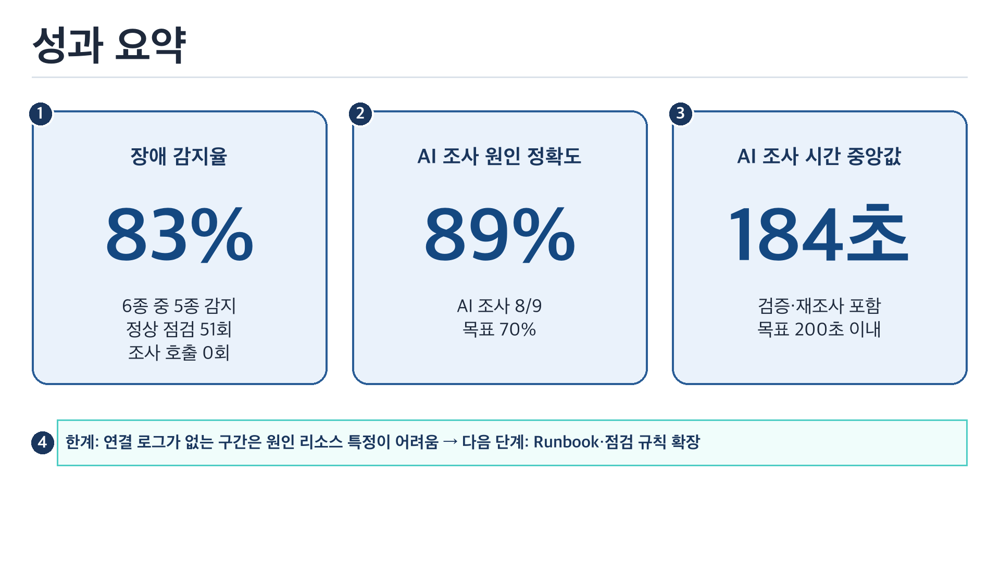

**디자인(Intro 슬라이드에서 그대로 뽑은 값)**

| 항목 | 값 |
|---|---|
| 슬라이드 | 12191695 × 6858000 EMU(16:9 비율), 흰 바탕, Intro와 같은 레이아웃(slideLayout7, 빈 화면) |
| 글꼴 | Malgun Gothic (latin·ea 모두, Intro 번호·라벨과 같다. 테마 글꼴은 Calibri지만 Intro는 글꼴을 직접 지정했다) |
| 제목 | "성과 요약", 40pt 굵게, #1E293B(Intro 이미지의 제목 색), 왼쪽 정렬, 아래에 Intro와 같은 옅은 구분선(#DAE1E9) |
| 번호 원 | 지름 326563 EMU, 채움 #1A365D, 흰색 25400 테두리, 흰색 16pt 굵은 숫자 1~4(Intro의 번호 1~3과 같은 방식) |
| 수치 카드 3장 | 둥근 사각형, 채움 #EAF2FB, 테두리 #2A5D96 25400(Intro 다이어그램의 조사 단계 상자 색). 카드 이름 20pt 굵게 #1A365D, 수치 72pt 굵게 #144881, 설명 18pt #1E293B |
| 한계 띠 | Intro 라벨과 같은 사각형(채움 #F0FDFB, 테두리 #4ECDC4 19050), 16pt 굵게 #1A365D, 한 줄. 왼쪽에 번호 원 4 |
| 하단 | 아래 약 1/6은 비워 둔다(자막 띠 자리) |

카드 구성은 다음이다. 카드 번호는 녹화에서 하나씩 짚는 순서다.

1. ① "장애 감지율 90%" — 장애 10종 중 9종 감지 · 정상 상태 오탐 0회.
2. ② "AI 조사 원인 정확도 100%" — 6종 × 3회, 18/18 · 원인 지점 기준.
3. ③ "알림·조사 완료 시간 184초" — AI 조사 장애 평균, 점검 시작부터 조사 완료 알림까지 · 목표 5분 이내 달성. (AI 조사 장애 실측 평균 184.0초, 최대 241.1초)
4. ④ 한계 띠 — "한계: 원인 지점은 찾지만 원인 리소스 특정은 일부만 → 다음 단계: Runbook·점검 규칙 확장". (장표 4쪽 한계 상자와 같은 취지. 긴 문장은 내레이션에서 풀어 말한다.)

영상 규칙: 슬라이드와 자막에 시나리오 ID(A7, C8 등)를 쓰지 않는다. 카드는 8.5초, 10초, 8.3초, 한계 띠 6.7초로 합계 33.5초다. 시각은 R13 소절과 같다.

## 7. 인용할 로그 줄, 강조할 로그 줄, 재조사 대안, 편집 체크리스트

### 인용할 로그 줄, 강조할 로그 줄

장면 안으로 옮겼다. 정본은 §4의 각 장면이다. C8 조사 로그 전체와 강조할 줄 표는 R9, 알림 줄(`M1u`, `M9`, `조사 마침`)은 R10, A7 근거 요약과 경로 A 줄은 R3·R5를 본다.

### 재조사 장면을 못 찍었을 때의 대안

재촬영에서도 재조사 장면을 확보하지 못하면 확보한 실행의 보고서에서 실제 판단 수준과 근거를 설명한다. 보고서의 판단 근거에서 확정 조건(원인 리소스 설정 직접 인용, 서로 다른 출처 근거 2종 이상, 호출 체인에 결함 없음)을 보이고, 호출 체인과 단계 기록을 열어 "에이전트가 스스로 결론을 내리지 않고 코드 검증기가 확정 여부를 정한다"고 말한다. 자막은 "Self-Correction: 코드 검증기가 판단 수준을 정함"으로 하고 재조사 로그가 없다는 사실은 숨기지 않는다. 이 장면은 판단 수준 검증을 보여 주며 재조사 장면을 대체할 수 없다.

### 편집 체크리스트

- 자막이 "자막 전체 표"와 [subtitles.srt](assets/08-demo/subtitles.srt)대로 들어갔고, 한 번에 2줄 이내인가. 번호가 바뀌는 곳(이슈, 점검, 근거)에는 번호를 쓰지 않았는가.
- 자막, 내레이션, 시작·성과 요약 슬라이드에 시나리오 ID(A7, C8, C2 등)가 없고 장애 내용으로 말했는가.
- 총 길이가 5분 이내인가. 편집 목표는 4분 55초 이하다(편집 지도 4분 54.1초, 파일은 표지 3.5초가 붙어 4분 57.6초).
- 후시 녹음한 내레이션이 §8의 시작~끝 시각 안에 들어가는가(장면 길이를 넘는 문장은 속도를 올리거나 문장을 줄였는가). 문장 중간에서 잘리거나 숨 쉬는 소리, 틀린 말의 앞부분이 남지 않았는가. 배속·중간 생략 구간에 말이 겹치지 않았는가.
- 음량이 일정한가(장면별로 따로 녹음한 문장 사이에 크기 차이가 없는가). 녹음 세션 시작 5초 정적의 잡음을 기준으로 잡음을 줄였는가.
- 시나리오 소개 슬라이드(R0)의 2~4장 강조 경로 순서(시나리오 1 → 2 → 3)가 내레이션의 첫째·둘째·셋째와 맞는가. 화면 둘러보기(R1-1~R1-4)에서 설정 → 점검 이력 → 이슈 → 이력 채팅 순서로 클릭하고, 각 클릭 순간에 콜아웃(영역 이름 + 한 줄 설명)과 부드러운 줌이 들어갔는가. 이력 채팅 패널은 열기만 하고 질문하지 않았는가. 성과 요약 슬라이드(R13)의 ①②③④ 짚는 순서와 시각이 내레이션과 맞는가.
- 배속 구간마다 "2배속" 자막이 있고, 잘라 낸 구간에는 "중간 생략"이 있는가.
- 서비스 주소명 오류 뒤(R6)에 원복 명령(`reset.sh`), L1 "지금 점검" 결과(판정 "정상", 열린 이슈 없음·이슈 해결), L2 Slack의 복구 알림이 보이고 "장애를 원복하고, 직접 점검과 Slack 복구 알림으로 정상 복구를 확인합니다"가 말과 자막으로 들어갔는가. LLM 배포명 변경의 원복·정상 확인(옛 R12)이 영상에 남아 있지 않은가. 서비스 주소명 오류 주입(R2)에서 오타(점)를 말하지도 자막에 쓰지도 않았고(출력 줄의 바뀐 주소는 가렸는가), 오타는 근거 서랍(R4-3)에서 처음 말했는가. 설정 투어(R1-1)에서 S04를 짚지 않았는가.
- 비밀값, 토큰, 사내 주소가 화면에 나오지 않는가. 외부 LLM 호스트 이름은 가려져 있어야 하고, Slack 채널 이름과 담당자 이름, 브라우저 북마크와 탭 제목, 터미널의 환경 변수 출력도 확인한다.
- 글자가 읽히는가. L2의 ③·⑤(오른쪽 640×540 칸)는 16pt에서 약 18줄, L3의 ④(오른쪽 아래 640×270 칸)는 약 9줄, ②(오른쪽 위 640×810 칸)는 20pt에서 약 21줄이라 줄바꿈된 줄까지 읽히는지 확인하고, ②는 20pt 이상이어야 한다.
- 장면마다 데스크톱과 레이아웃이 "장면 × 레이아웃" 표(§1)와 §4 각 장면의 "레이아웃" 줄과 맞는가. 로그가 필요 없는 장면(L1)에 터미널이 끼어 있지 않은가. ③ 명령 터미널은 L2 장면(R2, R5-1, R6의 원복·복구 알림, R7, R8의 Slack 안내, R10)에만 보이고, 로그 명령 교체는 영상에 없는가. R6의 정상 확인 점검은 L1 창 A이고, R3·R4·R8의 점검은 L3 창 B다.
- ⑤ Pod 감시 창의 글자 크기가 읽히는가(16pt 이상). ③·⑤의 명령 줄에 비밀값이 없는가(`env`, `printenv`, Secret 출력이 없는가).
- ④ llm-gateway 창의 외부 호스트가 `<외부 호스트>`로 가려졌는가.
- 박스와 화살표가 해당 줄 위에 정확히 놓였는가.
- 성과 요약 슬라이드(R13)의 수치가 발표 장표(v0.3) 4쪽과 같은 순서·수치인가(장애 감지율 90%, AI 조사 원인 정확도 100%, 알림·조사 완료 시간 184초, 한계 한 줄). 슬라이드에 시나리오 ID가 없는가.
- 기능 라벨 카드(§5 기능 소개 지도의 모든 줄)가 처음 나오는 시각에 2~3초씩 들어갔고, 모양이 Intro 라벨과 같은가. R9의 단계 라벨 5개와 줄별 박스(§4 R9 표)가 지시대로인가.
- R10에서 전후 분할 화면(R8 Slack 장면의 정지 프레임 + 갱신 후), 바뀐 필드 박스, 스레드 답글 열기, 보고서 링크 클릭이 이어지고 R11-1 보고서로 자연스럽게 넘어가는가. R5-1·R8의 Slack 알림 확대에서 채널 이름과 담당자 이름이 가려졌는가.
- Slack으로 넘어가는 장면(R5-1, R8, R10)에서 알림 배너가 뜬 화면이 보이고, 컷 없이 `⌃←` 전환 애니메이션 그대로 Slack이 나오는가, 모든 전환이 이웃 한 칸인가("동작 줄이기"가 꺼져 있는가). 배너에 채널 이름·담당자 이름이 보이면 가렸는가.
- 확대가 줌 인 0.5초 → 유지 → 줌 아웃 0.5초로 부드럽고, R9에서 긴 줄은 확대하지 않고 박스로 짚었는가. 점검 이력(R1-2)의 주기 점검 줄이 매시 정각으로 이어져 보이는가. R8의 ④ 403 줄이 읽히는가.
- R9 촬영본에 `보고서 작성 시작`·`마침`, `근거 번호 대조` 줄이 나오는가(코드 변경 후 이미지). 보고서 작성 정적은 "중간 생략"으로 잘랐는가.
- 파일은 MP4, 500MB 이하, 파일명은 `[사번]_[성명]_시연영상.mp4`인가.
- R6의 원복과 "지금 점검" 정상 확인(이슈 해결), Slack 복구 알림은 영상에 나오고, C8 전에 A7을 원복했으며, 원복 뒤 점검이 "정상"이고 열린 이슈가 없는지 확인했는가. LLM 배포명 변경의 원복·정상 확인은 녹화를 끈 뒤에 했는가. R8의 서비스 로그 403 줄과 R11-5 근거 서랍의 403 줄이 같은 줄인가.
- R8에서 창 B 점검 상세의 "조사 중" 스피너와 "조사 중: 도구 호출 N/20" 표시가 3~4초 보이고 N이 늘어나는가. 두 칸 이상 건너뛰는 전환이 없는가(1↔3 직행 0개).
- R5-2에서 ②의 `[알림] M1 발송`·`근거 요약` 줄과 ④의 `agent.` 주소 호출 실패 줄(프록시 요청, 업스트림 요청 최종 실패)이 읽히고 `[조사 #N]` 줄이 없는가. R2 롤아웃 뒤 L3에 도착한 시점에 ④를 다시 켰는가, 창 B가 점검 이력 화면에서 시작해 R3에서 바로 "지금 점검"을 눌렀는가.
- R10의 보고서 링크가 창 A에서 열리고 L2 → L1로 이동했는가(창 A·창 B를 서로 다른 브라우저 앱으로 띄우고 기본 브라우저의 창이 창 A 하나인가). R9-2의 점검 이력 결과 훑기가 들어갔는가.
- 촬영 시작 때 열린 이슈가 0이었는가.

## 8. 녹음 대본 (후시 녹음)

녹화는 무음이므로 내레이션은 **편집이 끝난 영상(자막·라벨 카드·박스·배속·중간 생략이 확정된 상태)에 맞춰 장면별로 따로 녹음**한다. 아래는 읽기용 대본이고, 구간은 최종 영상 시각(시작~끝)과 문장 길이(초) 기준이다. **말투는 발표자가 화면을 가리키며 안내하는 안내체이고, 4차 수정에서 "무엇을·왜·어떻게"를 풀어서 설명하는 방식으로 다시 썼다(첫 장애는 "서비스 주소명 오류"로 부른다). 한 문장에 한 가지 내용만 넣었고 화면을 가리키는 말("여기")을 썼다. 시나리오 ID(A7, C8)는 말하지 않는다. 사실·수치는 `docs/05-rules.md`, `06-테스트및고도화.md`, 기존 문서에서만 가져왔다. 길이가 5분을 넘지 않게 우선순위가 낮은 문장은 아래 "선택 문장"으로 뺐다.** 길이는 1초에 6음절로 읽는 예상값이라 실제로 읽어 보고 맞춘다(§3 "내레이션 녹음"). 시작~끝은 장면 안에서 문장이 시작하면 좋은 시각과 끝나야 하는 시각이고, 장면 구간(§5 편집 지도)을 넘지 않게 잡았다. 기존 문장은 뜻을 유지한 채 말투만 다듬었고, 새로 쓴 문장은 `[새로 씀]`으로 표시했다. 장면 사이를 잇는 연결 말은 추가하지 않았다(필요하면 `[연결 말 추가]`로 표시해 넣는다). 녹음 규칙(5초 정적, 틀리면 그 문장만 2초 쉬고 다시, 문장 단위 녹음)은 §3이다. **6차 수정에서 설정 화면 투어(화면 구성 → 점검 규칙, S04는 짚지 않음), 서비스 주소명 오류 장면(주입에서는 오타를 말하지 않고, 점검 결과에서 S04를, 근거 서랍에서 비로소 오타를 말함), 시나리오 전환 원복 두 장면, 배포명 변경 장애의 Pod 상태·서비스 로그 403 장면과 근거 서랍 연결, 성과 요약의 결과 서술("~했습니다")로 다시 썼다. 전체 길이는 4:54.1이다(파일 4:57.6). 8차 수정에서 규칙 경로에 R5-2 문장 하나를 더하고 장면 사이 빈 시간을 줄여 규칙 경로 63초를 지켰다. 9차 수정에서 장면 순서(R5-2 → R5-1)와 데스크톱 배치(L3 창 B)를 바꾸고, R12 문장을 빼고, R6 문장에 Slack 복구 알림 확인을 더하고, R9-2 문장 하나를 더해 규칙 경로 64.5초, AI 조사 경로 124.1초가 됐다.**

### 소개 — 시나리오 슬라이드, 화면 둘러보기 (0:00~1:12, 72초)

| 순번 | 시각(시작~끝) | 길이 | 장면 · 말할 시점 | 문장 |
|---|---|---|---|---|
| 0 | 표지 0.2~3.2초 | 3.0초 | R0 · 표지(로고·KubeGuardian)가 보이면 | "KubeGuardian 서비스 시연을 보여 드리겠습니다." `[새로 씀]` |
| 1 | 0:00.3~0:04.0 | 3.7초 | R0 · 1장(전체 개요)이 보이면 | "시연은 장애 진단 워크플로우를 기반으로 진행합니다." `[새로 씀]` |
| 2 | 0:04.4~0:09.9 | 5.5초 | R0 · 2장(시나리오 1 강조)으로 넘어가며 | "첫 번째는 규칙 점검으로 적발되는 서비스 주소명 오류 장애 점검 시나리오입니다." `[새로 씀]` |
| 3 | 0:10.3~0:17.8 | 7.6초 | R0 · 3장(시나리오 2 강조)으로 넘어가며 | "두 번째는 LLM 배포명 변경으로, Kubernetes에서 확인되지 않는 오류에 대해 AI 조사가 진행되는 시나리오입니다." `[새로 씀]` |
| 4 | 0:18.2~0:23.6 | 5.3초 | R0 · 4장(시나리오 3 강조)으로 넘어가며 | "마지막으로 세 번째는 쌓인 이력들에 대해 채팅으로 질의하는 시나리오입니다." `[새로 씀]` |
| 5 | 0:24.3~0:28.3 | 4.0초 | R1-1 · 브라우저 화면이 나타났을 때(클릭 전) | "먼저 화면을 살펴보겠습니다. 화면은 네 영역으로 나뉩니다." `[새로 씀]` |
| 6 | 0:28.7~0:34.5 | 5.8초 | R1-1 · 왼쪽 메뉴의 설정 아이콘을 클릭해 설정 화면(대상 서비스 탭)이 열릴 때(콜아웃), 상단 세 탭을 차례로 짚으며 | "설정 화면에서는 점검 대상 서비스의 구성과 점검 규칙, 기능 점검을 확인할 수 있습니다." `[새로 씀]` |
| 7 | 0:35.0~0:44.8 | 9.8초 | R1-1 · "점검 규칙" 탭을 클릭해 단계 머리(0 환경 → 5 구동)를 훑으며 | "점검 규칙은 설정부터 구동까지 서비스 생애 주기 단계별로 정의했고, 각 규칙은 Pod, Service 같은 Kubernetes 구성 요소를 기준으로 수립했습니다." `[새로 씀]` |
| 8 | 0:45.2~0:48.5 | 3.3초 | R1-1 · 상단 "구성별" 토글을 클릭해 구성별 보기가 보일 때 | "같은 규칙을 구성별 보기로도 확인할 수 있습니다." `[새로 씀]` |
| 9 | 0:49.3~0:57.3 | 8.0초 | R1-2 · 점검 이력 아이콘을 클릭하고 주기 점검 줄이 보일 때 | "두 번째는 점검 이력입니다. 이력 화면에서 보시듯 정각마다 점검이 돌고 있고, 동작은 직접 점검을 통해 보여드리겠습니다." `[새로 씀]` |
| 10 | 0:57.5~1:01.0 | 3.5초 | R1-2 · 판정과 근거, "열린 이슈 없음" 띠가 보일 때 | "판정과 근거가 남고, 지금은 정상이라 열린 이슈가 없습니다." `[새로 씀]` |
| 11 | 1:01.3~1:05.8 | 4.5초 | R1-3 · 이슈 아이콘을 클릭해 이슈 목록이 보일 때 | "세 번째는 이슈입니다. 열린 이슈와 원인 보고서가 여기에 모입니다." `[새로 씀]` |
| 12 | 1:06.3~1:11.6 | 5.3초 | R1-4 · 상단 "질문" 버튼을 클릭해 "이력에 질문" 패널이 열릴 때 | "네 번째는 이력 채팅입니다. 쌓인 기록을 근거로 과거 장애를 물어볼 수 있습니다." `[새로 씀]` |

### 규칙 경로 — 서비스 주소명 오류 (1:12~2:16.5, 64.5초)

| 순번 | 시각(시작~끝) | 길이 | 장면 · 말할 시점 | 문장 |
|---|---|---|---|---|
| 1 | 1:12.3~1:17.6 | 5.3초 | R2 · ③에서 주입 명령을 칠 때 | "먼저 규칙 점검을 보여 드리기 위해, 서비스 주소명 오류 장애를 주입하겠습니다." `[새로 씀]` |
| 2 | 1:18.1~1:23.5 | 5.4초 | R2 · ⑤에서 새 Pod가 `1/1 Running`으로 보일 때 | "Pod는 Ready이고 Service도 그대로라서, Kubernetes는 이 오류를 알지 못합니다." `[새로 씀]` |
| 3 | 1:24.1~1:26.6 | 2.5초 | R3 · L3 창 B에서 "지금 점검" 버튼을 누를 때 | "지금 점검을 눌러 점검을 실행합니다." `[새로 씀]` |
| 4 | 1:27.0~1:32.2 | 5.2초 | R3 · 창 B 점검 상세의 `S04 적발` 줄을 짚으며 | "여기, 점검 규칙 중 서비스 주소 설정 오류 규칙, S04 위반으로 적발되었습니다." `[새로 씀]` |
| 5 | 1:32.9~1:36.6 | 3.7초 | R4-1 · 기능 점검 라벨 카드가 뜰 때 | "기능 점검은 채팅이 실제로 되는지 직접 호출해 봅니다." `[새로 씀]` |
| 6 | 1:37.4~1:41.7 | 4.3초 | R4-2 · 이슈 상세의 규칙 기반 진단 결과 표가 보일 때 | "보고서 자리에는 AI 보고서 대신, 규칙 기반 진단 결과가 나옵니다." |
| 7 | 1:42.1~1:45.8 | 3.7초 | R4-2 · 표의 위치·규칙·확인한 사실 칸을 차례로 짚으며 | "표에는 적발된 규칙과 위치, 확인한 사실이 정리됩니다." `[새로 씀]` |
| 8 | 1:46.5~1:49.7 | 3.2초 | R4-3 · "근거 N" 배지를 클릭해 근거 서랍이 열릴 때 | "근거 번호를 누르면, 원문이 서랍으로 열립니다." `[새로 씀]` |
| 9 | 1:50.1~1:55.3 | 5.2초 | R4-3 · 서랍의 "AI 요약"에서 `agent.`(점이 붙은 주소) 대목을 짚으며 | "여기 agent 주소 끝에 점이 붙은 오타가 있어, 연결 대상을 찾지 못했습니다." `[새로 씀]` |
| 10 | 1:55.9~2:00.9 | 5.0초 | R5-2 · L3에서 ②의 알림 발송·근거 요약 줄과 ④의 주소 호출 실패 줄에 박스가 붙을 때(조사 줄이 없음) | "작업자 로그에는 알림 발송과 근거 요약만 있고, AI 조사 줄은 없습니다." `[새로 씀]` |
| 11 | 2:01.7~2:05.3 | 3.6초 | R5-1 · 배너가 보인 채 `⌃←`로 Slack으로 넘어가는 동안 | "점검이 끝나자, Slack으로 1차 알림이 도착했습니다." `[새로 씀]` |
| 12 | 2:05.7~2:10.2 | 4.5초 | R5-1 · Slack 1차 알림의 제목·사유·규칙 진단 줄(A)에 노란 박스가 붙을 때 | "여기 적발된 규칙과 위치가 나오고, 규칙 기반 진단 결과라고 안내합니다." `[새로 씀]` |
| 13 | 2:10.9~2:15.9 | 5.0초 | R6 · ③에서 원복 명령을 치고 L1의 "지금 점검"으로 "정상"·열린 이슈 없음을 보인 뒤, Slack 복구 알림을 짚는 동안(마지막 1.0초는 복구 알림 정지) | "장애를 원복하고, 직접 점검과 Slack 복구 알림으로 정상 복구를 확인합니다." `[새로 씀]` |

### AI 조사 경로 — LLM 배포명 변경, 이력 질의 (2:16.5~4:20.6, 124.1초)

| 순번 | 시각(시작~끝) | 길이 | 장면 · 말할 시점 | 문장 |
|---|---|---|---|---|
| 1 | 2:16.8~2:21.1 | 4.3초 | R7 · ③에서 주입 명령을 칠 때 | "규칙이 못 잡는 장애를 위해, LLM 배포명 변경 장애를 주입합니다." `[새로 씀]` |
| 2 | 2:22.3~2:28.3 | 6.0초 | R7 · ③의 `kubectl get pods -n dev` 출력(모두 `Running`)이 보일 때부터, `chat_failed` 줄을 짚으며 | "LLM 배포명을 바꿔, Pod는 모두 정상인데 채팅은 안 되는 상태를 만들었습니다." `[새로 씀]` |
| 3 | 2:30.7~2:32.5 | 1.8초 | R8 · L3 창 B에서 "지금 점검" 버튼을 누를 때 | "이제 지금 점검을 누릅니다." `[새로 씀]` |
| 4 | 2:32.9~2:39.6 | 6.7초 | R8 · 창 B 점검 상세에 기능 점검 chat 실패와 "조사 시작"이 보일 때부터, 끝 2초에 제목 옆 "조사 중"과 도구 호출 횟수를 가리키며 | "기능 점검은 실패했지만 규칙 신호는 없어서, AI 조사가 시작됩니다. 화면에 조사 진행이 보입니다." `[새로 씀]` |
| 5 | 2:42.2~2:47.7 | 5.5초 | R8 · L3 오른쪽 아래 ④ 서비스 로그(llm-gateway)에 이미 찍힌 `403 … deployment_not_allowed` 줄에 박스가 붙을 때 | "기능 점검이 채팅을 시도하는 동안, 서비스 로그에 403 거부 오류가 찍혔습니다." `[새로 씀]` |
| 6 | 2:48.2~2:52.9 | 4.7초 | R9 · ②에 `지식 주입` 줄이 올라올 때(지식 주입 라벨 카드) | "조사가 시작되면 먼저, 환경 설명과 조사 지침을 지식으로 주입합니다." `[새로 씀]` |
| 7 | 2:53.2~2:57.7 | 4.5초 | R9 · `사전 확인` 줄에서 (Planning 라벨 카드) | "이어서 사전 확인에서 호출 관계와 실패 재현을 코드로 모읍니다." |
| 8 | 2:58.0~3:01.8 | 3.8초 | R9 · `선별`·`계획` 줄에서 | "선별에서 문제를 좁히고, 계획에서 가설 3개를 세웁니다." |
| 9 | 3:02.2~3:08.5 | 6.3초 | R9 · ToT 라벨 카드가 뜨고 `도구 …` 줄이 올라올 때, 줄 끝 `→ 근거 ev-…`를 가리키며 | "계획에 따라 로그 조회, 설정 조회, 상태 확인 같은 도구를 직접 불러, 줄 끝의 근거 번호로 남깁니다." `[새로 씀]` |
| 10 | 3:08.9~3:12.9 | 4.0초 | R9 · `보고서 작성 시작(시도 1)` 줄에서 | "근거를 모으면 보고서를 쓰는데, 이 동안 로그는 조용합니다." `[새로 씀]` |
| 11 | 3:13.3~3:20.6 | 7.3초 | R9 · Self-Correction 라벨 카드가 뜨고 `근거 번호 대조` 줄이 보일 때 | "보고서가 나오면 인용한 근거 번호를 실제 근거와 대조해, 없는 번호는 지우고 근거가 모자란 결론은 강등합니다." `[새로 씀]` |
| 12 | 3:21.0~3:26.3 | 5.3초 | R9 · `재조사: 빈틈 1개` 줄과 이어지는 `(재조사) 도구 …` 줄이 보일 때 | "여기 재조사 줄처럼 빈틈이 남으면 한 번 더 조사하는 것이 Self-Correction입니다." |
| 13 | 3:26.7~3:31.7 | 5.0초 | R9 · `결론 … 판단 수준 후보` 줄이 보일 때 | "근거가 모자라면 결론은 후보로 제한되고, 이 판단 수준은 코드가 정합니다." |
| 14 | 3:33.2~3:36.4 | 3.2초 | R9-2 · 창 B 점검 상세에서 "조사 중"이 사라지고 조사 결과가 나타난 것을 훑을 때 | "조사가 끝나면, 점검 이력에도 결과가 남습니다." `[새로 씀]` |
| 15 | 3:36.8~3:41.8 | 5.0초 | R10 · 배너 뒤 Slack에서 갱신된 메시지와 스레드 답글이 보일 때 | "조사가 끝나자 Slack 메시지가 원인으로 갱신되고, 스레드 답글이 붙습니다." `[새로 씀]` |
| 16 | 3:42.1~3:44.3 | 2.2초 | R10 · 보고서 링크를 누를 때 | "보고서 링크로 보고서를 엽니다." `[새로 씀]` |
| 17 | 3:44.8~3:49.1 | 4.3초 | R11-1 · 보고서 라벨 카드가 뜨고 결론이 보일 때 | "조사 결과, 결론은 LLM 배포명 호출이 거부된 지점을 짚습니다." `[새로 씀]` |
| 18 | 3:50.4~3:54.6 | 4.2초 | R11-2 · 호출 체인을 펼친 상태가 보일 때 | "호출 체인은 요청이 어느 지점에서 실패했는지를 보여 줍니다." `[새로 씀]` |
| 19 | 3:54.8~4:00.6 | 5.8초 | R11-3 · 가설 판정이 보일 때, 판정 열의 "지지"와 "미결" 표시를 차례로 짚으며 | "가설은 근거가 뒷받침하면 지지, 모자라면 미결입니다. 여기 지지 한 건, 미결 세 건입니다." `[새로 씀]` |
| 20 | 4:01.3~4:04.3 | 3.0초 | R11-5 · 호출 체인의 llm-gateway 지점에 붙은 근거 번호 배지에 클릭 링이 뜰 때 | "호출 체인의 llm-gateway 근거 번호를 누르면," `[새로 씀]` |
| 21 | 4:04.6~4:10.9 | 6.3초 | R11-5 · 서랍이 열리고 로그 상자의 `403 … deployment_not_allowed` 줄에 박스가 붙을 때(R8의 ④ 서비스 로그 줄과 같은 줄) | "앞서 서비스 로그에서 본 403 deployment_not_allowed 줄이 근거로 쓰인 것을 볼 수 있습니다." `[새로 씀]` |
| 22 | 4:11.3~4:14.0 | 2.7초 | R11-7 · 이슈 상세(보고서 화면)에서 "질문" 버튼을 클릭해 패널이 열릴 때 | "이번에는 이력 채팅을 보여드리겠습니다." `[새로 씀]` |
| 23 | 4:14.4~4:20.2 | 5.8초 | R11-7 · 답이 올라온 뒤, 답 문장 끝의 `이슈 #N`·`점검 #N`·`근거 N` 인용에 박스가 붙을 때 | "문장마다 붙은 이슈·점검 번호는 참조한 과거 이력으로, 비슷한 장애를 찾아 답했습니다." `[새로 씀]` |

### 성과 요약 — Outro 슬라이드 (R13, 5장) (4:20.6~4:54.1, 33.5초)

| 순번 | 시각(시작~끝) | 길이 | 장면 · 말할 시점 | 문장 |
|---|---|---|---|---|
| 1 | 4:20.6~4:29.1 | 8.5초 | R13 · ①을 짚으며 | "장애 열 가지를 점검한 결과 아홉 가지를 찾아내 감지율 90%를 달성했고, 정상 상태에서 잘못 울린 알림은 없었습니다." `[새로 씀]` |
| 2 | 4:29.2~4:38.9 | 9.7초 | R13 · ②을 짚으며 | "AI 조사 장애 여섯 가지를 세 번씩, 모두 열여덟 번 조사한 결과 열여덟 번 모두 원인 지점을 찾아내 원인 정확도 100%를 달성했습니다." `[새로 씀]` |
| 3 | 4:39.1~4:47.3 | 8.2초 | R13 · ③을 짚으며 | "AI가 조사한 장애는 점검 시작부터 알림과 조사 완료까지 평균 3분 4초 만에 완료해, 5분 이내 목표를 달성했습니다." `[새로 씀]` |
| 4 | 4:47.4~4:54.1 | 6.7초 | R13 · ④을 짚으며 | "원인 지점은 찾지만 그 안의 원인 리소스 특정은 일부여서, 다음 단계로 Runbook과 점검 규칙을 확장합니다." `[새로 씀]` |

### 문장 수 요약

| 구간 | 문장 수 |
|---|---|
| 소개 — 시나리오 슬라이드, 화면 둘러보기 | 12 |
| 규칙 경로 — 서비스 주소명 오류 | 13 |
| AI 조사 경로 — LLM 배포명 변경, 이력 질의 | 23 |
| 성과 요약 — Outro 슬라이드 (R13, 5장) | 4 |
| 합계 | 52 (그 가운데 `[새로 씀]` 46) |

### 선택 문장

시간이 모자라 대본에서 뺀 문장이다(위 시각표와 자막에는 없다). 말하고 싶으면 그 장면 끝을 정지 프레임으로 길게 두고 읽는다. 총 길이가 4:54.1(파일 4:57.6)이라 파일 5분까지 2.4초밖에 남지 않으므로, 선택 문장을 하나라도 넣으면 먼저 총 길이를 확인한다.

| 구간 | 선택 문장 | 길이 | 쓰는 조건 |
|---|---|---|---|
| R1-1 둘러보기 설정 | "의존 단계에는 전용 규칙이 없어, 기능 점검과 AI 조사가 맡습니다." | 4.3초 | 해당 장면에서 정지 프레임을 5초 더 두면 읽을 수 있다(총 길이가 그만큼 늘어난다) |
| R1-2 둘러보기 점검 이력 | "Pod가 정상인데 서비스가 안 되는 장애는, 수작업 진단에 며칠이 걸리기도 합니다." | 5.4초 | 해당 장면에서 정지 프레임을 6초 더 두면 읽을 수 있다(총 길이가 그만큼 늘어난다) |
| R4-1 점검 상세 | "여기, 채팅 기능 점검도 실패했습니다." | 2.5초 | R4-1 장면을 2.5초 늘려야 읽을 수 있다. 6차 수정에서 옮겼다 |
| R5-1 Slack | "근거 요약은 LLM이 하고, 원인 조사 AI는 규칙이 못 잡을 때만 실행됩니다." | 4.8초 | R5-1 장면을 5초 늘려야 읽을 수 있다(총 길이 +5초). 6차 수정에서 옮겼다 |
| R8 점검 실행 | "Slack 1차 알림에는 조사 중이라는 안내가 붙습니다." | 3.6초 | R8의 Slack 장면(자막만 있는 2.2초)에 말이 얹힌다. 읽으려면 장면을 1.5초 늘린다. 6차 수정에서 옮겼다 |
| R9 조사 로그 | "그 결과 가설마다 지지와 판단 불가가 갈립니다." | 3.2초 | 해당 장면 길이를 그만큼 늘려야 읽을 수 있다(총 길이가 4:55를 넘지 않는지 먼저 확인한다) |
| R11-1 보고서 상단 | "보고서는 결론과 판단 수준으로 시작하고, 호출 체인, 가설 판정, 확인한 범위가 이어집니다." | 6.0초 | 해당 장면 길이를 그만큼 늘려야 읽을 수 있다(총 길이가 4:55를 넘지 않는지 먼저 확인한다) |
| R11-4 확인한 범위 (장면째) | "확인한 범위로 AI가 어디까지 봤는지 알 수 있습니다." | 3.5초 | R11-3 뒤에 3초 장면("5. 확인한 범위")을 되살려야 읽을 수 있다(총 길이 +3.5초). 6차 수정에서 장면을 뺐다 |
| R11-7 이력 질의 (끝) | "비슷한 장애가 다시 나면, 쌓인 기록을 인용해 과거 원인과 조치를 이력 채팅으로 물어볼 수 있습니다." | 6.7초 | 해당 장면 길이를 그만큼 늘려야 읽을 수 있다(총 길이가 4:55를 넘지 않는지 먼저 확인한다) |
| R13 성과 요약 (Outro 슬라이드) | "최종 평가는 장애 10종과 정상 2종, 모두 28회였습니다." | 3.9초 | 해당 장면 길이를 그만큼 늘려야 읽을 수 있다(총 길이가 4:55를 넘지 않는지 먼저 확인한다) |
