# 08. 시연 영상 스크립트

시연 영상의 촬영, 편집, 내레이션(자막) 대본이다. 전체 타임라인을 한 번에 녹화한 뒤 5분 이내로 편집하므로, 이 문서는 **녹화 순서대로** 구성했다. 창 배치는 이 문서 §2의 레이아웃 프리셋을 따르고, 촬영 전 준비와 복구 방법은 [07-demo-script.md](../07-demo-script.md)의 해당 절을 따른다. 11월 9일 반영된 [PR #228](https://github.com/skax-jihyeryu/KubeGuardian/pull/228)부터 규칙이 적발한 장애(경로 A)는 규칙 기반 진단 결과로 마무리한다. **경로 A에서도 근거 요약 LLM은 백그라운드에서 동작한다. 원인 조사 AI는 규칙 장애 신호 없이 기능 점검이 실패한 경로 B에서만 실행한다.** 07-demo-script는 촬영 전 준비(§2), A7 원복과 복구(§4~5)에 참고한다. 장면마다 보여 줄 창이 달라 화면 배치를 고정하지 않고 프리셋 4개(L1~L4)로 나눴다.

## 1. 영상 개요

- 보여 주는 것: 두 장면이다. 첫째, 서비스 주소에 점 하나가 들어간 장애(A7)는 규칙이 적발해 규칙 기반 진단 결과를 보여 준다. 둘째, Kubernetes에 흔적이 없어 규칙이 못 잡는 장애(C8, 잘못된 LLM 배포명)는 기능 점검 실패로 AI 조사 에이전트가 열려 사실 수집, 가설 계획과 도구 검증을 거쳐 근거가 붙은 보고서를 작성한다.
- 방식: 소개부터 C8 원복까지 한 번에 녹화(원본 약 15분 예상)하고, 편집에서 5분 이내(목표 4분 25초)로 줄인다. 원복 구간(R6, R12)과 대기 구간은 편집에서 지운다.
- 구간은 가이드의 권장 구성(소개, 실행, 핵심 로그, 결과, 성과 요약)을 규칙 경로와 AI 조사 경로로 다시 묶은 것이다. 핵심 로그와 결과는 C8 장면 안에 들어 있다.
- 파일: `[사번]_[성명]_시연영상.mp4`, MP4, 500MB 이하.
- 화면 사진은 이 서비스의 실제 기록(A7 = 이슈 #15·점검 #90, C8 = 이슈 #16·점검 #92)을 11/12에 캡처한 것이다. 촬영 때 번호와 시각은 달라진다.

### 장면 × 레이아웃

로그가 필요한 장면에서만 터미널을 보인다. 프리셋 L1~L4의 정의는 §2다.

| 장면 | 레이아웃 | 보이는 창 | 로그를 보여 주는(또는 안 보이는) 이유 |
|---|---|---|---|
| R1 정상 상태 | L1 | 브라우저 전체 | 로그 필요 없음. 글자를 가장 크게 |
| R1-2 점검 규칙 목록 | L1 | 브라우저 전체 | 규칙 화면만 보인다. 로그 필요 없음 |
| R2 A7 주입 | L2 | 브라우저 + ③ | 주입 명령과 Pod 교체(`pods -w`)를 화면과 함께 보인다 |
| R3 점검 실행 | L2 | 브라우저 + ③ | Job 로그의 `게이트: 경로 A`, `이슈 #N 새로 열림 (규칙 진단)` 줄을 보인다 |
| R4 A7 결과 화면 | L1 | 브라우저 전체 | 결과는 화면이 증거다. 로그 필요 없음 |
| R5 Slack, 근거 요약 | L3 | Slack + ② | 알림과 그 알림을 낸 `근거 요약`, `[알림] M1 발송` 줄을 나란히 |
| R6 A7 원복 | (편집에서 삭제) | 아무거나 | 영상에 안 나온다 |
| R7 C8 주입 | L2 | 브라우저 + ③ | 주입 명령과 검증 출력(`chat_failed`)을 보인다 |
| R8 C8 점검 실행 | L2 → L3 | ③ → 브라우저 + ② | ③ Job 로그의 `게이트: 경로 B`를 본 뒤, ②에 `[조사 #N] 시작`이 보이면 L3으로 |
| R9 조사 로그 | L4 | ② 전체 | 조사 과정(사전 확인, 계획, 도구, 재조사, 결론)이 이 영상의 핵심이라 로그를 크게 |
| R10 Slack 갱신 | L3 | Slack + ② | 알림 갱신과 그 근거 줄(`M1u`, `M9`)을 나란히 |
| R11 C8 보고서 | L1 | 브라우저 전체 | 보고서 화면만 보인다 |
| R12 C8 원복 | (편집에서 삭제) | 아무거나 | 영상에 안 나온다 |

### 사진의 표시 범례

| 표시 | 뜻 |
|---|---|
| 빨간 실선 박스와 빨간 원 속 숫자 1, 2, 3 | 그 장면에서 누르거나 이동하는 곳. 숫자는 누르는 순서 |
| 노란 점선 박스와 노란 원 속 글자 A, B | 누르지 않고 "여기를 보라"는 강조(편집에서도 박스를 붙이는 자리) |
| 회색 박스 | 가린 영역(외부 LLM 호스트 이름) |

사진은 `assets/08-demo/NN-이름.png`이고 번호는 녹화 순서다. 사진의 목록 화면에는 "기간 11/09" 같은 필터를 걸어 두었다. 촬영 화면에서도 같은 필터를 걸어 두면 목록 맨 위의 11/12 점검 줄(`해결 #18` 등)을 피할 수 있다.

## 2. 레이아웃 프리셋

녹화 캔버스는 1920×1080(16:9)이다. 화면을 하나로 고정하지 않고 장면에 따라 프리셋 4개를 바꿔 쓴다. 로그가 필요 없는 장면에서는 브라우저를 크게 보이고, 로그가 필요한 장면에서만 터미널을 보인다. 그림 원본은 [00-layout.svg](assets/08-demo/00-layout.svg)이다.

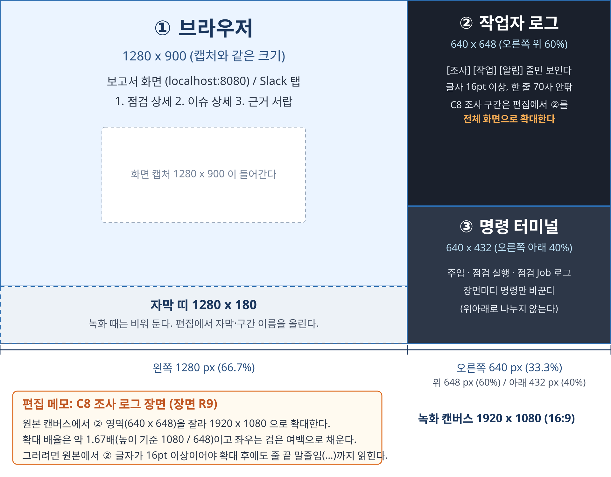

| 프리셋 | 이름 | 영역 | 들어갈 내용 | 쓰는 장면 |
|---|---|---|---|---|
| L1 | 화면 전체 | ① 브라우저 1920×1080 | 로그가 필요 없는 장면. 정상 상태, 점검 규칙 목록, A7 결과 화면, C8 보고서. 글자가 가장 크게 보인다 | R1, R1-2, R4, R11 |
| L2 | 화면 + 명령 터미널 | ① 브라우저 왼쪽 1280×1080 + ③ 명령 터미널 오른쪽 640×1080 | 주입, 점검 실행처럼 명령 출력과 화면을 함께 볼 때 | R2, R3, R7, R8 앞부분 |
| L3 | 화면 + 작업자 로그 | ① 브라우저(또는 Slack) 왼쪽 1280×1080 + ② 작업자 로그 오른쪽 640×1080 | 알림과 그 알림을 낸 로그 줄을 나란히 볼 때 | R5, R8 뒷부분, R10 |
| L4 | 로그 전체 | ② 작업자 로그 1920×1080 | 조사 진행(R9). 글자 22pt 이상 | R9 |

- 터미널 글꼴: L2, L3의 640폭 터미널은 한 줄 70자 안팎에 16pt 이상, L4의 1920폭 ②는 22pt 이상이다. OBS에서 L4는 ② 창을 전체 화면 크기로 키워 쓴다.
- 3분할(브라우저 + ② + ③을 한 화면에)은 쓰지 않는다. 640폭 영역을 위아래로 나누면 한 칸이 640×540 이하로 줄어 글자가 16pt 아래로 내려가 읽히지 않기 때문이다. R8처럼 ③ Job 로그와 ② 작업자 로그 시작 줄이 둘 다 필요하면 L2에서 ③으로 점검 줄을 본 뒤 L3으로 넘어간다.
- 자막 띠는 따로 두지 않는다. 자막과 구간 이름은 편집에서 올린다.
- 터미널에 환경 변수나 비밀값이 찍히지 않게 한다. `env`, `printenv`, `kubectl get ... -o yaml`(Deployment, Secret)을 치지 않는다. 프롬프트는 짧게(`$`) 바꾸고, 시작 전에 `clear`로 화면을 비우고, 셸 기록(↑ 키)에 비밀값이 든 명령이 없는지 확인한다.

### 전환 방법

- 권장: OBS Studio에 L1~L4 장면 4개를 미리 만든다. 창 캡처 소스는 세 개(① 브라우저, ② 터미널, ③ 터미널)이고 장면마다 크기와 위치만 다르다. 녹화 중에는 단축키로 장면을 바꾼다. 창을 녹화 중에 옮길 필요가 없고, 보이지 않는 터미널도 계속 돌고 있어서 L4로 넘어가도 로그가 이어져 있다. 장면별 단축키(예: F1~F4)는 사용자가 OBS에서 정한다. OBS 설치와 설정은 사용자가 하며, 이 문서를 위해 따로 설치하지 않았다.
- 대안: 화면 전체를 기본 배치(L2/L3 형태)로 한 번에 녹화하고 편집에서 장면마다 잘라 확대한다. 이때 브라우저 1280폭을 1920으로 키우면 1.5배라 글자가 흐려질 수 있다. ②를 L4로 키울 때는 R9 터미널 글자가 흐려지지 않게 원본 글자를 22pt 이상으로 둔다.

### 터미널 명령

실제로 읽기 전용 명령으로 형식을 확인했다(11/12 11:00 기준).

**② 작업자 로그** (항상 켜 둔다. 장면에 따라 필터만 바꾼다. L3, L4에서 보인다)

```bash
# 조사·작업·알림 줄만 (R7~R10, L3·L4)
kubectl -n kubeguardian logs -f deploy/diagnostic-agent -c worker --since=1s | grep --line-buffered -E '\[조사|\[작업\]|\[알림\]'

# A7 장면(R5, L3)은 근거 요약 줄도 함께
kubectl -n kubeguardian logs -f deploy/diagnostic-agent -c worker --since=1s | grep --line-buffered -E '근거 요약|\[작업\]|\[알림\]'
```

- 실제 형식 확인: `kubectl -n kubeguardian logs deploy/diagnostic-agent -c worker --tail=300`의 현재 출력은 `작업자 시작: /data/kubeguardian.db (알림 Slack)` 한 줄이었다. 작업자 Pod가 25분 전에 새로 떠서 근거 요약 줄과 조사 줄은 남아 있지 않았다. 줄 형식은 소스(`service/pipeline/worker.py`, `flow_log.py`, `notify/notifier.py`, `evidence_summary_worker.py`)와 아래 11/09 리허설 발췌로 확인했다. `근거 요약: ev-… done …`은 `evidence_summary_worker.py`의 `근거 요약: {message}` 출력이다.
- 형식 예: `2026-11-12 01:55:45,999 INFO [kubeguardian] [알림] M3 발송 이슈 #18 (Slack)`(Job 로그에서 확인한 같은 로거 형식), `[작업] 이슈 #12 조사 마침: done`(리허설 발췌).
- `grep`이 없으면 줄이 많아 읽히지 않으므로 필터를 쓴다. 파이프에서는 `--line-buffered`가 없으면 줄이 늦게 나온다.

**③ 점검 실행과 Job 로그** (L2에서 보인다)

`make kg-cron-run`(Makefile 171행)은 CronJob에서 Job만 만든다(`kubectl -n kubeguardian create job --from=cronjob/kg-check kg-check-$(date +%Y%m%d%H%M%S)`). 점검 결과 줄은 그 Job의 로그에 나온다. 방금 만든 Job의 로그를 바로 따라가는 한 줄은 다음이다.

```bash
make kg-cron-run && J=$(kubectl -n kubeguardian get jobs --sort-by=.metadata.creationTimestamp -o jsonpath='{.items[-1:].metadata.name}') && until kubectl -n kubeguardian logs -f job/$J 2>/dev/null; do sleep 1; done
```

- 확인한 것: 기존 완료 Job(`kg-check-29907480`, `kg-check-restore-1794448539`)의 로그를 `kubectl -n kubeguardian logs job/<이름>`으로 읽었다. 출력은 `점검 #154  dev  2026-11-12T02:00:03...`, `통과 100건 · 규칙 14개 (전체 보기: --verbose)`, `증상 감지`, `성공  chat  시나리오 chat: 2단계 모두 성공 (총 2349ms)`, `게이트: 경로 C — 장애 신호 없음` 순서였다. 해결된 점검에는 `이슈 #18 해결`과 `[알림] M3 발송 이슈 #18 (Slack)`이 이어졌다. 그래서 A7·C8의 `게이트: 경로 A …`, `이슈 #N 새로 열림 (규칙 진단)`(`cli.py`의 `RULE_DIAGNOSIS_LABEL`) 줄도 Job 로그에 나온다고 본다.
- 확인하지 못한 것: 새로 만든 Job에 `logs -f`를 거는 순서는 실행하지 않았다(Job 생성 금지). `until` 반복은 Pod가 뜨기 전 오류를 건너뛰고 다시 시도하는 용도이며 Job이 끝나면 멈추는 것으로 설계했다. 리허설 때 꼭 한 번 돌려 본다.
- 점검 결과가 나오는 Job은 약 8~9초에 끝난다. 점검 Job 로그만 보면 되므로 ③에 `-w` 감시를 따로 두지 않는다.

`kubectl -n kubeguardian logs deploy/diagnostic-agent -c web`는 접속 로그(`GET ... 200 OK`)와 `/healthz`뿐이라 영상에 넣을 가치가 없다.

## 3. 녹화 전 준비 (녹화 밖)

준비 상세는 [07-demo-script.md](../07-demo-script.md) §2를 따른다. 요약은 다음이다.

- 창 띄우기: ①~③ 창을 모두 띄워 두고 OBS에 L1~L4 장면을 만든다(§2). ② 로그, ③ 빈 프롬프트를 먼저 띄운다. ①은 `http://localhost:8080`(보고서)과 Slack 탭을 쓴다. 녹화 전에 장면 전환 단축키를 한 번씩 눌러 본다.
- port-forward: `make kg-web`으로 `http://localhost:8080`을 연다(Makefile의 `kubectl port-forward service/diagnostic-agent 8080:8080`). 촬영 도중 끊기면 R1부터 다시 찍는다.
- **열린 이슈 없음**: 점검 이력 상단 띠가 "열린 이슈 없음"이어야 한다. 11/12 현재는 이슈 #18(11/10 10:02~, 채팅 실패, 긴급)이 11/12 10:55 점검 #153에서 해결되어 이 조건을 만족한다. 이 문서의 사진도 그 뒤에 캡처했다. 촬영 직전에도 확인한다. 사진 속 "열린 이슈 없음"이 아니라 "긴급 1"이 보이면 열린 이슈가 남은 것이다.
- 정시 회피: 다음 정시 점검(매시 정각)과 겹치지 않는 시간에 시작한다. 조사 대기열이 비어 있어야 한다.
- H0 OK: `bash scenarios/H0/verify_symptom.sh`가 OK여야 시작한다.
- CronJob과 diagnostic-agent는 [PR #235](https://github.com/skax-jihyeryu/KubeGuardian/pull/235)의 표시 변경을 포함한 이미지여야 한다.
- 터미널 준비: 환경 변수 출력 금지, 프롬프트 단축, 화면 비우기(§2).
- Slack: 테스트 채널만 연다. 채널 이름과 담당자 이름이 보이면 가린다.

## 4. 녹화 순서

각 장면의 "자막" 줄은 화면 아래 띠에 올릴 글이다(내레이션과 별개, 전체는 5. 편집 지도 뒤 "자막 전체 표"). 시각은 예상값이다. 원본 시간은 예상이다. 편집 후 길이는 5. 편집 지도와 같다. ①②③은 레이아웃 프리셋(§2)의 영역이고, 장면마다 "레이아웃" 줄에 쓸 프리셋과 전환 시점을 적었다. R1-2를 끼워 넣어 R2 이후 원본 시각은 약 20초씩 뒤로 밀린다(예상 시간이라 다시 맞추지 않았다).

### R1. 정상 상태 (원본 0:00~0:40 → 편집 25초, 유지)

- 자막:
  - 0:05~0:17: 열린 이슈 없음 · 정상 상태
  - 0:17~0:30: 오늘의 두 장면 / A7 규칙 경로 · C8 AI 조사
- 레이아웃: **L1** (브라우저 전체. 로그 필요 없음)
- 화면: ①. 점검 이력 첫 화면. 상단 "열린 이슈 없음" 띠와 정상 점검 목록.
- 편집: 제목 카드 5초를 앞에 붙이고(R1-2와 합쳐 소개 45초), 두 장면 이름("A7 규칙 경로", "C8 AI 조사")을 자막으로 나란히 보인다.

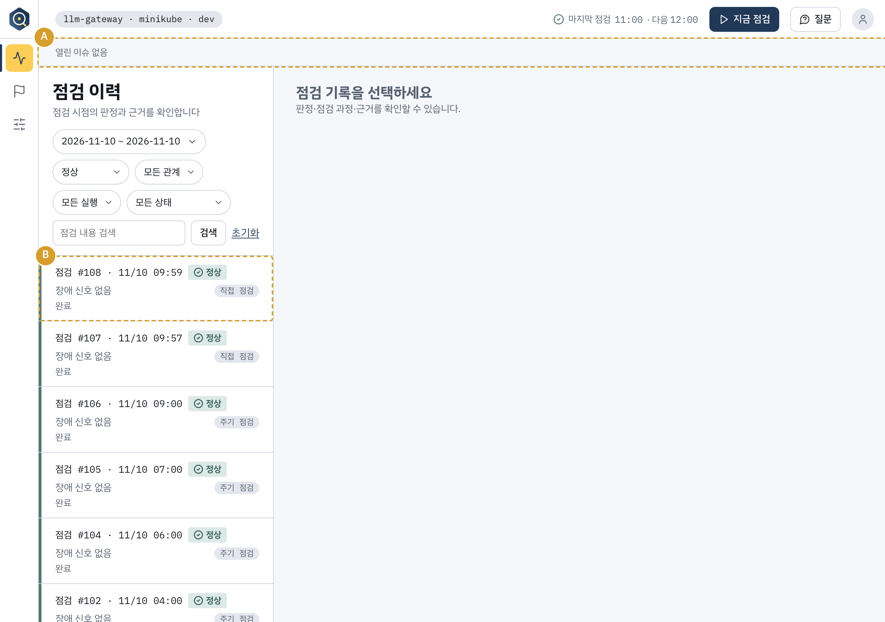

- 사진은 점검 이력에서 심각도 "정상", 기간 11/10으로 거른 화면이다. 번호 없이 강조만 쓴다.
  - A = 상단 "열린 이슈 없음" 띠. 박스를 편집에서 크게 붙인다.
  - B = 목록 첫 줄의 "정상" 점검.
- 촬영 때는 열린 이슈가 0이어야 한다(§3). 11/12 현재 이슈 #18이 이미 해결되어 있다. 11/12 10:55 점검 #153 줄에 `해결 #18`이 보이므로, 촬영 화면에서는 기간 필터를 걸거나 위에서 스크롤해 그 줄을 피한다.
- 내레이션: "Pod는 모두 정상인데 서비스가 안 되는 장애는 사용자 문의로 알게 되는 경우가 있고, 수작업 진단에는 경험상 며칠이 걸립니다." "오늘은 두 장면을 보여 드립니다. 서비스 주소 오타는 규칙 기반 결과로 끝납니다. 규칙이 놓친 채팅 실패는 AI가 조사합니다."

### R1-2. 점검 규칙 목록 (원본 0:40~1:00 → 편집 15초)

- 자막:
  - 0:30~0:35: 점검 규칙 14종 / 서비스 생애 주기 10단계 기준
  - 0:35~0:40: S04: 서비스 주소 설정 오류 / A7에서 적발할 규칙
  - 0:40~0:45: 7 의존: 전용 규칙 없음 / 기능 점검과 AI 조사가 맡음
- 레이아웃: **L1** (브라우저 전체. 규칙 목록은 화면이 증거라 로그 필요 없음)
- 화면: ①. 왼쪽 메뉴의 설정 아이콘 → "점검 규칙" 탭(`http://localhost:8080/llm-gateway/setup/rules`). 체크박스와 "저장"은 누르지 않는다. 규칙 이름을 눌러 오른쪽 설명을 바꾸는 것은 화면 안의 GET이라 괜찮다.
- 보이는 것: 상단 탭 "대상 서비스 5 / 점검 규칙 14 / 기능 점검 1", "사용 14 · 끔 0 · 향후 계획 11", 서비스 생애 주기 10단계(0 환경 ~ 9 점검)별 규칙 목록, "7 의존: 전용 규칙 없음 · 기능 점검과 AI 조사에서 확인합니다.", "복합 · 설정 + 연결"의 S04 서비스 주소 설정 오류.

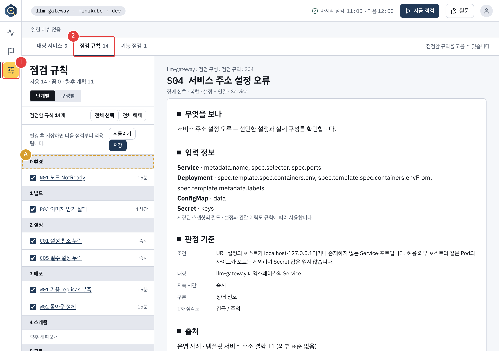

- 1 = 왼쪽 메뉴의 설정("점검 구성") 아이콘
- 2 = "점검 규칙 14" 탭
- A = 단계별 규칙 목록. 회색 띠로 된 단계 묶음 머리(0 환경, 1 빌드, …)가 생애 주기 순서다. 사진은 첫 머리 "0 환경"에 박스를 쳤고, 편집에서 머리 전체를 훑는다.
- 사진 오른쪽은 S04를 선택한 상태의 설명(무엇을 보나, 입력 정보, 판정 기준)이다.

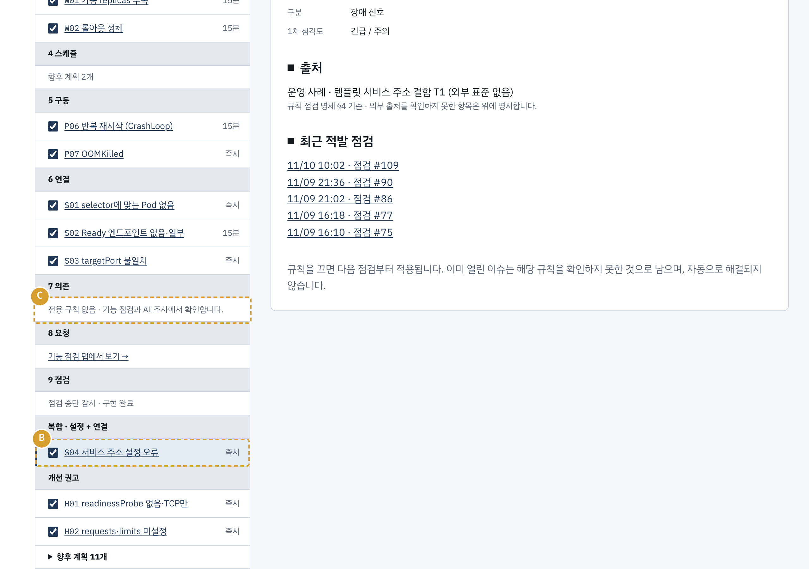

- 목록을 아래로 스크롤한 화면이다(같은 페이지, 두 번째 장).
- B = "복합 · 설정 + 연결"의 S04 서비스 주소 설정 오류. 오늘 A7에서 적발할 규칙이다.
- C = "7 의존 · 전용 규칙 없음 · 기능 점검과 AI 조사에서 확인합니다." C8이 규칙이 아니라 기능 점검으로 잡히는 이유다.
- 오른쪽의 "최근 적발 점검"에는 S04를 적발한 점검 #90이 보인다(A7 리허설 기록).
- 내레이션: "규칙 14종은 서비스가 뜨는 생애 주기 10단계에서 공개 기준으로 뽑았습니다. 오늘 A7에서 적발할 S04는 서비스 주소 설정 오류 규칙입니다. 서비스 간 의존 문제는 전용 규칙이 없어 기능 점검과 AI 조사가 맡습니다."
- 편집: 위쪽 사진에서 A를 훑고(5초), 스크롤해서 B(5초)와 C(5초)에 박스를 붙인다.

### R2. A7 주입 (원본 0:40~2:10 → 편집 8초, 롤아웃 대기는 2배속)

- 자막:
  - 0:45~0:49: A7: 서비스 주소에 점 하나
  - 0:49~0:53: Pod는 Ready, 알림은 없음 / 롤아웃 대기 2배속
- 레이아웃: **L2** (브라우저 왼쪽 + ③ 오른쪽). 브라우저는 점검 이력 화면에 둔다.
- 화면: ① 점검 이력, ③ 명령.
- ③ 명령(07-demo-script §3):
  1. `KG_TYPO=dot bash scenarios/A7/inject.sh`
  2. `kubectl get pods -n dev -w`로 gateway 새 Pod가 교체되는 것을 보인다. 롤아웃이 끝나면 Ctrl+C.
- ②는 L2에서 보이지 않는다. 작업자는 아직 아무것도 하지 않는다.
- 편집: 롤아웃 대기는 2배속 자막을 붙인다. 이 장면은 사진이 없다(터미널 화면).
- 내레이션: "gateway가 agent를 부르는 주소에 점 하나만 더했습니다. Pod는 Ready라 Kubernetes는 아무것도 알리지 않습니다."

### R3. 점검 실행 (원본 2:10~2:30 → 편집 4초)

- 자막(0:53~0:57): 점검 실행 → 규칙이 바로 적발
- 레이아웃: **L2** (R2에서 그대로 이어서). 명령 → Job 로그에 `이슈 #N 새로 열림 (규칙 진단)`이 보이면 다음 장면(R4)에서 L1로 바꾼다.
- 화면: ① 점검 이력, ③ 명령.
- ③ 명령: 위 "점검 실행과 Job 로그" 한 줄(`make kg-cron-run && … logs -f job/$J`).
- 기다릴 줄(③): `게이트: 경로 A …`, `이슈 #N 새로 열림 (규칙 진단)`. 점검 #90 실측에서는 `이슈 #15 새로 열림 (규칙 진단)`이 나왔다.
- 이 장면은 CLI 출력 줄 위에 박스를 붙인다(편집).
- 내레이션: "점검을 실행하면 규칙이 서비스 주소 오류를 바로 잡습니다."

### R4. A7 결과 화면 (원본 2:30~4:00 → 편집 18초)

점검 상세 → 이슈 상세 → 근거 서랍 순서다. 레이아웃은 **L1**(브라우저 전체)이다. 결과 화면이 증거라 로그가 필요 없다. R3에서 `이슈 #N 새로 열림` 줄을 보인 직후 L1로 바꾼다.

**R4-1. 점검 상세 #90 (6초)**

- 자막(0:57~1:03): S04 적발: 서비스 주소에 점 하나 / 조사 안 함 · 규칙 기반 진단 결과
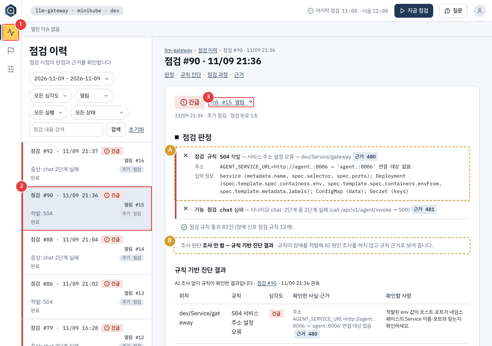

- 1 = 왼쪽 메뉴의 "점검 이력" 아이콘
- 2 = 목록의 점검 #90 줄
- A = 판정: `S04` 적발(서비스 주소 설정 오류, 주소 `AGENT_SERVICE_URL=http://agent.:8006 → 'agent.:8006' 연결 대상 없음`)과 기능 점검 chat 실패
- B = "조사 안 함 — 규칙 기반 진단 결과"
- 3 = "이슈 #15 열림" 링크(다음 이동)
- 편집: A와 B 줄을 확대한다.
- 내레이션: "채팅 기능 점검도 실패했습니다."

**R4-2. 이슈 상세 #15 (12초)**

- 자막(1:03~1:12): AI 보고서 대신 규칙 기반 진단 결과 / 확인한 사실: agent 주소의 점 오타
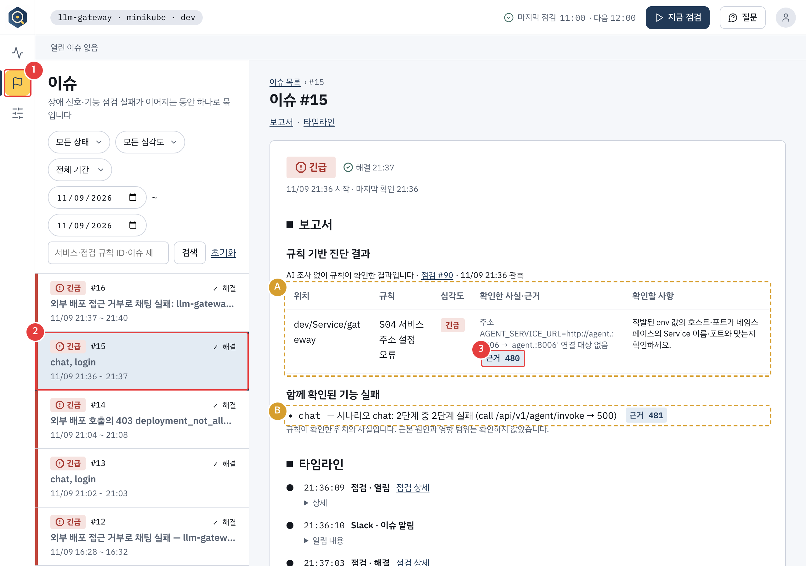

- 1 = 왼쪽 메뉴의 "이슈" 아이콘
- 2 = 이슈 목록의 #15
- A = 보고서 자리의 "규칙 기반 진단 결과" 표(위치, 규칙, 심각도, 확인한 사실·근거, 확인할 사항)
- B = "함께 확인된 기능 실패" 절
- 3 = 표 안의 "근거 480" 배지(눌러서 R4-3으로)
- 내레이션: "보고서 자리에는 AI 보고서 대신 규칙 기반 진단 결과가 나옵니다. 확인한 사실에 agent 주소의 점 오타와 연결 대상이 표시됩니다."

**R4-3. 근거 서랍 (R4-2에 포함, 3초 안팎)**

- 자막(1:12~1:15): 근거 번호를 누르면 원문이 열림
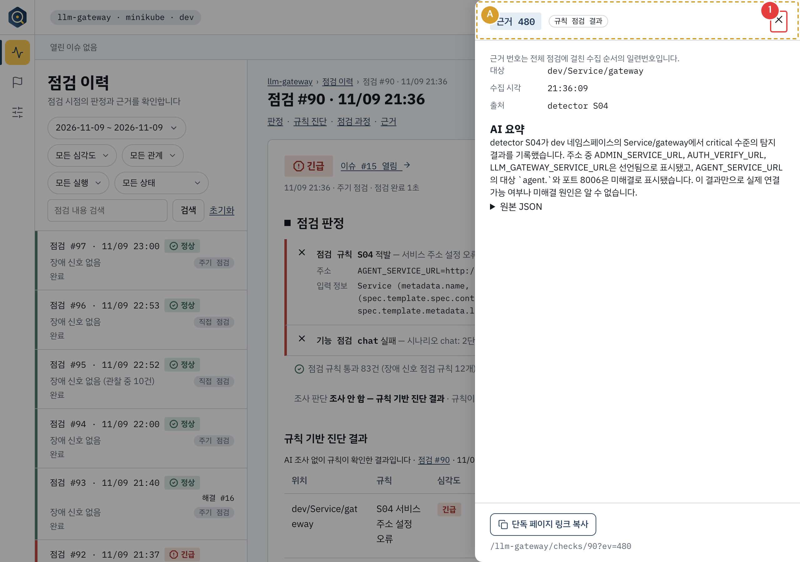

- 1 = "근거 480"을 누르면 오른쪽에 열린 서랍의 닫기(X). 서랍을 보여 준 뒤 닫는다.
- A = 서랍 머리(근거 번호와 종류 `규칙 점검 결과`). 대상 `dev/Service/gateway`, 출처 `detector S04`, AI 요약, 원본 JSON이 보인다.
- 서랍은 화면 안에서만 바뀌는 GET이다. 누를 때 상태가 바뀌지 않는다. 사진은 점검 #90 상세에서 연 서랍이다. 이슈 상세의 배지를 누르면 같은 서랍이 점검 상세 위에 열린다.

### R5. Slack과 근거 요약 로그 (원본 4:00~4:30 → 편집 10초)

- 자막:
  - 1:15~1:20: Slack: 규칙 기반 진단 결과 / 근본 원인은 확인하지 않음
  - 1:20~1:25: 경로 A에서도 근거 요약 LLM 동작 / 원인 조사 AI는 경로 B에서만
- 레이아웃: **L3** (Slack 탭 왼쪽 + ② 오른쪽). R4 근거 서랍을 닫고 Slack 탭으로 옮기면서 L3로 바꾼다.
- 화면: Slack 탭(①), ②.
- Slack 화면은 캡처할 수 없어 사진이 없다. Slack 화면: 테스트 채널, 1차 알림에서 "📋 규칙 기반 진단 결과입니다. 근본 원인은 확인하지 않았습니다." 줄을 강조한다(`app/service/notify/messages.py` 108행). 그 앞에 적발 규칙 ID, 이름, 위치가 최대 3줄 나온다.
- ② 기다릴 줄: `근거 요약: ev-… done …`(근거 요약 LLM 작업 완료). 이 장면에서는 근거 요약 필터로 ②를 켜 둔다. 원인 조사 줄(`[조사 …]`)은 나오지 않는다. 박스는 `근거 요약` 줄과 `[알림] M1 발송` 줄에 붙인다.
- 근거가 있는 문구(PR #228의 `app/service/notify/messages.py`, `app/api/templates/_rule_report.html`, `app/api/viewmodels/checks.py`, `docs/04-ui-spec.md`):
  - Slack 1차 알림의 규칙 진단 안내: "규칙 기반 진단 결과입니다. 근본 원인은 확인하지 않았습니다." 앞에 적발 규칙 ID, 이름, 위치가 최대 3줄 나온다.
  - 이슈 보고서 자리와 점검 상세 모두 소제목이 "규칙 기반 진단 결과"이고, 기능 점검이 함께 실패하면 "함께 확인된 기능 실패" 절이 붙는다.
  - 점검 상세의 조사 판단은 "조사 안 함 — 규칙 기반 진단 결과"로 표시된다.
  - A7은 원인 조사 대기열에 들어가지 않는다. 작업자 로그에서는 `근거 요약`을 보여 준다.
- 내레이션: "경로 A에서도 수집된 근거를 LLM으로 요약합니다. 원인 조사 AI는 다음에 보여 드릴 경로 B에서만 실행합니다."

**2026-11-09 재배포 후 실측.** 점검 #90에서 채팅 호출이 500으로 실패했고, S04 적발로 경로 A에 진입했다. CLI는 `이슈 #15 새로 열림 (규칙 진단)`을 표시했다. 이슈 #15와 점검 #90 화면에 `AGENT_SERVICE_URL=http://agent.:8006 → 'agent.:8006' 연결 대상 없음`이 표시됐다. 이 점검에 연결된 근거 요약 LLM 작업 2건이 완료됐고, 원인 조사 기록은 0건이었다. 원복 후 H0 채팅이 성공했고 점검 #91에서 이슈 #15가 해결됐다.

### R6. A7 원복 (원본 4:30~6:30 → 편집에서 삭제)

- 레이아웃: 아무거나(편집에서 삭제하는 구간이라 상관없다). 원복 명령을 보기 쉬운 L2가 편하다.
- **C8 촬영 전에 A7을 원복한다.** 녹화는 계속하되 편집에서 이 구간 전체를 지운다. (녹화 밖에서 해도 된다. 한 번에 녹화하려면 여기까지 켜 둔다.)
- ③ 명령: `bash scenarios/A7/reset.sh`로 주소를 복구하고 롤아웃이 끝나면 `make kg-cron-run`을 실행한다.
- 점검이 완료되어 A7 이슈가 해결되고 복구 알림(M3)이 온 것을 확인한다. Slack 복구 알림 문구는 "✅ 복구 · {네임스페이스} — …이 정상으로 돌아왔습니다"(`messages.py` 319행)다.
- `bash scenarios/H0/verify_symptom.sh`가 OK일 때만 R7로 간다.

### R7. C8 주입 (원본 6:30~7:00 → 편집 8초)

- 자막(1:25~1:33): C8: LLM 배포명 하나가 바뀜 / Pod·Service 정상, 규칙은 못 잡음
- 레이아웃: **L2** (브라우저 왼쪽 + ③ 오른쪽). 브라우저는 점검 이력 화면에 둔다.
- 화면: ① 점검 이력, ③ 명령. ②(`[조사|[작업]|[알림]` 필터)는 L2에서 보이지 않지만 OBS에서 계속 켜 둔다. 로그는 이어서 쌓인다.
- 주입 전에 ②에서 작업자 로그 명령을 켜 둔다. ③ 명령은 저장소 루트에서 실행한다.
- ③ 명령:
  1. `bash scenarios/H0/verify_symptom.sh`가 OK인지 확인한다.
  2. `bash scenarios/C8/inject.sh`
  3. `bash scenarios/C8/verify_symptom.sh`로 검증 출력에서 `chat_failed`가 `true`이고 `upstream_error`가 `403 deployment_not_allowed`인지 확인한다. 검증기가 서버 측 감사 로그를 조회하므로 원문을 열거나 녹화할 필요가 없다. DB 한 행만 바꾸므로 Pod 변화는 없고 ③은 조용하다.
- 내레이션: "이번에는 Kubernetes에 흔적이 없는 장애입니다. LLM 배포명 하나가 바뀌어 채팅이 실패하는데 Pod와 Service는 정상이라 규칙은 못 잡습니다."
- 활성 Azure `gpt-4.1` 배포 행의 `deployment_name`만 `gpt-4.1-next`로 바뀌어 LLM 게이트웨이가 403 `deployment_not_allowed`로 거절하고, Pod와 Service는 정상이다. 실행 절차는 [C8 README](../../scenarios/C8/README.md)를 참고한다.

### R8. C8 점검 실행 (원본 7:00~7:40 → 편집 17초)

- 자막:
  - 1:33~1:41: 규칙 신호 없음 / 기능 점검 chat 실패 → 경로 B
  - 1:41~1:50: AI 조사 시작 / 1차 알림에 조사 중 안내
- 레이아웃: **L2 → L3**. 명령을 치고 ③ Job 로그에 `게이트: 경로 B …`와 `이슈 #N 새로 열림 (조사 대기)`가 보이면 L3(점검 상세 #N 화면 + ② `[조사 #N] 시작` 줄)으로 바꾼다. 3분할은 쓰지 않는다(§2).
- 화면: ③(L2), ①(점검 상세)와 ②(L3), Slack.
- ③ 명령: R3과 같은 한 줄(`make kg-cron-run && … logs -f job/$J`). 규칙 신호 없이 기능 점검 실패로 경로 B 조사가 열린다. C8 README는 서비스 화면의 "직접 점검" 버튼도 안내하지만 영상은 07-demo-script와 같이 `make kg-cron-run`을 쓴다. 화면에서 "지금 점검" 버튼은 누르지 않는다.
- 기다릴 줄(③): `게이트: 경로 B …`, 기능 점검 `실패  chat …`, `이슈 #N 새로 열림 (조사 대기)`.
- ①: 점검 상세 #92. 사진은 조사 완료 후 화면이라 "판단: 후보" 배지가 보인다. 촬영 시점(조사 시작 직후)에는 배지가 아직 없다.

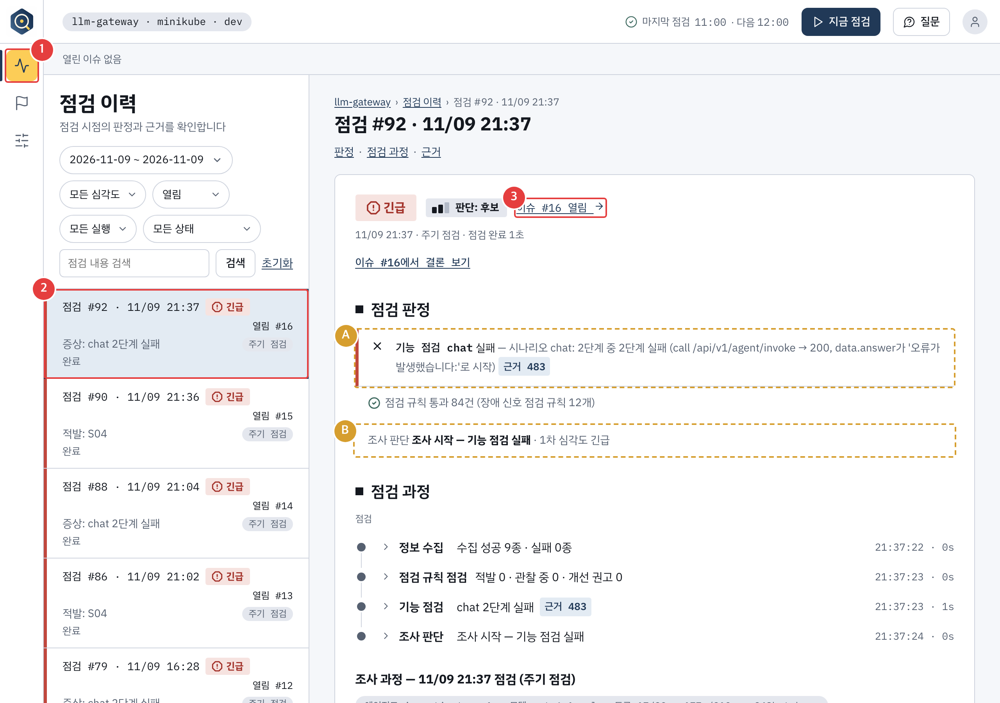

- 1 = 왼쪽 메뉴의 "점검 이력" 아이콘
- 2 = 목록의 점검 #92 줄
- A = 판정: 기능 점검 chat 실패(`call /api/v1/agent/invoke → 200`, `data.answer`가 '오류가 발생했습니다:'로 시작)
- B = "조사 시작 — 기능 점검 실패 · 1차 심각도 긴급"
- 3 = "이슈 #16 열림" 링크(다음 이동, R11에서 이슈 상세로 간다)
- Slack 화면: 테스트 채널, 1차 알림에서 "🔍 원인을 조사하고 있습니다. 조사가 끝나면 이 메시지를 갱신합니다." 줄에 박스(`messages.py` 150행). 사진은 없다.
- 내레이션: "기능 점검이 실패를 잡고 AI 조사가 열립니다." 편집은 여기까지 조사 시작 전이라 실시간이다.

### R9. 조사 로그 (원본 7:40~10:40 → 편집 85초)

- 레이아웃: **L4** (② 작업자 로그 전체 화면). R8의 L3에서 ②에 `[조사 #N] 사전 확인` 줄이 보이면 L4로 바꾼다. 글자는 22pt 이상이라 줄 끝 `…`까지 읽힌다. 편집에서 확대하지 않는다.
- 화면: ②. 원본 조사 시간은 회차마다 다르다. 재배포 후 실측은 약 177초였다.
- ② 기다릴 줄(필터는 R7과 같다): `[조사 #N] 시작`, `사전 확인`, `선별`, `계획`, `도구 …`, `재조사`, `가설 판정`, `결론`. 아래 "인용할 로그 줄"의 표가 그 출력이다.
- ③은 L4에서 보이지 않는다.
- 편집 지시와 내레이션(25초씩 세 묶음과 결론 10초):

| 묶음 | 길이 | 보여 줄 줄 | 내레이션과 편집 |
|---|---|---|---|
| 1 | 25초 | 사전 확인, 선별, 계획 | "가설을 세우기 전에 호출 관계와 실패 재현을 코드로 먼저 모읍니다. 근거 7건입니다. 그다음 문제를 하나로 좁히고 가설 3개를 세웁니다." 세 줄마다 멈추고 박스. 자막 "사전 확인", "문제 선별", "Planning" |
| 2 | 25초 | 도구 검증 줄 | "가설마다 도구를 직접 불러 확인하고 결과는 근거 번호로 남습니다." 핵심 도구 호출만 남겨 25초로 편집한다. 대기는 자르고 "중간 생략", 빠르게 재생하는 구간은 "2배속" 자막을 붙인다 |
| 3 | 25초 | 재조사 줄과 이어지는 로그 확인 | "검증기가 빈틈을 하나 찾아 에이전트에게 한 번 더 조사시켰고, 에이전트가 로그를 두 번 더 확인했습니다." `재조사: 빈틈 1개`에 박스와 화살표. 자막 "Self-Correction: 코드 검증기가 빈틈을 찾음" |
| 4 | 10초 | 가설 판정, 결론 | "가설마다 지지와 판단 불가가 갈립니다. 근거가 모자라 결론은 확정이 아니라 후보로 제한됩니다." `판단 수준 후보`에 박스 |

- 묶음별 자막(R9):
  - 1:50~1:57 (묶음 1): 사전 확인: 코드로 근거 수집
  - 1:57~2:05 (묶음 1): 문제 선별: 문제를 하나로 좁힘
  - 2:05~2:15 (묶음 1): Planning: 가설 3개
  - 2:15~2:28 (묶음 2): Tool Call: 가설마다 도구로 직접 확인
  - 2:28~2:40 (묶음 2): 결과는 근거 번호로 남음 / 중간 생략 · 2배속
  - 2:40~2:55 (묶음 3): Self-Correction: / 코드 검증기가 빈틈을 찾음
  - 2:55~3:05 (묶음 3): 한 번 더 조사 / 로그를 두 번 더 확인
  - 3:05~3:10 (묶음 4): 가설별 판정: 지지 · 판단 불가
  - 3:10~3:15 (묶음 4): 판단 수준: 후보 (확정 아님)
- 재조사는 리허설 1회에서 관찰된 것이라 매번 나온다는 보장이 없다. 본편에는 실제 `재조사` 로그와 `판단 수준 후보` 결론이 함께 나온 회차를 쓴다. 둘 중 하나라도 빠지면 원복 후 다시 찍는다. C8의 반복 평가는 없다.

### R10. Slack 갱신 (원본 10:40~11:00 → 편집 5초)

- 자막(3:15~3:20): Slack 1차 알림이 원인으로 갱신 / 스레드에 후속 답글
- 레이아웃: **L3** (Slack 탭 왼쪽 + ② 오른쪽). R9 묶음 4의 결론 줄이 나오면 L4에서 L3로 바꾼다.
- 화면: Slack 탭(①), ②.
- Slack 화면: 테스트 채널, 1차 알림이 원인 문구로 갱신되고(M1 → M1u) 스레드에 후속 답글(M9)이 붙는다. 이 두 장면에서 "원인 갱신"과 "원인 확인 답글" 줄을 잠깐 보인다. 사진은 없다.
- ② 기다릴 줄: `[알림] M1u 발송 이슈 #N (Slack)`, `[알림] M9 발송 이슈 #N (Slack)`, `[작업] 이슈 #N 조사 마침: done`.
- 내레이션: R9 묶음 4와 이어서 말한다.

### R11. C8 보고서 화면 (원본 11:00~13:00 → 편집 35초)

레이아웃은 **L1**(브라우저 전체)이다. R10의 `[작업] 이슈 #N 조사 마침: done` 줄을 보인 뒤 L1로 바꾼다. 번호의 이동 순서는 R8에서 이어진다(이슈 아이콘 → #16 → 보고서 → 근거).

**R11-1. 보고서 상단 (10초)**

- 자막(3:20~3:30): 결론: gpt-4.1-next 배포 403 거부 / 판단 수준: 후보
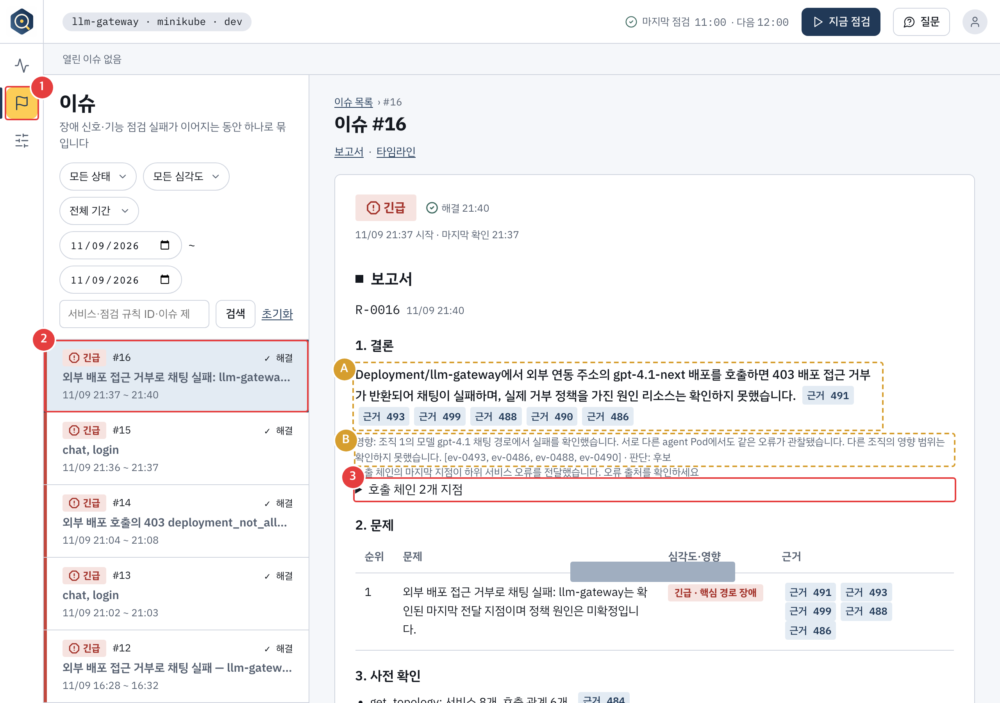

- 1 = 왼쪽 메뉴의 "이슈" 아이콘
- 2 = 이슈 목록의 #16
- A = "1. 결론"(`Deployment/llm-gateway에서 외부 연동 주소의 gpt-4.1-next 배포를 호출하면 403 배포 접근 거부가 반환되어 채팅이 실패하며, 실제 거부 정책을 가진 원인 리소스는 확인하지 못했습니다.`)과 근거 배지
- B = 영향 줄의 "판단: 후보"와 판단 근거(어디까지 확인했는지)
- 3 = "호출 체인 2개 지점"(눌러서 펼친다. R11-2)
- 사진의 목록은 기간을 11/09로 걸어 #18을 뺐다.

**R11-2. 호출 체인 (8초)**

- 자막(3:30~3:38): 호출 체인: agent → llm-gateway / → 외부 403 수신
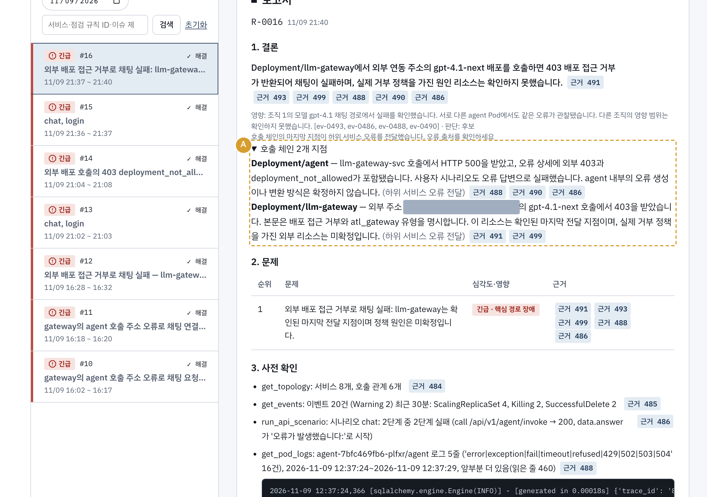

- A = 펼쳐진 호출 체인(`Deployment/agent`의 하위 서비스 오류 전달, `Deployment/llm-gateway`의 외부 403 수신). 외부 LLM 호스트 이름은 회색 박스로 가렸다. 촬영 때도 같은 곳을 편집에서 가린다.
- 이 사진은 호출 체인을 누른 뒤의 화면이다. 누르는 위치는 R11-1의 3이다.

**R11-3. 가설 판정 (8초)**

- 자막(3:38~3:46): 가설 판정: 지지 1 · 미결 3 / 이유와 근거 배지
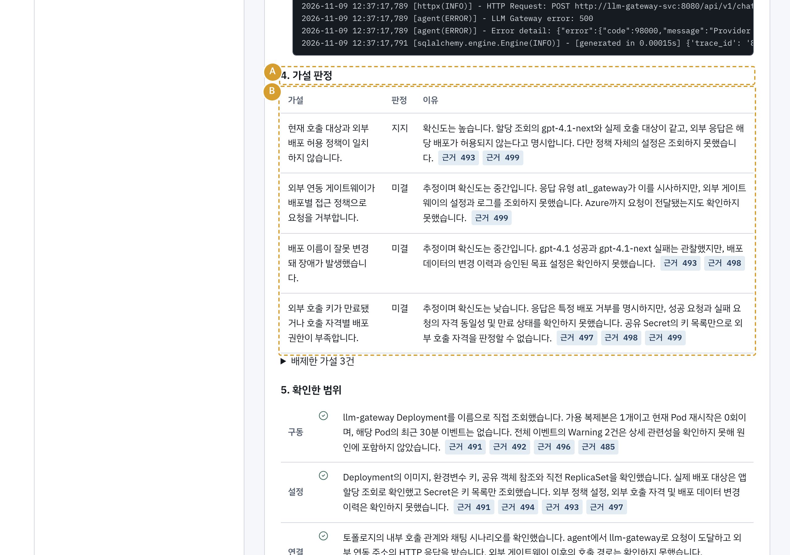

- A = "4. 가설 판정" 소제목, B = 가설 4건과 판정(지지 1, 미결 3)과 이유, 근거 배지

**R11-4. 확인한 범위 (5초)**

- 자막(3:46~3:51): 확인한 범위: 구동·설정·연결·로그
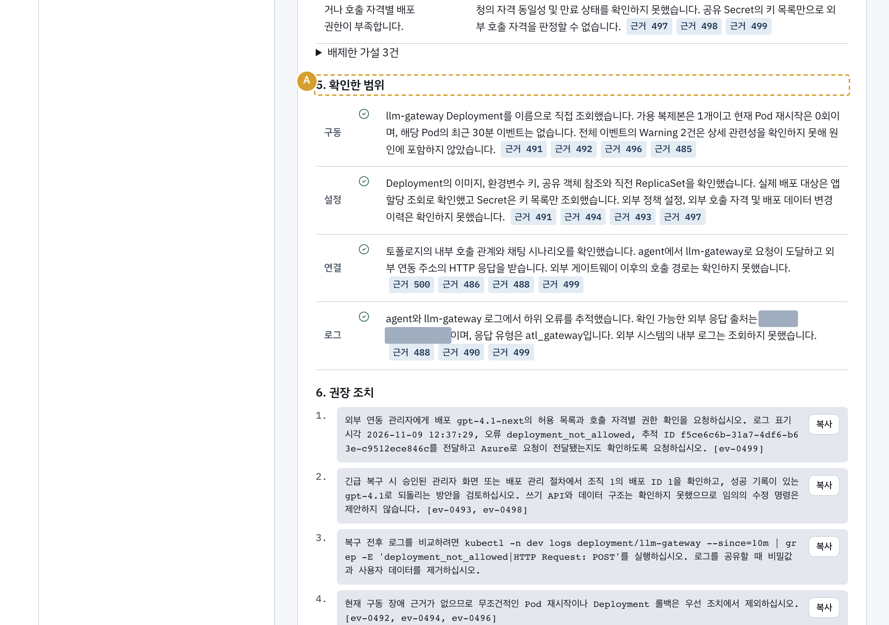

- A = "5. 확인한 범위"(구동, 설정, 연결, 로그 네 항목). 로그 항목의 외부 호스트 이름은 회색 박스로 가렸다.

**R11-5. 근거 번호 → 원문 서랍 (4초, 실시간)**

- 자막(3:51~3:55): 근거 번호 → 원문 서랍
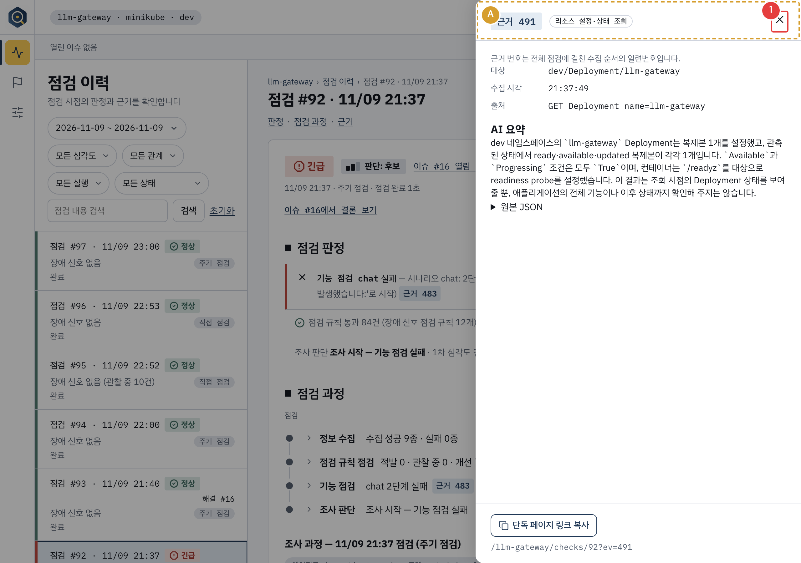

- 1 = 서랍의 닫기(X). 서랍은 결론의 "근거 491" 배지를 누르면 열린다.
- A = 서랍 머리(근거 번호 491, 종류 `리소스 설정·상태 조회`, 대상 `dev/Deployment/llm-gateway`, AI 요약).
- 주의: AI 요약이 아직 없는 근거를 열면 화면이 "요약 생성 중"이 되며 요약을 생성하는 POST가 나간다(캡처 중 근거 493에서 확인해 차단했다). 영상에서는 요약이 이미 있는 근거(491)를 열고 요약 없는 근거는 누르지 않는다.

**R11-6. (보너스) 점검 과정 (원본 포함, 편집 여유 시)**

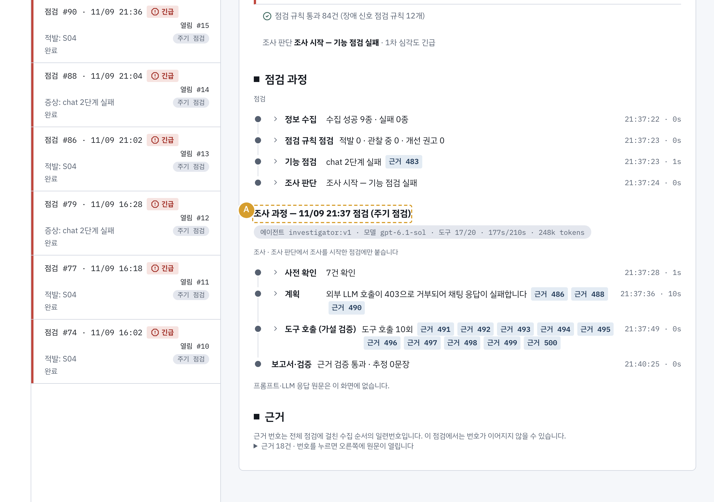

- A = "조사 과정 — 11/09 21:37 점검 (주기 점검)"(에이전트 investigator:v1, 도구 17/20, 177s/210s, 248k tokens). 사전 확인 7건, 계획, 도구 호출 10회, 보고서·검증 단계가 시각과 함께 나온다. 점검 상세의 "점검 과정" 절이다.
- 사진에는 단계를 펼치지 않았다. 필요하면 단계 줄을 눌러 펼친다(화면 안의 열기만 한다).

- 내레이션: "보고서에서 판단 근거와 호출 체인, 실제 가설 판정과 확인한 범위를 볼 수 있습니다. 근거 번호를 누르면 원문이 열립니다." 근거 클릭은 실시간이다.
- 사진은 이슈 #16 화면이다. 촬영 때는 번호가 다르다.

**2026-11-09 재배포 후 실측.** C8 검증기가 실제 채팅 실패와 감사 로그의 `403 deployment_not_allowed`를 확인했다. 점검 #92가 경로 B로 이슈 #16을 열었고, 조사 #16은 약 177초 만에 완료됐다. 화면의 실제 보고서는 `gpt-4.1-next` 호출이 403으로 거부돼 채팅이 실패했다고 설명했고, 거부 정책을 가진 리소스는 확인하지 못했다고 밝혔다. 검사 대상 보고서 문장에서 한자 검출은 0건이었고 인용 근거는 11개였다. 원복 후 H0 채팅이 성공했고 점검 #93에서 이슈 #16이 해결됐다. [한국어 보고서 PR #234](https://github.com/skax-jihyeryu/KubeGuardian/pull/234) · [C8 검증기 PR #233](https://github.com/skax-jihyeryu/KubeGuardian/pull/233)

### R12. C8 원복 (원본 13:00~15:00 → 편집에서 삭제)

- 레이아웃: 아무거나(편집에서 삭제). L2가 편하다.
- ③ 명령: `bash scenarios/C8/reset.sh`(Pod 재시작 없음), `make kg-cron-run`으로 이슈를 해결시켜 복구 알림을 확인하고, `bash scenarios/H0/verify_symptom.sh`가 OK인지 본다. 재촬영할 때도 이 원복과 정상 확인을 먼저 마친다.
- 편집에서 이 구간을 전부 지운다.

## 5. 편집 지도

| 원본 장면 | 원본(예상) | 편집 후 길이 | 편집 | 최종 영상 구간 |
|---|---|---|---|---|
| R1 정상 상태 | 0:00~0:40 | 25초 (+제목 카드 5초) | 유지 | 1. 소개 0:00~0:45 (45초) |
| R1-2 점검 규칙 목록 | 0:40~1:00 | 15초 | A·B·C 박스 | 1. 소개 |
| R2 A7 주입 | 0:40~2:10 | 8초 | 롤아웃 대기 2배속 | 2. A7 0:45~1:25 (40초) |
| R3 점검 실행 | 2:10~2:30 | 4초 | 유지 | 2. A7 |
| R4 A7 결과 화면 | 2:30~4:00 | 18초 | 판정, 표 확대 | 2. A7 |
| R5 Slack, 근거 요약 로그 | 4:00~4:30 | 10초 | 줄 박스 | 2. A7 |
| R6 A7 원복 | 4:30~6:30 | 0초 | 삭제 | (없음) |
| R7 C8 주입 | 6:30~7:00 | 8초 | 유지 | 3. C8 1:25~3:55 (150초) |
| R8 C8 점검 실행 | 7:00~7:40 | 17초 | 유지 | 3. C8 |
| R9 조사 로그 | 7:40~10:40 | 85초 | L4로 녹화(확대 없음), 대기 삭제, 배속 | 3. C8 |
| R10 Slack 갱신 | 10:40~11:00 | 5초 | 유지 | 3. C8 |
| R11 C8 보고서 화면 | 11:00~13:00 | 35초 | 근거 클릭은 실시간 | 3. C8 |
| R12 C8 원복 | 13:00~15:00 | 0초 | 삭제 | (없음) |
| (편집에서 새로 만듦) | | 30초 | 자막 카드 4장 | 4. 성과 요약 3:55~4:25 (30초) |

- 구간 합계: 45초(R1 25 + 제목 5 + R1-2 15), 40초(8 + 4 + 18 + 10), 150초(8 + 17 + 85 + 5 + 35), 30초로 265초, 곧 4분 25초다. 5분 상한까지 35초가 남는다. 편집 중 늘어나면 이 여유 안에서 흡수하고, 모자란 설명이 있으면 C8 구간에 쓴다.
- 원본이 길면 R9의 대기 구간을 줄여 맞춘다. 아래 192초 로그 예시처럼 원본이 길면 묶음 1~3의 대기 구간을 줄인다.

### 자막 전체 표

화면 아래 띠에 뜨는 글이다. 내레이션(말)과 별개이고, 내레이션의 핵심을 줄이고 화면에서 봐야 할 것을 짚는다. 규칙은 다음이다.

- 한 번에 1~2줄, 줄당 25자 안팎, 짧은 명사형·평서형.
- 영어 용어는 발표 장표(v0.2)와 같게 쓴다(Planning, Tool Call, Self-Correction).
- 촬영 때 바뀌는 번호(이슈, 점검, 근거 번호)는 자막에 넣지 않는다.
- "2배속", "중간 생략"은 해당 구간 자막 줄에 함께 넣었다. 표의 " / "는 자막의 줄바꿈이다.
- 시각은 이 문서 편집 지도 기준의 **예상값**이다. 실제 편집 길이에 맞춰 다시 맞춘다.
- 같은 내용을 [subtitles.srt](assets/08-demo/subtitles.srt)로도 만들었다(UTF-8, 편집 지도 시각 기준, 장면 안의 분할은 예상값). R11-6(보너스)은 편집 여유가 있을 때만 쓰므로 자막을 넣지 않았다.

| 순번 | 최종 영상 시각 | 장면 | 자막 문구 | 위치 |
|---|---|---|---|---|
| 1 | 0:00~0:05 | 제목 카드 | KubeGuardian / AI 기반 Kubernetes 서비스 진단 Agent | 카드 중앙 |
| 2 | 0:05~0:17 | R1 정상 상태 | 열린 이슈 없음 · 정상 상태 | 하단 띠 (A 박스 옆) |
| 3 | 0:17~0:30 | R1 정상 상태 | 오늘의 두 장면 / A7 규칙 경로 · C8 AI 조사 | 하단 띠 |
| 4 | 0:30~0:35 | R1-2 점검 규칙 목록 | 점검 규칙 14종 / 서비스 생애 주기 10단계 기준 | 하단 띠 (A 박스 옆) |
| 5 | 0:35~0:40 | R1-2 점검 규칙 목록 | S04: 서비스 주소 설정 오류 / A7에서 적발할 규칙 | 하단 띠 (B 박스 옆) |
| 6 | 0:40~0:45 | R1-2 점검 규칙 목록 | 7 의존: 전용 규칙 없음 / 기능 점검과 AI 조사가 맡음 | 하단 띠 (C 박스 옆) |
| 7 | 0:45~0:49 | R2 A7 주입 | A7: 서비스 주소에 점 하나 | 하단 띠 |
| 8 | 0:49~0:53 | R2 A7 주입 | Pod는 Ready, 알림은 없음 / 롤아웃 대기 2배속 | 하단 띠 |
| 9 | 0:53~0:57 | R3 점검 실행 | 점검 실행 → 규칙이 바로 적발 | 하단 띠 (Job 로그 줄 박스 옆) |
| 10 | 0:57~1:03 | R4-1 점검 상세 | S04 적발: 서비스 주소에 점 하나 / 조사 안 함 · 규칙 기반 진단 결과 | 하단 띠 (A·B 박스 옆) |
| 11 | 1:03~1:12 | R4-2 이슈 상세 | AI 보고서 대신 규칙 기반 진단 결과 / 확인한 사실: agent 주소의 점 오타 | 하단 띠 (A 박스 옆) |
| 12 | 1:12~1:15 | R4-3 근거 서랍 | 근거 번호를 누르면 원문이 열림 | 하단 띠 |
| 13 | 1:15~1:20 | R5 Slack, 근거 요약 | Slack: 규칙 기반 진단 결과 / 근본 원인은 확인하지 않음 | 하단 띠 (Slack 줄 박스 옆) |
| 14 | 1:20~1:25 | R5 Slack, 근거 요약 | 경로 A에서도 근거 요약 LLM 동작 / 원인 조사 AI는 경로 B에서만 | 하단 띠 |
| 15 | 1:25~1:33 | R7 C8 주입 | C8: LLM 배포명 하나가 바뀜 / Pod·Service 정상, 규칙은 못 잡음 | 하단 띠 |
| 16 | 1:33~1:41 | R8 C8 점검 실행 | 규칙 신호 없음 / 기능 점검 chat 실패 → 경로 B | 하단 띠 (Job 로그 줄 박스 옆) |
| 17 | 1:41~1:50 | R8 C8 점검 실행 | AI 조사 시작 / 1차 알림에 조사 중 안내 | 하단 띠 |
| 18 | 1:50~1:57 | R9 묶음 1 | 사전 확인: 코드로 근거 수집 | 하단 띠 (줄 박스 옆) |
| 19 | 1:57~2:05 | R9 묶음 1 | 문제 선별: 문제를 하나로 좁힘 | 하단 띠 (줄 박스 옆) |
| 20 | 2:05~2:15 | R9 묶음 1 | Planning: 가설 3개 | 하단 띠 (줄 박스 옆) |
| 21 | 2:15~2:28 | R9 묶음 2 | Tool Call: 가설마다 도구로 직접 확인 | 하단 띠 |
| 22 | 2:28~2:40 | R9 묶음 2 | 결과는 근거 번호로 남음 / 중간 생략 · 2배속 | 하단 띠 |
| 23 | 2:40~2:55 | R9 묶음 3 | Self-Correction: / 코드 검증기가 빈틈을 찾음 | 하단 띠 (`재조사` 줄 박스·화살표 옆) |
| 24 | 2:55~3:05 | R9 묶음 3 | 한 번 더 조사 / 로그를 두 번 더 확인 | 하단 띠 |
| 25 | 3:05~3:10 | R9 묶음 4 | 가설별 판정: 지지 · 판단 불가 | 하단 띠 |
| 26 | 3:10~3:15 | R9 묶음 4 | 판단 수준: 후보 (확정 아님) | 하단 띠 (`판단 수준 후보` 박스 옆) |
| 27 | 3:15~3:20 | R10 Slack 갱신 | Slack 1차 알림이 원인으로 갱신 / 스레드에 후속 답글 | 하단 띠 |
| 28 | 3:20~3:30 | R11-1 보고서 상단 | 결론: gpt-4.1-next 배포 403 거부 / 판단 수준: 후보 | 하단 띠 (A·B 박스 옆) |
| 29 | 3:30~3:38 | R11-2 호출 체인 | 호출 체인: agent → llm-gateway / → 외부 403 수신 | 하단 띠 (A 박스 옆) |
| 30 | 3:38~3:46 | R11-3 가설 판정 | 가설 판정: 지지 1 · 미결 3 / 이유와 근거 배지 | 하단 띠 (B 박스 옆) |
| 31 | 3:46~3:51 | R11-4 확인한 범위 | 확인한 범위: 구동·설정·연결·로그 | 하단 띠 |
| 32 | 3:51~3:55 | R11-5 근거 서랍 | 근거 번호 → 원문 서랍 | 하단 띠 |
| 33 | 3:55~4:03 | 성과 요약 카드 1 | 원인 정확도 89% / AI 조사 8/9 · 규칙 진단 3/3 | 카드 중앙 |
| 34 | 4:03~4:11 | 성과 요약 카드 2 | 장애 감지율 83% / 6종 중 5종 감지 · 오알림 0 | 카드 중앙 |
| 35 | 4:11~4:19 | 성과 요약 카드 3 | AI 조사 시간 중앙값 184초 / 20.8만 토큰 | 카드 중앙 |
| 36 | 4:19~4:25 | 성과 요약 카드 4 | 한계: C2(Redis 차단) 원인 미규명 / Redis 연결이 호출 관계 그래프에 없음 | 카드 중앙 또는 하단 |

## 6. 성과 요약 자막 카드

수치는 발표 장표(v0.2)와 같다. 카드 한 장당 6초 안팎(카드 문구는 "자막 전체 표" 끝 4줄과 같다), 단색 배경에 수치만 크게 보인다.

1. "원인 정확도 89%" 부제: AI 조사 8/9, 규칙 진단 3/3 (목표 70%).
2. "장애 감지율 83%" 부제: 장애 6종 중 5종 자동 감지·알림, 정상 6회 오알림 0. B1은 점검 10회 중 1회.
3. "AI 조사 시간 중앙값 184초" 부제: 20.8만 토큰 (목표 200초, 25만 토큰).
4. 한계 한 줄(마지막 카드 하단 또는 내레이션): "C2(Redis 차단)는 Redis 연결이 호출 관계 그래프에 없어 원인을 규명하지 못했습니다." (장표 4쪽과 같은 문장)

## 7. 인용할 로그 줄, 강조할 로그 줄, 재조사 대안, 편집 체크리스트

### 인용할 로그 줄 (실제 출력)

아래 로그는 11/09 16:28 리허설에서 대본에 옮긴 작업자 로그 발췌다. [리허설 결과는 이슈 #188](https://github.com/skax-jihyeryu/KubeGuardian/issues/188)이다. 재배포 후 C8 조사는 약 177초였고, 이 로그 예시를 남긴 이전 조사는 192초였다.

```text
[작업] 조사 대기 집음: 이슈 #12 (점검 #79)
[조사 #14] 시작: 이슈 #12 경로 B
[조사 #14] 사전 확인: 근거 7건
[조사 #14] 선별: 문제 1개 — 채팅 응답 실패: 외부 Azure OpenAI 호출의 403 오류가 l…
[조사 #14] 계획: 가설 3개 — 추정(확신도: 중간): 외부 Azure OpenAI의 배포 접근 정책이… / 추정(확신도: 중간): LLM 배포의 엔드포인트·배포명 설정이 잘못되어… / 추…
[조사 #14] 도구 get_resource Deployment/llm-gateway → 근거 ev-0443
[조사 #14] 도구 get_pod_logs llm-gateway-96986c5ff-5zvs4 llm-gateway 100 deployment_not_… → 근거 ev-0447
[조사 #14] 도구 get_events Pod/llm-gateway-96986c5ff-5zvs4 → 근거 ev-0449
[조사 #14] 재조사: 빈틈 1개
[조사 #14] 도구 get_pod_logs llm-gateway-96986c5ff-5zvs4 llm-gateway 100 atl_gateway|dep… → 근거 ev-0450
[조사 #14] 도구 get_pod_logs llm-gateway-96986c5ff-5zvs4 llm-gateway 30 Azure OpenAI err… → 근거 ev-0451
[조사 #14] 가설 판정: 활성 할당된 gpt-4.1-next 배포가 외부 호출에서 거부되는 것이… 지지 / 외부 ATL 중계 게이트웨이의 허용 정책이 잘못됐습니다. 판단 불가 / 앱 …
[조사 #14] 결론: Deployment/llm-gateway의 외부 호출이 <외부 LLM 호스트>의 gpt-4.1-next 배포에서 403 dep… (판단 수준 후보, 192s, 도구 16회)
[알림] M1u 발송 이슈 #12 (Slack)
[알림] M9 발송 이슈 #12 (Slack)
[작업] 이슈 #12 조사 마침: done
```

위 발췌는 촬영 때 찾을 로그의 예시다. 실제 녹화에서 선택한 줄 사이를 자르면 "중간 생략" 자막을 붙인다. 촬영 때 번호(#12, #14, ev-번호, Pod 이름)는 달라진다.

### 강조할 로그 줄

위 C8 리허설 발췌에서 촬영 때 찾을 줄이다.

| 줄 | 설명 한 문장 |
|---|---|
| `[조사 #14] 사전 확인: 근거 7건` | 가설을 세우기 전에 호출 관계와 실패 재현을 코드로 먼저 모았다. |
| `[조사 #14] 선별: 문제 1개 — 채팅 응답 실패: …` | 수집한 사실에서 조사할 문제를 하나로 좁혔다. |
| `[조사 #14] 계획: 가설 3개 — …` | 한 가지 원인으로 단정하지 않고 가설 3개를 세운다(Planning). |
| `[조사 #14] 도구 get_resource Deployment/llm-gateway → 근거 ev-0443` | 가설마다 도구를 직접 불러 확인하고 결과는 근거 번호로 남는다(Tool Call). |
| `[조사 #14] 도구 get_pod_logs … deployment_not_… → 근거 ev-0447` | 로그 검색 단어까지 줄에 보여 무엇을 찾았는지 알 수 있다. |
| `[조사 #14] 재조사: 빈틈 1개` | 코드 검증기가 빈틈을 찾아 에이전트에게 한 번 더 조사시킨다(Self-Correction). |
| `[조사 #14] 가설 판정: … 지지 / … 판단 불가 / …` | 가설별로 지지와 판단 불가를 따로 가른다. |
| `[조사 #14] 결론: … (판단 수준 후보, 192s, 도구 16회)` | 근거가 부족하면 확정 대신 후보로 내려간다. |
| `[알림] M1u 발송`, `[알림] M9 발송` | 1차 알림이 보고서 링크와 함께 갱신되고 스레드에 후속 답글이 붙는다. |

### 재조사 장면을 못 찍었을 때의 대안

재촬영에서도 재조사 장면을 확보하지 못하면 확보한 실행의 보고서에서 실제 판단 수준과 근거를 설명한다. 보고서의 판단 근거에서 확정 조건(원인 리소스 설정 직접 인용, 서로 다른 출처 근거 2종 이상, 호출 체인에 결함 없음)을 보이고, 호출 체인과 단계 기록을 열어 "에이전트가 스스로 결론을 내리지 않고 코드 검증기가 확정 여부를 정한다"고 말한다. 자막은 "Self-Correction: 코드 검증기가 판단 수준을 정함"으로 하고 재조사 로그가 없다는 사실은 숨기지 않는다. 이 장면은 판단 수준 검증을 보여 주며 재조사 장면을 대체할 수 없다.

### 편집 체크리스트

- 자막이 "자막 전체 표"와 [subtitles.srt](assets/08-demo/subtitles.srt)대로 들어갔고, 한 번에 2줄 이내인가. 번호가 바뀌는 곳(이슈, 점검, 근거)에는 번호를 쓰지 않았는가.
- 총 길이가 5분 이내인가. 편집 목표는 4분 25초다.
- 배속 구간마다 "2배속" 자막이 있고, 잘라 낸 구간에는 "중간 생략"이 있는가.
- A7에서 C8으로 바뀌는 자막에 경로 A에서도 근거 요약 LLM이 동작하고 원인 조사 AI는 경로 B에서만 실행한다고 적었는가.
- 비밀값, 토큰, 사내 주소가 화면에 나오지 않는가. 외부 LLM 호스트 이름은 가려져 있어야 하고, Slack 채널 이름과 담당자 이름, 브라우저 북마크와 탭 제목, 터미널의 환경 변수 출력도 확인한다.
- 글자가 읽히는가. L4의 ②는 줄이 잘린 `…`까지 읽히는 크기(22pt 이상)여야 하고, L2·L3의 640폭 터미널은 16pt 이상이어야 한다.
- 장면마다 레이아웃이 "장면 × 레이아웃" 표(§1)와 맞는가. 로그가 필요 없는 장면(L1)에 터미널이 끼어 있지 않은가.
- 박스와 화살표가 해당 줄 위에 정확히 놓였는가.
- 성과 요약 카드의 수치가 발표 장표(v0.2)와 같은가(원인 정확도 89%, 장애 감지율 83%, 184초·20.8만 토큰, 한계 한 줄).
- 파일은 MP4, 500MB 이하, 파일명은 `[사번]_[성명]_시연영상.mp4`인가.
- R6과 R12(원복)를 지웠고, C8 전에 A7을 원복했으며, 각 시나리오 원복 후 이슈 해결과 H0 OK를 확인했는가.
- 촬영 시작 때 열린 이슈가 0이었는가.
