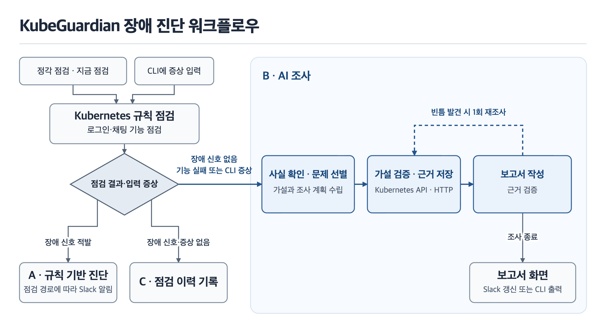

### 핵심 구현 내용

이번 PoC 단계에서 실제 코드로 구현된 핵심 기능들을 **동작 원리**와 **사용 기술** 중심으로 상세히 기술합니다.

**1.1 에이전트 워크플로우 (Agent Workflow)**

* **구현 기능:** 정기 점검 또는 화면의 직접 점검에서 규칙 점검 및 기능 점검이 실패하면 조사 작업자(worker)가 사실 확인, 이후 AI가 문제 선별, 가설 계획, 도구 검증, 보고서 작성, 근거 검증, 빈틈 재조사 순서로 조사해 근거가 붙은 보고서를 만든다. CLI의 `kg investigate`는 규칙 신호가 없으면 입력한 증상으로 직접 조사한다. 규칙이 장애를 적발한 경우는 AI 조사 없이 규칙 기반 진단 결과로 끝나고, 이상이 없으면 조사하지 않는다.

* **동작 원리:** 조사는 대화가 아니라 한 번 실행되면 보고서를 내고 끝나는 작업이다.

  1. 시작 판단은 코드가 한다. 규칙이 장애 신호를 적발하면 조사 요청을 만들지 않고 이슈를 규칙 기반 진단 결과(위치, 규칙, 심각도, 근거, 함께 확인된 기능 실패, 확인할 사항)로 표시하며 1차 알림에 규칙 요약을 담아 끝낸다. 규칙 신호 없이 기능 점검(로그인 후 채팅을 실제로 호출)이 실패했거나 사용자가 증상을 입력했을 때만 조사를 시작한다. 그 밖에는 AI 원인 조사를 시작하지 않는다. 근거 요약은 작업자가 별도로 처리한다.
  2. 사전 확인에서 코드가 가설 없이 확정할 수 있는 사실을 도구로 모은다. 서비스 호출 관계, 최근 30분 이벤트가 기본이고, 기능 점검이 실패했으면 실패한 흐름을 다시 돌리고 오류 로그를 모은다.
  3. 문제 선별에서 모델이 사용자 영향 순으로 문제를 최대 3건 고르고, 같은 원인의 신호는 묶고, 문제에 맞는 조사 지침을 하나 고른다.
  4. 계획에서 문제마다 가설을 최대 3개 세우고, 구동, 설정, 연결, 로그 네 영역을 볼 순서를 정한다.
  5. 도구 검증에서 모델이 도구를 고르고 코드가 실행하는 일을 반복한다. 같은 도구를 같은 인자로 다시 부르지 않고, 원인 리소스의 설정을 직접 조회했고, 로그를 봤거나 볼 수 없는 이유가 있으며, 서로 다른 출처의 근거 2개가 한 원인을 지지하면 스스로 멈춘다. 문제당 8회, 조사 전체 20회, 150초 상한은 프롬프트가 아니라 코드가 강제한다.
  6. 모델이 구조화 출력으로 보고서를 쓰면 근거 검증기가 없는 근거 번호를 지우고, 근거 없는 문장에 "(추정)"을 붙이고, 결론에 근거가 없으면 한 번 다시 쓰게 한다.
  7. 빈틈 검사가 원인 리소스를 직접 조회했는지, 네 영역을 봤는지, 증상에서 원인까지 호출 체인이 이어지는지, 지지된 가설이 있는지를 코드로 확인한다. 빈틈이 있으면 시간을 60초 늘려 한 번만 도구 단계로 돌아가 재조사한다.
  8. 마지막에 코드가 저장된 근거를 보고 판단 수준을 정한다. 확정은 원인 리소스의 설정을 직접 인용했고 근거 출처가 2종 이상이며 지지된 가설의 근거도 2종 이상이며 호출 체인에 결함이 없을 때다. 조건이 하나 빠지면 후보, 결론에 근거가 없으면 추정이다. 모델이 매긴 확신도는 기록만 하고 화면과 알림에는 보이지 않는다.

* **주요 기술:** LangGraph 상태 그래프(체크포인터 없이 단계마다 DB에 기록), Azure OpenAI, Pydantic 구조화 출력, 가설을 먼저 세운 뒤 도구 호출을 반복하며 확인하는 방식의 시스템 프롬프트, 코드로 강제하는 호출 수와 시간 상한

**1.2 조사 도구 연동**

* **구현 범위** — 설계한 조사 도구 중 Kubernetes API와 서비스 HTTP 호출을 구현했다. Kubernetes에서 구성·상태, 서비스 호출 관계, 로그·이벤트를 확인하고, HTTP 호출로 로그인·채팅 실패를 재현하거나 개별 Pod의 응답을 비교한다. 설계에 있는 지식 기반 검색은 아래의 조사 지침 참조 방식으로 대신한다.
* **동작 원리** — 도구 입력, 조회 범위, 호출 횟수를 코드가 검사한다. 결과는 마스킹해 SQLite에 저장하고, 에이전트에는 필요한 부분과 근거 번호를 전달한다. 실패한 호출도 어떤 확인을 시도했는지 근거로 남긴다.
* **주요 기술** — Kubernetes Python 클라이언트, Pydantic 입력 검증, Kubernetes RBAC, 패턴 기반 마스킹

**1.3 데이터 및 메모리 (RAG & Context)**

* **구현 기능:** 조사 지침과 환경 설명을 프롬프트에 통째로 넣기, 도구 결과를 근거로 저장해 보고서가 번호로 인용하기, 저장된 점검과 보고서 이력에 질문하기

* **동작 원리:**
  * 조사 지침: 환경 설명 1개와 증상별 조사 지침 6개를 시스템 프롬프트에 항상 전부 넣는다. 지침은 원인이 아니라 증상으로 나누었고 문서당 1천 토큰 이하다. 어느 지침을 따를지는 문제 선별 단계에서 모델이 이름 하나를 골라 계획과 도구 선택 프롬프트에 넣는다.
  * 근거 저장: 도구를 한 번 부를 때마다 결과를 마스킹해 SQLite에 근거로 저장한다. 보고서의 사실 문장은 근거 번호를 인용해야 하고, 근거 검증기가 저장되지 않은 번호를 지운다. 화면의 근거 서랍에서 번호로 원문을 열 수 있다.
  * 이력 질의 채팅: 별도의 이력 질의 채팅 에이전트가 읽기 전용 도구 8종으로 SQLite의 점검, 이슈, 보고서, 알림, 근거를 조회하고 필요하면 지침 파일을 읽는다. 조회 결과에 근거해 답변하는 검색 증강 생성(RAG) 방식이다. 답변은 사실·안내·해석을 구분한다. 서버는 인용 번호를 검증하고 인용이 없는 사실에는 "(추정)"을 붙인다. 서버는 비밀값을 가린 질문·답변을 SQLite에 대화 ID별로 저장한다. 같은 대화 ID로 저장된 사용자 질문과 에이전트 답변 중 최근 메시지 최대 10개를 불러와 후속 답변에 사용한다.
  * 벡터 검색을 쓰지 않은 이유: 환경 설명과 지침을 합쳐 7개 문서이고 문서당 1천 토큰 이하라서 전부 넣어도 프롬프트 부담이 작다고 판단했다. 이력 질의 채팅은 보고서, 이슈, 점검이 번호와 기간을 갖고 있어 번호, 기간, 키워드로 정확히 찾는 쪽이 인용 검증에 맞다고 판단했다. 필요한 지침만 불러오는 방식과 전체 주입을 비교하는 실험은 하지 않았다. 의미 기반 이력 검색은 향후 과제로 남겼다.

* **주요 기술:** SQLite, 마크다운 지침 문서의 프롬프트 주입, Pydantic 구조화 출력, 근거 번호 검증기.

### 주요 문제 해결 및 기술 리서치

공개 자료를 참고한 항목과 프로젝트 안에서 재현·비교한 항목을 구분했다.

| **이슈 구분** | **문제 상황 및 원인**                       | **리서치 및 해결 과정 (Reference & Solution)**                                                    |
| --------- | ------------------------------------ | ----------------------------------------------------------------------------------------- |
| **점검 설계** | 원본 템플릿을 클러스터에 올리면 Pod는 모두 Ready인데 gateway의 모든 API가 502였다. readinessProbe가 포트만 열려 있으면 통과하는 방식이고, 하위 서비스 주소 환경변수가 없으면 코드 기본값 localhost로 호출하기 때문이다. 주소가 환경변수가 아니라 ConfigMap으로 들어오는 경우도 있었다. | 공개 자료와 환경 재현: 규칙의 판정 시점은 kubernetes-mixin 알림 규칙의 지속 시간(for) 기준을, 대상과 조건은 Kubernetes 문서의 Debug Services와 EndpointSlice를, readinessProbe 개선 권고는 Polaris의 기준을 참고했다. 템플릿 매니페스트를 읽고 minikube에 띄워, 이름 하나가 어긋나도 호출이 끊기고 공유 ConfigMap 키 하나가 빠지면 여러 서비스가 함께 실패함을 확인했다. 적용: 선언된 서비스 주소만 보고 적발하는 규칙(ConfigMap 값까지 확인)과, 로그인 후 채팅을 실제로 호출하는 기능 점검을 만들었다. 결과: 서비스 주소 오류 시나리오 A5가 W2 규칙만 조건 측정(10/19~10/23)에서 3회 모두 즉시 적발되었고, 규칙만으로 정상으로 보이던 C1과 C2는 기능 점검 추가 후 조사 대상이 되었다. |
| **오탐 방지** | 설정이 없다는 사실만으로 장애로 올리면, 설정 없이도 정상인 서비스를 장애로 오인한다. 반대로 환경변수를 지운 장애를 못 잡는 공백도 있었다. | 설계 대안 비교: 선택지 3개(한계로 기록, 필수 환경변수 목록 선언, 이전 revision과 비교)의 오탐 위험과 설정 부담을 비교했다. 적용: 무언가가 가리키는데 대상이 없을 때만 적발한다는 원칙을 세웠고, 같은 Pod 안 사이드카를 가리키는 localhost는 정상으로 두었으며, 운영자가 선언한 필수 환경변수만 적발하는 규칙을 더했다. 설정 없이 정상인 서비스 H1을 정상 기준선 시나리오로 추가했다. 결과: H0와 H1은 이후 실행한 모든 평가 배치에서 조사 없이 종료되었다. |
| **도구 연동 보안** | 로그인이 422로 실패하면 응답의 검증 오류 필드에 보낸 비밀번호가 그대로 들어 있다. 키 이름이 input이라 이름 기반 마스킹이 가리지 못해 근거, LLM, 보고서에 남을 수 있었다. | 코드와 테스트 확인: FastAPI의 422 응답 구조를 모의 데이터로 만들고, 요청값이 응답의 `input` 아래로 돌아오는 경로를 확인했다. 적용: 로그인 실패는 응답 본문을 버리고 상태 코드만 남기고, 일반 호출 실패는 요청 본문 사본 필드를 지운 뒤 200자로 줄였다. 결과: 단위 테스트에서 모의 422 응답을 넣고 비밀번호가 도구 결과에 남지 않는지 확인했다. 클러스터 재현 기록은 없다. |
| **프롬프트 / 채점** | 없는 이미지 장애 A3에서 조사 결론이 3회 거의 같은데 1회만 채점이 불일치했다. 정답 문구는 없는 이미지 태그였지만 실제 주입은 해석되지 않는 레지스트리여서 증상이 DNS 오류로 보였다. 채점 기준이 모호했고 결론이 Deployment의 이미지 참조를 짚지 않아 DNS 장애로도 읽혔다. | 평가 기록 대조: 보고서·채점 결과를 A3의 실제 주입 조건과 비교했다. 적용: 정답 문구를 실제 주입에 맞추고, 채점 기준을 원인 대상(리소스와 설정 항목, 경로, 동작)이 같아야 일치로 바꾸고, 보고서 결론에 원인 리소스와 설정 항목을 쓰도록 지시했다. 결과: A3가 3회 모두 통과했고 이후 실행한 모든 배치에서 통과했다. |

### 핵심 동작 검증

최종 배포 버전에서는 규칙 진단 3건이 AI 호출 없이 끝났고, B1·C1·C2는 경로 B에서 조사했다. C2 재현 조건에서 Service 경유와 Pod 직접 상태 확인이 3회 모두 약 15초씩 겹쳤고, 결과와 근거는 요청 순서대로 기록됐다.

**C8 검증 기록 · 허용되지 않은 LLM 호출 배포명**

2026-11-09 시연 리허설의 조사 #14 기록이다. 규칙 신호 없이 기능 점검이 실패해 AI 조사가 시작되는 운영 경로 B를 보여 준다. 아래 단계와 수치는 같은 실행의 작업자 로그에 남은 기록이며, 반복 정확도 평가와 KPI 집계에는 포함하지 않았다.

* **입력:** 테스트 서비스의 DB에 등록된 활성 LLM 배포명을 `gpt-4.1`에서 `gpt-4.1-next`로 바꾼다. Pod와 Service는 정상이지만 허용되지 않은 배포명으로 실제 LLM 호출이 거절되어 채팅이 실패한다. DB 변경 내역은 평가용 정답으로만 보관하며 에이전트에 제공하지 않는다.

* **에이전트 동작:**

  1. 점검에서 규칙 신호 없이 채팅 기능 실패가 확인된다. 새 이슈와 1차 알림이 생성되고 경로 B 조사가 시작된다.
  2. 사전 확인에서 근거 7건을 수집한다.
  3. 문제 선별에서 외부 LLM 호출의 403 오류로 인한 채팅 실패를 조사 대상으로 고른다.
  4. 계획에서 배포 접근 정책과 엔드포인트·배포명 설정 등을 확인할 가설 3개를 세운다.
  5. llm-gateway의 Deployment, Pod 로그와 이벤트 등을 조회한다. 조사 범위의 빈틈 1개가 발견돼 재조사하고 관련 오류 로그를 추가로 확인한다.
  6. 활성 배포 `gpt-4.1-next`의 호출이 외부에서 거절된다는 가설은 지지한다. 외부 중계 게이트웨이의 허용 정책 자체가 잘못됐다는 가설은 판단 불가로 남긴다.
  7. 보고서를 저장하고 기존 Slack 알림에 조사 결과를 갱신한다.

* **최종 결과:**

llm-gateway가 `gpt-4.1-next` 배포를 호출했을 때 `403 deployment_not_allowed`로 거절되어 채팅이 실패한 지점을 보고했다. 판단 수준은 **후보**, 조사 시간은 약 **192초**, 도구 호출은 **16회**였다.

이 실행은 실패한 호출 구간, 호출 배포명과 거절 사유를 찾은 동작 검증이다. 에이전트에는 DB 조회 수단이 없어 DB에 잘못 저장된 배포명을 직접 대조하지 못했고, 외부 거부 정책의 설정 원인도 확인하지 못했다. 따라서 DB 설정 오류까지 확정한 사례로 설명하지 않는다. 별도 재배포 후 조사 #16에서도 같은 배포명의 403 거절을 보고했고 약 177초가 걸렸다. 두 실행의 시간과 단계 기록은 구분한다.
